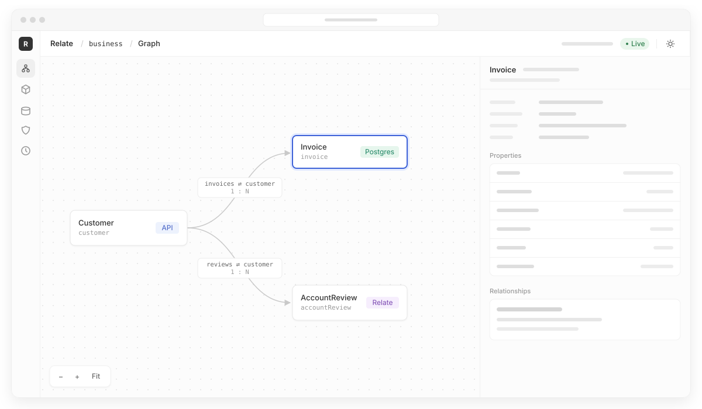

<h1>
  <picture>
    <source media="(prefers-color-scheme: dark)" srcset="assets/brand/relate-logo-dark.svg">
    
  </picture>
</h1>

**A typed, permission-aware model of your business data, defined in
TypeScript.**

Relate lets you describe your business objects (customers, invoices, reviews),
where each field comes from, how the objects relate and who may see what. Your
application and agents then read across your CRM, billing database and other
systems through one typed API. Every read is filtered for the caller and says
where each value came from and how fresh it is.

> **Request for comment.** Relate is early (`0.0.0-dev.0`), not yet on npm and
> not ready for production. We're publishing it now to get the model right in
> the open. [What works today](#status) ·
> [What we'd like feedback on](#feedback)

<p align="center">
  
</p>

## Try it in two minutes

You need **Node 22 (22.16+), 24 or 26** and pnpm 12 (`npm i -g pnpm@12.9.1`). No
database, Docker or credentials.

```sh
git clone https://github.com/relatehq/relate && cd relate
pnpm install
pnpm example:connected-sources
```

Each default example command opens a seeded Inspector. Run
`pnpm example:native-objects` for owner-only todos with notes, or
`pnpm example:datasets` for ad campaigns with impression analytics. Add
`:walkthrough` to the todo command for the scripted terminal demo. The
[examples](examples/README.md) explain what each application teaches.

Preparation runs quietly; add `--verbose` to see build logs. Build failures and
runtime errors are always shown.

Each example launcher loads the root `.env` if present. Add `ANTHROPIC_API_KEY`
there to enable the inspector's built-in agent, then restart the example. The
seeded graph and Playground also work without a key.

The Inspector opens with a seeded customer from an HTTP CRM, invoices from a
SQLite database and Relate-owned account reviews. Explore the graph and use the
Playground as Ana or Fin.

Run `pnpm example:connected-sources:walkthrough` for a scripted SDK example of
role-based reads, review creation and receipt replay.

## Why

Most real work touches more than one system. Before anyone can review an
account, the CRM's customer has to be joined to the billing database's invoices.
Then the code has to check that the caller may see them, judge whether the data
is fresh enough to act on and make a retried submission safe.

Usually each app and each agent integration solves this again in its own glue
code. Relate moves it into one model that every consumer shares. That matters
more once agents are involved: an agent should see what the user asking it may
see, and know whether a number is current.

We built the first version inside [ARC](https://viablesystems.ai), where Viable
Systems deploys agents to do end-to-end work for media businesses. Every client
had a different shape of "customer" spread across different systems. Relate is
that layer, extracted as an open-source library.

## What it looks like

Describe the systems you already have, the objects you want and the rules:

```ts
const access = defineAccess({
  roles: ['employee', 'account-manager', 'finance'],
  fieldGroups: ['ordinary', 'financial'],
  claims: { portfolio: z.string() },
});

// Your CRM owns customers.
const crm = defineSource({
  id: 'crm.customers',
  idField: 'id',
  schema: z.object({ id: z.string(), name: z.string(), portfolio: z.string() }),
});

// Your billing database owns invoices. It knows customers by CRM ID.
const billing = defineSource({
  id: 'billing.invoices',
  idField: 'id',
  schema: z.object({
    id: z.string(),
    crm_customer_id: z.string(),
    status: z.string(),
    total: z.number(),
  }),
});

const Customer = defineObject({
  id: 'customer',
  membership: source(crm),
  properties: {
    id: objectId({ id: 'customer.id' }),
    name: from(crm.fields.name, { id: 'customer.name' }),
    portfolio: from(crm.fields.portfolio, { id: 'customer.portfolio' }),
  },
});

const Invoice = defineObject({
  id: 'invoice',
  membership: source(billing),
  properties: {
    id: objectId({ id: 'invoice.id' }),
    customer: reference(Customer, {
      id: 'invoice.customer',
      from: billing.fields.crm_customer_id, // CRM ID → Customer
    }),
    status: from(billing.fields.status, { id: 'invoice.status' }),
    total: from(billing.fields.total, {
      id: 'invoice.total',
      access: access.groups.financial,
    }),
  },
});

const CustomerInvoices = defineRelationship({
  id: 'customer.invoices',
  forward: 'invoices',
  reverse: 'customer',
  via: Invoice.properties.customer,
});

const graph = defineGraph({
  id: 'business',
  objects: { Customer, Invoice },
  relationships: { CustomerInvoices },
  access,
  policies: {
    // Employees see customers in their own portfolio...
    Customer: {
      read: {
        gate: access.role('employee'),
        where: { portfolio: { eq: access.claims.portfolio } },
        evidenceMaxAgeMs: 30_000,
      },
    },
    // ...and those customers' invoices. Only account managers see amounts.
    Invoice: {
      read: {
        gate: access.role('employee'),
        where: { customer: { portfolio: { eq: access.claims.portfolio } } },
        evidenceMaxAgeMs: 30_000,
      },
      groups: { financial: access.role('account-manager') },
    },
  },
});
```

Then connect the sources and read as an authenticated caller:

```ts
const relate = createRuntime({
  graph,
  bindings: [
    bind(crm, {
      connectionId: 'crm',
      resourceId: 'records',
      providerAccountId: 'spindle-ferry-crm',
      connector: crmApi,
    }),
    bind(
      billing,
      sqlite({ connectionId: 'billing', path: './billing.sqlite' }).table(
        'invoices',
      ),
    ),
  ],
});

// Records enter the graph by explicit adoption for now (see Status).
const mothlight = await relate.host.adopt(Customer, 'crm_456');
await relate.host.adopt(Invoice, 'INV-1042');

// Your app authenticates the caller. Relate enforces the model's rules.
const { objects } = relate.as({
  id: 'fin',
  roles: ['employee', 'finance'],
  claims: { portfolio: 'north' },
});

const invoices = await objects.Customer.traverse.invoices(mothlight, {
  select: ['status', 'total'],
});
```

Fin gets the status. Compact evidence keeps the explanation for the withheld
amount. Each record in the page looks like this:

```json
{
  "id": "invoice-uuid",
  "data": { "status": "Overdue" },
  "meta": {
    "evidence": "compact",
    "completeness": "partial",
    "degraded": false,
    "definitionRevision": "sha256:…",
    "fields": { "total": { "status": "forbidden" } }
  }
}
```

Pass `evidence: 'full'` to include every selected field's provenance and
freshness details.

A customer outside Fin's portfolio returns `not-found`, the same as one that
doesn't exist.

## What's different

- **Access rules live in the model.** Role gates, claim-based row filters
  (including through references, such as "invoices of customers in my
  portfolio") and field groups are declared once. They are enforced on every
  read, traversal and action, so no consumer can forget to check.
- **Every value has evidence.** Compact responses preserve exceptional field
  states; full responses report provenance and freshness for every selected
  field. Policy checks can demand evidence no older than a set age.
- **Writes are actions with receipts.** Typed, authorized actions run in a
  transaction. They return a receipt for success or for a declared business
  failure, and retrying with the same idempotency key replays the receipt rather
  than repeating the write.
- **Source systems stay in charge.** Relate keeps the identities and
  observations it needs. It doesn't copy your CRM into a new silo.

## Querying the graph

Query existing graph members with scalar predicates, or omit `where` to
enumerate:

```ts
const page = await objects.Invoice.query({
  where: { status: 'Overdue' },
  select: ['status', 'total'],
  limit: 25,
});
```

Await one page or use `for await` to follow all pages. Queries cover adopted
source records and Relate-owned records; they do not discover provider records.
See
[Reading Data](apps/docs/content/runtime/reading-data.md#querying-objects-query)
for filters, access rules, pagination, and current limits.

## Many-to-many relationships

Model collections in both directions using an explicit junction object and
`defineRelationship({ through: { from, to }, ... })`. Traversal returns distinct
destinations while keeping membership metadata on the junction. See
[Graph Modeling](apps/docs/content/authoring/graph.md#many-to-many-relationships)
for a complete example.

## Status

| Works today                                                                     | Not yet                                       |
| ------------------------------------------------------------------------------- | --------------------------------------------- |
| TypeScript authoring, compiler and diagnostics                                  | Direct source queries and sync from sources   |
| Objects backed by one source; references across sources                         | One object enriched from several sources      |
| Graph queries and to-many traversals with scalar and timestamp filters          | Ordinary-property sorting and indexed filters |
| Dataset calculations, computed filters/order and exact result types             | Graph-wide aggregates                         |
| Two-way relationship traversal                                                  | Standalone HTTP consumer API                  |
| Role gates, claim filters, field-level access                                   | Writing back to source systems                |
| Per-field evidence and freshness bounds                                         | Migrating between model revisions             |
| Relate-owned objects, idempotent actions and receipts                           | Published npm packages                        |
| In-memory and Postgres stores                                                   | Work lineage graph of agent reads and actions |
| SQLite, PostgreSQL/DuckDB analytics, Stripe and read-only Salesforce connectors | Cloud MCP clients (ChatGPT) for `relate dev`  |
| MCP discovery and JS execution (stdio / Streamable HTTP)                        |                                               |
| `relate dev` model inspector, `/mcp` and activity log                           |                                               |
| Activity feed, operation history and object provenance (host APIs)              |                                               |

Relate runs embedded in a Node application and exposes actor-bound graph access
through two MCP tools: `discover` and `execute`. Both stdio and Streamable HTTP
use the same tools. The supplied subprocess executor is for trusted development
code, not a security sandbox. See the
[MCP guide](apps/docs/content/runtime/mcp.md) for host setup, execution flow,
and a runnable example.

After that comes work lineage: a graph of how an agent's work unfolded, linking
each object it read, each traversal it followed and each action it took, so you
can see what it looked at and why it did what it did.

## Feedback

We'd most like to hear about:

1. **The model.** Do sources → objects → relationships → policies match how you
   think about your own domain? What can't you express?
2. **Evidence.** Is per-field provenance and freshness useful in practice, or
   noise? What would you do with it?
3. **Getting records in.** Adoption is explicit today. Would you want sync,
   scanning, change feeds or on-demand fetches?
4. **Agents.** The MCP interface exposes `discover` and `execute`. Does this
   discovery-and-code approach give agents the context and control they need?
5. **Connectors.** Which systems would you need first?

Please open a [discussion](https://github.com/relatehq/relate/discussions) or an
issue.

## Learn more

- [Docs](https://docs.relatehq.dev): [Why Relate](https://docs.relatehq.dev/),
  [Getting started](https://docs.relatehq.dev/getting-started),
  [Key concepts](https://docs.relatehq.dev/key-concepts)
- [Examples](examples/README.md): a simple todo/notes app, the business customer
  workspace, and Postgres persistence
- [Inspector](packages/cli/README.md): `pnpm relate dev`
- [Contributing](CONTRIBUTING.md) · [Releasing](RELEASING.md)

## Agent evaluations

The standalone [SDK agent evaluation suite](evals/agent-sdk/README.md) measures
discovery, reads, traversal, permissions and action workflows across models and
agent strategies, with reproducible task worlds, state-based grading and
retained transcripts. It is separate from the runtime packages and normal SDK
installation.

## License

[Apache 2.0](LICENSE). Created by [Viable Systems](https://viablesystems.ai).
