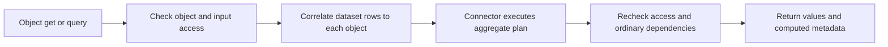

# Datasets and Calculations

Datasets let an object calculate values from external rows without adopting
those rows as Relate objects. For example, a campaign can count its impressions
and calculate click-through rate from a warehouse delivery log.

| Term                 | Meaning                                                                      | Example                                             |
| -------------------- | ---------------------------------------------------------------------------- | --------------------------------------------------- |
| Dataset              | A declared set of typed columns; rows may repeat and have no Relate identity | `Impressions`                                       |
| Association          | Matches dataset columns to ordinary object properties                        | `Campaign.impressions`                              |
| Declared calculation | A reusable read-only property with a stable ID                               | `computed({ id, sql })`                             |
| Caller expression    | A calculation supplied for one read, optionally with parameters              | `compute: { videoClicks: { sql, parameters } }`     |
| Binding              | Connects a dataset to a physical resource                                    | `bind(Impressions, warehouse.table('impressions'))` |

## Declare the dataset and association

Columns own their schemas, stable IDs, field groups and optional descriptions.
There is no separate row schema or row key. This small model uses a source for
campaign records and a dataset for impressions:

```ts
// model.ts
import { z } from 'zod';
import {
  computed,
  defineAccess,
  defineDataset,
  defineGraph,
  defineObject,
  defineSource,
  from,
  objectId,
  source,
} from 'relate';

const access = defineAccess({
  roles: ['employee'],
  fieldGroups: ['ordinary'],
  claims: {},
});
const { ordinary } = access.groups;

export const campaigns = defineSource({
  id: 'adserver.campaigns',
  idField: 'id',
  schema: z.object({ id: z.string(), name: z.string() }),
});

export const Impressions = defineDataset({
  id: 'adserver.impressions',
  description: 'One row per served impression.',
  columns: {
    campaignId: {
      id: 'impressions.campaign-id',
      schema: z.string(),
      access: ordinary,
    },
    clicked: {
      id: 'impressions.clicked',
      schema: z.boolean(),
      access: ordinary,
    },
    placement: {
      id: 'impressions.placement',
      schema: z.string(),
      access: ordinary,
      description: 'Where the ad ran, such as video or article.',
    },
  },
});

const Campaign = defineObject({
  id: 'campaign',
  membership: source(campaigns),
  properties: {
    id: objectId({ id: 'campaign.id' }),
    externalId: from(campaigns.fields.id, { id: 'campaign.external-id' }),
    name: from(campaigns.fields.name, { id: 'campaign.name' }),
    served: computed({
      id: 'campaign.served',
      access: ordinary,
      sql: 'SELECT COUNT(*) FROM self.impressions',
    }),
    ctr: computed({
      id: 'campaign.ctr',
      access: ordinary,
      sql: 'SELECT COUNT(*) FILTER (WHERE clicked) * 1.0 / NULLIF(COUNT(*), 0) FROM self.impressions',
    }),
  },
  datasets: {
    impressions: {
      id: 'campaign.impressions',
      dataset: Impressions,
      on: [{ column: 'campaignId', property: 'externalId' }],
    },
  },
});

export const graph = defineGraph({
  id: 'campaign-analytics',
  access,
  objects: { Campaign },
  datasets: { Impressions },
  policies: {
    Campaign: {
      read: { gate: access.role('employee') },
      datasets: { impressions: { gate: access.role('employee') } },
    },
    Impressions: {},
  },
});
```

`self.impressions` names the association, not a physical table. Relate restricts
its rows using `on` before applying the expression's predicates. Correlation
columns and properties must have matching logical types. Add more `on` pairs
when the key includes, for example, both tenant and campaign IDs.

Object read policies, association gates, dataset column groups, ordinary
property dependencies and the calculation's own field group all apply. A
calculation never grants access to its inputs. For sensitive columns, declare a
field group and restrict it in the dataset policy, such as
`Impressions: { groups: { identifying: access.role('privacy') } }` when those
groups and roles are included in `defineAccess`. See
[Access Control](./access-control.md) and the
[datasets example](../../../../examples/04-datasets/README.md) for team and
column restrictions.

## Bind resources and start the app

Keep physical table names and connection configuration in application setup:

```ts
// app.ts
import { duckdb } from '@relate/connector-duckdb';
import { sqlite } from '@relate/connector-sqlite';
import { bind, defineApp } from 'relate';
import { startApp } from '@relate/node';
import { campaigns, graph, Impressions } from './model.js';

const app = defineApp({
  graph,
  setup({ onDispose }) {
    const database = sqlite({ connectionId: 'adserver', path: './ads.sqlite' });
    const warehouse = duckdb({
      connectionId: 'warehouse',
      path: './ads.duckdb',
    });
    onDispose(() => database.close());
    onDispose(() => warehouse.close());
    return {
      bindings: [
        bind(campaigns, database.table('campaigns')),
        bind(Impressions, warehouse.table('impressions'), {
          columns: { campaignId: 'campaign_id' },
        }),
      ],
    };
  },
});

const host = await startApp(app);
```

The databases and tables must already exist. Unmapped columns keep their logical
names. `startApp` validates all registered dataset columns and declared
calculations before serving. DuckDB requires compatible physical types and
nullability; close any writer before starting its read-only connector.

[Choose a connector](./connections.md#analytical-dataset-connectors) for SQLite,
PostgreSQL or DuckDB. Each connector README owns its physical type mapping,
configuration and lifecycle details. Packages are currently used from this
repository, not published npm releases.

## Read calculated values

Adopt the campaign source records before querying them, as described in
[Reading Data](../runtime/reading-data.md#2-adopting-source-records). Impression
rows do not need adoption. Given an authenticated employee principal:

```ts
const consumer = host.as(principal);
const page = await consumer.objects.Campaign.query({
  select: ['name', 'served', 'ctr'],
  compute: {
    videoClicks: {
      sql: 'SELECT COUNT(*) FROM self.impressions WHERE clicked AND placement = $placement',
      parameters: { placement: 'video' },
    },
  },
  where: { videoClicks: { gt: '0' } },
  orderBy: [{ field: 'ctr', direction: 'desc' }],
});
```

Declared calculations are selected like other properties. Caller aliases add
fields independently of `select` and must not collide with property names.
Object `get` also accepts `compute`; traversal and action transaction readers do
not. Counts and integer sums return exact decimal strings (`'40'`), while
formulas return numbers or null. Values are calculated at read time and are not
persisted as object properties.



Missing or forbidden results are omitted, not replaced by zero. See
[Application Setup](../runtime/application.md#analytical-declaration-validation)
for execution budgets, failure behavior, freshness, pagination and cleanup, and
[Discovery](../runtime/discovery.md#analytical-metadata) for actor-visible
columns, types and calculation metadata.

## SQL expressions

Compute supports numeric formulas over aggregates from one dataset:

```sql
-- CTR: clicks divided by impressions
SELECT COUNT(*) FILTER (WHERE clicked) * 1.0 / NULLIF(COUNT(*), 0)
FROM self.impressions

-- CPA: spend divided by conversions
SELECT SUM(spend) / NULLIF(SUM(conversions), 0) FROM self.delivery

-- Pacing: pass the elapsed flight share as a named numeric parameter
SELECT SUM(spend) / NULLIF(self.budget * $elapsedShare, 0)
FROM self.delivery
```

Use `+`, `-`, `*`, `/`, parentheses, `NULLIF(a, b)` and `COALESCE(a, b)`. Each
aggregate may have its own `FILTER`; the query's `WHERE` applies to all of its
aggregates. Formulas return nullable `float64`, including integer division. Zero
denominators return null; use `COALESCE(formula, 0)` if zero is the desired
fallback. Wide integers may lose precision in formulas. Standalone counts and
integer sums retain their exact `int64` results. Ordinary `self` properties must
be readable and available. Declared calculations cannot use named parameters;
store the elapsed share as an ordinary property to use it in a declaration.
Joins, subqueries and multiple datasets in one expression are unsupported.

### Arithmetic inside an aggregate

An aggregate argument can combine values from the same row before aggregating:

```sql
-- Spend in account currency, converting each row by its own rate
SELECT SUM(spendMicros * rate) FROM self.delivery

-- Average cost per click, per row
SELECT AVG(spend / clicks) FROM self.delivery WHERE clicks > 0

-- Scale every row by a caller parameter
SELECT SUM(clicks * $weight) FROM self.delivery
```

Operands are numeric columns, `self` properties, literals and named parameters,
combined with `+`, `-`, `*`, `/` and parentheses. Integer `+`, `-` and `*` stay
exact `int64`. A float operand or `/` makes the node `float64`, so `3 / 2` is
`1.5`. Spelling types a literal: `2` is an integer, `2.0` and `2e0` are floats.
A parameter takes the type of the column it is compared with or, failing that,
of its neighbor in the arithmetic, so `$weight` above is `int64` and
`{ weight: 0.5 }` is rejected; write `clicks * (1.0 * $weight)` to accept a
fraction.

Arithmetic is checked for each row and never silently skips one. If any row the
aggregate includes overflows `int64`, produces an infinite float or divides by
zero, that field is unavailable with `execution-failed` for that object only;
other fields and objects are unaffected, and an outer `COALESCE` cannot hide the
failure. Rows excluded by `WHERE` or `FILTER` are not evaluated. A sum succeeds
whenever its final total fits, even if a running total would not. Float results
are approximate binary floating point, not exact decimal money arithmetic.

### Calendar dates

Declare a day with no time or timezone, such as a daily delivery date, with
`z.iso.date()`:

```ts
date: { id: 'delivery.date', schema: z.iso.date(), access: ordinary },
settledOn: {
  id: 'invoice.settledOn',
  schema: z.iso.date().nullable(),
  access: ordinary,
},
```

```sql
-- First delivery day in a caller-supplied window
SELECT MIN(date) FROM self.delivery WHERE date >= $from AND date < $to
```

```json
{ "parameters": { "from": "2026-10-01", "to": "2026-11-01" } }
```

- Values are exactly `YYYY-MM-DD` text, from `0000-01-01` to `9999-12-31`, with
  real month lengths and leap years. `2026-02-29`, time or timezone suffixes,
  spaces and `infinity` are rejected rather than moved to another day.
- `=`, `<>`, `<`, `<=`, `>`, `>=`, `IS NULL`, `MIN`, `MAX` and `COUNT` work on
  dates. `MIN` and `MAX` return dates. `SUM`, `AVG` and arithmetic such as
  `date + 1` are rejected.
- Dates compare only with dates and with date parameters or literals. Comparing
  a date column with a string or timestamp column is rejected.
- Computed dates can be filtered with `eq`, `in`, `gt`, `gte`, `lt` and `lte`
  and used in `orderBy`. `decodeComputed` returns them as canonical strings,
  never `Date`, so a timezone cannot shift the day.
- Ordinary object properties have no date type, so a date column cannot be an
  association key. The storage type does not decide which day a row belongs to;
  write dates for every table in the same convention, such as account-local
  days.

For a complete runnable application, run `pnpm example:datasets` from the
repository root. The [example guide](../../../../examples/04-datasets/README.md)
explains the model and queries; the API reference covers
[`defineDataset`](../reference/api/functions/defineDataset.md),
[`computed`](../reference/api/functions/computed.md) and
[`bind`](../reference/api/functions/bind.md).
