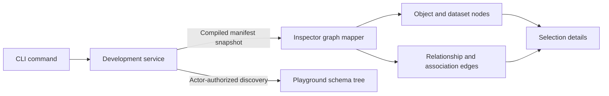

# Inspector

Developer tooling for inspecting a Relate application: a live model graph of the
project's objects, datasets, relationships and dataset associations, served by
[`relate dev`](../../packages/cli/README.md) and updated from compiled Manifest
snapshots as local code changes.

The [development service](../../packages/dev/README.md) owns the live API,
reload supervision, MCP, playground execution and agent. This package owns the
UI, browser-safe wire schemas and static asset mount.

The [specification](../../specs/2026-10-07-inspector.md) records the agreed
foundation; this package is its first implementation. Its screens are the model
graph (React Flow and ELK in a Web Worker, with a side panel for diagnostics and
selection details), the activity log, the built-in agent and the playground.

## Layout

```text
apps/inspector/
  index.html, vite.config.ts     Vite SPA; prebuilt into dist/client
  src/protocol.ts                validated DevEvent / Diagnostic / snapshot DTOs
  src/server.ts                  Hono mount for the packaged shell and assets
  src/connection/                session bootstrap, SSE client, state reducer
  src/graph/                     Manifest -> nodes/edges, React Flow view
  src/layout/                    ELK adapter and worker engine
  src/panel/, src/screens/       side panel, screens, shell
  src/playground/                playground editor (CodeMirror), checks, completion, results
  src/theme/theme-*.css          generated Relate design-system tokens (twenty-ui, MIT); do not edit
  src/styles.css                 primitives and screens built on those tokens
```

Two entry points are exported:

- `@relate/inspector/protocol` (browser-safe): `parseDevEvent`,
  `readProtocolVersion`, `PROTOCOL_VERSION`, the zod schemas and TypeScript
  types for `DevEvent`, `Diagnostic`, `ModelSnapshot` and `ManifestDiff`. It
  depends on `relate/model` and `relate/diagnostics` only.
- `@relate/inspector/server` (Node): `createInspectorApp({ basePath })` returns
  a Hono app that serves the shell with `Cache-Control: no-cache` and a
  restrictive CSP, hashed assets as `immutable`, and 404 for anything else.

Browser code never imports the compiler, runtime, connectors or user modules;
`tests/boundaries.mjs` enforces that.

## Behavior

- The terminal link carries `#token=…`; the page removes it with `replaceState`,
  exchanges it at `POST dev/session` for an HttpOnly cookie, loads
  `dev/snapshot` and subscribes to `dev/events`. Without a session the page
  explains how to open the terminal link.
- Events are validated and applied in sequence. Duplicates are ignored; a gap or
  a new instance resynchronizes from a snapshot. Late models and older attempts
  never replace newer ones.
- Three states are kept distinct: invalid authored code (compile, syntax, import
  diagnostics with codes, paths, definitions and sites), loader failure
  (`worker.*`, presented as not your code), and connection loss (a dimmed stale
  graph, never a diagnostic). An unsupported `protocolVersion` or an invalidated
  session keeps the last graph as stale and offers one explicit reload.
- Nodes and edges use definition IDs as identity, so label edits never recreate
  elements. Selection and the camera survive updates; the view fits
  automatically only on the first non-empty model. Layout reruns only when
  topology changes; a failed layout keeps the previous placement with a visible
  diagnostic.
- Type diagnostics (`typecheck` events) are accepted and rendered as warnings,
  but no checker emits them yet.
- The playground reads `GET dev/playground/discovery?as=<principal>` and runs
  code with `POST dev/playground/runs`; `relate dev` executes it like the MCP
  `execute` tool and records it in Activity. Completion, the object tree and
  live checks use that discovery only. Datasets and computed properties are read
  from authorized runtime metadata (`src/playground/model.ts`).

The Activity screen (`src/screens/ActivityScreen.tsx`, derivations in
`src/activity/model.ts`) lists requests, or every call and operation with
**Events**, filtered by a query such as
`principal:ana status:failed duration>100ms def:customer object:cus_1 -source:agent`.
Keys: `principal`, `source`, `transport`, `tool`, `op`, `def`, `status`,
`runtime`, `record` (`attempt`, `committed`, `dispatch`), `object`, `req`,
`analytical` and `duration` (`>`, `<`, `>=`, `<=`, `=`); bare words search all
text. `key:value` matches part of a value and `key=value` the whole value, so
`object=cus_1` leaves out `cus_10`; facet and drawer filters add the `=` form,
quoted when the value has spaces or commas. A histogram and facet counts follow
the query. Selecting a request opens a drawer
(`src/activity/ActivityDrawer.tsx`):

| Tab      | Shows                                                                                                       |
| -------- | ----------------------------------------------------------------------------------------------------------- |
| Code     | The executed JavaScript, highlighted and numbered, with stdout/stderr, the returned preview or thrown error |
| Timeline | Call, execution and operation waterfall from each event's start and duration; nested refreshes are indented |
| Objects  | Records each operation returned or changed, grouped by definition, with changed and refused property IDs    |
| Metadata | Every recorded field of the call, execution and selected operation, and the raw events as JSON              |

Selecting an analytical operation in Timeline shows **Analytical timings**: each
entered stage's count, summed work duration (bar) and longest span (tick). The
operation duration remains elapsed time; overlapping stages are not presented as
additive parts of a total. Timings come from host activity, including failed
operations after cleanup, and contain only fixed stage names and numbers. An
adjacent **Analytical calculations** table shows expression counts, computed
filter/order flags, logical association/dataset IDs and declared property IDs.
Failure counts cover observed object results across the evaluated scope, with
repeated checks counted once. Caller aliases and SQL are never shown. Truncated
diagnostic entries are reported explicitly. Inspector protocol version 5 adds
this bounded summary to the activity payload.

## Development

```sh
pnpm --filter @relate/inspector build     # dist/server + dist/client
pnpm --filter @relate/inspector dev       # Vite HMR for inspector work
pnpm relate dev                           # serves the prebuilt client
```

### Analytical discovery

The playground reads actor-visible dataset associations and declared computed
properties from the runtime through `@relate/dev`. Its schema tree shows logical
types and marks denied columns/calculations; hidden associations stay absent. An
explicit empty `filterOperators` list disables property filter suggestions.
Declaration SQL and physical binding details never enter this discovery view.
The model graph reads the full local authoring manifest. Dataset nodes show
logical column types (including timestamp precision), access groups and their
required roles. Association edges show every correlation pair and the required
association role. Object panels list declared computed properties and access
groups separately from stored properties. These panels do not show declaration
SQL or physical bindings. They describe the authored model; actor-specific read
permissions belong to the playground discovery view.


