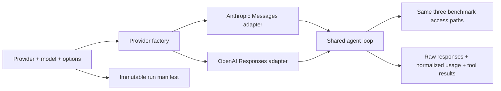
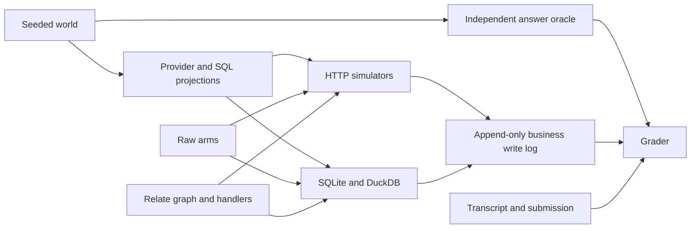

# Northlight Media agency benchmark

A private, runnable benchmark comparing raw tools, raw JavaScript and Relate on
the same fictional agency systems. The
[first fix-round pilot](results/2026-10-28-luna-round1.md) records 60 fresh paid
model runs (57 passed), with all failures and limitations retained. The
[original pilot](results/2026-10-28-luna-pilot.md) remains available with its
fault-injection correction. These are small regression pilots, not held-out
comparison claims. Reference validation separately checks harness correctness
and task solvability.

| Status       | Scope                                                                                                                                                                                    |
| ------------ | ---------------------------------------------------------------------------------------------------------------------------------------------------------------------------------------- |
| Implemented  | Seeded S/M/L worlds (version 2); five HTTP simulators; SQLite plans/finance; DuckDB warehouse; three arms; reference solutions; grading; provider adapters; resumable artifacts; reports |
| Runnable     | 53 task variants (world v2), including a 22-task pilot, with independent world-derived answers; nothing deferred                                                                         |
| Superseded   | The v1 catalogue (66 runnable + 14 deferred) saturated: 57/60 in the fix-round pilot. Its results stay reproducible from their recorded commits                                          |
| Not run here | Full main/scale model evaluations, human prompt/parity audit, human review of model-error labels                                                                                         |

## Glossary

- **World:** seeded business truth, such as
  `generateWorld({ seed: 7, tier: 'S' })`.
- **Arm:** access given to a solver: `baseline-tools`, `baseline-code`, or
  `relate`.
- **Oracle:** expected answer computed from world facts without querying a
  simulator.
- **Reference solution:** hand-written code using only the arm's public HTTP/SQL
  or graph surface.
- **Mutation:** a committed business change, logged even when its response is
  lost.
- **Journal:** benchmark integration code recording unknown external writes so
  retries recover by reading, instead of creating again.
- **Deferred:** an intended task whose required reference-dataset feature is
  deliberately absent.
- **Manifest:** hashes and configuration identifying exactly what produced a
  run.

## Run

From the repository root, with dependencies installed and `pnpm build`
completed:

```sh
pnpm bench:agency:catalogue
pnpm bench:agency:generate --tier S --seed 7 --out benchmarks/media-agency/artifacts/world-s7

# Deterministic checks, no API key or model charge:
pnpm bench:agency:validate --stage pilot --out benchmarks/media-agency/artifacts/pilot-validation
pnpm bench:agency:validate --stage main --seed 19 --out benchmarks/media-agency/artifacts/heldout-validation
pnpm bench:agency:report --out benchmarks/media-agency/artifacts/pilot-validation

# Model run: choose a model explicitly; the API key stays in the parent process.
OPENAI_API_KEY=... pnpm bench:agency:run --stage pilot \
  --provider openai --model gpt-6-luna --reasoning low \
  --pricing /absolute/path/to/pricing.json --out benchmarks/media-agency/artifacts/model-pilot

# Anthropic uses its own key and accepts any Messages-compatible model ID:
ANTHROPIC_API_KEY=... pnpm bench:agency:run --provider anthropic --model claude-haiku-5-5 \
  --out benchmarks/media-agency/artifacts/anthropic-pilot

# A focused run or repeated task family:
pnpm bench:agency:run --model MODEL_ID --tier M --arm relate \
  --task 'action.create-*' -k 5 --out benchmarks/media-agency/artifacts/create-evaluation
```

`--stage pilot` selects 20 tasks; `main` and `scale` select the full catalogue.
Tier, model, repetition count and seed are explicit configuration, not an
implicit large paid matrix. Run each desired tier/model/seed in its own
directory. Main spending still needs the owner's budget decision after a
measured pilot.

A pricing file contains USD per million tokens:

```json
{ "input": 2, "output": 10, "cacheRead": 0.1, "cacheWrite": 2.5 }
```

Supply prices appropriate to the actual model and context size. This is an
example, not an automatically maintained price list. Without pricing, costs are
`null`/unknown. Token usage includes separate uncached input, output, cache
reads and cache writes; all input categories count toward the budget. The
adapters use
[Anthropic Messages](https://platform.claude.com/docs/en/api/messages) and
[OpenAI Responses](https://developers.openai.com/api/docs/guides/function-calling).
The default provider is `anthropic` for compatibility with the original command.
`--provider openai` reads `OPENAI_API_KEY`; `anthropic` reads
`ANTHROPIC_API_KEY`. Keys stay outside manifests and transcripts. The CLI does
not automatically load `.env`; use your environment loader when needed.

`--max-output-tokens` defaults to 8192 for both providers. OpenAI optionally
accepts `--reasoning none|low|medium|high|xhigh|max`; omit it for the model's
default. Unsupported provider/options combinations fail before a run. Model
availability and supported reasoning levels remain the provider's decision:
there is no model-name substitution, fallback, or hidden paid retry.

The shared loop consumes neutral text, tool-call and tool-result blocks plus
four disjoint token categories. Adapters retain original responses and opaque
continuation items, including OpenAI encrypted reasoning and Anthropic thinking
signatures. OpenAI uses `store: false`, replays the full local conversation, and
sets tool `strict: false` to preserve the same optional-argument schemas as the
other provider. It subtracts cache reads/writes from total input, and output
usage includes reasoning tokens. Anthropic uses automatic prompt caching.
Output-limit responses retain usage but never dispatch partial tool calls.



`src/harness/providers/types.ts` owns the provider-neutral contract;
`providers/index.ts` validates configuration and selects an adapter. Add a new
provider there with its own translation and contract tests, without changing arm
implementations or grading. Provider, model, reasoning and output limit are
pinned in `manifest.config.modelConfig`; changing any requires a new output
directory. Raw API failures remain in transcripts; unknown usage keeps costs
unknown. Prices are user-supplied estimates, not billing reconciliation. A flat
pricing file is only appropriate while requests stay within the selected model's
context-price tier.

Outputs are ignored by Git under `artifacts/`. Each scheduled run gets a JSONL
transcript and a result JSON, plus a shared `manifest.json`. Resume requires the
same manifest and only reuses finished records. An interrupted transcript is
preserved and requires a new output directory, so rerunning never erases an
attempt. A different source hash, seed, model, price or task selection also
requires a new directory. No generated database is required in Git: world and
projections are reproducible from the versioned generator and seed.

## Step telemetry

New runs include correlated per-model, tool, HTTP, SQL, connector and lifecycle
spans with individual durations, outcomes, sizes and parent-process resource
samples. Model steps record tokens and estimated cost; provider calls retain
request IDs and transport timing. Reports include latency percentiles and
unfinished operations. See [telemetry fields and limits](TELEMETRY.md).
Historical pilot timings remain aggregate-only.

## What the three arms receive

| Arm              | Tools                                                     | Execution                                                       |
| ---------------- | --------------------------------------------------------- | --------------------------------------------------------------- |
| `baseline-tools` | `http_request`, `sql_query`, `read_docs`, `submit_answer` | Tool calls only                                                 |
| `baseline-code`  | `execute`, `read_docs`, `submit_answer`                   | Raw `http(system, request)` and `sql(db, text, params)` helpers |
| `relate`         | `discover`, `execute`, `read_docs`, `submit_answer`       | Actor-bound `graph` consumer                                    |

Both code arms use `@relate/mcp`'s **same** `createDevelopmentExecutor`, with a
fresh child process, 60-second call limit and 1 MiB output limit. The raw code
arm bridges HTTP/SQL through two private transport actions; these provide no
business rules, mapping, pagination, conversion, retry or aggregation helpers.
The Relate arm uses MCP's discovery/execute shape and executor directly, without
adding an MCP network transport to measured latency.

**This executor is not a security sandbox.** It removes inherited host
credentials and starts in a temporary directory, but model code must be treated
as trusted development code. These runs cannot establish adversarial isolation
from the host filesystem. Use an isolated disposable machine for model
evaluations. Reference solutions never inspect the filesystem, world, graders or
write logs.

Every arm receives the same handbook and answer contract in its system prompt,
including permissions, output IDs, ISO dates, refusal shape and micros-to-minor
conversion. The handbook remains available through `read_docs`. Raw arms also
get the API/DDL documentation in `src/harness/arms.ts`; Relate gets graph
discovery. HTTP results truncate at 100 kB with a marker. SQL tools return up to
2,000 rows with a truncation marker; the raw code helper throws on truncation,
requiring an aggregate or explicit SQL pagination. Int64 SQL values are JSON
strings.



## Coverage (world v2)

The v1 world let every arm shortcut the work: IDs named their platform and
client, prompts gave the exact ID, every refusal was decidable from the prompt,
drift only ever hit Meta invoices, and the hard FX/pacing tasks were deferred.
World v2 removes those shortcuts and runs every task.

| Category       | Variants | What they exercise                                                                                                           |
| -------------- | -------: | ---------------------------------------------------------------------------------------------------------------------------- |
| Lookup         |        6 | Campaign found **by name** across opaque IDs; shared Google budgets; a non-existent well-formed name with a malformed twin   |
| Traversal      |        6 | Client → CRM merge survivor → dashed/act\_ account links → four platforms; explicit missing plan links                       |
| Aggregation    |       10 | Account-currency spend with **per-account** load cutoffs; client-currency spend by channel converted **per delivery day**    |
| Reconciliation |        4 | Net invoices (credit notes), noise and near-threshold drift on every platform, merged CRM IDs in finance                     |
| Permissions    |        8 | Refusals that need data (team in CRM, 25% budget move, shared budget, ended flight); partly permitted requests               |
| Freshness      |        3 | Per-account `etl_runs`, including one lagging TikTok and one lagging Meta account                                            |
| Action         |       11 | Status/budget by name (TikTok, TTD full PUT, Google budget object), create + lost response, dispute, bulk pauses with faults |
| Diagnose → act |        5 | Pacing per plan line (per-day FX, per-account elapsed days); cut the most over-pacing changeable campaign                    |

World v2 realism, all deterministic from the seed:

| Seam               | v2 behaviour                                                                                                       |
| ------------------ | ------------------------------------------------------------------------------------------------------------------ |
| Identifiers        | Meta 18-digit, TikTok 19-digit, TTD 7–8 char alphanumeric, Google 11–13 digit; CRM 18-char; no ordinal leakage     |
| Account addressing | Meta paths need `act_{id}`; Google `account_links` stores `123-456-7890`, the API `1234567890`                     |
| Ownership          | Campaigns assigned to clients unevenly; three clients have merged CRM duplicates still referenced by links/finance |
| Status/flights     | ARCHIVED/PAUSED/ended flights on every platform; paused campaigns and ads stop delivering mid-window               |
| Delivery           | Per-campaign October trend, weekend dip, daily noise, non-integer micros; launches on 6 October                    |
| FX                 | EUR/USD drift ±5–6% over the window plus ±1.2% daily moves; one-rate conversion fails the 0.01% tolerance          |
| Invoices           | ±1.8% vendor noise, near-threshold cases at 1.85–2.25%, real drift, 12% with credit notes                          |
| Brand safety       | High-severity events spread from 1 to 14 October, so the "since 8 October" filter matters                          |
| Faults             | Bulk pauses see a 429 (with retry-after), a 500 and a lost response on three different ads                         |

**FX without an SDK join.** Reference datasets are still not implemented in
Relate. The Relate integration exposes daily rates as an `FxRate` lookup object.
The Relate arm sums delivery per day (up to 8 date-parameterised expressions per
query) and multiplies in code. No pre-converted value is substituted, so the
Relate arm carries the same conversion work and shows the SDK gap honestly.

The generator sizes are 8/40/150 clients, 160/800/3,000 campaigns and
1,920/16,000/60,000 ads, over 90 days of ad facts. World fact rows stream into
DuckDB instead of occupying two full in-memory copies.

## Integration and grading contracts

The graph uses public package APIs. Platform sources normalize their own vendor
representation; the shared `account_links` table maps provider account IDs to
CRM client IDs and is equally available to raw arms. The integration resolves
dashed Google IDs and merged CRM duplicates (`MasterRecordId`) when it binds
accounts and invoices; raw arms must do the same from the documented fields.
Load is keyed per platform account. A 429 from a provider is retried once inside
`changeMedia`; other unknown outcomes are recovered by reading back. The current
SDK has no role-dependent OR policy, so `createGraph(principal)` creates one of
three fixed policy variants: planner reads are team-scoped; activation/finance
read all clients; commercial fields require finance. The host fixes the
principal for the run. This is benchmark integration, not a proposed SDK
permission feature.

```ts
await graph.actions.launchAdGroup({
  input: { campaign: campaignRelateId, name: 'Retargeting', budgetMinor: 5000 },
  idempotencyKey: 'launch-1',
});
// Handler: provider create/recover → objects.TikTokAdGroup.adopt(providerId)
//          → native MediaChange audit → receipt containing adGroupId.
```

SQL metrics separately count raw statements, SQLite source fetches and DuckDB
analytical dispatches. They exclude connection/schema housekeeping. HTTP request
counts include connector and action-handler calls, including failed attempts.

Initial membership is populated through public `host.adopt()` and timed outside
agent execution. New source records are adopted **inside the measured action**.
The runner forwards each task's configured faults to the simulator and records
both configured faults and observed fault outcomes in every completed result.
The write journal lives in SQLite outside the local action transaction. A lost
create response is recovered by a documented exact-name lookup. An unresolved
outcome is returned as a failure; it never triggers a blind second create.

Budget rules use cumulative absolute movement against day-start budget,
including reversals. Google shared budgets are rejected by the integration
unless the caller performs an explicitly reviewed shared operation (there is no
such action in this version). Ended/unlinked flights are rejected. Finance
disputes write a shared finance row in both arms; Relate also makes a native
audit record, which does not count as extra business success.

Grading checks the answer, required caveats and every committed mutation.
Numbers are exact by default (integer budgets, net invoiced amounts); spend uses
a 0.01% relative tolerance with a one-minor-unit floor, and pacing ±0.15
percentage points. Caveat kinds ignore case and normalize spaces/underscores to
hyphens; clear synonyms are accepted (`stale…`, `permission`/`access`/
`restricted`, `partial`/`skipped`), and a nonempty detail is still required. A
partly forbidden request must answer only the permitted part with a `permission`
caveat; a refusal where an answer is due fails as `unneeded-refusal`. Bulk
pauses must change exactly the eligible ads and report skipped ones with
`partial-action`. Final IDs remain platform/source IDs, dates remain YYYY-MM-DD,
and wrong monetary values still fail. Creation must produce exactly one correct
record and a subsequent read by the returned provider identity. A separate
integration test verifies that the Relate receipt's ID reads the newly adopted
object. TTD replacement may not erase unrequested fields. Repeated requests,
committed mutations and actual state transitions are counted separately: a
second no-op absolute assignment is not mislabelled as a duplicate business
effect.

Reports distinguish forbidden writes, missing/duplicate effects, clobbers,
missing follow-up reads, wrong answers and absent stale caveats.
Commercial-value exposure in tool output is recorded separately from disclosure
in assistant text or the final submission. Whole-token leak checks include
restricted plan and invoice IDs as well as campaign IDs and commercial sentinel
values; they avoid ID-prefix matches. They remain a lower bound, not a semantic
privacy proof. The proposed LLM mistake judge/human audit is not wired into this
initial runner.

## Reproducibility and limits

- Each run gets a new world projection, SQL files, server, runtime, membership,
  journal and executor process. There is no shared mutation/cache state between
  arms or repetitions.
- Manifests hash benchmark and public SDK/connector source plus the lockfile,
  record the Git revision and Node version, and pin all run configuration.
- The graph and task catalogue were developed together. The manifest freezes
  them **for a run**, not before all task design. Reference validation across
  held-out seeds checks mechanical consistency, not independent task-design
  validity. Prompt clarity and documentation parity still need human review.
- The simulators implement the documented subset, not vendor API fidelity.
  Native error shapes, pagination, units, shared-budget effects and replacement
  semantics are deliberate; eventual read visibility and every real API edge
  case are not simulated.
- Pacing/FX/rebalancing headline results must wait for the deferred tasks. Today
  spend remains a separate partial source value, and warehouse freshness is
  exposed through `Load`/`loadedThrough`; a recent connector read does not mean
  delivery rows are current.
- The report's cost per success includes failed runs. Unknown costs remain
  unknown. `pass^k` reports only complete repetition groups and separately
  counts incomplete groups. Paired bootstrap intervals resample tasks, retaining
  all repetitions within each task.

## Ownership and validation

| File/directory | Responsibility                                                                            |
| -------------- | ----------------------------------------------------------------------------------------- |
| `src/world/`   | Canonical truth, seeded generator, tiers and fact iterators                               |
| `src/systems/` | Physical databases, HTTP projections, faults, request/mutation logs                       |
| `src/relate/`  | Graph, connectors, policies, action handlers and external-write journal                   |
| `src/tasks/`   | Intended catalogue, world oracles, raw/Relate reference programs, deterministic graders   |
| `src/harness/` | Arm capabilities, docs, model adapter, limits, manifest, transcripts and CLI              |
| `src/report/`  | Aggregation, paired bootstrap and Markdown/JSON reporting                                 |
| `test/`        | Determinism, provider contracts, permission/action correctness, budgets and report checks |

```sh
pnpm exec vitest run --project unit benchmarks/media-agency/test
pnpm check:boundaries
pnpm check
```

The benchmark is a private workspace package. No library imports it; it imports
only public Relate APIs and owns its test setup. It has no dependency on
examples, exploratory fixtures, Docker or a database server.
