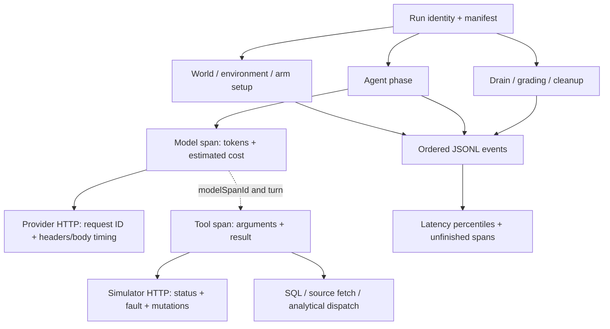

# Agency benchmark telemetry

New runs record individual operations in `<run-id>.jsonl`; their result JSON
also includes a compact `telemetry` summary. Recording is always enabled for all
three arms, including reference validation. Historical runs retain their
original aggregate timings; there is no invented per-step backfill.

- **Span:** one timed operation, with a durable start event and a matching end
  event. For example, one `execute` tool call.
- **Parent:** the enclosing operation. HTTP and SQL work inside `execute` point
  to that tool's `spanId` through `parentSpanId`.
- **Outcome:** `ok`, a thrown `error`/`aborted` operation, or a returned failure
  such as `executor-failed`, model `limit`, or simulator fault.
- **Segment:** report grouping for setup, measured work, grading, or cleanup.



## Recorded fields

Every event has `telemetryVersion: 1`, `runId`, increasing `sequence`, UTC
`timestamp`, and monotonic `elapsedMs`. Events emitted inside a span include
`contextSpanId`. Span ends carry `spanId`, `parentSpanId`, `kind`, `name`,
`startedAt`, `endedAt`, `durationMs`, `outcome`, and operation-specific
`attributes`. A start is written **before** dispatch so an interrupted operation
remains visible even if no result JSON was written.

| Kind                  | Detail beyond timing                                                                                                                                                                              |
| --------------------- | ------------------------------------------------------------------------------------------------------------------------------------------------------------------------------------------------- |
| `model`               | Turn, model, context bytes/message count, normalized token categories, per-call estimated cost, usage completeness, stop reason, response bytes; full provider reply remains in the `model` event |
| `provider`            | Exact request body in `provider-request`; request/response bytes, HTTP status, response ID, request ID and allowlisted rate-limit/retry headers, time to response headers and body-read duration  |
| `tool`                | Tool name, arguments, result, input/output bytes, tool call ID, turn and causing `modelSpanId` for model runs; thrown errors and failed executor results                                          |
| `http`                | System, method/path/query/body, request ID, sizes, HTTP status, simulator fault/outcome, committed mutation count, including a write whose response was lost                                      |
| `sql`                 | Database, statement, parameters, row limit, returned row count/bytes, errors                                                                                                                      |
| `source-fetch`        | Connection, resource, external ID, result bytes, errors                                                                                                                                           |
| `analytical-dispatch` | Public logical query, timeout, result bytes, errors; generated connector SQL is private and is not captured                                                                                       |
| `phase`               | World generation, environment and arm setup, agent execution, drain, grading, arm/environment cleanup                                                                                             |

`agent-start` retains the full system prompt, task, tool schemas and budgets.
`agent-end` retains the stop reason, totals and usage completeness. Existing
submission, evidence exposure, final disclosure, mutation, fault and grading
records remain available. Cleanup errors preserve previously measured usage and
cost instead of replacing them.

Each span samples parent-process CPU, RSS, heap, external memory and
array-buffer memory. End events include CPU deltas and RSS change. The run
summary includes parent CPU totals, maximum **observed** RSS, compact completed
spans, unfinished spans, event/byte counts and time spent writing the log.

## Reading results

```sh
pnpm bench:agency:report --out benchmarks/media-agency/artifacts/YOUR_RUN
```

`report.md` includes per-arm, tier, segment, kind and operation counts, non-ok
outcomes, median/p90/p99/max latency. `report.json` additionally contains summed
latency within each group, unfinished operations, malformed log-line locations,
legacy transcript counts, token subtotals with unknown-run counts, total cost
when known, and a clearly labelled known-cost subtotal otherwise. The reporter
streams transcripts independently of result files, preserving evidence from
interrupted attempts. Deferred tasks have no execution spans.

To inspect model and tool steps directly:

```sh
jq -c 'select(.type == "span-end" and (.kind == "model" or .kind == "tool")) |
  {runId, spanId, parentSpanId, kind, name, durationMs, outcome, attributes}' \
  benchmarks/media-agency/artifacts/YOUR_RUN/*.jsonl
```

## Measurement boundaries

- Durations use a monotonic clock; wall-clock adjustments cannot make them
  negative. They are inclusive of nested operations and logging overhead,
  including queue wait for ordered writes. Do not sum parent and child durations
  to derive elapsed runtime. `telemetry.writeMs` measures sink writes, excluding
  serialization and queue wait; it is not the full instrumentation overhead.
- Provider adapters are non-streaming. `headersMs` is time to response headers,
  **not time to first token**. `bodyMs` covers reading the response body; model
  duration additionally includes translation, parsing and telemetry.
- Resource samples belong to the parent process. They include concurrent work;
  they exclude the executor/connector child processes and do not establish exact
  per-operation allocation, CPU attribution or a true peak memory measurement.
- Model tools are dispatched sequentially. Nested asynchronous work keeps its
  context; executor IPC callbacks installed during setup use the currently
  active tool when their original setup span has closed. Setup stays separate
  from measured tool work.
- Raw SQL spans cover the benchmark SQL helper. Relate's connector source
  fetches and analytical dispatches have separate kinds. Connection/schema
  housekeeping and individual private SDK internals are not SQL step metrics.
- Cost uses the manifest's supplied prices and provider-reported tokens. Missing
  pricing or lost/invalid usage leaves cost unknown, including a failed call
  that may still have been billed. No hidden provider retries are introduced.
- Authentication request headers, environment variables and cookies are never
  selected for telemetry. Provider error excerpts redact the configured API key.
  Business prompts, generated code, requests and responses are deliberately
  retained for audit. Keep artifacts private if replacing the fictional dataset
  with real business data.

## Ownership

| File                                                                     | Responsibility                                                     |
| ------------------------------------------------------------------------ | ------------------------------------------------------------------ |
| `src/harness/telemetry.ts`                                               | Ordered events, span correlation, clocks, resource samples         |
| `src/harness/model.ts`, `run.ts`                                         | Agent steps, usage/cost, lifecycle and failure retention           |
| `src/harness/providers/request.ts`                                       | Shared provider transport telemetry                                |
| `src/systems/{environment,simulators,databases}.ts`, `src/relate/app.ts` | HTTP/SQL and connector operation spans                             |
| `src/report/telemetry.ts`, `aggregate.ts`                                | Step distributions, interrupted/legacy coverage, token/cost totals |

All instrumentation is benchmark-owned; no public SDK or connector contracts
change.
