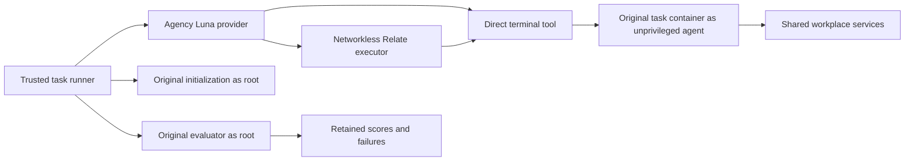

# TheAgentCompany integration (in progress)

This directory owns the agency benchmark's integration with the original
TheAgentCompany workplace. Infrastructure bootstrap, a terminal agent, a Relate
action adapter, original evaluator invocation, and reporting are implemented.
Live task validation and the measured comparison remain pending. No task scores
have been produced yet; API credit exhaustion stopped the pilot before any task.

Upstream source: `TheAgentCompany/TheAgentCompany@98b68ef82a47690c316f42fddb05baafaab56851`.
Controller image is pinned by digest in `services.py`. The source's compose file
is mounted over the older copy in the image, because the source uses
`bitnamilegacy/mongodb` while the published image still references `bitnami/mongodb`.
The first failed startup and its original compose file are retained under artifacts.

```sh
python3 benchmarks/media-agency/src/external/agent-company/services.py \
  --output benchmarks/media-agency/artifacts/agent-company/services-002
```

The launcher checks fixed upstream container names, compose volumes, and service
ports before starting. It refuses to reset existing matching resources. It records
all pre-existing containers and the new controller ID. The upstream controller
needs Docker socket access to launch its workplace services; it runs with amd64
emulation on this machine. A started controller does not mean the services are
healthy. Inspect `/api/healthcheck/{gitlab,owncloud,rocketchat,plane}` on port 2999
before launching tasks.

```sh
python3 benchmarks/media-agency/src/external/agent-company/run.py \
  --arm baseline-tools --output "$PWD/benchmarks/media-agency/artifacts/agent-company/baseline"
# Repeat with --arm relate and a fresh output directory after baseline finishes.
```

The default selection is all 175 original tasks. `--tasks` explicitly selects a
wiring pilot. Tasks run sequentially because upstream initialization resets the
shared services. Every task uses its published 1.0.0 image and original
`/utils/init.sh` and `/utils/eval.py`; exact image IDs are retained. The agent is
Luna with medium reasoning and 8192 output tokens per call. Original NPCs and
LLM graders use `gpt-4o-2024-08-06`, disclosed as an environment-model change
from the upstream Sonnet baseline. Credentials are injected only into host-owned
initialization/evaluation commands, not into agent commands.

Both arms have 80 model rounds, 80 terminal commands, and 1800 seconds per task.
Terminal commands have 45 seconds; longer work can be launched in the background
and polled. The agent is a non-root task-container user, cannot read `/utils` or
`/npc`, and has no Docker socket or host directory mounts. It has a terminal,
not an OpenHands browser agent; it can use workplace APIs and install user-level
dependencies. This is a custom agent evaluation, not a reproduction of the
published OpenHands baseline. Relate wraps the same terminal action and gives
discovery and receipts, not a richer business graph.



The local Docker VM has about 8 GB RAM. Starting the full workplace alongside
12 STATE-Bench executors made Docker unresponsive; affected attempts were
retained and stopped. Run these suites separately. Workplace service health is
still unverified, and its containers were deliberately stopped after this event.

Cleanup must be limited to resources created by this benchmark. Never run global
Docker prune or stop unrelated containers. The retained before-state inventory is
the ownership boundary; teardown and health automation still need implementation.
