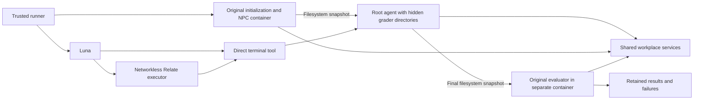

# TheAgentCompany integration (in progress)

This directory owns the agency benchmark's integration with the original
TheAgentCompany workplace. Infrastructure bootstrap, a terminal agent, a Relate
action adapter, original evaluator invocation, and reporting are implemented.
Both tool surfaces pass an offline lifecycle check against an original task and
deterministic evaluator. Live Luna validation and the measured comparison remain
pending: API credit exhaustion stopped the pilot before any model task. The
offline check deliberately leaves its task unsolved and is not a benchmark score.

Upstream source: `TheAgentCompany/TheAgentCompany@98b68ef82a47690c316f42fddb05baafaab56851`.
Controller image is pinned by digest in `services.py`. The source's compose file
is mounted over the older copy in the image, because the source uses
`bitnamilegacy/mongodb` while the published image still references `bitnami/mongodb`.
The first failed startup and its original compose file are retained under artifacts.

```sh
python3 benchmarks/media-agency/src/external/agent-company/services.py \
  --output benchmarks/media-agency/artifacts/agent-company/services-002
```

The launcher checks fixed upstream container names, compose volumes, and service
ports before starting. It refuses to reset existing matching resources. It records
all pre-existing containers and the new controller ID. The upstream controller
needs Docker socket access to launch its workplace services; it runs with amd64
emulation on this machine. A started controller does not mean the services are
healthy. Inspect `/api/healthcheck/{gitlab,owncloud,rocketchat,plane}` on port 2999
before launching tasks.

```sh
python3 benchmarks/media-agency/src/external/agent-company/run.py \
  --arm baseline-tools --output "$PWD/benchmarks/media-agency/artifacts/agent-company/baseline"
# Repeat with --arm relate and a fresh output directory after baseline finishes.
```

The default selection is all 175 original tasks. `--tasks` explicitly selects a
wiring pilot. Tasks run sequentially because upstream initialization resets the
shared services. All 175 published 1.0.0 task images were resolved from the public registry.
`images-1.0.0.lock.json` freezes their linux/amd64 digests; the runner requires
matching entries and retains the lock hash and selected references. Each task
uses its original `/utils/init.sh` and `/utils/eval.py`. Refreshing the lock is an
explicit operation with `images.py --output <new-file>`. The agent is
Luna with medium reasoning and 8192 output tokens per call. Original NPCs and
LLM graders use `openai/gpt-4o-2024-08-06` (the provider prefix is required by
the original image's LiteLLM), disclosed as an environment-model change
from the upstream Sonnet baseline. Credentials are injected only into host-owned
initialization/evaluation commands, not into agent commands.

Both arms have 80 model rounds, 80 terminal commands, and 1800 seconds per task.
Terminal commands have 45 seconds; longer work can be launched in the background
and polled. Root access is preserved for tasks that install software or write
outside `/workspace`. Isolation uses three containers:

- Initialization runs in a trusted original-image container; NPC processes and
  their credentials stay there. Initialization logs redact provider keys because
  the upstream NPC launcher prints them.
- The agent receives a filesystem snapshot in a separate PID namespace, with
  empty read-only mounts hiding `/utils` and `/npc`. It has no Docker socket or
  provider credentials. Only those empty directories are mounted from the host.
- The grader receives a final filesystem snapshot with the original protected
  files restored by Docker's exclusion of bind mounts. Agent-created files reach
  the original evaluator. Images declaring volumes are rejected until explicit
  volume-state transfer is implemented. The agent container remains running
  during grading so background servers remain available.

The agent has a terminal, not an OpenHands browser agent. This is a custom agent
evaluation, not a reproduction of the published OpenHands baseline. Relate wraps
the same terminal action and gives discovery and receipts, not a richer business
graph. Containers share host networking to reach the upstream services; this is
not network isolation from other local services.



The offline test uses scripted tool calls and zero model calls. It checks root
write permissions, hidden grader directories, absent provider credentials and
NPC process environment, preserved filesystem changes, equal original evaluator
results, and owned-resource cleanup in both arms. It also checks that the
original LiteLLM routes the configured environment model to OpenAI.

```sh
AGENCY_DOCKER_TESTS=1 python3 -W error::ResourceWarning -m unittest discover \
  -s benchmarks/media-agency/src/external/agent-company/test -v
```

Retained compact evidence: `validation/offline-lifecycle.json`. The full local
artifacts include trajectories, tool records, initialization/evaluation logs,
filesystem diffs, and cleanup outcomes. These checks cover one deterministic
service-independent task, not the full workplace, NPC conversations, or LLM graders.

The local Docker VM has about 8 GB RAM. Starting the full workplace alongside
12 STATE-Bench executors made Docker unresponsive; affected attempts were
retained and stopped. Run these suites separately. Workplace service health is
still unverified, and its containers were deliberately stopped after this event.

Cleanup must be limited to resources created by this benchmark. Never run global
Docker prune or stop unrelated containers. The retained before-state inventory is
the ownership boundary. Per-task containers and snapshots have explicit cleanup;
full workplace teardown and recovery still need implementation.
