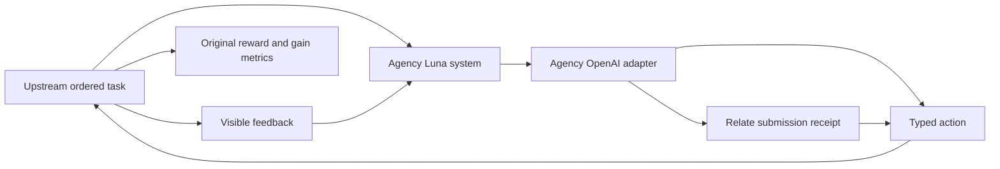

# Continual Learning Bench integration (in progress)

Runs original ordered task environments and their stateless baseline through the
agency benchmark's OpenAI provider. Agent: `gpt-6-luna`, medium reasoning, 8192
output tokens. The custom `agency_luna` system retains visible task feedback and
chosen actions until upstream resets it. A tool call encodes each typed action;
upstream validates and executes it, computes rewards, and measures learning
gain.

Upstream pin:
`pgasawa/continual-learning-bench@5f8c50eb1e84b2eda2ef4faff757dfc812a0ea26`.
Install under `benchmarks/media-agency/artifacts/upstream/continual-learning`
using `uv sync --frozen --extra all`. No upstream files are edited.

From the Relate worktree root, a wiring pilot:

```sh
benchmarks/media-agency/artifacts/upstream/continual-learning/.venv/bin/python \
  benchmarks/media-agency/src/external/continual-learning/run.py \
  run exploitable_poker --schedule quick_test --runs 1 --max-workers 1 \
  --output "$PWD/benchmarks/media-agency/artifacts/continual-learning/pilot-001/result.json"
```

The parent output directory must be new. Raw requests/replies, upstream traces,
and the run manifest are retained; credentials remain in the worktree
environment. The five-instance pilot is not the full benchmark. Full task
coverage and a final measured comparison remain pending.

`suite.py --output <fresh-directory>` schedules all six task families with their
full default schedules, one run each plus the original stateless baseline. Run
`clbench setup --all` from the upstream checkout first (codebase setup uses a
relative data path). Tasks that fail or have not started stay in `suite.json`.
`report.py <suite-directory>` summarizes each task separately; rewards have
different units and must not be averaged across task families.

Add `--agency-arm relate` to either runner to use the Relate adapter. It exposes
one `respond` action whose input is the original action serialized in
`input.arguments`. The receipt acknowledges submission; the upstream engine
still owns execution and returns the actual feedback. The adapter never treats
a receipt as task success. Arbitrary nested schemas are not yet supported by
Relate's action compiler, so discovery includes the original JSON schema.

Across queries, both systems retain the same kinds of public prompts, typed
choices and feedback; encrypted reasoning and temporary interface calls are not
carried between queries. Direct submission needs one model call; the Relate arm
allows up to eight discovery/execution calls, with a shared 8192-output-token
budget per query. Costs include those extra interface calls. The executor is in
a networkless, read-only Docker container built from the agency benchmark image;
the host invokes only schema-validated submission callbacks. This tests the
interface, not business objects or learned graph relationships.

Current retained result: `results/database-exploration-baseline-001.json` records
all 40 database questions. Mean reward was **0.37166** with history versus
**0.206665** stateless, a **0.164995** mean gain. Both covered 40/40 instances;
this is one run and is not a Relate comparison. Other default schedules remain
incomplete. Relate pilot 001 failed on an invalid submission; pilot 002 was
interrupted by Docker resource contention; pilot 003 hit API credit exhaustion.
All attempts remain under ignored artifacts. No successful Relate score is claimed.



The interface forwards only `query.prompt` and its response schema. It does not
inspect task internals or grader answers. Reset clears history between
independent runs and stateless baseline instances; ordinary feedback remains
within a run.
