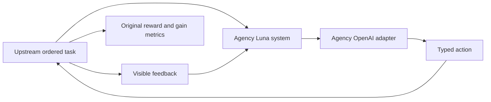

# Continual Learning Bench integration (in progress)

Runs original ordered task environments and their stateless baseline through the
agency benchmark's OpenAI provider. Agent: `gpt-6-luna`, medium reasoning, 8192
output tokens. The custom `agency_luna` system retains visible task feedback and
chosen actions until upstream resets it. A tool call encodes each typed action;
upstream validates and executes it, computes rewards, and measures learning
gain.

Upstream pin:
`pgasawa/continual-learning-bench@5f8c50eb1e84b2eda2ef4faff757dfc812a0ea26`.
Install under `benchmarks/media-agency/artifacts/upstream/continual-learning`
using `uv sync --frozen --extra all`. No upstream files are edited.

From the Relate worktree root, a wiring pilot:

```sh
benchmarks/media-agency/artifacts/upstream/continual-learning/.venv/bin/python \
  benchmarks/media-agency/src/external/continual-learning/run.py \
  run exploitable_poker --schedule quick_test --runs 1 --max-workers 1 \
  --output "$PWD/benchmarks/media-agency/artifacts/continual-learning/pilot-001/result.json"
```

The parent output directory must be new. Raw requests/replies, upstream traces,
and the run manifest are retained; credentials remain in the worktree
environment. The five-instance pilot is not the full benchmark. Full task
coverage, the Relate arm, and a final measured comparison remain pending.



The interface forwards only `query.prompt` and its response schema. It does not
inspect task internals or grader answers. Reset clears history between
independent runs and stateless baseline instances; ordinary feedback remains
within a run.
