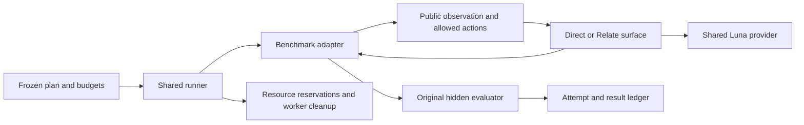

# External benchmark integration: findings and proposed shared interfaces

Status: findings below are grounded in the implemented adapters and retained
runs. Shared interfaces are proposals, not exported Relate APIs. The three
benchmark comparisons are not complete.

## Terms

- **Adapter:** connects an original benchmark to the agency runner; for example,
  `stateBench.act(session, toolCall)` invokes the original task tool handler.
- **Rollout:** an ordered evaluation sequence. A STATE-Bench rollout can be one
  conversation; a Continual Learning rollout includes many related instances.
- **Surface:** the interface the model sees, such as original tools or Relate
  discovery and execution. It must not change the original grading rules.
- **Manifest:** the frozen task selection, source/image versions, budgets and
  artifact hashes that identify one attempt. A retry is a new attempt.

## What the work has shown

1. **Preserving the original evaluator is practical.** STATE-Bench can execute
   original tool handlers through Relate while its simulator and grader still
   receive original calls/results. The adapter keeps wrapper calls in a separate
   model trace. See `agents/agency_relate.py`.
2. **Action schemas need better interoperability.** Relate currently rejects
   arbitrary nested JSON-schema inputs. The working bridge uses
   `input.arguments: JSON.stringify(args)` and describes the original schema.
   A pilot model mistakenly supplied direct fields, demonstrating that this
   encoding is real usability overhead. See `executor-bridge.ts`.
3. **Submission and execution are distinct.** Continual Learning returns a typed
   action to its engine, which later executes it. A Relate receipt can honestly
   acknowledge submission, but cannot claim that the task action succeeded.
4. **Memory reset is a first-class benchmark contract.** A stateless baseline
   resets per instance; a learning system keeps visible observations across a
   sequence. A per-task runner cannot silently erase that distinction. On the
   completed 40-question database run, visible history improved mean reward
   from 0.206665 to 0.37166. This is a memory result, not a Relate effect.
5. **Resource scheduling is part of validity.** The local Docker VM has roughly
   8 GB. Starting the workplace alongside twelve executors stalled Docker and
   invalidated that comparison attempt. Workplaces need an exclusive resource
   reservation; lightweight executor concurrency needs one global cap.
6. **Completion and billing need explicit coverage.** Upstream "OK" can mean
   execution completed, even if task success is false. A process can exit zero
   after all trials fail. Current agent-only costs omit STATE simulator/judge
   spend. Missing scores, grader failures and unpriced calls must remain visible.

## Proposed private agency-benchmark interfaces

Keep orchestration in `benchmarks/media-agency/src/external/core/` and each
benchmark's original environment/grader adaptation beside that benchmark.
Do not add benchmark-specific contracts to public Relate packages.

```ts
// Proposed sketch; Json and the named records below are private runner types.
interface BenchmarkAdapter {
  plan(selection: Json): Promise<FrozenPlan>;
  start(rollout: PlannedRollout): Promise<TrustedSession>;
  observe(session: TrustedSession): Promise<PublicObservation>;
  act(session: TrustedSession, response: AgentResponse): Promise<PublicFeedback>;
  grade(session: TrustedSession, trace: OriginalTrace): Promise<BenchmarkResult>;
  dispose(session: TrustedSession): Promise<CleanupResult>;
}

interface AgentSurface {
  // Receives public schema and authorized callbacks only, never TrustedSession.
  bind(input: {
    observation: PublicObservation;
    invoke: (action: PublicAction) => Promise<PublicFeedback>;
  }): Promise<{ tools: ModelTool[]; close(): Promise<void> }>;
}
```

`FrozenPlan` should carry original task IDs and ordering, all seeds, source and
image digests, reset boundaries, model/reasoning parameters and limits. A
`TrustedSession` owns hidden grading state and credentials exclusively in the
host. `PublicObservation` contains only the benchmark-sanctioned prompt/schema.
`BenchmarkResult` retains the benchmark's own metrics and units, plus explicit
scored/unscored/error status; it is not one universal score.



## What to build next

1. Extract the repeated provider bridge, usage ledger, immutable attempt
   manifests and credential-free executor RPC. Record `agent`, `simulator`,
   `grader` and `learning` call categories, including failed calls and unknown
   usage. A quota circuit breaker must stop queued work across processes.
2. Add sequence-aware reset/feedback hooks and an exclusive-workplace versus
   bounded-worker scheduler. Container cleanup must be based on recorded IDs,
   and process cancellation must propagate to tools without losing final state.
3. Improve Relate JSON action inputs or generate schema-aware codecs and useful
   validation errors. Avoid making every benchmark author teach the model a
   serialized-JSON wrapper.
4. Add a parity manifest to each comparison: same model, source state, visible
   information, acquisition responsibilities, memory policy, feedback schedule
   and budgets. Report unavoidable interface differences explicitly.
5. After a clean action-interface comparison, model actual benchmark entities
   and relationships in a separate Relate arm. Only that arm could test the
   benefit of the business graph. Current wrappers do not establish it.

Acceptance for a new plugin: no new model client; the original grader remains
authoritative; hidden state never enters model input; replayable hashes and all
failed attempts are retained; a complete task selection can run on either
surface with declared reset and budget policies.
