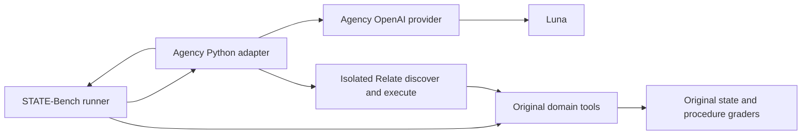

# STATE-Bench integration (in progress)

Runs live STATE-Bench tasks inside the agency benchmark using its existing
OpenAI Responses provider. The upstream harness retains tool execution,
simulated users, task state, and grading. This initial adapter is the
direct-tool baseline and a Relate action adapter are available.

Pinned upstream:
`microsoft/STATE-Bench@5644b1838d96bc4483da29642d058ecaa6f80f7f`. Install its
dependencies with `uv sync --frozen` in the upstream checkout under
`benchmarks/media-agency/artifacts/upstream/state-bench`.

From the Relate worktree root:

```sh
benchmarks/media-agency/artifacts/upstream/state-bench/.venv/bin/python \
  benchmarks/media-agency/src/external/state-bench/run.py \
  --domain customer_support --split test --num-runs 1 --num-workers 2 \
  --output-dir "$PWD/benchmarks/media-agency/artifacts/state-bench/baseline"
```

Use a fresh output directory per run. One run is a diagnostic; upstream official
reporting requires five runs. `--tasks` can select a wiring pilot explicitly.

Add `--agency-arm relate` for the comparison. Set `AGENCY_EXECUTOR_IMAGE` to
the agency Docker image built from the same Relate package revision (this run
uses `relate-agency:v2-14b8ca0`). The runner resolves its immutable local image
ID into the manifest. The executor runs in a networkless, read-only container;
only its TypeScript bridge is mounted, never credentials or benchmark data.
Python permits RPC calls only to the original task's tool handlers.

The Relate arm defines one action per original tool. There are no extra business
objects, joins, policy helpers or memories. Relate's current action schema
compiler accepts scalar object fields, so original nested tool arguments cross
as `input.arguments: JSON.stringify(args)` and original results as
`output.value: JSON.stringify(result)`. Discovery includes each original schema.
This measures interface overhead and receipt behavior, not a business-graph
advantage. The upstream simulator and graders receive original tool calls and
results, not the discover/execute wrapper calls. Both arms permit eight model
rounds per conversation turn; the Relate discovery round consumes that budget.

The agent uses `gpt-6-luna`, medium reasoning, 8192 output tokens. User
simulator and judges remain the upstream protocol's GPT-5.4. The wrapper changes
their transport from Azure to the OpenAI API without editing upstream files;
report that deviation. Never label these custom interface experiments official
scores.

The agent receives only the public system prompt, conversation and tool schemas.
It never receives the runtime context's expected state or task requirements.
Full model request/response records are stored below each output directory in
`agency-traces/`. These are trusted-host artifacts, not exposed to the agent.



Validation includes canonical tool-result conversion, missing-result denominator
checks, and a Docker integration test for concurrent source calls, nested result
preservation, idempotent receipt replay and absence of host credentials.
The development executor itself is trusted code, not a JavaScript security
sandbox; the outer Docker container supplies the isolation boundary.
Both arms have completed a live training-task pilot. Held-out comparison runs
and the final retained report remain required before completion.
