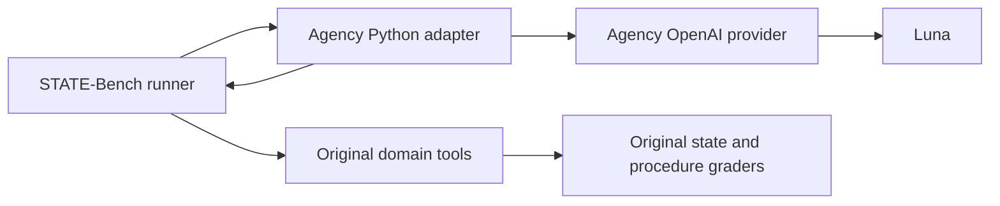

# STATE-Bench integration (in progress)

Runs live STATE-Bench tasks inside the agency benchmark using its existing
OpenAI Responses provider. The upstream harness retains tool execution,
simulated users, task state, and grading. This initial adapter is the
direct-tool baseline; the Relate comparison arm is still pending.

Pinned upstream:
`microsoft/STATE-Bench@5644b1838d96bc4483da29642d058ecaa6f80f7f`. Install its
dependencies with `uv sync --frozen` in the upstream checkout under
`benchmarks/media-agency/artifacts/upstream/state-bench`.

From the Relate worktree root:

```sh
benchmarks/media-agency/artifacts/upstream/state-bench/.venv/bin/python \
  benchmarks/media-agency/src/external/state-bench/run.py \
  --domain customer_support --split test --num-runs 1 --num-workers 2 \
  --output-dir "$PWD/benchmarks/media-agency/artifacts/state-bench/baseline"
```

Use a fresh output directory per run. One run is a diagnostic; upstream official
reporting requires five runs. `--tasks` can select a wiring pilot explicitly.

The agent uses `gpt-6-luna`, medium reasoning, 8192 output tokens. User
simulator and judges remain the upstream protocol's GPT-5.4. The wrapper changes
their transport from Azure to the OpenAI API without editing upstream files;
report that deviation. Never label these custom interface experiments official
scores.

The agent receives only the public system prompt, conversation and tool schemas.
It never receives the runtime context's expected state or task requirements.
Full model request/response records are stored below each output directory in
`agency-traces/`. These are trusted-host artifacts, not exposed to the agent.



Validation so far: canonical tool-result conversion tests and a real Luna API
smoke. Neither is a benchmark task score. Full runs and Relate integration
remain required before this work is complete.
