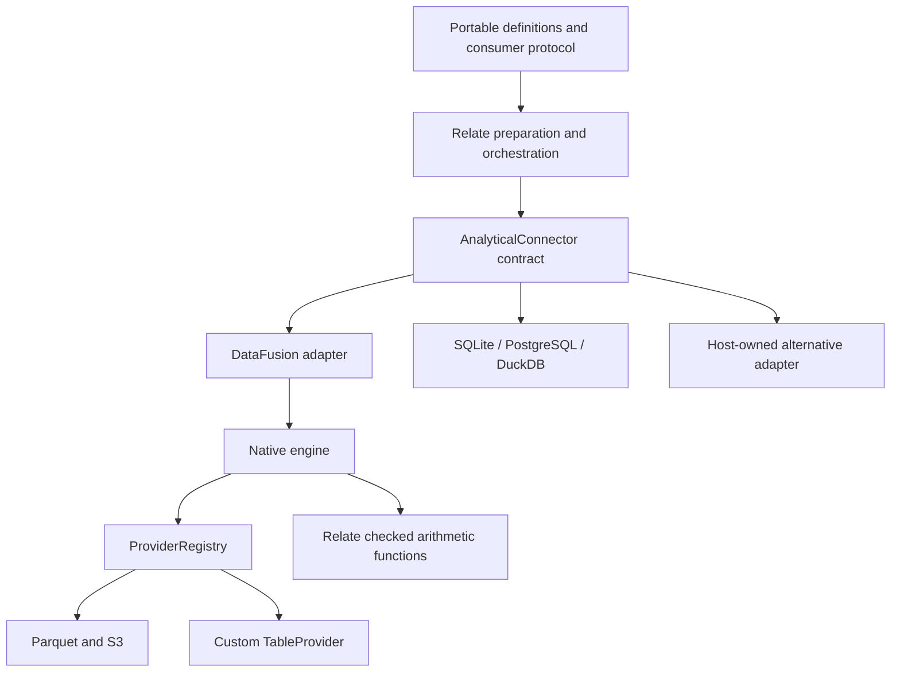

# DataFusion analytical execution

Execute Relate calculations over local or S3 Parquet using Apache DataFusion.
The connector is opt-in: importing `@relate/node` does not load this package or
start a native process. Existing SQLite, PostgreSQL and DuckDB bindings continue
working, including alongside DataFusion datasets on the same object.

## Terms

| Term               | Meaning                                                    | Example                             |
| ------------------ | ---------------------------------------------------------- | ----------------------------------- |
| Dataset            | Typed rows used by an object's calculations                | `Events`                            |
| Slot               | One authorized object's correlation values and field masks | `customerId = 'acme'`               |
| Provider           | A Rust table implementation DataFusion can scan            | Parquet or a custom `TableProvider` |
| Plan               | An opaque handle owned by one configured connection        | `analytics.plan(query)`             |
| Checked arithmetic | Calculations that report overflow for the affected cell    | `SUM(amount)` outside int64 range   |

## Build and bind

Requires Node supported by Relate and Rust 1.92 or later. The package includes
Rust source and a lockfile; it does **not** include prebuilt native binaries or
run installation scripts. The first native build can take several minutes.
DataFusion is pinned to 54.1.0.

From this repository:

```sh
pnpm install
pnpm build:datafusion
pnpm build
pnpm test:datafusion
```

For an installed package, build its executable explicitly:

```sh
cargo build --locked --manifest-path node_modules/@relate/connector-datafusion/engine/Cargo.toml
```

```ts
import { datafusion } from '@relate/connector-datafusion';
import { bind, defineApp } from 'relate';

// graph and Events are your existing Relate definitions.
const app = defineApp({
  graph,
  setup({ onDispose }) {
    const lake = datafusion({ connectionId: 'delivery-lake' });
    onDispose(() => lake.close());
    return {
      bindings: [
        bind(Events, lake.parquet('/absolute/path/events.parquet'), {
          columns: { customerId: 'customer_id' },
        }),
      ],
    };
  },
});
```

For a separately built executable (including a release build), supply
`enginePath`. The default is `engine/target/debug/relate-datafusion` inside this
package. Native execution is verified on macOS and Linux; Windows binaries and
packaging are not validated by this implementation.

### S3

```ts
lake.parquet('s3://analytics/events/part-001.parquet', {
  s3: {
    bucket: 'analytics',
    region: 'us-east-1',
    accessKeyId: process.env.ANALYTICS_ACCESS_KEY!,
    secretAccessKey: process.env.ANALYTICS_SECRET_KEY!,
    // sessionToken: process.env.ANALYTICS_SESSION_TOKEN,
    // Local emulator only:
    // endpoint: 'http://127.0.0.1:5033',
    // allowHttp: true,
  },
});
```

Credentials are explicit host configuration sent over the child's stdin. They
are never command-line arguments or consumer results. No implicit environment
credential discovery or HTTP URL reading is enabled. The configured bucket must
match the S3 URL. Files and directory prefixes use DataFusion's Parquet
provider.

Physical schema comes from Parquet metadata. Required Relate columns require
required physical fields; an optional Parquet field must be declared nullable.
Supported physical types are strings, Boolean, Int32, Int64, Float64, Date32,
and timezone-free timestamps in milliseconds or microseconds. Other types are
reported as unsupported at startup, without lossy coercion.

Try the fully local, self-checking tutorial:

```sh
# Requires uv as well as Rust and Node. No cloud account or Docker required.
pnpm example:datafusion
```

The runner launches a pinned Moto S3 emulator on a free loopback port, seeds
Parquet, runs a public Relate query combining S3 and SQLite calculations, checks
denied access, and stops the emulator. See
[the tutorial](../../examples/05-datafusion/README.md).

## Execution and ownership

```mermaid
sequenceDiagram
  participant C as Consumer
  participant R as Relate runtime
  participant N as Node connector
  participant D as DataFusion process
  participant S as Table provider
  C->>R: get/query with select and compute
  R->>R: authorize object, dataset, fields and dependencies
  R->>R: resolve types, create slots, batch and admit
  R->>N: plan(AuthorizedDatasetQuery)
  N->>N: validate and render typed SQL; keep opaque handle
  R->>N: execute(plan, signal, timeout)
  N->>D: source configuration and generated query over stdin
  D->>S: open configured provider and inspect schema
  D-->>N: ready
  D->>D: logical and physical optimization, checked functions
  D->>S: scan projected/filterable data
  D-->>N: typed result rows
  D-->>N: process exits
  N-->>R: slot values, checks, readAt
  R->>R: validate, revalidate, merge, evidence, order and paginate
  R-->>C: portable Relate result
```

The public SQL surface remains Relate's restricted calculation language. This
package does not expose arbitrary SQL to consumers. Runtime queries arrive as
`AuthorizedDatasetQuery`; identifiers are quoted and values are typed bind
parameters. Resources and plans cannot be moved between connections or forged.
Rust also rejects DDL, DML, COPY and session-changing statements before
execution.

One process owns one statement and one catalog. Startup and execution have
separate deadlines; the execution deadline includes teardown. Parent loss also
terminates native work through a held-open input pipe. On success, Node closes
that pipe after the response to release the native input reader. Abort, timeout
and connection retirement kill the process and wait for close before settling.
There are at most four active processes per connection, an 8 MiB request limit,
a 16 MiB response limit, and a 256 MiB DataFusion memory-pool budget per
process. Spilling is disabled so forced cancellation cannot leave spill files
behind. The pool is **not** an operating-system RSS limit; source buffers and
result serialization can allocate outside it. Relate additionally owns request
budgets and per-connection statement queues.

`readAt` is the connector observation when startup completes. It is neither an
S3 version nor a snapshot guarantee. Metadata inspection and execution can see
source changes; use immutable object keys when repeatability matters. No source
row cache, cross-source snapshot or automatic retry is introduced.

## Extending DataFusion without making it the product



Relate owns object meaning, authorization, preparation, batch placement, result
validation and final ordering. DataFusion optimizes only the statement assigned
to it. A future Relate optimizer can change the prepared work and backend
selection without exposing DataFusion plans in the model or protocol. An
operation DataFusion cannot perform can remain in Relate or use another
`AnalyticalConnector`; there is no silent fallback or error-triggered retry.
Cross-dataset expressions, global federated joins and arbitrary SQL are not
added by this connector.

This implementation already supplies semantics beyond native DataFusion: integer
row operations detect overflow, integer sums use exact arbitrary-size partial
state before checking the final int64 range, and averages divide exact integer
totals before rounding. Float operations retain failures through nulls; scaled
accumulation avoids avoidable overflow. Results have per-cell failure checks so
one invalid value cannot corrupt sibling objects or fields.

The shared SQL renderer's optional `checked.nodeBinding: 'inline'` lets
function-based dialects bind each child once without correlated scalar
subqueries, which DataFusion cannot execute in these aggregate inputs. Existing
dialects retain their subquery binding. This is a syntax capability, not a
DataFusion dependency in portable authoring.

### Custom Rust providers

Implement `ProviderFactory`, register it in a host-owned binary, and call the
shared `stdio::serve(registry)` entry point. The factory returns an ordinary
DataFusion `TableProvider`:

```rust
#[async_trait]
pub trait ProviderFactory: Send + Sync {
    async fn open(
        &self,
        context: &SessionContext,
        options: &serde_json::Value,
    ) -> anyhow::Result<Arc<dyn TableProvider>>;
}
```

The complete [custom-provider example](engine/examples/custom-provider.rs)
implements `TableProvider::scan`, delegates a small in-memory scan to
DataFusion, and retains DataFusion filtering through the default
unsupported-pushdown contract. It is compiled by `pnpm build:datafusion` and
exercised from Node tests:

```ts
const connection = datafusion({
  connectionId: 'custom',
  enginePath: '/absolute/path/engine/target/debug/examples/custom-provider',
});
const events = connection.custom('demo-events', { customerId: 'acme' });
// bind(Events, events) uses the same public dataset binding API.
```

Provider configuration must be JSON-serializable. The default binary rejects
unregistered names. Provider code is trusted host code, not a sandbox: it owns
its I/O behavior, credentials and any external effects. Put remote I/O in the
execution stream rather than `scan`, and advertise exact filter pushdown only
when it really is exact. See Apache's
[custom table provider guide](https://datafusion.apache.org/library-user-guide/custom-table-providers.html).

## Verification and current limits

- The existing SQL corpus runs through public Node get/query APIs for both
  caller and declared calculations; the existing row-arithmetic suite checks
  overflow, underflow, cancellation, nulls and exact integer behavior.
- Connector tests cover mapped schemas, duplicate slots, masks, opaque handles,
  custom providers, authorization/evidence, process protocol and cancellation.
- Native tests exercise provider registration and rejection of mutating SQL.
- The package smoke test builds the packed Rust source and executes a query
  through the installed JavaScript package.
- The local S3 example verifies a real signed object-store read against Moto.
  This is not evidence of AWS IAM, large-file performance, production S3
  behavior or distributed federation. No performance improvement is claimed.
- Process startup and metadata reads happen per statement. Pooling, binary
  distribution, richer credential providers, custom-provider deployment and
  engine-wide planning across datasets remain separate future work.
