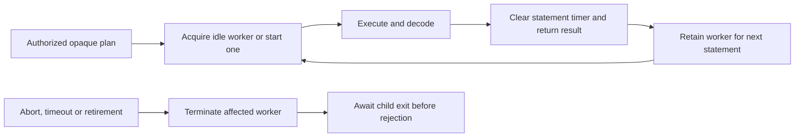

# DuckDB analytical connector

For the shared dataset declaration, access rules and query flow, see
[Datasets and Calculations](../../apps/docs/content/authoring/datasets.md).

`@relate/connector-duckdb` reads existing DuckDB tables for Relate computed
properties and caller calculations. It does not persist Relate's own state or
implement keyed source reads.

The package alone depends on `@duckdb/node-api` and its platform binary.
Installing `relate` or `@relate/node` does not install DuckDB. Packages are
currently development packages used from this repository; after publication,
applications opt in with `pnpm add @relate/connector-duckdb`.

- **Dataset:** declared analytical columns, such as `Events`.
- **Resource:** a physical table selected with `analytics.table('events')`.
- **Slot:** one object's correlation values; duplicate keys retain distinct
  slots.

```ts
import { duckdb } from '@relate/connector-duckdb';
import { bind } from 'relate';

// Inside defineApp's setup(context):
const analytics = duckdb({
  connectionId: 'analytics',
  path: './analytics.duckdb',
});
context.onDispose(() => analytics.close());
return {
  bindings: [
    bind(Events, analytics.table('events'), {
      columns: { customerId: 'customer_id' },
    }),
  ],
};
```

`table(name, { schema })` defaults to schema `main`. Identifiers are quoted
individually. Resources and plans belong to their creating connection. The
database file must already exist. In-memory databases are unsupported.

## Physical types

Startup checks all bound columns without scanning rows. Nullability must match
the dataset declaration. Unsupported types are rejected rather than coerced.

| Relate type            | DuckDB column type |
| ---------------------- | ------------------ |
| boolean                | BOOLEAN            |
| string                 | VARCHAR            |
| int32                  | INTEGER            |
| int64                  | BIGINT             |
| float64                | DOUBLE             |
| timestamp, precision 3 | TIMESTAMP_MS       |
| timestamp, precision 6 | TIMESTAMP          |

Timestamp columns must contain UTC wall-clock values: DuckDB's unzoned types are
interpreted as UTC. TIMESTAMPTZ, TIMESTAMP_NS, DECIMAL, FLOAT and unsigned
integers are currently unsupported. Integers remain exact and microsecond
timestamps never pass through JavaScript Date. String comparisons use binary
collation. Checked row arithmetic widens integer nodes to `HUGEINT`; integer
sums accumulate in `HUGEINT`; an out-of-range node or total fails only that
cell. Double operations never raise and are checked with `isfinite`. Float64
values bind as round-trip text, because the driver would bind an integral number
such as `1e308` as `BIGINT`.

## Execution and lifecycle

A lazy pool of up to four read-only child processes reuses each native DuckDB
instance across statements. Successful reads leave the worker ready for its next
operation. External file/network access, extension autoloading and extension
installation are disabled, including for bound views. Generated SQL uses typed
bound values and keeps object correlation outside caller predicates.



Timeouts and caller abort terminate the affected worker and wait for process
cleanup before rejecting. A later statement starts a replacement. `close()`
retires every worker, including idle workers, and joins all child exits. Each
worker runs one statement at a time. The connector advertises
`maxConcurrentStatements: 4` so the runtime queues work within that capacity,
including when multiple runtimes share the connection. Statement timers stop
when an outcome arrives. Process startup is charged only when a new worker is
needed, with a separate execution timing per operation. Cancellation timings
include cleanup. Failed diagnostic observers cannot fail a read.

`analyticalStartupTimeoutMs` defaults to 5,000 ms (allowed: 1–60,000 ms).
Statement execution uses the runtime-provided timeout, up to 2,147,483,647 ms.
Schema inspection uses 5,000 ms after startup. Plans have a conservative 65,535
bound parameter limit, calculated without rendering SQL.

Optional `onDiagnostic(diagnostic)` receives host-only database, startup,
timeout, crash or protocol diagnostics. Database failures retain driver details
in the internal error `cause`; native crash stderr is bounded to its last 4,096
characters. These details can contain private physical names and values and must
stay in trusted operator logging. Public error messages and consumer results
remain sanitized. No driver details are logged by default.

This connector targets existing analytical files. Close any writer before
opening the connector, and call `await analytics.close()` before reopening a
writer: idle workers retain read locks for the connection lifetime. It does not
coordinate ingestion or concurrent writer processes. Parquet/S3 resources and
extension-backed sources remain outside this capability.

## Validation

Tests exercise real DuckDB files, aggregate families, exact scalars, empty and
null results, slot masks, cancellation with lock release, external-access
blocking, and public Node-host get/query reads. Installed-tarball tests verify
both the absence of DuckDB from ordinary installations and the packaged child
process after explicitly installing the connector.
