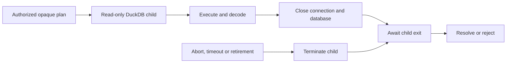

# DuckDB analytical connector

`@relate/connector-duckdb` reads existing DuckDB tables for Relate computed
properties and caller calculations. It does not persist Relate's own state or
implement keyed source reads.

The package alone depends on `@duckdb/node-api` and its platform binary.
Installing `relate` or `@relate/node` does not install DuckDB. Packages are
currently development packages used from this repository; after publication,
applications opt in with `pnpm add @relate/connector-duckdb`.

- **Dataset:** declared analytical columns, such as `Events`.
- **Resource:** a physical table selected with `analytics.table('events')`.
- **Slot:** one object's correlation values; duplicate keys retain distinct
  slots.

```ts
import { duckdb } from '@relate/connector-duckdb';
import { bind } from 'relate';

// Inside defineApp's setup(context):
const analytics = duckdb({
  connectionId: 'analytics',
  path: './analytics.duckdb',
});
context.onDispose(() => analytics.close());
return {
  bindings: [
    bind(Events, analytics.table('events'), {
      columns: { customerId: 'customer_id' },
    }),
  ],
};
```

`table(name, { schema })` defaults to schema `main`. Identifiers are quoted
individually. Resources and plans belong to their creating connection. The
database file must already exist. In-memory databases are unsupported.

## Physical types

Startup checks all bound columns without scanning rows. Nullability must match
the dataset declaration. Unsupported types are rejected rather than coerced.

| Relate type            | DuckDB column type |
| ---------------------- | ------------------ |
| boolean                | BOOLEAN            |
| string                 | VARCHAR            |
| int32                  | INTEGER            |
| int64                  | BIGINT             |
| float64                | DOUBLE             |
| timestamp, precision 3 | TIMESTAMP_MS       |
| timestamp, precision 6 | TIMESTAMP          |

Timestamp columns must contain UTC wall-clock values: DuckDB's unzoned types are
interpreted as UTC. TIMESTAMPTZ, TIMESTAMP_NS, DECIMAL, FLOAT and unsigned
integers are currently unsupported. Integers remain exact, integer sum overflow
fails the statement, and microsecond timestamps never pass through JavaScript
Date. String comparisons use binary collation.

## Execution and lifecycle

Each describe or execute operation opens a fresh read-only database in an
isolated child process. External file/network access, extension autoloading and
extension installation are disabled, including for bound views. Generated SQL
uses typed bound values and keeps object correlation outside caller predicates.



Timeouts, caller abort and `close()` terminate native work and wait for process
cleanup before settling. Failed diagnostics cannot fail a read. Startup and
execution timings include the corresponding cleanup. The startup timeout
`analyticalStartupTimeoutMs` defaults to 5,000 ms (allowed: 1–60,000 ms).
Statement execution uses the runtime-provided timeout. Schema inspection uses
5,000 ms after startup. At most four operations run concurrently per connector;
the runtime provides queued admission. Plans have a conservative 65,535 bound
parameter limit.

Process isolation adds startup cost per statement. This connector targets
existing analytical files: close any writer before reading, and finish reads
before opening a writer. It does not coordinate ingestion or concurrent writer
processes. Parquet/S3 resources and extension-backed sources are outside this
initial capability.

## Validation

Tests exercise real DuckDB files, aggregate families, exact scalars, empty and
null results, slot masks, cancellation with lock release, external-access
blocking, and public Node-host get/query reads. Installed-tarball tests verify
both the absence of DuckDB from ordinary installations and the packaged child
process after explicitly installing the connector.
