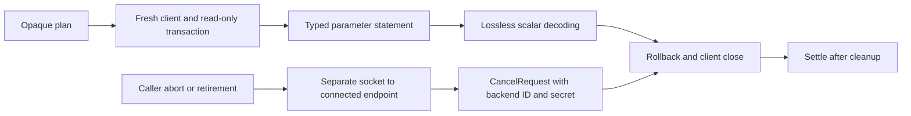

# PostgreSQL analytical connector

`@relate/connector-postgres` reads aggregates from application-owned PostgreSQL
tables through Relate dataset bindings. It implements the analytical capability;
keyed source reads are not implemented. Relate's own graph persistence uses the
separate `@relate/postgres` package.

- **Dataset:** declared columns available to an authorized calculation, such as
  `Events`.
- **Resource:** a selected physical table, such as `analytics.table('events')`.
- **Slot:** one candidate object's correlation values; duplicate keys retain
  separate slots.

```ts
import { postgres } from '@relate/connector-postgres';
import { bind } from 'relate';

// In defineApp({ graph, setup(context) { ... } }):
const analytics = postgres({
  connectionId: 'analytics',
  url: process.env.ANALYTICS_DATABASE_URL!,
});
context.onDispose(() => analytics.close());
return {
  bindings: [
    bind(Events, analytics.table('events', { schema: 'reporting' }), {
      columns: { customerId: 'customer_id', occurredAt: 'occurred_at' },
    }),
  ],
};
```

`schema` defaults to `public`. Names are exact physical identifiers, quoted
individually; a dot in a table name is part of that identifier. Connection IDs
are configured by the host. Resource IDs distinguish schema/table pairs. Opaque
resources and plans cannot be passed between connection instances.

## Types and planning

Startup describes columns through PostgreSQL catalogs and checks SELECT access
with a zero-row query. It does not scan rows. Declared nullability and logical
types must match the physical schema:

| Logical type           | Physical type                                 |
| ---------------------- | --------------------------------------------- |
| boolean                | `boolean`                                     |
| string                 | `text`, `varchar`                             |
| int32                  | `smallint`, `integer`                         |
| int64                  | `bigint`                                      |
| float64                | `double precision`                            |
| timestamp, precision 3 | `timestamptz(3)`                              |
| timestamp, precision 6 | `timestamptz(6)` or unqualified `timestamptz` |

Domains over supported base types are accepted. `numeric`, `real`, zone-less
timestamps and blank-padded `char` are unsupported: local timestamps have no
instant without an explicit timezone, and `char` equality ignores trailing
spaces. Text equality retains exact byte semantics even under nondeterministic
collations. Use int64 minor units for exact monetary aggregates. No type
coercion silently narrows a declared column.

Plans bind every value with an explicit PostgreSQL type. Built-in types,
functions, comparison operators and the binary collation are qualified through
`pg_catalog`, preserving their meaning under application search paths. String
ordering, minimum/maximum and distinct counts use `COLLATE "C"`. Equality and
correlation combine an ordinary indexable comparison with a binary guard,
preserving exact matching while existing B-tree indexes remain eligible.
Correlation joins remain outside caller predicates, and per-slot masks exclude
unavailable dependencies. The parameter budget includes masks, slots, keys,
literals and fallbacks, and plans reject more than 65,535 parameters before
opening a client.

Integer sums cast to `bigint`; overflow fails the statement. Integer averages
cast to `double precision`. Boolean minimum/maximum use `bool_and`/`bool_or`.
Result decoding uses per-query text parsers, preserving exact int64 and
microsecond timestamp values without changing global `pg` parsers. Timestamps
are formatted in UTC; ISO year zero maps to PostgreSQL 1 BC. Infinity and dates
outside the portable range remain invalid scalar values for runtime rejection.

## Execution and cancellation

Each statement opens a fresh client, runs in `BEGIN READ ONLY`, sets a local
`statement_timeout` inside the transaction (never in the connection startup
packet), executes one generated statement and closes the client. Successful
reads roll back the read-only transaction before closing. A table view cannot
bypass the read-only transaction to perform writes.



Caller abort and retirement send a PostgreSQL protocol CancelRequest to the
connected endpoint, using its backend ID and secret key. No PID-only SQL
cancellation is used. A wrong server cannot accept the request based on a
matching process ID alone. The statement client is never reused. CancelRequest
has no acknowledgement, so capacity remains occupied until the primary result or
server timeout arrives. A watchdog then disconnects an unresponsive primary
connection; under a network partition it cannot confirm server termination. The
server timeout remains installed. All local client cleanup completes before the
promise settles, and results are withheld after an abort, including during
cleanup.

The runtime's shared connection queue owns admission and clamps concurrency to
the published connector limit of four. Execution timeouts are non-retryable for
the same supplied budget. The connector also caps direct concurrent operations
at four and reports retryable failure beyond that bound. `close()` retires
resources and waits for every admitted operation.

| Option                       | Default  | Allowed range |
| ---------------------------- | -------- | ------------- |
| `analyticalStartupTimeoutMs` | 5,000 ms | 1–60,000 ms   |
| `cancellationTimeoutMs`      | 2,000 ms | 1–60,000 ms   |

Startup and execution report separate monotonic host timings. Execution includes
decoding and cleanup. Failed startup omits execution timing; observer failures
cannot change the read. Driver details remain in internal causes, while public
errors use sanitized `DatasetExecutionError` messages.

## Validation

Package unit tests cover planning, parameter limits, opaque handles and client
lifecycle failures. `*.integration.test.ts` uses the dedicated
`RELATE_TEST_DATABASE_URL` through the repository integration project, with
owned temporary schemas. It exercises real aggregates, read-only enforcement,
cancellation, session cleanup and public Node-host reads. No external dataset or
production credentials are required.
