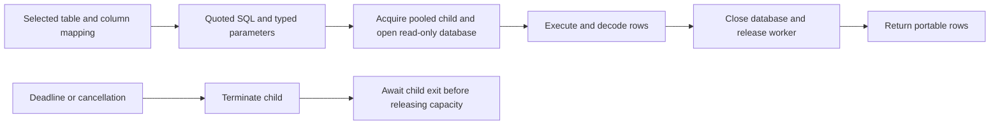

# @relate/connector-sqlite

Read an existing SQLite database as a Relate source. This is a provider
connector, separate from the storage adapter used to persist Relate observations
and actions. Requires Node.js 22 (22.16+), 24 or 26; uses built-in
`node:sqlite`.

```ts
import { sqlite } from '@relate/connector-sqlite';
import { bind } from 'relate';

const database = sqlite({ connectionId: 'local-crm', path: './crm.sqlite' });
const binding = bind(customers, database.table('customers'));
// In defineApp.setup: onDispose(() => database.close()).
```

`customers` is your `defineSource(...)` definition. Its `idField` supplies the
key column; its schema selects the fields to expose. Unlisted columns are not
read or retained in Relate. Direct connector users can select a keyed reader
with `database.table(name, { idColumn, columns })`. Selected columns must exist.
Configured names become result keys, even when their casing differs from
SQLite's declared identifiers.

The resource needs unique TEXT IDs. Matching uses binary equality and TEXT
storage class, so `abc` and `ABC` are distinct even on a NOCASE column, and
numeric values are not aliases for string IDs. Numeric-affinity key declarations
(such as `INTEGER PRIMARY KEY`) raise a configuration error. Untyped columns,
BLOB-affinity columns and views may supply TEXT IDs. If there is no exact TEXT
match, the connector checks for non-TEXT key values before reporting `deleted`;
any such value raises an error instead. This conservative absence check may scan
the resource. Existing exact TEXT matches in mixed columns remain readable.
Duplicate exact TEXT matches fail. Use an index with BINARY collation for
efficient reads (the connector does not create indexes). Identifiers are quoted
and IDs are bound parameters. Identity and resource statements are prepared once
per worker and reused; selected data is read afresh on each fetch.

## Connection identity

By default the application owns identity through `connectionId`; SQLite needs no
account table. Keep the ID stable when moving or restoring the same logical CRM.
Use a new ID when connecting a different logical source. Two connections with
different IDs can both contain `customers.id = '1'` without sharing a Relate
object or cached observations. The file path is a locator, not identity.

This mode explicitly uses `ApplicationSourceConnector`
(`identity: 'application'`), with no `identify()` or `providerAccountId` on its
results or binding. It cannot detect a different database substituted under the
same `connectionId`; the application owns that boundary. Relate policy and
freshness checks still apply. File access is the credential boundary, so use
trusted database files.

### Optional database verification

If the database contains a stable account ID and you want Relate to detect a
replacement under the same connection ID, configure verification explicitly:

```ts
const database = sqlite({
  connectionId: 'local-crm',
  path: './crm.sqlite',
  identity: { table: 'account', column: 'id' },
});
const binding = bind(customers, database.table('customers'), {
  providerAccountId: 'crm-production',
});
```

This returns a provider-verified `SourceConnector`. Application-owned and
provider-verified modes have separate retained identities, even with the same
connection ID; switching modes requires explicit adoption in the new scope.

The identity table must contain exactly one row with a nonempty TEXT account ID
without leading or trailing whitespace. Padded IDs are explicitly denied with a
configuration diagnostic; identity is never silently trimmed:

```sql
CREATE TABLE account (id TEXT PRIMARY KEY NOT NULL);
INSERT INTO account VALUES ('crm-production');
```

Provision that identity in the provider database; the connector never creates
it. Keep it stable for the lifetime of that account. A copied database retains
the same identity: provision a new ID if the copy represents a different
account. `identify()` reads the ID, and each fetch reads identity and data in
one SQLite snapshot. Relate compares this evidence to the binding's expected
account. An empty or ambiguous identity is explicit access denial.

A successful lookup with no row returns `deleted`. Missing tables, lock errors,
invalid values, and other database failures throw; they never imply deletion. An
invalid singleton account identity becomes `SourceAccessDenied`. File-open
errors (including missing or unreadable files) and other SQLite errors stay
database failures: a generic CANTOPEN error is not evidence of provider
authorization denial. TEXT, finite numbers and NULL are returned unchanged. When
`bind(source, connection.table(name))` sees a `z.int64()` source field, it reads
that column as a 64-bit integer and returns an exact decimal string, including
small values such as `"2"`. The explicit keyed table API accepts
`int64Columns: ['total_minor']` for the same encoding; these must be selected,
non-key columns. Declared int64 columns reject non-INTEGER storage classes
except NULL. Ordinary numeric columns still return JSON numbers. Booleans remain
0/1 and JSON text remains text; describe those representations in your source
schema. Selected BLOBs, nonfinite numbers and integers outside JavaScript's safe
range without int64 encoding are rejected. No source version is claimed because
SQLite supplies no per-row version contract.

The system connection can select multiple tables, each using the connection’s
chosen identity mode. Database opening is deferred until the first read or
identify; open errors reject that call. An owned worker serializes reads on one
read-only connection, leaving the application event loop free to enforce source
deadlines. `busyTimeoutMs` defaults to 150 ms (configurable from 0 to 60000); a
writer lock that outlasts that wait still fails. Keep keys indexed and records
small.

An aborted queued read is removed without affecting active work. Aborting an
active read rejects it immediately and retires the worker; later calls get a
fresh connection after teardown. Native SQLite work may finish before worker
termination completes, so teardown and queued reads can take longer than the
caller's deadline. At most one worker is active per system connection. Always
await `database.close()` (or register it with `onDispose`): it rejects
outstanding reads and waits for worker teardown. Closing is idempotent; calls
after close fail.

This package implements keyed record reads and analytical aggregates. It does
not implement object enumeration, change feeds, provider writes or Relate
storage.

See [customer workspace](../../examples/02-customer-workspace) for a runnable
application.

## Analytical datasets

A selected table also supports `bindDataset`, so one connection can back both a
keyed source and a dataset:

```ts
const database = sqlite({ connectionId: 'local', path: './data.sqlite' });
context.onDispose(() => database.close());
return {
  bindings: [
    bind(customers, database.table('customers')),
    bind(Events, database.table('events'), {
      columns: { customerId: 'customer_id', occurredAt: 'occurred_at' },
    }),
  ],
};
```

`startApp` checks every declared column against `PRAGMA table_info`. INTEGER
supports boolean, int32 and int64; BOOLEAN declarations use the same portable
values. TEXT supports strings and canonical UTC millisecond/microsecond
timestamps; DATETIME and TIMESTAMP declarations support the same canonical text
representation. REAL supports float64. NUMERIC/DECIMAL and BLOB are unsupported.
Non-null declarations require `NOT NULL` as reported by SQLite. Inspection
checks affinity and nullability, without scanning rows, and uses a five-second
statement deadline after process startup.

The connection's `analytics` capability accepts opaque resources and authorized,
typed query structures. It never accepts caller SQL text. Planning generates one
statement with object slots, explicit correlations and per-aggregate masks.
Identifiers are quoted; all values, including generated slots and defaults, are
bound with explicit SQLite types. Parameter budgeting counts the exact generated
placeholders against SQLite's 32,766 limit. Correlation and masks remain outside
expression predicates; duplicate correlation keys remain separate object slots.
String comparisons use binary collation. Timestamp comparisons normalize exact
milliseconds to microseconds, including MIN/MAX and COUNT(DISTINCT). Float64 SUM
uses SQLite's compensated summation, and integer AVG divides a sum already
rounded to float64; both can differ from PostgreSQL in the last digits.
Correlation uses indexed equality against both canonical timestamp precisions,
leaving the dataset column unwrapped.

A pool of at most four reusable child processes belongs to each configured
connection. Every statement opens a fresh read-only database handle and closes
it before returning a result; successful workers return to the idle pool.
Failures and cancellation terminate the worker and await its exit before
releasing capacity. A child-local watchdog runs on a separate thread, enforces
the operation lifetime even while SQLite blocks, and terminates the child if its
parent disappears. Idle workers exit on parent disconnect and do not keep the
host event loop alive. The runtime's shared statement queue coordinates
admission across runtimes borrowing that connection and clamps to its published
capacity. Startup timing includes worker acquisition and opening the database.
`analyticalStartupTimeoutMs` defaults to 5000 (range 1–60000). After startup,
`execute`'s `timeoutMs` bounds the statement. Timeout, abort and connection
close terminate the child and await its exit before settling, so capacity is not
released while native SQLite work continues. Analytical cancellation does not
retire the keyed-read worker. Resource and plan handles cannot move between
connections or be used after retirement.

Integers are read as bigint to preserve int64; int32 and boolean driver values
are decoded to portable scalars. SQL overflow fails the whole statement. BLOB or
malformed row framing is `invalid-result`; logical scalar validation remains the
runtime's per-alias responsibility. Error messages do not include SQL, values or
driver details. A successful result contains one ordered row per input slot and
`readAt` from the actual statement's start.

Optional `execute` timing callbacks report `connectionStartup` and `execution`
once per entered phase, including errors and cancellation. They use monotonic
client elapsed time; execution includes process cleanup. Synchronous or
asynchronous observer failures do not change results. These measurements are
host diagnostics, separate from returned data and evidence.



Connector execution and public app schema validation are implemented. Analytical
fields execute on object `get` and `query`, including computed filters and
ordering.
