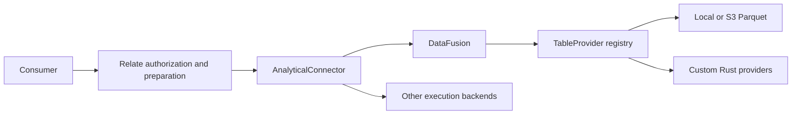

# DataFusion implementation log

## Contract and ownership

- Relate owns authorization, typed calculation preparation, batching, result
  validation, evidence, ordering and pagination.
- `AnalyticalConnector` is the existing backend boundary. DataFusion implements
  it; no DataFusion types enter portable authoring or runtime contracts.
- A **slot** is one authorized object's correlation values and per-field
  validity masks. A **provider** supplies a typed table to DataFusion. A
  **plan** is an opaque connection-owned handle produced from an authorized
  query.
- Rust owns provider registration, Arrow schemas, DataFusion planning/execution,
  and exact checked arithmetic functions. Node owns resource handles and process
  lifecycle. Source configuration is trusted host input, never consumer SQL.

## Planned validation gates

1. Native engine: typed parameters, exact integers, checked row arithmetic and
   aggregates, read-only plans, provider registration and S3 reads.
2. Connector: opaque handles, physical schema checks, slot shape, cancellation,
   deadlines, disposal, bounded process output and sanitized public errors.
3. Public host: get/query calculations, authorization denial, evidence, mixed
   existing/DataFusion backends, local object-storage example.
4. Workspace boundaries, types, package installation, onboarding and full check.
5. Self-review and refactor; document actual limitations and open the PR once.

## Stage 1 — design from existing contracts

- Inspected runtime execution, host binding validation and existing analytical
  connectors. Kept the existing backend boundary rather than introducing a
  parallel planner abstraction before it is needed.
- The previous federation benchmark is reference material only; its trusted raw
  SQL interface is not suitable as a consumer API.
- Use one isolated Rust process per statement initially. This makes abort and
  timeout release native resources before settlement and prevents catalog state
  leaking between requests. Startup cost is a deliberate initial tradeoff.
- Keep incremental commits local until all delivery gates pass.

## Stage 2 — native execution and connector

- Implemented a real DataFusion 54.1.0 engine, Parquet/S3 registration and a
  host-extensible Rust `ProviderRegistry`; added a runnable custom provider.
- Implemented the existing analytical connector contract with opaque resources
  and plans, typed parameters, schema mapping and exact result transport.
- Added checked integer functions/accumulators and floating-point checks.
- The initial renderer failed on DataFusion's unsupported scalar subqueries.
  Refactored the shared renderer with an optional inline-node capability; other
  connectors keep their existing SQL. The unchanged public SQL corpus and row
  arithmetic contracts now pass against DataFusion.
- Initial test fixtures exported through DuckDB lost required-field metadata and
  millisecond precision. Replaced the contract-suite fixtures with a test-owned
  Arrow writer rather than loosening schema checks. Enabled serde's round-trip
  float parsing after an adjacent-double boundary test caught fixture rounding.
- Added a held-open stdin ownership protocol: parent loss stops native work; a
  successful response makes Node close stdin so Tokio's blocking input reader
  can join during normal shutdown. Regression tests exercise parent loss during
  a real pending S3 request. Abort/timeout/retirement settle after process
  close.
- Disabled native spilling to prevent abandoned temporary files after forced
  cancellation. Documented that DataFusion's pool budget is not an RSS ceiling.
- Focused verification: 153 TypeScript tests passed, including the existing
  121-case SQL corpus and 13-case arithmetic contract; native provider/write
  rejection tests and Clippy passed. Full workspace verification follows.

## Stage 3 — local proof and distribution

- Added a self-checking campaign tutorial combining S3 Parquet spend and SQLite
  budget in one public Relate query, plus a caller-defined impression count.
- Verified exact `9007199254740995` spend and denied dataset access through the
  real signed S3 client against Moto 5.1.16.
- A Docker image pull did not progress; stopped that owned attempt and verified
  the simpler uv-based emulator path instead. The shipped runner starts its own
  emulator on a free loopback port and cleans it up; no Docker setup is
  required.
- Added native source/lockfile packaging and an installed-tarball smoke that
  compiles the packed custom-provider binary and executes the installed adapter.
- CI builds the native backend and runs the local S3 walkthrough; no branch has
  been pushed and no PR/CI run has been triggered during implementation.
