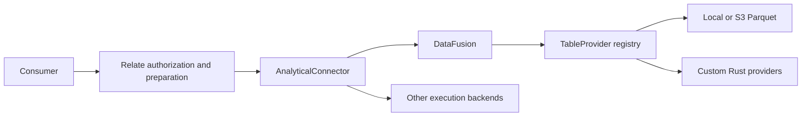

# DataFusion implementation log

## Contract and ownership

- Relate owns authorization, typed calculation preparation, batching, result
  validation, evidence, ordering and pagination.
- `AnalyticalConnector` is the existing backend boundary. DataFusion implements
  it; no DataFusion types enter portable authoring or runtime contracts.
- A **slot** is one authorized object's correlation values and per-field validity
  masks. A **provider** supplies a typed table to DataFusion. A **plan** is an
  opaque connection-owned handle produced from an authorized query.
- Rust owns provider registration, Arrow schemas, DataFusion planning/execution,
  and exact checked arithmetic functions. Node owns resource handles and process
  lifecycle. Source configuration is trusted host input, never consumer SQL.

## Planned validation gates

1. Native engine: typed parameters, exact integers, checked row arithmetic and
   aggregates, read-only plans, provider registration and S3 reads.
2. Connector: opaque handles, physical schema checks, slot shape, cancellation,
   deadlines, disposal, bounded process output and sanitized public errors.
3. Public host: get/query calculations, authorization denial, evidence, mixed
   existing/DataFusion backends, local object-storage example.
4. Workspace boundaries, types, package installation, onboarding and full check.
5. Self-review and refactor; document actual limitations and open the PR once.

## Stage 1 — design from existing contracts

- Inspected runtime execution, host binding validation and existing analytical
  connectors. Kept the existing backend boundary rather than introducing a
  parallel planner abstraction before it is needed.
- The previous federation benchmark is reference material only; its trusted raw
  SQL interface is not suitable as a consumer API.
- Use one isolated Rust process per statement initially. This makes abort and
  timeout release native resources before settlement and prevents catalog state
  leaking between requests. Startup cost is a deliberate initial tradeoff.
- Keep incremental commits local until all delivery gates pass.
