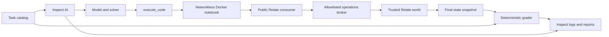

# Relate SDK agent evaluations

Measure whether an agent can discover and use Relate to complete business tasks.
This standalone project uses **Inspect AI** for model calls, agent execution,
repeated trials, logs, scoring and the results viewer. It has its own Python and
Node lockfiles and is outside the pnpm workspace. No Relate runtime code changes
are required.

## Terms

| Term          | Meaning                                                   | Example                                 |
| ------------- | --------------------------------------------------------- | --------------------------------------- |
| Task family   | One capability and success rule                           | `idempotent-retry`                      |
| Task          | A family with concrete data                               | `idempotent-retry-s11`                  |
| Trial / epoch | One fresh attempt at the same task                        | epoch `2`                               |
| Agent         | Model, instructions, tools and solver together            | `openai/gpt-5.4-nano` with `tool-agent` |
| Solver        | An Inspect function controlling the agent's steps         | `relate_eval.agents:discovery_first`    |
| Grader        | Code checking the submitted answer and actual world state | exactly one matching review             |
| Oracle        | A reference solution used to validate a task              | `--oracle`, no model call               |

## Start here

Requirements: Python 3.11–3.13, uv, Node 24+ on the host, Docker with Linux
containers, and a built Relate checkout. Run from this directory unless noted.
This is a source-checkout tool, not a published Python package.

```sh
# From the Relate repository root, build the SDK once:
pnpm install --frozen-lockfile
pnpm build
cd evals/agent-sdk

uv sync --locked
npm ci
npm run prepare:sdk
# Or: npm run prepare:sdk -- /absolute/path/to/another/built/relate-checkout
docker build -t relate-agent-eval:local .local/prepared

uv run relate-eval list
uv run relate-eval run --oracle --output .local/oracle-001
RELATE_EVAL_INTEGRATION=1 uv run pytest -q
```

The 84 reference tasks must pass before using a new SDK build for model scores.
A changed API may require a new suite version. Do not silently repair an old
suite and label it the same benchmark.

## Compare models or agents

Set provider credentials in the calling shell using your usual secret manager.
They are read by Inspect; neither the code container nor the world process
receives them. Config files contain model IDs, never credentials.

```sh
# 8 tasks × 2 trials × 2 models = 32 model trials (paid API calls)
uv run relate-eval run --config configs/smoke.json --output .local/smoke-001

# 84 tasks × 3 trials × 2 models = 504 model trials
uv run relate-eval run --config configs/comparison.json --output .local/full-001

uv run relate-eval report .local/smoke-001
uv run relate-eval compare .local/smoke-001 nano haiku
uv run inspect view --recursive --log-dir .local/smoke-001/logs
```

Model names are examples verified in the retained smoke run, not an exhaustive
supported list or an availability guarantee. Any compatible Inspect provider can
be configured. `model_args` and `generate_config` are passed to Inspect; for
example a provider-specific endpoint or a reasoning-effort setting.

```json
{
  "agents": [
    { "name": "baseline", "model": "openai/gpt-5.4-nano" },
    {
      "name": "discovery-first",
      "model": "openai/gpt-5.4-nano",
      "solver": "relate_eval.agents:discovery_first"
    }
  ],
  "epochs": 3,
  "concurrency": 2,
  "selection": { "levels": [2, 3], "seeds": [11, 29, 47] },
  "limits": { "max_cells": 24, "max_operations": 400, "cell_timeout": 20 }
}
```

Runs require a new output directory and never replace old attempts. Provider and
sample retries are disabled by default. For an interrupted run, generate its
report to see missing trials, then schedule a new run; do not pool successful
retries into the original denominator. Exit codes: `0` means every scheduled
trial was scored (agents may still fail tasks), `1` means oracle validation
failed, `2` means there are missing or errored trials. Setup/configuration
errors also exit nonzero. CI gates oracle correctness, not paid model scores.

## What is measured

| Level | Families | Tasks | Capabilities                                                                                                                                |
| ----- | -------: | ----: | ------------------------------------------------------------------------------------------------------------------------------------------- |
| 1     |        6 |    18 | Discovery, lookup, counts, equality filters, empty results, projection                                                                      |
| 2     |        7 |    21 | Reference filters, one/many/through traversal, numeric/date ranges, cursors                                                                 |
| 3     |        7 |    21 | Ranking, integer-money totals, deduplication, field/row permissions, error recovery, untrusted record text                                  |
| 4     |        8 |    24 | Create/readback, idempotent retry, receipt lookup, business failure, bulk writes, atomic rollback, cross-domain workflow, conflict recovery |

Every family has three data variants. Fixtures contain eight accounts, six
specialists, 108–144 tickets, assignments, 48 invoices and initially no reviews.
Only the authenticated user's north-team accounts and related records are
readable. Worlds reset for every trial. [Full task inventory](docs/TASKS.md).

Success requires **all** of:

1. An explicit `submit(value)` with the correct typed JSON answer.
2. The exact expected review state, including no unexpected writes or
   duplicates.
3. The requested procedure where the task explicitly asks for a cursor,
   traversal, receipt lookup, or identical retry.

Equivalent read strategies are accepted unless the task explicitly requires an
operation. Array order matters only when the task says it does. Recovery after
an SDK error can succeed; error counts remain visible. Read tasks fail if they
leave any new review behind.

Reports show success over **all planned trials**, scored-only success, errors,
missing trials, levels/families, token counts, latency and traces. `pass@k`
estimates the chance at least one of k attempts succeeds; `pass^k` estimates all
k succeeding. They require repeats of the same task, exclude incomplete repeat
groups, and show eligible task counts. These are descriptive results on a small
authored suite, not a general capability leaderboard or a causal SDK comparison.
Data variants are correlated; avoid treating 84 tasks as 84 independent
capability samples.

This suite evaluates SDK consumers in a synthetic support/billing domain. It
does not yet measure graph authoring, production connectors, analytical SQL, MCP
clients, persistence/restart recovery, coding-agent CLIs, or AppWorld task
performance. Those require new environments/tasks or solver adapters. The
extension boundaries support them without changing Relate packages.

## Files and ownership

| Path                      | Owns                                                                              |
| ------------------------- | --------------------------------------------------------------------------------- |
| `relate_eval/catalog.py`  | Seeded worlds, public prompts, expected answers, reference solutions              |
| `relate_eval/task.py`     | Inspect task, tool, solver selection, budgets, outcome scorer                     |
| `relate_eval/session.py`  | Container/world lifecycle and allowlisted operation transport                     |
| `environment/world.mjs`   | Public Relate graph, fixture bindings, authenticated operations, trusted snapshot |
| `environment/worker.mjs`  | Persistent TypeScript notebook and the real `relate/consumer` facade              |
| `environment/prepare.mjs` | Bundle a chosen SDK build and record input hashes                                 |
| `relate_eval/grading.py`  | Independent answer/state/procedure checks                                         |
| `relate_eval/report.py`   | Planned-denominator reports and paired comparisons                                |
| `relate_eval/cli.py`      | Frozen run manifests, matrix execution and reports                                |
| `relate_eval/agents.py`   | Example alternative agent scaffold                                                |
| `tests/`                  | Negative grader, accounting, isolation and lifecycle regressions                  |
| `configs/`                | Example model matrices                                                            |
| `evidence/`               | Retained validation and smoke evidence                                            |



[Research and framework decision](docs/RESEARCH.md) ·
[Extending the suite](docs/EXTENDING.md) ·
[Isolation and reproducibility](docs/ARCHITECTURE.md) ·
[Validation evidence](evidence/README.md)
