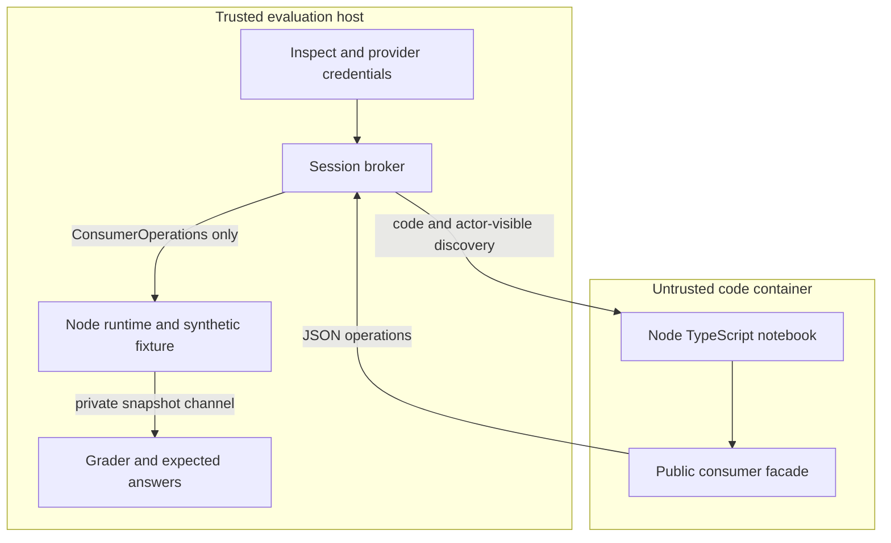

# Isolation and reproducibility

An **operation** is one public SDK call, such as `query`. A **world** is one
fresh runtime with test-owned data. A **snapshot** is the trusted final state
used for grading, not a tool exposed to the agent.

## Trust boundary

- The container image contains only bundled notebook code and the public
  consumer facade. No fixture rows, reference programs or grader files.
- No host filesystem mounts, provider environment variables, Docker socket or
  network. Non-root user, read-only filesystem, dropped capabilities, process,
  CPU and memory limits. The container is removed on normal/error cleanup.
- Node's REPL is **not** a security boundary. Code may access its container;
  authorizing data happens in the separate runtime. The transport allowlist is
  `get`, `query`, `traverse`, `invoke`, `getReceipt`. Worker messages cannot
  choose a principal, initialize a world or request its private snapshot.
- `createConsumer` comes from the chosen SDK build. The broker does not emulate
  query handles, pagination, errors, discovery or authorization. The consumer
  uses an actor-visible discovery snapshot and a small evaluation-only
  JSON-lines adapter over `ConsumerOperations`. This is not a production HTTP
  client.
- The host world also receives no provider credentials. It evaluates no model
  code and uses only synthetic fixture-backed connectors and native actions.
- Cells are serialized. A wall-clock cell timeout terminates the code container;
  the grader can still inspect the independent world. Pending runtime replies
  are drained in order so timeout cleanup cannot confuse a call result with a
  snapshot. Whole-trial/model/token limits additionally come from Inspect.
- SDK-call budget counts real operations; rejected budget requests never reach
  the runtime. Prelude cells count against the same cell limit as agent cells.
- Kernel/container isolation and Docker availability remain deployment
  assumptions. This is a local research harness, not a hardened multi-tenant
  service. A machine/process kill can bypass cleanup; remove only containers
  bearing the recorded `relate-eval-` run names after inspecting their state.

## Fixed inputs and retained evidence

`prepare:sdk` resolves public exports from a chosen built checkout. It bundles
the worker/world and hashes every bundled input, including built SDK files. A
commit SHA alone is insufficient when a checkout has modified builds; both
bundle hashes and the dirty-source flag are retained. Rebuild the SDK before
preparation when changing its sources. The image pins the Node base by digest.

The CLI checks the worker inside the selected image against the prepared bundle,
then retains a dedicated per-run image tag and uses the immutable image ID. The
tag keeps Docker from reclaiming the image when the development tag is rebuilt.
It is recorded in `manifest.json`; remove it with `docker image rm <tag>` only
after the run finishes and its artifacts are retained. The CLI copies the
prepared bundles into the run and uses that copy. New preparation cannot change
an in-flight run.

| Run artifact               | Contents                                                                                                                                       |
| -------------------------- | ---------------------------------------------------------------------------------------------------------------------------------------------- |
| `manifest.json`            | Schedule including epochs, agents/configuration, limits, image ID, SDK commit/dirty flag, source and bundle hashes, installed package versions |
| `tasks.json`               | Public task IDs, prompts, seed and complexity metadata                                                                                         |
| `sources/`                 | Exact harness/lockfiles, custom solver's defining module, prepared worker/runtime bundles                                                      |
| `logs/<agent>/*.eval`      | Model messages and API records, tool calls/results, usage, limits/errors, grader outcomes, SDK calls, final world                              |
| `report.json`, `report.md` | Recomputable scores with planned and observed counts                                                                                           |
| `setup-errors.jsonl`       | Errors raised before an agent can produce normal sample logs, when present                                                                     |

Custom solver modules are trusted plugins. Their defining file and installed
package inventory are retained; if they load other local files, vendor those
files under `relate_eval/` or retain them separately. Never put credentials in
config dictionaries. Provider/model aliases may drift; prefer dated model IDs
when offered. Local base URLs must be reachable from the host, not the
container.

Fixture row data are deterministic per seed. Bootstrap UUID generation is
briefly replaced in the trusted world process with hash-derived UUIDs, then
restored before agent execution. This fixes membership order within a prepared
SDK build without changing SDK source. Random receipt IDs, cursor ciphertext and
observation times remain runtime-generated and are retained in logs. The cursor
grader orders independent fixture subjects by the retained adopted IDs; it does
not query the SDK for the expected page. Different SDK revisions may allocate
bootstrap IDs differently, so compare business outcomes and retain the mapping
rather than asserting byte-identical traces across revisions.

The current read fixture is stable; it does not simulate provider changes,
staleness or eventual consistency. All writes are native reviews. Financial
amounts are integer pence; no currency-rate assumptions are involved.

## Reports and accounting

- Primary rate: passed / planned. Also show passed / scored, errors and missing.
- `pass@k = 1 - C(n-c,k)/C(n,k)` and `pass^k = C(c,k)/C(n,k)`, where `n` is
  repeated trials for one task and `c` successes. No estimate when `n < k`.
- Reliability averages only fully scored task groups and reports their count. It
  does not turn seed variants into repeated attempts.
- Pair comparisons match task ID and epoch within the same frozen run. They
  expose unpaired tasks and pairs with errors; no retries are pooled.
- Tokens come from retained sample usage, including errored samples when the
  provider returned usage. Failed requests with no usage remain unknown, not
  invented zeros in a billing claim. Reports do not estimate dollar charges.
- Run reports can be regenerated without model calls. Existing output
  directories are rejected; they are not resumed or overwritten.
