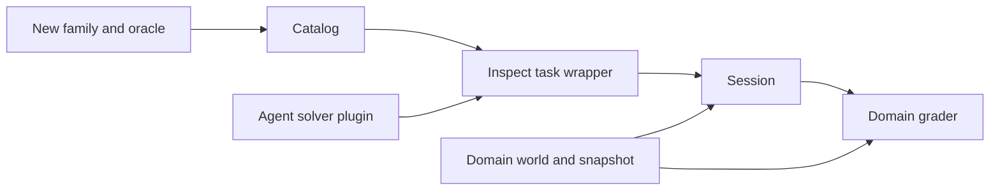

# Extending the suite

A task's **contract** is its prompt, starting world, answer rule and allowed
state changes. Changing any of these changes what a score means.

## Add a task family

1. Add a `Case` in `relate_eval/catalog.py`, using the local `add(...)` helper.
   Give it a stable family ID and one of the four complexity levels.
2. Compute its expected answer from fixture rows. Never read an SDK result to
   decide whether that same result is correct. The cursor case uses the retained
   source-to-canonical ID mapping plus independent fixture rows.
3. Add an SDK reference program. It is private validation data, never included
   in the model input. Use all-page iteration where appropriate.
4. Set `reviews` to the entire expected new-review set. Empty means no writes.
   Set `requires` only when the prompt explicitly asks for a particular method.
5. Add a negative grader test showing a plausible wrong result is rejected.
6. Run all reference cases and tests; update `docs/TASKS.md`, version and
   evidence.

```python
Case(
    id="account-tier-s11", family="account-tier", level=1, seed=11,
    prompt="Find Alder 11's tier. Submit the string.",
    expected="enterprise",
    reference="/* SDK program that calls submit(...) */",
    role="manager", unordered=False, reviews=[], requires=(),
)
```

Use new family IDs for new capabilities. Increment `VERSION` when changing
existing prompts, data, reference contracts, grading or environment semantics.
Never rewrite retained old scores to match a new version. Public authored tasks
can be memorized; a future private holdout should have its own IDs/version and
independent authorship.

## Add a model or agent

For another model, add `{ "name": "candidate", "model": "provider/model-id" }`
to a matrix. Model API integrations belong to Inspect, not this project.

For a different agent strategy, provide an Inspect solver factory:

```python
from inspect_ai.model import ChatMessageUser
from inspect_ai.solver import solver

@solver
def my_agent():
    async def solve(state, generate):
        # state.tools already contains execute_code. Preserve it and the prompt.
        state.messages.append(ChatMessageUser(content="Verify your final answer."))
        return await generate(state, tool_calls="loop")
    return solve
```

Select with `"solver": "my_module:my_agent"`. A complete working alternative is
`relate_eval.agents:discovery_first`, which spends a budgeted cell reading graph
discovery before the model starts. Inspect agents can also be adapted with
`inspect_ai.agent.as_solver`. Keep the runtime/session/scoring wrapper intact.

Agent factories execute trusted Python. They must not inspect target answers,
fixtures or grader state. Integrating a coding CLI or external agent requires an
adapter that routes its code calls through this session and returns an Inspect
state; there is no bundled CLI agent integration yet. Keep credentials on the
host, preserve model/tool transcripts, and test cancellation before using a new
adapter for comparisons.

## Add a domain or environment

Own the domain's fixture, runtime setup, private snapshot and grading together.
The initial support/billing world uses `environment/world.mjs`; the Python
`world(seed)` supplies raw fixture rows. New connector behavior, analytical SQL,
MCP or graph-authoring tasks should get their own world module and task version.
Do not import examples as fixture setup or put evaluators in runtime packages.



Run a focused reference check while developing, then the entire suite:

```sh
uv run relate-eval run --oracle --families create-review --seeds 11 --output .local/new-task
uv run relate-eval run --oracle --output .local/all-tasks
RELATE_EVAL_INTEGRATION=1 uv run pytest -q
uv run ruff check relate_eval tests
uv run ruff format --check relate_eval tests
```
