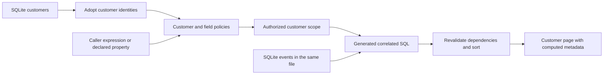

# Customer events

Read, filter and rank customers using their event history. Customer records and
event rows live in one temporary SQLite file. Only customers are adopted into
Relate; events remain dataset rows, including any duplicates.

| Term                 | Meaning here                                                        |
| -------------------- | ------------------------------------------------------------------- |
| Dataset              | `Events`: the typed columns of the existing `events` table          |
| Association          | `Customer.events`: matches `customerId` to `Customer.externalId`    |
| Caller expression    | `compute.loginsOct`: SQL and parameters supplied for this read      |
| Declared calculation | `loginCount`: reusable all-time login SQL with a stable property ID |

## Run

From the repository root, after `pnpm install`:

```sh
pnpm example:customer-events
```

The command builds its dependencies, runs both forms, prints the results and
closes the runtime and database. Node 22.16+, 24 or 26 is sufficient; no
external service or database is required. Each start creates a fresh SQLite file
and an in-memory Relate store, and removes the file on shutdown. Dates are fixed
in October 2026 so the results stay reproducible.

| Customer | October logins | Last login                 | All-time logins (declared extension) |
| -------- | -------------- | -------------------------- | ------------------------------------ |
| Acme     | `'2'`          | `2026-10-09T10:30:00.000Z` | `'3'`                                |
| Globex   | `'1'`          | `2026-10-03T14:00:00.000Z` | `'1'`                                |
| Initech  | `'0'`          | `null`                     | `'0'`                                |

Umbrella belongs to another portfolio and is not returned. Count results are
JSON strings because their type is `int64`. `decodeComputed(row)` produces `2n`
and a `Date` for Acme's count and millisecond timestamp. Missing fields stay
missing; an empty aggregate's SQL null stays null.

## Query the authorized scope

The primary graph declares no login-count property. The caller chooses the
period and the expression:

```ts
const page = await runtime.as(actors.ana).objects.Customer.query({
  select: ['name'],
  compute: {
    loginsOct: octoberLogins,
    lastLogin,
  },
  orderBy: [{ field: 'lastLogin', direction: 'desc' }],
  limit: 25,
});
```

`queries.ts` contains the SQL and named parameters. The October interval
includes October 1 and excludes November 1. To find customers without an October
login, add `where: { loginsOct: { eq: '0' } }`; the result is Initech. Int64
filter bounds are decimal strings. Null never matches a computed filter and
sorts last in either direction. Iterating a query follows its encrypted
continuation cursors; each page re-evaluates the authorized scope.

`declaredGraph` extends the same customer definition with:

```ts
loginCount: computed({
  id: 'business.customer.login-count',
  access: ordinary,
  sql: "SELECT COUNT(*) FROM self.events e WHERE e.eventType = 'login'",
});
```

The extended app selects and orders by `loginCount`. A declared calculation used
only in `where` or `orderBy` is required for evaluation but is not returned
unless selected. Both forms use the same access checks, batching, metadata and
failure rules. Dataset values have `freshness: 'unverified'`; a successful live
read does not certify the source's freshness or a shared database snapshot.

## Access rules

Both development actors work in `portfolio_north`:

| Actor | Roles                     | Customer events | Identifying `userId` column |
| ----- | ------------------------- | --------------- | --------------------------- |
| Ana   | employee, account-manager | Available       | Forbidden                   |
| Fin   | employee, finance         | Hidden          | Forbidden                   |

The portfolio policy governs customer visibility. The association additionally
requires `account-manager`; the identifying column requires `support`, which
neither actor holds. Ana's `COUNT(DISTINCT userId)` is withheld as forbidden.
Fin's caller SQL against `self.events` is rejected as an unknown association.
Neither a caller expression nor a declared property grants access to its inputs.

## Inspect the model

```sh
pnpm build
pnpm relate dev --config examples/04-customer-events/relate.config.ts --seed
```

Open the printed Inspector link. The graph includes the Events dataset and its
association; the playground's schema tree follows the selected actor's access.
The config exports the primary graph and its explicit customer-adoption seed. To
explore the declared extension, export `declaredApp` as default and
`seedDeclared` as `seed` from the config. Importing either model opens no
resources; setup owns the database and connector.



| File               | Responsibility                                                                   |
| ------------------ | -------------------------------------------------------------------------------- |
| `src/graph.ts`     | Source/dataset definitions, correlation, policies and optional declared property |
| `src/app.ts`       | SQLite setup, physical bindings and disposal                                     |
| `src/data.ts`      | Reproducible customer and event rows                                             |
| `src/seed.ts`      | Explicit customer adoption; no event adoption                                    |
| `src/queries.ts`   | Caller expressions and October parameters                                        |
| `src/index.ts`     | Terminal walkthrough using public APIs                                           |
| `test/app.test.ts` | Results, paging, access, correlation, cursor scope and both calculation forms    |

For execution budgets and failure semantics, see the
[application guide](../../apps/docs/content/runtime/application.md) and
[Node contract](../../packages/node/CONTRACT.md#analytical-operation-limits).
