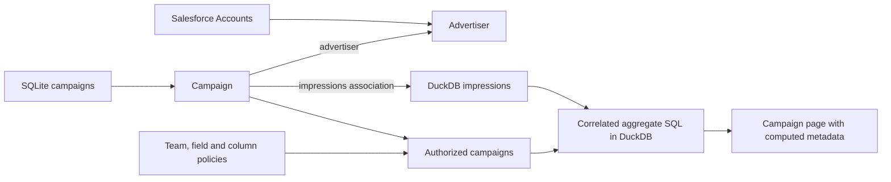

# 04 · Datasets

Aggregate rows that have no Relate identity, such as an event log, into
per-object values. An ad network ranks its campaigns by delivery and clicks.
Advertisers live in Salesforce, campaigns in the ad server's SQLite database,
and the impression log in a DuckDB warehouse. Advertisers and campaigns are
adopted into Relate; impressions remain dataset rows that Relate aggregates per
campaign.

| Term                 | Meaning here                                                                    |
| -------------------- | ------------------------------------------------------------------------------- |
| Dataset              | `Impressions`: typed columns of the DuckDB `impressions` table                  |
| Association          | `Campaign.impressions`: matches `campaignId` to `Campaign.externalId`           |
| Declared calculation | `served`, `clicks`, `ctr`, `spendMicros`: reusable SQL with stable property IDs |
| Caller expression    | `compute.servedInWindow`: SQL and parameters supplied for one read              |
| Reference            | `Campaign.advertiser`: the campaign's Salesforce Account ID as an object ID     |

## Run

From the repository root, after `pnpm install`:

```sh
pnpm example:datasets
```

The command builds its dependencies, creates fresh SQLite and DuckDB files,
seeds the runtime and opens the Inspector. Use `--no-open` to print the link
instead. Ctrl+C closes the runtime and removes both files. Node 22.16+, 24 or 26
is sufficient: Salesforce is answered by an in-process stand-in
(`src/salesforce.ts`) behind the real `@relate/connector-salesforce`, so no org,
credentials or network are needed. Dates are fixed in October 2026.



## Explore in the Inspector

Seeded data, as Ana (team `emea`):

| Advertiser         | Campaign         | `served` | `clicks` | `ctr`  | `spendMicros` (Fin only) |
| ------------------ | ---------------- | -------- | -------- | ------ | ------------------------ |
| Brightwater Travel | City Breaks      | `'40'`   | `'6'`    | `0.15` | `'100000'`               |
| Kestrel Running    | Trail Launch     | `'50'`   | `'4'`    | `0.08` | `'150000'`               |
| Brightwater Travel | Autumn Escapes   | `'25'`   | `'1'`    | `0.04` | `'45000'`                |
| Kestrel Running    | Retargeting Test | `'0'`    | `'0'`    | `null` | `'0'`                    |

Harbor Bank's Savings Push belongs to team `apac` and is never returned. Counts
are JSON strings because their type is `int64`; `ctr` is a nullable `float64`.

In the Playground as Ana:

```ts
return graph.objects.Campaign.query({
  select: ['name', 'served', 'clicks'],
  compute: {
    servedInWindow: {
      sql: 'SELECT COUNT(*) FROM self.impressions i WHERE i.servedAt >= $since AND i.servedAt < $until',
      parameters: {
        since: '2026-10-01T00:00:00.000Z',
        until: '2026-10-08T00:00:00.000Z',
      },
    },
  },
  orderBy: [{ field: 'clicks', direction: 'desc' }],
});
```

Add `where: { servedInWindow: { eq: '0' } }` to find campaigns idle in that
week: Trail Launch (its flight starts October 8) and Retargeting Test.

## Access rules

| Actor | Roles                     | Campaigns   | `budgetMinor`, `spendMicros`, `costMicros` | `deviceId` |
| ----- | ------------------------- | ----------- | ------------------------------------------ | ---------- |
| Ana   | employee, account-manager | Team `emea` | Forbidden                                  | Forbidden  |
| Fin   | employee, finance         | Team `emea` | Available                                  | Forbidden  |

The advertiser's Salesforce `Team__c` decides which advertisers and campaigns an
actor sees. Media cost is `financial`; device IDs are `identifying` and need the
`privacy` role, which neither actor holds. Reach,
`SELECT COUNT(DISTINCT i.deviceId) FROM self.impressions i`, is therefore
withheld as forbidden for both. Neither a caller expression nor a declared
property grants access to its inputs.

## Click-through rate

Click-through rate (CTR) is clicks divided by impressions: arithmetic over two
aggregates of the same dataset. The declared `ctr` property uses one formula:

```ts
ctr: computed({
  id: 'adnetwork.campaign.ctr',
  access: ordinary,
  sql: 'SELECT COUNT(*) FILTER (WHERE i.clicked = TRUE) * 1.0 / NULLIF(COUNT(*), 0) FROM self.impressions i',
}),
```

Formulas return a nullable `float64`. `NULLIF` turns a zero denominator into
null, so Retargeting Test, which has served nothing, has `ctr: null` and sorts
last. Callers can write their own formula with parameters, for example video
CTR:

```ts
return graph.objects.Campaign.query({
  select: ['name', 'ctr'],
  compute: {
    videoCtr: {
      sql: 'SELECT COUNT(*) FILTER (WHERE i.clicked = TRUE) * 1.0 / NULLIF(COUNT(*), 0) FROM self.impressions i WHERE i.placement = $placement',
      parameters: { placement: 'video' },
    },
  },
  orderBy: [{ field: 'ctr', direction: 'desc' }],
});
```

Only City Breaks has a video click (1 of 13 video impressions). Each formula
reads one dataset; combining datasets in one expression is not supported.

## Code map

| File                | Responsibility                                                              |
| ------------------- | --------------------------------------------------------------------------- |
| `src/graph.ts`      | Sources, dataset, objects, relationship, declared calculations and policies |
| `src/app.ts`        | SQLite and DuckDB setup, connector bindings and disposal                    |
| `src/salesforce.ts` | In-process Salesforce stand-in for the real connector                       |
| `src/data.ts`       | Reproducible advertisers, campaigns and generated impressions               |
| `src/seed.ts`       | Explicit advertiser and campaign adoption; no impression adoption           |
| `src/queries.ts`    | Caller expressions, including caller CTR formulas                           |
| `relate.config.ts`  | App and seed exports for the Inspector                                      |
| `test/app.test.ts`  | Results, team scope, column access, caller filters and both CTR forms       |

For execution budgets and failure semantics, see the
[application guide](../../apps/docs/content/runtime/application.md) and
[Node contract](../../packages/node/CONTRACT.md#analytical-operation-limits).
