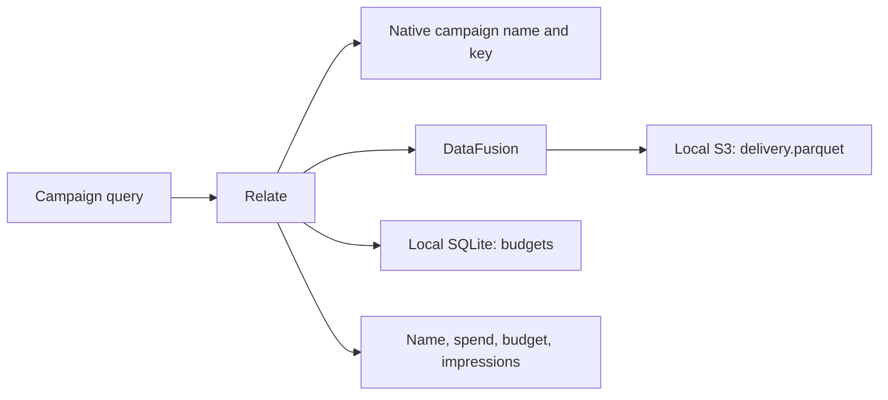

# DataFusion and local S3

A campaign's delivery rows live in Parquet on S3, while its budget lives in
SQLite. One Relate query returns both calculations and a caller-defined count.
The object, policy and consumer result remain ordinary Relate APIs.

```sh
# Prerequisites: supported Node, pnpm, Rust >= 1.92, and uv.
pnpm install
pnpm example:datafusion
```

The command builds the native engine, starts Moto 5.1.16 on a free local port,
seeds data, runs assertions and shuts down its emulator and temporary files. The
first invocation downloads/builds dependencies. Subsequent runs reuse local
build and uv caches. It needs no cloud account, Docker, PostgreSQL or secrets.



Expected values include:

```json
{
  "name": "Summer launch",
  "spend": "9007199254740995",
  "budget": "10000000000000000",
  "impressions": "2"
}
```

Integer results are strings in the portable wire result so large values remain
exact. The demo also checks that a reader without the analyst role cannot see
spend. Unrelated delivery rows are excluded by the campaign correlation.

- [src/app.ts](src/app.ts): definitions, policies and independent backend
  bindings.
- [src/index.ts](src/index.ts): local data setup, public actions and get/query
  assertions.
- [run-local.mjs](run-local.mjs): emulator lifecycle; uses a fresh process per
  run.
- [Connector documentation](../../connectors/datafusion/README.md): contracts,
  extension points, native build, diagrams and limitations.

To use an already running **local Moto** instance for debugging:

```sh
uvx --from 'moto[server]==5.1.16' moto_server -H 127.0.0.1 -p 5033
# In another terminal:
RELATE_S3_ENDPOINT=http://127.0.0.1:5033 node --import tsx examples/05-datafusion/src/index.ts
```

The seed uses Moto's unsigned first-write behavior and a fresh bucket name.
DataFusion reads through its real S3 client with explicit local credentials.
This seed script is specific to Moto; it is not a production bucket setup tool.
DuckDB only writes the tiny Parquet fixture; it does not execute the S3 reads.
