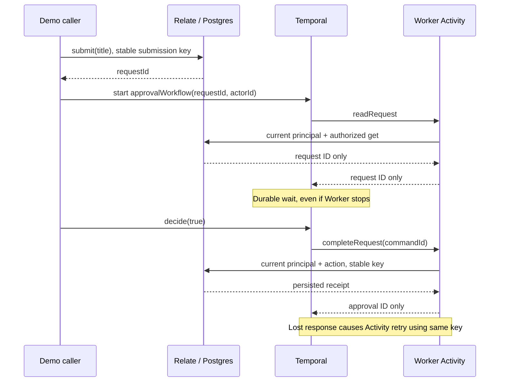
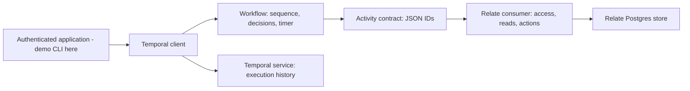

# Temporal workflow integration spike

**POC, not an adopted Relate execution API.** This example answers: can we build
a Temporal workflow using Relate business objects and actions without changing
Relate core? Yes: keep the workflow in TypeScript and call Relate from Temporal
Activities. This is an application integration, not a Temporal connector.

## Vocabulary

| Term            | Meaning here                                                                              | Tiny example                                      |
| --------------- | ----------------------------------------------------------------------------------------- | ------------------------------------------------- |
| Relate graph    | Business objects, actions and access rules                                                | `graph.objects.Request`                           |
| Relate action   | Validated, authorized business operation returning a receipt                              | `api.actions.complete({ input, idempotencyKey })` |
| Workflow        | Durable sequence of steps owned by Temporal                                               | `approvalWorkflow(input)`                         |
| Activity        | Worker code that can access databases and services; may run again                         | `activities.completeRequest(input)`               |
| Worker          | Process polling Temporal for work                                                         | `Worker.create({ activities, workflowsPath })`    |
| Signal          | Message to a running workflow                                                             | `handle.signal('decide', true)`                   |
| Replay          | Reconstruct workflow state using recorded history, without rerunning completed Activities | `Worker.runReplayHistory(...)`                    |
| Idempotency key | Identity reused when retrying the same business command                                   | `workflowId/runId/complete-v1`                    |
| Receipt         | Relate's persisted outcome of an action invocation                                        | `receipt.output.approvalId`                       |

## What we built

A member submits an onboarding request. A workflow reads the request through
Relate, waits up to a day for a decision, and records an approval through a
Relate action. Rejection or expiry creates no approval. The member approves
their own request in this minimal example; separation of submitter and approver
is not implemented. The title is illustrative, not an actual onboarding
integration.



The actual authoring seam is small:

```ts
// Workflow: deterministic orchestration, no Relate runtime or database imports.
await activities.readRequest(input);
await condition(() => decision !== undefined, timeoutMs);
const result = await activities.completeRequest({ ...input, commandId });

// Activity: normal public Relate API, current caller resolved by trusted host.
const api = relate.as(await resolvePrincipal(input.actorId));
const receipt = await api.actions.complete({
  input: { requestId },
  idempotencyKey: input.commandId,
});
return { approvalId: receipt.output.approvalId };
```

See `workflows.ts` for rejection/expiry handling omitted from this excerpt.
Signals are registered before the initial read, so an early decision is
retained; the first decision wins.

## Run the automated experiment

From the repository root, use the repository Node/pnpm versions. The worktree
helper creates its own `.env`, app database and disposable test database.

```sh
pnpm install --frozen-lockfile
pnpm example:temporal:test
```

Requires reachable Postgres via `RELATE_TEST_DATABASE_URL`. The Temporal test
SDK downloads and starts a real local development server on an available port;
first run needs network access. It stops the server afterward. No Temporal Cloud
account or Docker is required. Test data uses a new graph ID for each case and
remains in the disposable database; the test never truncates shared tables. The
suite is opt-in and is not part of ordinary `pnpm test`.

| Scenario                         | Assertions                                                                                                                                                                        |
| -------------------------------- | --------------------------------------------------------------------------------------------------------------------------------------------------------------------------------- |
| Restart and lost acknowledgement | Worker stops while waiting, Relate runtime/pool closes, both are recreated against the same graph; approval succeeds; exactly two completion attempts create exactly one approval |
| Revocation while waiting         | Current directory removes roles before resumption; one completion attempt fails non-retryably; zero approvals                                                                     |
| Different owner                  | Initial read fails non-retryably; no completion attempt or approval                                                                                                               |
| Rejection                        | Result is `rejected`; no completion attempt or approval                                                                                                                           |
| Expiry                           | Real Temporal timer expires; result is `expired`; no completion attempt or approval                                                                                               |
| History replay                   | Every case's completed history replays against the workflow bundle                                                                                                                |

This proves graceful Worker/runtime recreation, not OS process termination or a
Temporal server outage. Lost acknowledgement is deliberately injected after the
Relate call returns; it is not a network partition. Postgres is real in every
case; the identity directory is a test-owned function.

## Try it manually

Install the [Temporal CLI](https://docs.temporal.io/cli/setup-cli), then run the
following in separate terminals. The CLI uses localhost and the default Temporal
namespace; `TEMPORAL_ADDRESS` overrides the endpoint. `DATABASE_URL` supplies
Relate persistence. Run `pnpm build` once before starting the example.

```sh
# Terminal 1: development server and UI (http://localhost:8233)
temporal server start-dev

# Terminal 2: Worker; stop with Ctrl+C and rerun while waiting to see recovery
pnpm example:temporal worker

# Terminal 3: submit/start, approve, then await the result
pnpm example:temporal start onboarding-001
pnpm example:temporal decide onboarding-001 approve
pnpm example:temporal result onboarding-001
```

Use `reject` for the alternate branch and a fresh workflow ID for a new request.
Stopping a Worker does not stop the Temporal server or cancel the workflow. The
manual demo's principal directory recognizes only `ada`. These trusted local
commands are **not an authenticated API**: anyone with server access can send a
signal. Production must authenticate callers, authorize decision endpoints and
resolve current roles from a trusted directory. Workflow input is not proof of
identity. Do not expose these local demo endpoints publicly.

A workflow start and Relate submission are separate commits. Repeating `start`
with the same ID reuses the Relate submission key, and Temporal rejects
duplicate workflow IDs even after completion. If starting fails, inspect
Temporal before retrying. There is no automatic reconciliation or durable start
dispatcher here.

## Ownership and contracts



| Concern                                                | Owner / rule                                                                                                                    |
| ------------------------------------------------------ | ------------------------------------------------------------------------------------------------------------------------------- |
| Business schema, action input/output, ownership checks | Relate graph, unchanged public APIs                                                                                             |
| Waiting, bounded retries, workflow history             | Temporal                                                                                                                        |
| Identity                                               | Trusted application; resolved for every Activity attempt, no roles or tokens in history                                         |
| Activity payloads                                      | Only IDs and decisions; no graph instances, receipts or business titles                                                         |
| Action retry identity                                  | Workflow ID + run ID + versioned step name; never Activity attempt number                                                       |
| Authorization after a wait                             | Read and action check current access; an earlier read does not grant future access                                              |
| Relate failures                                        | `ActionError` becomes non-retryable `Relate:<code>`; unavailable/uncertain outcomes require operator reconciliation in this POC |
| Other Activity failures                                | Up to 3 attempts, 10-second start-to-close timeout; maximum 1-second retry interval                                             |
| Cancellation                                           | Temporal default cancellation; no compensation for a business action that already committed                                     |

IDs and decisions are still potentially sensitive and are retained in Temporal
history. Relate denial cannot retract already recorded history. Production needs
Temporal access controls, retention and possibly payload encryption.

The idempotency key prevents duplicate effects for retries of **this command**.
A different workflow run can create another approval for the same request; no
business-level uniqueness constraint is claimed. Relate's native action and
receipt share its transaction, but a provider-side effect would also need the
provider's idempotency/reconciliation contract. There is no distributed
transaction between Temporal and Relate.

## Options considered

| Option                                     | Caller shape                                             | Assessment                                                                                                                                             |
| ------------------------------------------ | -------------------------------------------------------- | ------------------------------------------------------------------------------------------------------------------------------------------------------ |
| Typed application Activities (implemented) | `activities.completeRequest({ requestId, commandId })`   | Small, explicit payloads and permissions; no core changes; recommended first integration                                                               |
| Generic action adapter                     | `invokeAction({ actionId, input, idempotencyKey })`      | Could use public `relate.operations(principal).invoke(...)`; needs runtime schemas, an action allowlist and careful error/receipt conversion; deferred |
| Relate action starts a workflow            | `actions.startOnboarding(...)` then Temporal client call | Useful product surface, but not atomic; requires a persisted start intent and retrying dispatcher before claiming reliable delivery; deferred          |
| Generate workflows from graph metadata     | `compileWorkflow(graph, plan)`                           | Graph describes business semantics, not step ordering, timers or compensation; no new workflow language justified by this experiment                   |

Recommendation: first keep workflows and Activities together in the application.
Extract a shared adapter only after a second real workflow establishes common
identity, error mapping, payload and versioning requirements. Do not add
Temporal as a source connector or runtime dependency to core Relate packages.

## Process and files

1. Read repository contracts and existing native-action/persistence examples;
   checked Temporal's official workflow and testing guidance.
2. Created `feat/temporal-workflow-poc` using `pnpm worktree:create` from
   `origin/main` (`72d2c3d`); isolated databases/dependencies via the helper.
   Later merged `main` at `56eaae2` and reran validation.
3. Implemented the public-API application and deterministic workflow separately.
4. Ran real-server experiments, checked Postgres results and replayed histories.
5. Added manual commands and documented limitations; validation evidence is in
   [VALIDATION.md](VALIDATION.md).

| File                                              | Change and purpose                                                                              |
| ------------------------------------------------- | ----------------------------------------------------------------------------------------------- |
| `src/model.ts`                                    | New request/approval graph, policies and native actions                                         |
| `src/contracts.ts`                                | New JSON-safe Activity input/output boundary                                                    |
| `src/workflows.ts`                                | New workflow, decision signal, phase query and timer                                            |
| `src/activities.ts`                               | New Relate adapter and explicit lost-response injection helper                                  |
| `src/runtime.ts`                                  | New persistent Relate runtime lifecycle                                                         |
| `src/cli.ts`                                      | New local Worker/start/decision/result commands                                                 |
| `test/poc.integration.test.ts`                    | New real-server experiment and replay assertions                                                |
| Root and example `package.json`, `pnpm-lock.yaml` | Commands and pinned Temporal 1.24.0 SDK dependencies, confined to the example                   |
| `pnpm-workspace.yaml`                             | Explicitly disable optional SWC/protobuf postinstall scripts; installed platform binary is used |
| `tests/architecture/package-boundaries.ts`        | Register the new example’s allowed public dependencies                                          |
| `examples/README.md`                              | Discoverability; this POC uses separate commands, not Inspector                                 |

No public package exports or runtime implementation changed.

## Open questions before production

- Should the workflow run as the initiating user, a service identity, or a
  delegated capability with revocation? This POC uses the initiating member.
- Where should the authenticated approval endpoint live, and how should it
  verify a separate approver and bind the decision to the request?
- Which failures are retryable, which require reconciliation, and who operates
  failed workflows? Conservative failure mapping here may stop recoverable work.
- How should graph/action versions evolve alongside long-lived workflow code?
  Same-code history replay is tested; compatibility across deployments is not.
- Is a durable start-intent dispatcher needed? What should business-level
  duplicate approval, cancellation and compensation mean?
- How should Temporal run IDs correlate with Relate activity lineage? This POC
  uses the command key; it does not introduce a full tracing integration.

## Primary sources

Consulted 2026-10-22; these explain Temporal semantics, not proof of this
example.

- [Workflow basics and deterministic execution](https://docs.temporal.io/develop/typescript/workflows/basics)
- [TypeScript testing: real workers, environments and replay](https://docs.temporal.io/develop/typescript/best-practices/testing-suite)
- [Temporal TypeScript SDK guide](https://docs.temporal.io/develop/typescript)
