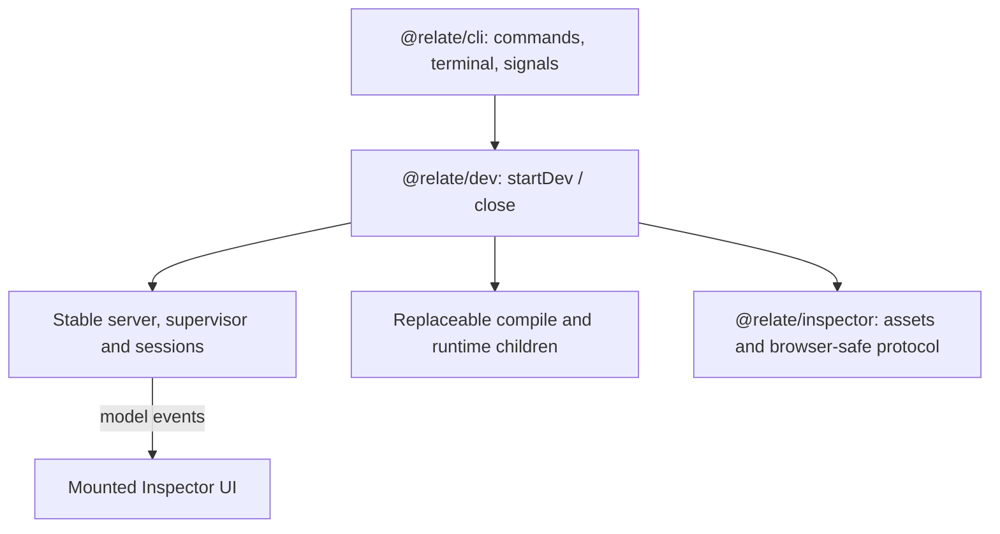

# @relate/dev

> Development baseline (`0.0.0-dev.0`), for discussion and contribution only.
> Not ready for application use. APIs and behavior are incomplete and may change
> without notice.

> [!WARNING]
>
> `relate dev` is implemented; other commands do not exist yet.

Local development lifecycle and Inspector backend, launched by `relate dev` or
embedded through `startDev`.

## `relate dev`

Serve the [inspector](../../apps/inspector/README.md) for the project's Relate
definitions and reload it on save. A replaceable compile child imports the
selected config, compiles `app.graph` with `relate/compiler` and reports a
Manifest or structured diagnostics over IPC; it never calls `setup`. For every
accepted build a separate **runtime host** child calls `startApp(app)` unchanged
(so `setup`, connectors and the app's chosen store run as in production) and
answers graph operations over IPC. The command never starts the application's
own HTTP server.

```sh
pnpm relate dev
pnpm relate dev --config ./packages/business/relate.config.ts
pnpm relate dev --port 4500 --open
pnpm relate dev --eval-timeout 60000
pnpm relate dev --no-runtime
pnpm relate dev --seed
pnpm relate dev --rotate-mcp-token
pnpm relate dev --allowed-origin https://my-private-forward.example
```

The config is an entry module exporting `defineApp(...)` from `relate` (or a
`defineGraph(...)` result) as its default export:

```ts
// relate.config.ts
export { default } from './src/relate/app.js';
```

Top-level imports of that module must be safe to evaluate; put connector and
credential work in `setup`, which only the runtime host calls.

Use `--quiet` to hide routine status lines while keeping the inspector URL,
application output, warnings and errors visible. Use `--no-runtime` to inspect
the model only: no runtime host starts, so `setup` never runs and no store is
opened.

A config that exports a bare graph (no `defineApp`) still gets a runtime host
with the in-memory store. When its sources need connections that only `setup`
can supply, the runtime reports a neutral `not-configured` state (printed once,
shown as **No runtime**) instead of failing on every save.

### Seed the development runtime

Export a function named `seed` from the config and opt in with
`relate dev --seed`:

```ts
// relate.config.ts
import type { Relate } from '@relate/node';
import { app } from './src/app.js';
import { Customer, Invoice } from './src/graph.js';

export default app;

export async function seed(relate: Relate<typeof app.graph>) {
  const customerId = await relate.host.adopt(Customer, 'crm_456');
  await relate.host.adopt(Invoice, 'INV-1042');
  console.log('Seeded customer:', customerId);
}
```

The runtime host calls this function with its own live runtime after `setup` and
the store revision check, before serving graph operations. It awaits the result;
any return value is ignored. The function can live in a separate module
re-exported by the config. Imported seed files are watched like other project
modules.

- Seeding runs once per runtime start, including every accepted reload, even
  when the graph definition is unchanged. Without `--seed` the export is
  ignored. Neither the compile worker nor ordinary `startApp(app)` calls it.
- `host.adopt` reads an existing source record and adds graph membership; create
  provider fixtures first, for example in `setup`. Use declared actions to
  create native records through `relate.as(principal).actions`.
- Make seeds repeatable. Adoption reuses the identity for the same source record
  within the same scope. For persistent stores, other writes need duplicate
  handling. A seed is not one transaction: completed writes remain if a later
  step fails, and external writes are not undone by an in-memory restart.
- A missing or non-function export reports `runtime.seed-missing` before setup.
  A thrown or rejected seed closes the runtime and reports
  `runtime.seed-failed`; the graph remains visible, but that runtime serves no
  operations. Seed errors appear in the terminal and inspector runtime
  diagnostics; `console` output goes to the terminal with the runtime prefix.
  Fixing the code and saving retries. A bare graph missing source bindings is
  also a startup error with `--seed`, explicitly reporting that the seed could
  not run. Fatal unhandled errors attempt cleanup before reporting failure,
  bounded by the five-second shutdown deadline; already completed writes are not
  undone.
- Setup, the store check and seeding share the 30-second runtime startup
  deadline. A stuck seed is terminated with `runtime.timeout`. `--eval-timeout`
  only changes the separate definition-loading deadline.
- `--seed` and `--no-runtime` cannot be combined. If a dev server already owns
  the project, a second invocation with a different `--seed` setting fails with
  instructions to stop and restart it. An older server that does not report its
  seed setting cannot be reused by a command requesting `--seed`. Matching
  invocations reuse the server without running another seed.

### What it prints

```text
  Relate dev
  Project    /work/my-product
  Config     relate.config.ts
  Inspector  http://127.0.0.1:4318/#token=…
  MCP        http://127.0.0.1:4318/mcp
             claude mcp add --transport http relate "http://127.0.0.1:4318/mcp" --header "Authorization: Bearer …"
             Append ?as=<principal> to act as another development principal
  Watching   application definitions
  Loading    attempt 1

  ready  gen 1  business  3 objects · 2 sources · 2 relationships  142ms
  runtime gen 1  running  in-memory store, data is lost on restart
  update src/relate/objects.ts          gen 2  +AccountReview.score  61ms
  runtime gen 2  running  in-memory store, previous data reset
  error  src/relate/graph.ts            attempt 3  1 issue; keeping gen 2
    policy.unknown-role: Unknown policy role 'finanse' in policy Invoice.read
    src/relate/graph.ts:24:22 (graph declaration)
    Graph path: policies.Invoice.read.gate
    Definition: business.invoice
```

- The inspector URL is printed and usable before the first model loads. Its
  fragment carries a per-instance bootstrap token; the page exchanges it for an
  HttpOnly, SameSite=Strict session cookie. Visiting the bare URL shows how to
  open the terminal link instead.
- The `MCP` lines carry the project's bearer token for `/mcp` (see [MCP](#mcp)).
  `--quiet` prints only the `Inspector` line and the `claude mcp add` line.
- Without `ANTHROPIC_API_KEY`, an `Agent      off: no ANTHROPIC_API_KEY` line
  gives the setup for the [built-in agent](#built-in-agent); nothing else
  changes.
- Successful loads advance the generation; failed attempts keep the last good
  model on screen and print structured diagnostics with `path:line:column`
  tokens relative to the invoking directory.
- Child `console.log`/`console.error` output is forwarded line by line as
  `[app attempt N stdout]` / `[app attempt N stderr]`; it never becomes a
  protocol message.
- Runtime host output is forwarded as `[runtime gen N stdout]` /
  `[runtime gen N stderr]`. A runtime failure (`runtime.setup-failed`,
  `runtime.store-revision-mismatch`, `runtime.seed-failed`, `runtime.timeout`,
  `runtime.exited`, …) prints `error  runtime gen N failed` with its
  diagnostics; the model stays published.
- Output is append-only and plain text when redirected or `NO_COLOR` is set.
  Standard output carries the banner, lifecycle lines and child stdout; standard
  error carries diagnostics, warnings and child stderr.

### Ports, locks and processes

- Binds `127.0.0.1` on the first free port from 4318 through 4327, or exactly
  `--port`. An occupied explicit port fails.
- One server per project, where the project is the real path of the directory
  holding the config. The lock and owner metadata live under
  `<project>/.relate/dev/` (gitignored). A second invocation prints the running
  server's complete bootstrap URL (including its token) and exits 0; `--open`
  opens it. A dead owner's lock is reclaimed automatically; an unverifiable one
  is reported and left intact. Reclamation uses an exclusive `lock.json.reclaim`
  guard. If a process crashes during reclamation, stop any remaining dev servers
  before removing the guard named in the error and retrying.
- Each attempt bundles the config with esbuild (project modules only;
  dependencies load from `node_modules`), writes it under `.relate/dev/build/`
  and runs it in a fresh Node child with source maps enabled. Loading and
  compiling must finish within `--eval-timeout` milliseconds (default 30000) or
  the attempt fails with `worker.timeout` and the child is terminated.
- Runtime host lifecycle: every accepted build (even with an unchanged Manifest)
  retires the current runtime, asks it to drain and close within five seconds,
  kills it if it does not, and then starts a new one with a fresh `runtimeId`.
  Requests addressed to a retired `runtimeId` fail with
  `ReadError('runtime-retired')` / `ActionError('runtime-retired')` and are
  never replayed on the new runtime; an action cut off by the kill rejects with
  `ActionError('uncertain')`. `setup`, the store check and any seed must finish
  within 30 seconds. With no store from `setup`, data lives in memory and is
  lost on every restart. A persistent store keeps its revision check, which runs
  eagerly at startup: an empty store gets the current revision written into it
  as soon as `relate dev` starts the runtime, and after a model change the
  runtime reports `runtime.store-revision-mismatch` and stays down, never
  resetting data. A `close` or a vanished dev server during a slow `setup` lets
  `setup` finish so `onDispose` cleanup runs, bounded by the same five-second
  deadline. The runtime host has no HTTP listener. Action inputs and results
  cross IPC by structured clone, so values JSON cannot represent (`NaN`,
  `undefined`, `Date`) reach validation unchanged, as in an embedded runtime.
- Environment variables are inherited from the invoking shell, except that the
  compile worker and the runtime host, which both import your modules, never
  receive `ANTHROPIC_API_KEY`; the command loads no `.env` files. Use the
  project's own loader: `pnpm exec dotenvx run -f .env -- pnpm relate dev`. The
  key is read only by the dev server's built-in agent; `execute` children
  inherit only `PATH`, and no browser payload carries it.
- Ctrl+C stops the watcher, terminates owned children (five seconds of grace, or
  immediately on a second Ctrl+C), closes the listener and releases the lock.
  Exit codes: 0 normal, 1 fatal startup or supervisor failure, 2 invalid
  arguments.

### Endpoints

All responses are `no-store`; Host is validated against the loopback origin plus
any `--allowed-origin`, and cross-site fetches are rejected.

| Route               | Session | Purpose                                                      |
| ------------------- | ------- | ------------------------------------------------------------ |
| `GET /`             | no      | Inspector shell (`no-cache`, strict CSP)                     |
| `GET /assets/*`     | no      | Content-hashed assets (`immutable`)                          |
| `GET /dev/instance` | no      | `{ instanceId, protocolVersion, ownerId }` for lock checks   |
| `POST /dev/session` | no      | Exchange `{ token }` for the session cookie; Origin required |
| `GET /dev/snapshot` | yes     | Current model, failure, runtime status and sequence          |
| `GET /dev/events`   | yes     | SSE: snapshot, then `model` / `diagnostics` / `runtime`      |
| `GET /dev/activity` | yes     | Activity snapshot (JSON), or SSE with `text/event-stream`    |
| `/dev/agent/*`      | yes     | The built-in agent; see [Built-in agent](#built-in-agent)    |
| `POST /mcp`         | bearer  | `@relate/mcp` `discover` / `execute`; see [MCP](#mcp)        |

The wire shapes are validated with `@relate/inspector/protocol`.

### MCP

`/mcp` mounts `@relate/mcp`'s stateless Streamable HTTP handler with
`createDevelopmentExecutor()` (a fresh Node child per `execute`; development,
not a sandbox), bound to the active runtime host:

```http
POST /mcp?as=alice
Authorization: Bearer <token printed by relate dev>
Content-Type: application/json
Accept: application/json, text/event-stream
```

| Request                                        | Response                                              |
| ---------------------------------------------- | ----------------------------------------------------- |
| Missing or wrong bearer token                  | `401` with `WWW-Authenticate: Bearer`                 |
| Any `Origin` header (browsers)                 | `403`; the inspector session cookie never applies     |
| Host not the loopback origin or allowed origin | `403` (the dev server's Host guard)                   |
| `?as=` not declared in `defineGraph`           | `404` naming the declared principals                  |
| No `?as=`                                      | The model's default (first declared) principal        |
| Runtime cannot serve the principal             | Immediate `binding-unavailable` tool error (below)    |
| Otherwise                                      | `runtime.binding(principal)`: pinned to its runtimeId |

Origin, token and principal are checked before the request body is read; only an
authenticated request is parsed and recorded as activity.

The token is 256 random bits per project, kept in `.relate/dev/mcp-token` (mode
0600, next to a `.gitignore` of `*`) and reused on every start, so a saved
`claude mcp add` entry survives restarts. A missing or malformed file, or
`--rotate-mcp-token`, issues a new one. Each HTTP request binds afresh, so a
request after a restart reaches the new runtime; operations inside an execution
stay pinned to the runtime that execution started on and fail with
`runtime-retired` after it.

When the runtime cannot serve the principal, `runtime.binding()` rejects with a
`RuntimeUnavailableError { reason, retryable }`, which `/mcp` forwards as
`@relate/mcp`'s `BindingUnavailableError`. The MCP handshake still succeeds and
both tools report it:

```json
{
  "error": {
    "code": "binding-unavailable",
    "message": "The runtime is restarting; retry shortly",
    "retryable": true
  }
}
```

| Situation                                           | `retryable` |
| --------------------------------------------------- | ----------- |
| Starting or restarting; no model compiled yet       | `true`      |
| Principal declared by the model, not by the runtime | `true`      |
| Runtime failed or not configured; `--no-runtime`    | `false`     |

### Activity

The dev server records what MCP clients do in `src/activity/`, without changing
`@relate/mcp`. The runtime records the graph operations themselves
([activity spec](../../specs/2026-10-13-activity.md)); the dev server joins its
own events to the runtime's rows:

```text
/mcp request ─ L1 observeRequest ─▶ execute ─ L2 observeExecutor ─▶ graph.objects.X.query()
requestId                            executionId
  ─▶ runtime binding (observeDispatch) ─ IPC { attempt: { operationId, context } } ─▶ runtime host
     operationId (UUIDv7)                                                          relate.host.dispatch(...)

runtime host ─ { type: 'activity', feed, operations } ─▶ projectActivity ─▶ activity log
```

- **Dispatch event.** The runtime binding assigns each operation a fresh
  operation ID and records a `running` operation event with bounded request
  previews (filter, selection, input). It settles with the transport's answer,
  including the error message and issues the caller saw. A call that never
  reached the engine (`runtime-retired`, a killed host) has only this event and
  says what the transport reported, never an engine result.
- **Runtime record.** The host runs the call with
  `relate.host.dispatch(principal, { operationId, context }, method, args)`, so
  the runtime's operation row has the same ID. For about a second after each
  call, the host forwards rows whose context names its `runtimeId`: settled
  operation rows (newest first, down to the last pass) and committed feed
  entries (from a checkpoint taken at startup). Seeds and earlier history in a
  persistent store are not forwarded. `src/activity/forwarding.ts` owns polling,
  checkpoints and runtime filtering; the runtime host starts it, schedules
  passes and flushes it during shutdown.
- **Projection.** A runtime row merges into the dispatch event with its ID, in
  either order, and is authoritative for the outcome; nested refreshes and
  committed entries (`created`, `updated`, `invocation-succeeded`, …) join the
  request by request ID. Their `runtime` summary says `attempt` or `committed`,
  with actor, parent operation, replay, refresh result, refused field IDs, and
  feed position. Values never cross.

Every event carries an `OperationContext`
(`{ requestId, runtimeId, definitionRevision, principal, transport, executionId? }`);
`executionId` is present only when agent JavaScript made the call. Events
(`call`, `execution`, `operation`) are upserts keyed by ID. The log is a ring
buffer of the last 200 finished requests (a running request is never evicted;
late events of an evicted one are dropped) with 500 operation events each. A
runtime row opens an event only within a request the log holds. Every
caller-controlled string is bounded: identifiers, keys and cursors to 256
characters, previews to 1 KiB, code and logs to 16 KiB each, with a 64 KiB
per-event backstop that keeps the runtime summary.

Runtime rows are best effort: a missing one is not evidence that nothing
happened, and the store's feed stays the record of what committed.

### Built-in agent

`src/agent.ts` runs the inspector's agent loop in the dev server with
`@anthropic-ai/sdk`: model `claude-opus-5-5`, streamed, adaptive thinking with
effort `high` set explicitly and `max_tokens` 64,000. Refusals are shown without
switching to a fallback model. The key comes from `ANTHROPIC_API_KEY` in the dev
server's environment only; without it the agent reports `missing-key` and
`POST /dev/agent/turns` answers `503` with the setup line.

The model reaches the graph exactly as an external client does: an
`@modelcontextprotocol/client` connects over loopback to this server's own
`/mcp?as=<principal>` with `McpEndpoint.agentToken`, a second bearer token that
exists only in memory (never printed or written). Calls with it are recorded as
`source: 'inspector-agent'`, and each names its activity request ID in
`params._meta['dev.relate/requestId']`, so a chat tool call links to its
activity entry while it runs. Any other caller's `_meta` ID is ignored.

```text
browser ─POST /dev/agent/turns─▶ agent loop ─messages.stream─▶ Anthropic API
                                     │ tool_use toolu_1
                                     └─tools/call _meta{requestId}─▶ /mcp?as=alice ─▶ runtime host
```

Per turn: MCP tools map field by field to Anthropic tools (`inputSchema` →
`input_schema`); `stop_reason` is checked before any tool runs (`refusal`,
`max_tokens` and `model_context_window_exceeded` leave tool calls unrun and
answered as such); every `tool_use` of a response runs and all `tool_result`s
return in one user message; history is append-only. A turn stops after 40 model
responses.

| Route                                            | Body / reply                                                     |
| ------------------------------------------------ | ---------------------------------------------------------------- |
| `GET /dev/agent/conversations`                   | `AgentSnapshot`: availability and one conversation per principal |
| `GET /dev/agent/events`                          | SSE: `AgentSnapshot`, then `turn` / `message` / `text` events    |
| `POST /dev/agent/turns`                          | `{ principal, text }` → `202 { turnId, principal }`              |
| `POST /dev/agent/turns/:turnId/cancel`           | `202 { turnId, principal }`, or `404` when not running           |
| `POST /dev/agent/conversations/:principal/reset` | `202 { principal }`; `404` undeclared, `409` while a turn runs   |

Turn requests need the session cookie, the page's own `Origin` and a JSON body.
`400` for an empty or oversized message, `404` for an undeclared principal,
`409` while that principal already has a running turn or before the first model,
`503` without a key. Conversations are in memory, one per principal; a turn is
pinned to the principal it started with. Cancelling aborts MCP setup, the model
stream and any in-flight `tools/call`. History records that the developer
cancelled the turn and it must not be resumed without an explicit request. A
cancelled call is answered to the model as cancelled with an unknown outcome and
never retried. A retryable `binding-unavailable` result reaches the model
unchanged. A reset clears that principal's history and display and emits a
`reset` event. Thinking is requested with `display: 'summarized'` and streamed
as `thinking` messages. When the running runtime changed since a conversation's
previous turn, the next user message starts with a note that earlier reads may
be stale. Shapes are in `@relate/inspector/protocol` (`agentEventSchema` and
friends).

## Playground

`createPlayground` owns authenticated discovery and code execution at
`GET /dev/playground/discovery?as=<principal>` and `POST /dev/playground/runs`.
It uses the active runtime binding and development executor, records runs in
Activity, and preserves the principal-specific discovery and result evidence
used by the editor. See the
[Inspector guide](../../apps/docs/content/authoring/inspector.md) for editor
tabs, completion and result tables.

## Programmatic API

```ts
import { startDev } from '@relate/dev';

const dev = await startDev({
  cwd: process.cwd(),
  runtime: true,
  onEvent(event) {
    if (event.type === 'warning') console.warn(event.message);
  },
});

console.log(dev.inspectorUrl);
// The embedding application owns when to stop.
await dev.close();
```

`startDev` resolves when the listener and watcher are ready; the initial model
and runtime may still be loading. `onEvent` reports project resolution,
listening, loading, model readiness/updates, diagnostics, runtime status,
notices, warnings and child output. It does not install process signal handlers,
write to the terminal or open a browser. `env` defaults to `process.env`;
`isOutputSaturated(stream)` lets an embedding caller apply output back-pressure.

`DevService.kind` is `started` when this call owns the service, or `existing`
when the same project/config/port/seed setting already has a verified owner.
Both return `project`, `pid`, `inspectorUrl`, `mcpUrl` and an optional
`mcpCommand`. `close()` is idempotent; on an `existing` handle it is a no-op.
Options are validated before any project resources are acquired. `port` accepts
integers from 0 through 65535 (`0` requests an available port); `evalTimeoutMs`
accepts integers from 1 through 2147483647. `allowedOrigins` accepts exact
HTTP(S) origins, normalizes trailing slashes and default ports, and requires
HTTPS except on loopback. Invalid options throw `DevOptionsError`; `seed: true`
requires the runtime. The CLI additionally requires an explicit port to be at
least 1.

Startup failures retain their original error even if cleanup also fails. An
unverifiable owner throws `DevStartError` with `lock: { reason, path }` for the
caller to present. Shutdown failures reject `close()` with an `AggregateError`
after attempting every disposer. The CLI formats these errors and exits with
code 1. During startup it retains Node's default signal behavior; after startup
it closes the service on a signal.

`close({ immediate: true })` also terminates a pending compile child without its
grace period, including during an ongoing close.

**Supervisor** means the long-lived model state and event publisher. **Runtime
host** means the replaceable child process running application code. An accepted
build replaces the runtime host, never the supervisor, HTTP server, sessions,
activity log or agent conversations. Failed builds retain the last good model.
The browser applies model events without remounting the UI, so selection and
camera state survive while their definitions remain. Playground tabs retain
their existing browser storage behavior.



| Owner                            | Responsibility                                                        |
| -------------------------------- | --------------------------------------------------------------------- |
| `packages/cli/src/commands/dev/` | Flags, terminal rendering, browser opening and signals                |
| `packages/dev/src/start.ts`      | Service composition, startup failure cleanup and shutdown             |
| `packages/dev/src/`              | Builds, watching, children, HTTP, MCP, playground, agent and activity |
| `apps/inspector/src/`            | Browser UI, shared wire protocol and static asset serving             |

The shared wire schemas remain at `@relate/inspector/protocol`: neither the
browser nor the protocol depends on the Node development service. This keeps the
package dependency direction acyclic. Runtime consumer operations continue to
use `@relate/protocol`.

Lower-level development components are exported from `@relate/dev` for tests and
custom composition, including `createDevServer`, `Supervisor`,
`createRuntimeController`, `createPlayground`, `createAgent`,
`createMcpEndpoint`, `createBuilder`, `createWatcher` and the activity helpers.

`createAgent` takes its model client and tool connection as parameters, so a
test can drive it without the network:

```ts
const agent = createAgent({
  env: process.env, // reads ANTHROPIC_API_KEY only
  principals: () => ({ names: ['alice', 'bob'] }),
  connect: connectLoopbackMcp({ url: `${origin}/mcp`, token: mcp.agentToken }),
  createClient: (apiKey) => fakeAnthropic, // default: new Anthropic({ apiKey })
});

const { turnId } = agent.send('alice', 'How many notes can I see?');
agent.cancel(turnId);
```

A `RuntimeBinding` is one `(runtimeId, principal)` view of the runtime host:

```ts
const runtime = createRuntimeController({
  projectRoot,
  configPath,
  env,
  onStatus,
  writeStdout,
  writeStderr,
});

await runtime.restart({ generation: 1, bundle });
const alice = await runtime.binding('alice'); // a principal from defineGraph({ principals })

alice.operations.discovery.describe(); // prefetched snapshot, synchronous
await alice.operations.query('business.customer'); // IPC, pinned to alice.runtimeId
```

## Not yet implemented

- Persisting agent conversations across `relate dev` restarts.
- A consumer HTTP API at `/api` (reserved).
- Remote MCP clients (such as ChatGPT) through a public tunnel; `/mcp` is
  loopback-only and `--allowed-origin` covers browser origins, not tunnels.
- Type diagnostics (`typecheck` events) from a watch-mode type checker.
- Telemetry; no collector exists in this scope.
- Watching non-imported files read at evaluation time.
- Operational commands such as running `@relate/postgres` migrations.
