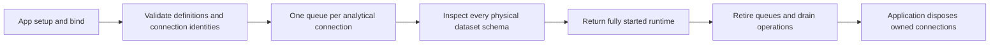
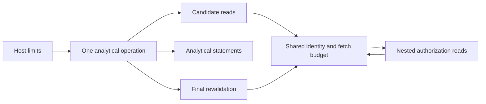

# @relate/node contract

Detailed behavior of the current slice. For an overview of the package, see
[README.md](./README.md).

Application composition for typed, authorized object reads. Private and
unpublished while implementation is in progress.

`defineApp` and `bind` are exported by `relate`. An app definition holds the
graph and deferred setup without executing it. `startApp` from `@relate/node`
runs setup, compiles the graph, creates the runtime, and owns cleanup registered
through `onDispose`. The inspector can compile `app.graph` without running
setup. Direct embedding can use `createRuntime` instead.

```ts
import { createRuntime } from '@relate/node';
import { bind } from 'relate';
import { assertFields } from 'relate';

const relate = createRuntime({
  graph, // defineGraph({ objects: { Customer }, access, policies, ... })
  bindings: [
    bind(customers, {
      connectionId: 'crm-primary',
      resourceId: 'records',
      providerAccountId: 'provider-account-123',
      connector,
    }),
  ],
});

try {
  const id = await relate.host.adopt(Customer, 'crm_456');
  const { objects } = relate.as(principal);
  const customer = await objects.Customer.get(id, { select: ['name'] });
  assertFields(customer, ['name']);
  console.log(customer.data.name); // string
} finally {
  await relate.close();
}
```

The host authenticates `principal`. `as` snapshots it and exposes only consumer
operations; trusted adoption stays on `host`. Reads do not adopt records.
Registry keys name the consumer API; stable definition IDs identify persisted
objects. Adoption accepts the registered object definition, not another object
that happens to have the same ID.

Runtime creation snapshots the graph's object, relationship, and action
registries. Later changes to the caller's registries or options do not change
the methods exposed by `as`; those methods stay aligned with the compiled model
and its discovery. Registered definition identities are preserved for adoption
and receipt lookup.

## Analytical startup validation

For a graph containing datasets or computed properties, `startApp` initializes
`@relate/sql-parser` and injects its synchronous parser into the runtime.
Ordinary apps do not import or initialize the parser. Every declared calculation
is resolved at startup, including declarations that no actor has selected or can
read. Invalid SQL, names, scalar types, named parameters and computed
dependencies fail with structured `CompileError` issues identifying the authored
property. Startup failure runs the registered disposal callbacks.

Analytical graphs use `startApp` because physical-schema inspection is
asynchronous. `createRuntime` remains synchronous for ordinary graphs and
rejects analytical graphs with guidance to use `startApp`. The initialized
parser is an internal startup dependency, not an application readiness handle.

## Dataset bindings and physical schemas

`bind(Events, connection.table('events'), { columns: { customerId: 'customer_id' } })`
retains the selected analytical resource and its original connection. Unmapped
columns keep their declared names. Every registered dataset requires exactly one
binding, using the registered definition instance. Unregistered bindings,
unsupported capabilities, invalid identities and conflicting connection
instances with the same `connectionId` fail startup before schema inspection.
Selected source and dataset resources can share one connection object.

Node creates one statement queue per analytical connection, shared by all its
dataset bindings. Every startup inspects every bound dataset through the
connector's `describe`, including unused datasets. Each declared column must be
present and advertise its exact logical type and timestamp precision. A
non-nullable declaration cannot use a nullable physical column; a nullable
declaration can use a non-nullable physical column. Inspection does not scan
rows. Driver failures retain their cause internally and expose a sanitized
startup message. Schema mismatches identify the declared dataset and column.

The runtime stays private until these asynchronous checks complete. Failure
retires its queues and releases app resources; close retires queues before
waiting for operations and before application disposal. Supplied connections
remain owned by application setup, so multiple dataset bindings do not cause
multiple connection closes. Explicit custom source bindings may supply
`connection` to establish shared ownership; otherwise their keyed connector
object is their identity for conflict detection.



Analytical `get` and ordinary query pages execute selected declared calculations
and caller `compute` expressions through the bound connector. Queries with
computed filters or ordering evaluate the full authorized ordinary-filter scope
before selecting a page, then recheck that page before returning it.

## Analytical operation limits

Application setup may return host-owned limits alongside its bindings:

```ts
return {
  bindings,
  analytics: {
    operationTimeoutMs: 60_000,
    maxSourceCalls: 100_000,
    maxCandidatesScanned: 12_500,
    maxCandidatesAdmitted: 10_000,
  },
};
```

These are the operation defaults. The same `analytics` object also accepts:

| Setting                   | Default | Scope                                                            |
| ------------------------- | ------- | ---------------------------------------------------------------- |
| `maxSqlBytes`             | 4,096   | UTF-8 SQL bytes per expression                                   |
| `maxParsedNodes`          | 256     | Parsed syntax nodes per expression                               |
| `maxParameters`           | 16      | Distinct named parameters per expression                         |
| `maxParameterBytes`       | 1,024   | UTF-8 bytes in each parameter's JSON encoding                    |
| `maxExpressions`          | 8       | Caller expressions plus selected or required declarations        |
| `maxKeysPerStatement`     | 1,000   | Authorized object slots, reduced by connector parameter capacity |
| `statementTimeoutMs`      | 5,000   | Statement execution, excluding queue wait and connection startup |
| `maxConcurrentStatements` | 4       | Running statements per configured connection                     |
| `maxQueuedStatements`     | 32      | Waiting statements per configured connection                     |
| `queueTimeoutMs`          | 2,000   | Maximum time waiting for a statement slot                        |

All values must be safe integers. Source, scan, admission and queue-depth limits
may be zero. `queueTimeoutMs: 0` rejects work that would have to wait; zero
queue depth rejects when all running slots are occupied. Other values must be
positive. All three timer limits must be at most 2,147,483,647 ms. Unknown keys
and invalid values fail startup and run registered disposal callbacks, including
for ordinary apps that supply analytical settings. Limits are copied before
parser initialization or resource inspection; later mutation cannot change them.

The same SQL and parameter limits govern declaration startup validation,
authorized discovery and request preparation. Selected declarations and caller
expressions share the expression budget. Invalid expressions fail before
candidate reads, including an empty query scope. Batching cannot exceed the
connector's physical parameter limit. Queues are shared by all dataset bindings
and actors on a configured connection; binding another dataset does not create
additional capacity. Statement slots remain occupied until connector cleanup
settles. Connector startup and cancellation bounds are configured on the
connection itself, separately from `statementTimeoutMs`.

Computed filter/order queries count every scanned member, including rejected
objects, against `maxCandidatesScanned`. Objects passing ordinary policy and
filters count against `maxCandidatesAdmitted`; exceeding either cap rejects
before analytical SQL. Ordinary page-first queries retain their 100-member scan
bound. These caps never return a truncated computed order.

Every analytical get or query page has one deadline and source-call budget,
shared by candidate reads, source-backed authorization dependencies, and final
revalidation. Both provider identity checks and fetch attempts consume the
budget. Cached application-identity reads consume none; zero permits those
reads. Each concurrent operation has its own budget. A consumer `timeoutMs` can
shorten the host deadline but cannot extend it. Consumers cannot set host limits
through read options. Activity capture does not affect enforcement.

Exceeding the source budget rejects with `invalid-request` / `not-supported`,
with guidance to narrow ordinary filters or adjust host configuration. An
expired deadline rejects with `unavailable`; runtime retirement rejects with
`runtime-retired`. These failures cannot return stale fallback or partial
analytical results. Cancellation reaches provider identity and fetch signals;
providers must honor those signals to stop their own work. Storage and arbitrary
provider JavaScript cannot be forcibly interrupted. Analytical connector
cancellation retains its joined cleanup contract.

The defaults are safeguards exercised by the retained
[scope-first capacity and refresh measurements](../../tests/performance/analytical-properties/README.md#retained-measurements).
Those runs cover 10,000 admitted candidates and 100,000 events with synthetic
source behavior. They are not evidence that every provider or policy shape
finishes within a minute; deployments still need their own capacity validation.



## Actor-bound discovery

The consumer API exposes progressive, synchronous discovery:

```ts
const consumer = relate.as(principal);
const graph = consumer.describe();
const customer = consumer.objects.Customer.describe();
const action = consumer.actions.addAccountReview.describe();
```

`consumer.describe()` returns graph identity and description plus complete
`objects` and `actions` maps keyed by SDK/API name. Each object includes its
description and a `traversals` map (target API name, cardinality, description).
Each action includes its description and readable `creates` object names.
Traversal targets and created types always exist in the visible objects map;
unsupported or unauthorized edges are omitted. Unauthored descriptions are
omitted, and empty collections remain `{}` or `[]`. Object detail returns its
API identity, display metadata, authorized properties and available traversals.
Action detail returns input, output, declared failure fields and readable
created-object types. Every result is frozen and JSON-serializable.

Discovery applies object read-role, field-group, relationship-reference, and
action execute-role gates. An input reference to an object the actor cannot read
removes that action from discovery. Object and action methods remain in the
graph-typed TypeScript SDK; their `describe()` returns `undefined` when the
actor cannot discover that definition. All describe methods reject after the
runtime closes.

Record-dependent policy predicates cannot be decided from metadata. Discovery
therefore means an actor may attempt the operation; ordinary execution still
checks the referenced records, actor claims, current authorization, and
availability. Discovery never exposes source IDs, connector fields, role names,
claim names, or policy predicates.

`consumer.describe().sdk` is the concise SDK guide shared by every graph and
actor: discovery/read/action/receipt calls, read options and defaults, essential
record/page shapes, pagination, evidence, read-error guidance and
graph-membership semantics. Each option carries its description/default and
accepted operation kinds; printed signatures use these lists. It omits verbose
shape catalogues. The full `operationContracts` remains available from
`@relate/runtime` for tooling, outside root discovery. Object detail adds this
SDK's call paths: `operations.get.call`, `operations.query.call` and each
traversal's `call`, such as `objects.Customer.traverse.invoices(id, options?)`,
beside the runtime's `returns` types and each property's `filter` text.
`String(operation)` and `util.inspect(operation)` return the call signature for
`get`, `query` and each traversal function, not implementation source.

Every object detail reports `query.collectionScope: 'graph-membership'`. Queries
and traversal enumerate adopted source-backed records or Relate-native records;
exhaustion is not a claim that every matching provider record has been
discovered.

Adoption returns `ObjectId<typeof Customer.id>`. `get` and traversal arguments
require the starting object's branded ID; result IDs and reference fields carry
their own or referenced object's brand. An Invoice ID cannot be passed to
`Customer.get`. The values remain strings in memory, storage, and JSON. For IDs
received from a route or decoded JSON, use
`referenceInput(Customer).parse(rawValue)` from `relate`. This validates a
nonblank string and declares its expected type; runtime membership and access
checks still apply. Provider source keys belong in `host.adopt`, not `get`.

`get` preserves selected property types and returns `ok` or `not-found`. An `ok`
result includes the canonical `id`, selected `data`, and existing read evidence.
Selected fields stay optional because authorization or availability can withhold
them. `assertFields` narrows fields actually present. Omitting `select` requests
all authorized fields. Refresh, stale fallback and strict completeness options
are the same as the underlying engine.

`bind` binds the actual source definition to a selected resource. Its connection
supplies `connectionId`; its table or API resource supplies `resourceId`.
Bindings use shared service authorization by default (the only supported mode).
Missing, duplicate or unregistered bindings fail at construction. Explicit
provider denial must use `SourceAccessDenied` from `relate/connectors`; ordinary
errors mean temporary unavailability.

Compilation belongs here; `@relate/runtime` still consumes portable compiled
models. Named registries are supported by the compiler alongside existing array
definitions. This API requires a named registry to infer consumer operations.
Supported schemas and policy predicates remain those of `relate`.

Storage defaults to isolated volatile memory; `graphId` defaults to the graph
definition ID. An injected `store` is borrowed: the caller owns migrations and
closing it. `close()` rejects new operations, waits for in-flight operations,
and flushes captured operation rows within `activity.flushTimeoutMs`; it does
not close borrowed storage or provider clients.

Native account-review actions now execute with authorized creation, rollback and
successful receipts and actor-bound lookup/replay; see
[the walkthrough](./NATIVE_ACTIONS.md#wait-for-completion-lookup-and-recovery).
Graph queries execute for source and native members; see the
[query contract](../runtime/CONTRACT.md#graph-queries). Provider-wide queries,
automatic synchronization, servers and workers remain unimplemented. See the
complete runnable [todo/notes example](../../examples/01-todo-notes/README.md).

Source-backed references and nested read policies support Invoice reads:

```ts
const invoice = await relate.as(ana).objects.Invoice.get(invoiceId, {
  select: ['customer', 'status', 'totalMinor'],
});
```

`customer` is the already-adopted Customer's Relate ID. Ana must match its
portfolio; `totalMinor` additionally requires finance. Another portfolio or
missing/expired policy evidence returns `not-found`. See the executable
[model and acceptance cases](../../dev/fixtures/customer-graph/invoice-read/README.md).

## Bidirectional traversal

Register a `defineRelationship` in `graph.relationships`, using the Invoice's
Customer reference for both directions. Traversal names and selected fields are
inferred from that registry:

```ts
const objects = relate.as(ana).objects;
const page = await objects.Customer.traverse.invoices(customerId, {
  select: ['status', 'totalMinor'],
  limit: 25,
});
const customer = await objects.Invoice.traverse.customer(invoiceId, {
  select: ['name'],
});

for await (const invoice of objects.Customer.traverse.invoices(customerId)) {
  console.log(invoice.id, invoice.data);
}
```

To-many traversal returns a lazy `QueryResult`: await one page or iterate
records across continuations. To-one returns the same `ok`/`not-found` object
shape as `get`. The starting object, reference field and destination must all be
readable; finance does not override portfolio access. Hidden and missing
starting objects produce the same empty final page or `not-found`, according to
cardinality.

Pages enumerate adopted objects, with up to 100 candidates checked per request.
They default to 25 returned records, capped at 100. Empty pages may have a
continuation; final pages have `meta.exhausted: true` and omit the cursor.
Unknown membership evidence on an otherwise readable object rejects with
`ReadError('incomplete')`. This is live enumeration, not a snapshot or a claim
of complete provider coverage.

Cursors hide the scan boundary and bind the caller, graph revision, bindings,
starting object, traversal and options. They expire after 15 minutes. The
default key is private to each runtime; supply the same secret 32-byte
`cursorKey` to trusted runtimes sharing storage if continuations must survive
restarts or move between instances. Every page rechecks current access.

## Host activity, attribution and shutdown

`operations(principal, context?)` accepts trusted request context such as
`{ requestId, transport: 'mcp' }`. The principal always supplies the actor.
Without context, embedded calls receive a fresh request ID per call. Request IDs
group calls; every operation still has its own operation ID.

`host.adopt(Object, sourceRecordId, { actor?, context? }?)` defaults to the
system actor `relate.host`. The host may explicitly attribute adoption to an
importer or another system actor. This attribution does not grant read access.

The host surface also provides:

- `host.activity.status()` for store support, durability and capture status.
- `host.activity.feed.read(options?)` for committed changes and invocation
  events in publication order, atomic with their corresponding stored state.
- `host.activity.operations.list(options?)` for best-effort operation history,
  newest recorded first. A missing operation row does not prove no work
  occurred.
- `host.provenance({ objectDefinitionId, objectId })` for creation/adoption
  attribution independent of history retention. Unknown objects return
  `undefined`; legacy objects return `{ kind: 'unknown' }`.
- `host.activityCounters()` for capture drop and truncation counters.
- `host.flushActivity()` to wait up to `activity.flushTimeoutMs` for captured
  rows to be appended or dropped. It returns `'pending'` if rows remain at the
  deadline, otherwise `'flushed'`; it does not stop new work.

A trusted transport can dispatch a consumer method with its own operation ID:

```ts
await relate.host.dispatch(
  principal,
  { operationId, context: { requestId, transport: 'mcp' } },
  'query',
  ['business.customer', { limit: 10 }],
);
```

`operationId` must be a fresh UUIDv7 per call. `method` is a
`ConsumerOperations` method other than `discovery`; `args` are that method's
arguments. The principal supplies the actor, and normal consumer authorization
still applies. This lets transport diagnostics and runtime history share an ID.

None of the host APIs is exposed through `as`, `ConsumerOperations` or MCP. See
[Activity & Provenance](../../apps/docs/content/runtime/activity.md) for capture
defaults, filtering, cursor semantics, retention and unsupported stores. The
public types are in [types.ts](./src/types.ts).

Shutdown drains in-flight work before flushing captured operations. At the flush
deadline, queued rows are reported as dropped with reason `shutdown`. Borrowed
stores remain open; close the runtime before closing its store. `startApp` then
runs registered disposal callbacks. Operation capture is best effort and is
separate from the feed's atomic publication guarantees.
