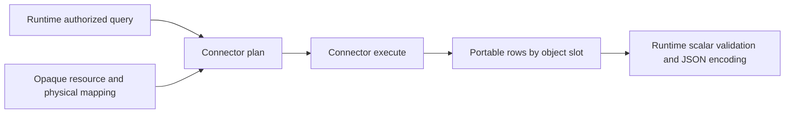
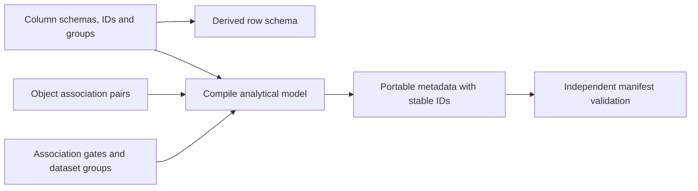
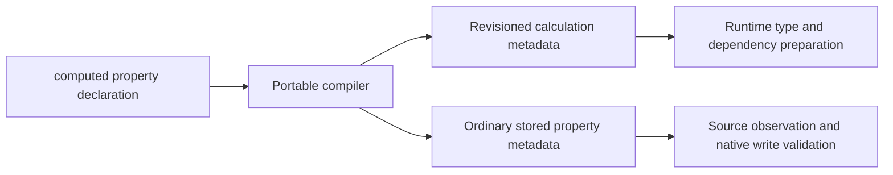
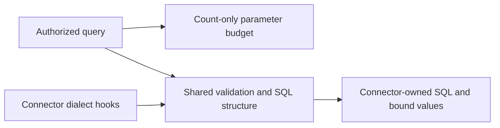

# relate contract

## Portable application and extension contracts

`bind`, `defineApp`, and their `Binding`, `AppBindings`, `AppDefinition`, and
`AppSetupContext` types belong to `relate`. `bind` creates a frozen binding and
defaults authorization to `shared-service`; it does not open a connection.
`defineApp` preserves the exact graph type and stores deferred setup without
invoking it. `isAppDefinition` recognizes the descriptor across module
instances. Execution and registered cleanup belong to `startApp` in
`@relate/node`.

`relate/connectors` owns `SourceConnector`, `SourceRecord`, `SourceVersion`,
`SourceBinding`, `SourceResource`, `ResourceConnection`, and
`SourceAccessDenied`. A selected resource carries its connection identity and
resource ID. `bind` derives its keyed selection from the source definition
through `bindSource`. Provider resources require an expected account;
application-owned resources cannot assert one. Custom adapters may supply an
explicit `SourceBinding` configuration. The resource-read contract covers:
account identification and fetching a known source record ID. It does not yet
define system factories, resource discovery, synchronization, or external
writes. Account evidence and denial/deletion semantics are unchanged; see the
[runtime contract](../runtime/CONTRACT.md).

`relate/storage` exports storage interface types needed by app setup and runtime
implementations. `@relate/runtime/storage` continues to re-export those types
alongside its errors and observation-ordering implementation. Neither portable
extension entry point imports graph authoring, compiler, or host code. The root
`relate` entry point has no runtime or Node-host dependency.

Import migration: authoring helpers previously exported by `@relate/node` now
come from `relate`; connector types and `SourceAccessDenied` previously exported
by `@relate/runtime` now come from `relate/connectors`.

Detailed behavior of the current slice. For an overview of the package, see
[README.md](./README.md).

TypeScript authoring and compiled-model contracts for authorized Customer and
Invoice reads and native account-review actions. Private and unpublished while
implementation is in progress.

- `relate`: `defineSource`, `source`, `defineObject`, `objectId`, `native`,
  `from`, `reference`, `referenceInput`, `defineRelationship`, `defineAccess`,
  `defineGraph`, `assertFields`, `nativeMembership`, `defineAction`,
  `implementAction`.
- `relate/compiler`: `compile`, with deterministic SHA-256 definition revisions.
- `relate/model`: portable manifest validation and types for runtime
  integrations.

Authoring imports do not import the compiler or Node APIs. The compiler
validates explicit stable `id` values, source references, canonical identity,
field classifications, and policy dependencies, then returns an immutable,
serializable manifest. Property renames preserve their IDs and change the
definition revision.

The current manifest format is **7**. Source observations, native values,
authorization evidence and persisted value history use stable property IDs;
consumer results retain property names. Formats 1 through 6 must be recompiled.
Format 4 added portable scalar bounds and declared action failure schemas;
format 5 added portable graph discovery descriptions; format 6 added timestamp
semantics to scalar schemas; format 7 adds analytical dataset and association
metadata with column policies and correlation IDs. Recompilation also changes
the installed revision, preventing an existing name-keyed store from being read
as ID-keyed data. Existing installations need an explicit data/revision
migration; see the
[storage contract](../runtime/STORE_CONTRACT.md#property-identity).

This slice supports a single membership source per object, scalar string/number/
boolean fields (including optional/nullable wrappers), a generated canonical
string object ID, explicit ordinary/restricted field groups, role gates, and
root and nested property-to-claim equality predicates. Each registered object
requires a read policy; use `read: 'deny'` for intentional denial. Source
schemas use ordinary `z.object` definitions. Unmapped JSON fields are retained
privately.

Arbitrary refinements, transforms, defaults, nested property values, and custom
policy handlers are rejected rather than silently compiled away. Policies in
this slice are fully declarative, so no executable handler registry is needed
for authorization. Native scalar properties, native references, action contracts
and create policies are supported; see the
[native action walkthrough](../node/NATIVE_ACTIONS.md). Release artifacts,
schema evolution, external actions and additional source bindings remain future
implementation work. The installed graph is pinned to one definition revision;
incompatible activation requires an explicit migration.

See [the runnable example](../../examples/01-native-objects/README.md).

Named object registries (`objects: { Customer }`) preserve consumer API names
and property inference through `@relate/node`. Objects and policies use matching
registry keys. Registry names do not replace stable definition IDs. `ObjectData`
and `PropertyNames` expose selected property types; selected values remain
optional because reads can withhold unavailable fields.

## Object names and display metadata

The object registry key is the canonical public API name. For example,
`objects: { AccountReview }` compiles to `apiName: 'AccountReview'` and names
`consumer.objects.AccountReview` in the typed SDK. API and SDK integrations must
use this machine name, never a display label. Separate route and SDK name
overrides are not part of the contract.

Graphs and objects optionally declare presentation metadata:

```ts
const AccountReview = defineObject({
  id: 'business.account-review',
  label: 'Account review',
  pluralLabel: 'Account reviews',
  description: 'An assessment of a customer account and its next steps.',
  // membership and properties…
});

const graph = defineGraph({
  id: 'business',
  description: 'Customer accounts, invoices, and account reviews.',
  // objects, access, and policies…
});
```

`label` defaults to a humanized registry key (`AccountReview` becomes
`Account Review`). `pluralLabel` defaults to the resolved singular label; Relate
does not guess plurals. Supply explicit collection labels such as `People` where
needed. `description` stays absent when omitted. Supplied labels must be
nonblank; different object types may share display labels.

Compilation resolves labels and preserves graph and object descriptions plus
`apiName`, `label`, and `pluralLabel` in the portable manifest. Display changes
preserve API addressing and definition IDs. Registry key changes rename the
public API but preserve definition IDs. Both changes affect the definition
revision; the existing installed-graph revision checks still apply.

Migration: replace object-level `name` with `label`, optionally add
`pluralLabel` and `description`, and recompile. Manifest format 2 introduced the
replacement of object `name` with `apiName` and the resolved display labels. Old
manifests are rejected; format 1's discarded registry keys cannot be recovered
safely from display labels. Property and relationship names retain their
existing meaning.

Properties, directional traversals, actions, and action fields can also explain
their business meaning. Property helpers accept `description`; relationship
directions accept `{ name, description }`; actions accept `description`.
Ordinary action fields use Zod `.describe()`, while branded references use
`referenceInput(Customer, { description })`. These descriptions affect the
definition revision but never API addressing, identity, access, or validation.

Each object declares exactly one `objectId({ id })` property, conventionally
named `id`. Relate owns its string schema and generates its value on adoption.
There is no object-level `key` selector. `defineObject`, the compiler, and
manifest validation reject missing or multiple ID properties.

`defineObject` creates a frozen copy of each property and binds it to the
returned object through `.owner`. It leaves the input properties unchanged;
reusing them in another definition creates separate bound copies. Use properties
from the returned object, such as `Invoice.properties.customer`, when defining
relationships.

`id` identifies a graph, source, object, or property definition and stays stable
across renames. `objectId` identifies a Relate record; `sourceRecordId`
identifies its external record. Sources declare `idField` to select the external
ID field from their validated schema. These identities are separate: adopting an
external record generates a Relate object ID and retains the mapping. Existing
definition ID strings are preserved.

Consumer IDs use `ObjectId<'business.customer'>`, a branded string keyed by the
stable object definition ID. `ObjectData` and `PropertyValue` infer this brand
for own ID properties and the target brand for reference properties. Selected
fields remain optional. Source keys, definition IDs, storage, and protocol JSON
remain strings; the compiled-model engine keeps its dynamic string interface.

For external input, use `referenceInput(Customer).parse(rawValue)`. The schema
accepts a nonblank string without changing its contents and returns a branded
ID, with no wrapper. Its TypeScript input and output types both carry the brand,
so typed callers cannot pass another object's ID or a raw string. Zod's
`parse(unknown)` is the explicit external boundary. The schema also works in
object/array schemas and for ID outputs, and its JSON Schema remains a string.
Parsing declares the expected type; it proves neither membership, existence, nor
authorization. Reads continue to check those at runtime.

## Typed policies

Declare roles, claim schemas, and field groups once, before defining objects:

```ts
const access = defineAccess({
  roles: ['employee', 'finance'],
  claims: { portfolio: z.string() },
  fieldGroups: ['ordinary', 'financial'],
});
```

Properties default to `ordinary` when `access` is omitted from `objectId`,
`from`, `native`, or `reference`. Set `access: access.groups.financial` for a
restricted field. The access declaration must still include `ordinary`. Key
policies by the objects registered in the same `defineGraph` call:

```ts
const graph = defineGraph({
  id: 'business.graph',
  objects: { Customer, Invoice },
  access,
  policies: {
    Customer: {
      read: {
        gate: access.role('employee'),
        where: { portfolio: { eq: access.claims.portfolio } },
        evidenceMaxAgeMs: 30_000,
      },
      groups: { financial: access.role('finance') },
    },
    Invoice: { read: 'deny' },
  },
});
```

TypeScript catches misspelled role, claim, and group names, incompatible claim
value types, unknown object keys, and missing policies or read decisions. Nested
predicates infer from the same object registry, including predicates extracted
into variables. Object IDs must use the ordinary group. Restricted groups
require their own role gate in addition to the object rule. A denied read cannot
have field-group grants.

`compile()` lowers references into portable IDs and records. It validates roles,
claims, field groups, property dependencies, comparison types, policy coverage,
and duplicate object definition IDs; `validateManifest()` also validates loaded
JSON. Claim schemas support the same portable scalars as properties. Hosts
supply authenticated principals; claim declarations do not authenticate or
populate claims. Missing claims deny access, and supplied claim values are
checked against their declared schema.

Migration: replace object arrays with `objects: { Customer, Invoice }`, and
policy-call arrays with `policies: { Customer: { read: ... }, Invoice: ... }`.
Remove `access.forObjects`, `access.policy`, and `equals`; direct comparisons
use `where: { portfolio: { eq: access.claims.portfolio } }`. Role-only reads
omit `evidenceMaxAgeMs`; predicate reads require it. Use `read: 'deny'` instead
of omitting an object's policy.

The compiler lowers explicit denial to an absent manifest policy. Runtime and
loaded manifests retain default-deny behavior. Registry aliases map to stable
object IDs; renaming a registry key and its policy key changes the manifest's
`apiName` and definition revision, while preserving durable definition IDs.
Recompile models after migration: direct predicates now use the same portable
path representation as nested predicates, which changes definition revisions.

## Source-backed references

```ts
customer: reference(Customer, {
  id: 'invoice.customer',
  from: invoices.fields.customer_id,
});
```

The source field must be a required string containing the target membership
source's record ID. Resolution looks up an already-adopted Customer within the
current graph, connection, source and object type; the returned value is its
canonical Relate ID. An unmapped key never adopts a target or becomes a guessed
ID. Additional source aliases and exact-match enrichment are not implemented.

Nested predicates use the target object inferred from the reference property:

```ts
const graph = defineGraph({
  id: 'invoice-graph',
  objects: { Customer, Invoice },
  access,
  policies: {
    Customer: { read: 'deny' },
    Invoice: {
      read: {
        gate: access.role('employee'),
        where: { customer: { portfolio: { eq: access.claims.portfolio } } },
        evidenceMaxAgeMs: 30_000,
      },
      groups: { financial: access.role('finance') },
    },
  },
});
```

Nested predicates compare explicit related attributes privately. They do not
inherit the target's read policy or field-group grants. All conditions must
match; each source-backed hop and terminal value must have retained evidence
within the rule's age bound. Missing, expired or unresolved evidence denies the
owner read. The bound is independent of the caller's data freshness options.
Paths support up to 16 properties. Role-only rules use `read: { gate }`.

Disclosing a reference ID additionally requires a readable target and a current,
retained reference. Otherwise that selected field is `unavailable`; its source
key and private evidence never enter the response. Finance access grants
financial fields only after the object's portfolio rule succeeds.

See the executable
[Invoice model](../../dev/fixtures/customer-graph/invoice-read/model.ts) and its
[acceptance suite](../../tests/support/invoice-read-contract.ts).

## Relationships

```ts
const CustomerInvoices = defineRelationship({
  id: 'business.customer-invoices',
  via: Invoice.properties.customer,
  forward: 'invoices',
  reverse: 'customer',
});
// Include relationships: { CustomerInvoices } in defineGraph(...).
```

`via` determines both endpoints: its target is `Customer` (`from`), and its
owner is `Invoice` (`to`). The reference also determines traversal cardinality:

- `Customer.traverse.invoices` returns many invoices, with pagination and
  `where` filters on invoice properties.
- `Invoice.traverse.customer` returns at most one customer, without pagination.

Authors provide only the relationship ID, bound reference and traversal names.
TypeScript rejects scalar properties and references that have not been bound by
`defineObject`, and preserves the target fields and branded IDs in both
directions. A to-one traversal can return `not-found` when the reference is
unresolved or access is denied.

The compiler validates that the exact endpoint objects and bound reference are
registered in the graph. Names must be unique among traversals on the same
object; reference properties and traversal names use separate namespaces.
Existing graphs can omit the relationship registry. Native references support
authorized get/create in the native-action slice; traversal over those
references and independent relationship records remain unimplemented.

Migration: remove authored `from` and `to`, and replace each
`{ name, cardinality }` traversal with its name string. Keep the existing
relationship ID and `via`. The compiled manifest format and runtime traversal
behavior are unchanged.

## Consumer facade

`createConsumer(description, operations)` from `relate/consumer` builds the
typed consumer API of a graph over the `ConsumerOperations` contract from
`@relate/protocol`. Every call is carried out by `operations`, which is already
bound to one actor. `@relate/node` passes the engine bound to a principal; the
planned `@relate/client` passes an HTTP implementation. Both produce the same
`Consumer<G>`.

The compiler exports the facade's runtime routing data as
`compile(graph).consumer`. It projects the validated manifest, so endpoint,
duplicate-name and unsafe-key checks have one owner. The artifact is deeply
frozen and JSON-safe:

```ts
// Shape example; ConsumerDescription<G> maps names, IDs, targets and cardinalities to G.
{
  formatVersion: 1,
  graphDefinitionId: 'business',
  definitionRevision: 'sha256:…',
  objects: {
    Customer: {
      definitionId: 'business.customer',
      traversals: { invoices: { cardinality: 'many', target: 'Invoice' } },
    },
    Invoice: {
      definitionId: 'business.invoice',
      traversals: { customer: { cardinality: 'one', target: 'Customer' } },
    },
  },
  actions: { addAccountReview: { definitionId: 'business.add-account-review' } },
}
```

Empty `actions` and `traversals` maps are required and exported explicitly.
Construction validates the artifact's format, identifiers, maps, cardinalities
and target references, then captures private frozen routing values. It does not
retain or freeze caller-owned JSON. `ConsumerDescription<G>` also checks object
and action keys, definition IDs and traversal shapes against the graph type.

`createConsumer` accepts only a description. It checks graph identity and exact
model revision against `operations.discovery.describe()` at construction and
throws on mismatch before any operation is dispatched. This requires discovery
to be available at binding. A later discovery failure does not prevent printing
a method's signature. Runtime validation of the artifact cannot validate erased
TypeScript declarations: generated types and JSON must be built together.

The description is actor independent; it describes a static SDK surface, not
permission. Discovery still filters metadata for the authenticated actor and the
runtime authorizes every operation. Generated clients ship the description and
type declarations, without importing the authoring graph or compiler at runtime.

```ts
// Build/host side:
import { compile } from 'relate/compiler';
import { createConsumer } from 'relate/consumer';

const model = compile(graph);
const consumer = createConsumer(model.consumer, operations);
const customer = await consumer.objects.Customer.get(id, { select: ['name'] });
for await (const invoice of consumer.objects.Customer.traverse.invoices(id)) {
  invoice.id;
}
const receipt = await consumer.actions.addAccountReview({
  input: { customer: id, note: 'Follow up' },
  idempotencyKey: 'review-1',
});
const saved = await consumer.receipts.get(
  'addAccountReview',
  receipt.invocationId,
);
```

After binding, the facade maps registry names to definition IDs, passes results
through unchanged, pages queries and to-many traversals with `createPagedQuery`,
checks traversal result cardinality, and decorates discovery with call paths.
Root `describe()` returns complete name-keyed object/action maps, authorized
traversal links and compact `sdk` guidance. Object/action `.describe()` methods
retain full metadata and schemas. The facade does not authorize, validate
requests or record payloads, cache results or retry. `get` and action invocation
return promises even when a port throws synchronously. Receipt lookup uses
registered action names and infers the receipt from the selected action; unknown
names reject with `ActionError('denied')`.

Operations implementations own complete result shapes and remain bound to the
model used at construction. A future remote implementation must check/pin the
model on every request, including actions and responses without records. A newer
discovery snapshot cannot update compiled types or the captured facade; rebuild
or rebind a compatible client. No automatic mutation replay is implied.

Printing an operation (`String(consumer.objects.Customer.get)` or
`util.inspect`) shows its call signature with the option names discovery reports
in each `sdk.options` entry's `operations` list. Option strings are computed
lazily and cached after successful discovery, separately for all four read
kinds. If discovery is unavailable before that cache is populated, the signature
shows `{ … }` instead of failing; failed lookups are not cached.

## Pagination

`createQuery(readPage, { cursor? })` wraps an authorized page reader in a
`QueryResult<T>`. Await the handle to obtain one `Page<T>`; use `for await` to
iterate records across pages. The graph query engine supplies authorized pages;
the helper itself does not implement filtering or action transactions.

```ts
import { createQuery } from 'relate/consumer';
import type { Page } from '@relate/protocol';

// An operation supplies its authorized reader, bound to query options/context.
declare const readPage: (cursor: string | undefined) => Promise<Page<Invoice>>;
const query = createQuery(readPage);
const page = await query; // One page; page.data remains available.

for await (const invoice of query) {
  // Each record, including its evidence, passes through unchanged.
}
```

Execution is lazy. The first page request and any failure are shared across
awaits and iterators on the same handle. Each iterator has independent
continuation state; later pages are fetched on demand and may be fetched again
on reiteration. There is no prefetch: `break` or a thrown business error stops
further page requests. The handle supports `await`/`then` and async iteration,
not the full `Promise` API.

The helper validates each page before exposing its records. Missing, empty,
contradictory or unchanged continuations throw `ReadError('incomplete')`, as do
cursor cycles within an iterator. Empty non-final pages are followed. Reader
failures propagate unchanged; the reader must already sanitize errors and
validate/authorize records. No operation is retried or committed by this helper.
Separate explicit-page handles only know their own request cursor, not the
history of earlier independent requests.

The page reader owns stable query/context binding, real scan progress, cursor
scope, ordering, resource budgets and cancellation of its I/O. Different opaque
tokens cannot prove progress or snapshot consistency. This helper introduces no
cross-source snapshot or automatic native rollback; those belong to the query
engine and action transaction owner. Page size and an application's total work
bound remain separate.

`createPagedQuery(operation, request, readPage)` binds a caller's paged request
once (a `structuredClone` snapshot, so later mutation cannot change which pages
are read), resumes from `request.cursor` when present, and names `operation` in
request errors. Options that are not plain data reject the handle with
`ReadError('invalid-request')` instead of throwing synchronously. The facade and
native action contexts page with it.

## Require values after a read

`assertFields(result, fields)` is an optional presence check on a result you
already have. Use it when an operation cannot proceed without particular values.
Ordinary reads remain partial and best-available by default.

```ts
import { assertFields } from 'relate';

const customer = await runtime.read(principal, 'customer', customerId, {
  select: ['name', 'status'],
});

assertFields(customer, ['name', 'status']);
// The result is now narrowed to status: 'ok', with both values present.
// This runtime's values remain Json; presence does not infer a string schema.
console.log(customer.data.name, customer.data.status);
```

The helper checks `status: 'ok'`, then verifies that each named field is an own
property of `data` with a value other than `undefined`. It returns nothing on
success and throws `ReadError` with code `incomplete` on failure, including a
`not-found` result. The error does not distinguish hidden, absent, unselected,
or unavailable values. It contains no field values or provider details.

It does not fetch, refresh, change the result, or bypass authorization. Use it
on results produced by an authorized, schema-validating read; it is not a
validator for arbitrary external JSON. Evidence and unchecked fields remain
unchanged, including any partial/degraded state.

### Type narrowing and nullable fields

For a result with schema-specific types, the assertion preserves those types and
removes only `undefined` from the requested fields. For example, given a typed
customer result whose data has these fields:

```ts
type CustomerData = {
  name?: string;
  manager?: string | null;
  status?: 'active' | 'inactive';
};

// Given a typed ok/not-found result with CustomerData:
assertFields(customer, ['name', 'manager']);
customer.data.name; // string
customer.data.manager; // string | null
customer.data.status; // 'active' | 'inactive' | undefined

if (customer.data.manager === null) {
  throw new Error('Assign a manager first');
}
// manager is now string: this action needs an assigned manager.
```

`null` passes because a nullable schema can legitimately mean “no manager
assigned.” `false`, `0`, and `''` also pass. Invalid nulls must be rejected by
schema validation before this assertion. The helper does not read the schema or
invent a stronger non-null contract.

Inline field arrays and `as const` tuples narrow the named properties. A dynamic
array is still checked at runtime, but cannot establish specific fields in the
type system: it could be empty or contain only some possible names. Likewise,
checking a variable that is either `'name'` or `'status'` does not establish
both. An empty array asserts only `status: 'ok'`.

The current embedded runtime returns partial JSON records. The customer graph
[action fixture](../../dev/fixtures/customer-graph/source/actions/review-invoice.server.ts)
demonstrates schema-specific narrowing with this implemented helper, but its
full escalation scenario remains a proposed API. Graph queries now execute for
consumers and native action implementations; see the
[query contract](../runtime/CONTRACT.md#graph-queries). The smaller
[native account-review path](../node/NATIVE_ACTIONS.md) is executable.

### Presence, freshness, and completeness

| Returned value                | Presence assertion               | Meaning                                                                  |
| ----------------------------- | -------------------------------- | ------------------------------------------------------------------------ |
| Fresh `'Spindle Ferry'`       | Passes                           | A value was supplied and its evidence is fresh.                          |
| Stale `'Spindle Ferry'`       | Passes                           | A value was supplied; an action may separately require fresher evidence. |
| `null` from a nullable schema | Passes                           | An explicit null value was supplied.                                     |
| Missing or `undefined`        | Throws `ReadError('incomplete')` | No usable value was supplied for this field.                             |

An action requiring freshness can request `evidence: 'full'` on its read and
inspect the checked field's evidence:

```ts
assertFields(customer, ['name']);
const evidence = customer.meta.fields?.name;

if (evidence?.status !== 'available' || evidence.freshness !== 'fresh') {
  throw new Error('A fresh customer name is required');
}
```

Freshness reflects the read's age policy and observation evidence; it does not
promise an upstream snapshot. Set an appropriate `maxAgeMs` on the read when
needed. The existing `stale: 'omit'` option omits stale values, which then fail
the presence assertion. The helper itself introduces no freshness policy.

`requireComplete: true` is different: it rejects forbidden or unavailable
evidence across the read selection, but a known absent optional field still
counts as complete evidence. `assertFields` requires actual values for its named
fields and allows other fields to remain forbidden or unavailable. Neither
presence nor complete evidence alone guarantees freshness.

Reads still happen when your implementation needs them. A later lookup can use
an ID from an earlier result, and assertions run on the results actually
returned. No upfront required-read declaration or preparation phase is needed.

## Portable scalar constraints

String `.min(n)`, `.max(n)` and `.length(n)` and numeric `.min(n)`/`.gte(n)`,
`.max(n)`/`.lte(n)`, `.gt(n)` and `.lt(n)` compile to JSON bounds. For example,
`z.string().min(1).max(4000)` produces `minLength: 1, maxLength: 4000`. Lengths
count Unicode code points, matching the supported Zod version; an emoji counts
as one code point. Numbers must be finite. Optional and nullable wrappers retain
their semantics. Chained bounds all apply, including exclusive bounds.

These constraints apply consistently to action inputs/outputs, native
properties, source fields, claims and declared error details. Discovery
preserves the bounds; loading the manifest validates their shape and scalar
type. Runtime validation uses this portable metadata, so an application cannot
bypass a native property limit by supplying a valid action input and
constructing an invalid value inside the handler. Unsupported checks (including
regex, arbitrary refinements, unrecognized formats, `z.int()`, transforms,
defaults and coercion) still reject compilation. Unrefined `z.int32()` and
`z.int64()` have explicit portable formats: signed 32-bit JSON numbers and
canonical signed 64-bit decimal strings, respectively. Optional/nullable
wrappers are supported; additional integer bounds or refinements are rejected.

Actions may declare `errors: { inactive: z.object({}) }`. Their implementation
can call `fail('inactive', {})`; callers receive a typed failed receipt after
native rollback. Error details use the same portable object fields and required
`referenceInput` fields as action input/output. Empty objects are supported. See
[native action outcomes](../node/NATIVE_ACTIONS.md#declared-business-failures)
for persistence, replay and disclosure rules.

## Local calendar datetimes

Use `localDateTime({ precision: "second" })` or
`localDateTime({ precision: "millisecond" })` from `relate`. Values are
fixed-precision `YYYY-MM-DDTHH:mm:ss` or `YYYY-MM-DDTHH:mm:ss.SSS`, years
0001–9999, with real Gregorian dates and no offset. Calendar tuple comparison is
timezone-independent. The application must declare a common clock domain or
partition by one; local values cannot resolve DST ambiguity or cross-zone
chronology. Plain strings and existing timestamps keep their contracts. Adoption
changes the portable schema and definition revision, invalidating old cursors;
recompile consumers and readopt/reacquire into the new revision. No silent
conversion of existing strings or source pushdown occurs.

## Analytical value boundary

`relate/analytics` exports `AnalyticalLimits` for the host-owned
`AppBindings.analytics` operation deadline and source-call budget, alongside the
portable SQL representation, parser interface, logical types and codecs. SQL
source spans are zero-based UTF-16 offsets into the original expression. Numeric
SQL literals retain their exact spelling until contextual type resolution;
parsing must never round a wide integer through a JavaScript number. No
parser-specific syntax tree crosses this boundary.

Result encoding validates int32/int64 bounds, finite float64 values, exact
boolean/string types and canonical UTC timestamp precision. Portable strings
exclude NUL; canonical int64 strings exclude `'-0'`. Int64 JSON is always a
decimal string; scalar decoding returns bigint. Millisecond timestamp decoding
returns Date, while microsecond decoding preserves the canonical string. The
same codecs own runtime result validation and consumer decoding. Null parameters
are rejected; SQL null literals have their own restricted syntax. Invalid values
raise a sanitized error that contains neither the value nor provider details.

Aggregates execute in the backend. `COUNT`, integer `SUM`, and `MIN`/`MAX` of
integer, boolean, string and timestamp values are identical on every supported
backend: strings order by UTF-8 bytes and timestamps by instant. `AVG` and
float64 `SUM` use the backend's floating-point arithmetic. Results can differ
between backends in the last digits, and can vary with row order or parallel
execution within one backend.

Scalar formulas over one dataset support `+`, `-`, `*`, `/`, `NULLIF`,
`COALESCE`, and per-aggregate `FILTER (WHERE predicate)`. Numeric formula leaves
may be aggregates, ordinary `self` properties, literals or named parameters.
Formula results are nullable float64, with null for division by zero; wide
integers can lose precision during conversion. Standalone aggregates preserve
the types above. Each aggregate is evaluated before the formula, including zero
counts for empty datasets. All branches contribute authorization and
ordinary-property dependencies. Joins and multi-dataset expressions remain
unsupported. Connector plans carry either a `ResolvedAggregateLeaf` or an
`aggregate: 'expression'` tree; masks remain per output field and parameter
budgets include all nested leaves and values.

`relate/consumer` exports `decodeComputed(result)`, `DecodedComputed<R>` and
`AnalyticalValueError`. Typed results constrain the decoded bag to selected
declared calculations and caller aliases. The input is a get result or an
individual query record carrying `data` and `meta.computed`. The output is a
separate object containing only own, present computed fields, decoded with those
logical types. It does not alter data, status, IDs or evidence in the input.
Both compact and full metadata are supported. Missing/forbidden/unavailable
values remain omitted; null remains null. A not-found result or absent computed
metadata returns an empty object. Ordinary fields, including ordinary int64
strings, are not part of the decoded bag. Pages are decoded record by record.

Malformed present scalars and their type metadata throw `AnalyticalValueError`;
no partial bag is returned and no value is included in the error. Type entries
for omitted fields are not decoded. Literal metadata narrows the decoded scalar
type; authored SQL retains the scalar union, and all output fields are optional.
The helper stays browser-safe and reaches only the shared portable value codecs.

The analytical entry point and its transitive local imports stay inside the
analytics subtree. Connector/storage contracts may reach that subtree but still
cannot reach graph authoring, compilation or runtime code.

## Analytical connector boundary

Glossary:

- **Resource handle**: a connector-owned identity for one selected table and
  column mapping, represented by `DatasetResource`.
- **Slot**: one object in a statement, identified by its zero-based input index.
  Two objects sharing correlation values still have different slots.
- **Validity mask**: one boolean per aggregate in each slot. A false mask means
  that object's dependency is unavailable; it must not widen another aggregate.
- **Plan**: a connector-owned `PreparedPlan`, created from an authorized query.
  It belongs to its resource and binding generation; it is never caller SQL.

`validateAuthorizedDatasetQuery(query, declaredColumns)` from
`relate/connectors` checks shared logical query invariants: mapped column names,
key indexes, slot widths and types, aggregate forms, predicate operators/arity,
and formula trees (plain numeric aggregate and operand leaves, no nested
formulas). Empty slots are allowed for parameter budgeting; connectors require
nonempty executable plans separately. Physical identifier quoting, value
encoding, SQL generation and backend execution remain connector-owned.

`relate/connectors` exports `AnalyticalConnector`, `AnalyticalResource`,
`AnalyticalConnection`, and their execution types. The SQLite and PostgreSQL
connectors implement this boundary for the runtime's analytical object reads.



`AuthorizedDatasetQuery` contains declared column names, typed bound values,
correlation keys, per-slot validity masks and Relate result types. It contains
no SQL or physical identifiers. `parameterBudget` conservatively counts every
parameter generated by `plan`, including repeated placeholders and masks; `plan`
must check its actual count. Correlation and masks are combined outside the
caller predicate. Returned rows contain exactly one row per slot, in order, with
one portable scalar per aggregate. Driver wrappers and `Date` objects must be
decoded inside the connector without losing precision.

`describe` returns columns keyed by declared name. Each `PhysicalColumn` reports
`databaseType` for startup diagnostics, `nullable`, and `supportedTypes` for
lossless compatibility checks. A missing physical column is absent. An
unsupported type has an empty supported-types list. This permits SQLite's
`INTEGER` affinity to support both int32 and int64 without pretending the
physical schema distinguishes them. It does not validate individual rows.

The connection owns cleanup, and the analytical capability has no `close()`.
`execute` must reject foreign or retired plans, honor abort and statement
timeout, and settle only after releasing its resources. `readAt` records
statement start after queue admission and client startup. Optional `modifiedAt`
is an observed backend timestamp, not a snapshot or ingestion guarantee.

`DatasetExecutionError` reports only `execution-failed` or `invalid-result` and
`retryable`. It stores optional driver details in a nonenumerable `cause`; its
message contains no driver text. Consumers must never serialize that cause.
Caller abort and retirement propagate through the operation signal, separately
from retryable analytical failures.

## Dataset and association compilation

Glossary:

- **Dataset**: an unbound row definition, such as `Events`. It has columns and
  no row key; duplicate rows are meaningful.
- **Association**: a named connection from one object to a dataset, such as
  `Customer.datasets.events`. Its `on` pairs describe which rows belong to that
  object using declared names, not physical column names.
- **Column group**: the declared access classification of a column, such as
  `ordinary` or `identifying`. Dataset policy assigns roles to restricted
  groups.

`defineDataset` accepts `id`, optional `description`, and `columns`. Every
column declares its Zod `schema`, stable `id`, `access` group and optional
`description`. A separate top-level input schema is rejected. The helper
captures and freezes column descriptors and derives `dataset.schema` and the
`DatasetRow<D>` TypeScript row type from them.

The compiler accepts unrefined `z.boolean()`, `z.string()`, `z.int32()`,
`z.int64()`, `z.number()` and
`z.iso.datetime({ offset: true, precision: 3 | 6 })` column schemas, optionally
wrapped in `.nullable()`. Optional values, coercions, transforms, defaults,
enum/decimal types and additional refinements are rejected: physical schema
checks cannot promise their row-level constraints. Int64 row schemas retain
bigint; datasets do not persist their rows as object JSON.



A graph registers datasets separately from objects. API names are unique across
those registries, and all stable IDs are unique across the graph. Dataset
columns, object properties and each object's association names cannot collide
after SQL case folding. Descriptions are preserved exactly; blank descriptions
are invalid and omitted descriptions remain absent.

Association `on` is a non-empty array of `{ column, property }`. Both names are
checked against their owner and compiled to stable IDs. Dataset column mappings
cannot repeat; multiple columns may match the same object property. Pair order
is normalized so it does not change `definitionRevision`. A dataset reference
must be the registered definition instance. Ordinary string, boolean, int32,
int64 and millisecond-instant properties (including nullable/optional properties
and object IDs) can correlate with compatible columns. Integer formats must
match exactly. Timestamp precision may differ without losing the millisecond
value. Reference properties, local wall-clock values, floating equality and
incompatible types are rejected.

Every registered dataset requires a policy, including `{}` for ordinary-only
columns. Every restricted column group requires a role gate. Dataset policies
accept only `groups`; uncorrelated row policy is deferred. Every association
requires its own object-policy gate, even if the object's read policy is deny.
Unknown association policy names, unsupported gates and unknown roles/groups are
compile errors. Association gates and dataset column groups are compiled
independently; neither grants access to the object itself.

Manifest format 7 includes dataset schemas and groups plus per-object
associations, correlation IDs and gates. Validation of loaded JSON repeats ID,
name, logical-type, correlation and policy checks independently of TypeScript
and authoring helpers. Dataset or association renames retain explicit IDs but
change the revision; description and policy changes also affect the revision.
Node `startApp` combines these declarations with physical bindings and the SQL
parser. The runtime executes caller expressions and declared calculations
through object `get` and `query`, including computed filtering and ordering on
both SQLite and PostgreSQL. See the
[runtime analytical contract](../runtime/CONTRACT.md#analytical-object-get).

## Declared calculation metadata

`computed({ id, sql, access?, description? })` declares a read-only analytical
property. Its default access group is `ordinary`, matching ordinary property
helpers. The helper captures and freezes the declaration. It rejects blank or
non-string SQL and unsupported authoring options, including parameters and a
caller-supplied schema. The compiler deliberately does not parse SQL: Node's
startup preparation validates all declarations with the injected parser,
including unselected or denied declarations. Unknown names, invalid types, named
parameters and computed dependencies fail startup with authored-path
diagnostics.

Manifest format 7 stores declarations in each object's `calculations` array,
separate from its ordinary `properties`. Each entry retains `id`, `name`,
`access`, `sql` and an optional unchanged `description`. Entries are sorted by
stable ID and participate in `definitionRevision`. Changing SQL or renaming the
property changes the revision without changing its explicit ID. Loaded JSON
validates declaration shape, names, IDs and access groups; calculated and
ordinary names share one namespace and cannot collide after SQL folding.



`ComputedPropertyNames<O>` denotes declared calculation names. The property
schema in TypeScript represents the JSON output envelope only: string, number,
boolean or null. It does not infer a result from the SQL string. Selected
calculated values remain optional, and ordinary selected properties retain
existing types. Declared filters accept scalar comparisons; runtime preparation
will validate them against the inferred result type.

Computed properties cannot be correlation keys, row-policy dependencies,
relationship references or native action write targets. Compilation rejects
policy/correlation dependencies, and native writes validate only stored
properties. Calculations are absent from adoption mappings and native stored
values, so adding a declaration cannot persist an analytical result.

## Dataset resource binding

`bind(Dataset, resource, { columns? })` binds a dataset declaration to an
`AnalyticalResource`. The optional mapping uses declared column names as keys;
unspecified physical names default to their declared names. Unknown keys, empty
or NUL-containing physical names and unsupported options are rejected.
Identifier text otherwise passes unchanged to the connector, which owns quoting.
Binding captures and freezes the mapping and does not inspect or execute the
resource.

`Binding` is the union of `SourceAppBinding` and `DatasetBinding`. A dataset
binding retains the original definition and connection, connection/resource IDs,
the opaque connector resource and the frozen mapping. A selected source binding
also retains its original connection. Explicit custom source bindings can supply
`connection` when several resource readers share the same configured connection.
Dataset resources require `bindDataset`; source resources require `bindSource`.
A resource can implement both capabilities.

Node `startApp` checks registrations, capabilities, connection identity and
physical-schema compatibility before returning a runtime. The resulting bindings
supply the opaque resources and shared connection queues used by analytical
object reads. Source and dataset resources may share a connection without
sharing object identity or membership.

## Analytical connector timing

`AnalyticalExecutionTiming` and `AnalyticalConnector.execute(..., { onTiming })`
provide optional host-only measurement of `connectionStartup` and `execution`.
Each entered phase reports once on success, failure, timeout or cancellation,
using monotonic finite non-negative durations. Execution includes required
resource cleanup. A phase never entered is omitted; failed startup does not
invent execution time. Observers cannot fail the query or block cleanup. These
callbacks contain only a stage and duration, never SQL, values, aliases or
physical connection details. Runtime activity aggregation and Inspector display
remain implementation work.

Traversal defaults select ordinary properties even when the target declares
calculations. Traversal selection and filters exclude calculated names in the
typed facade; explicit calculated requests remain unsupported at runtime.

Analytical connectors may publish `limits.maxConcurrentStatements`. Hosts clamp
admission to that capacity and coordinate it across runtimes borrowing a
connection; callers do not configure connector capacity. A missing capability
limit leaves the host's finite concurrency limit in force.

## Shared analytical SQL rendering

`relate/analytics` exports `renderAnalyticalQuery`, `analyticalParameterBudget`
and `quoteSqlIdentifier` for trusted connector implementations. They accept
runtime-authorized query structures, never caller SQL, and do not grant access
or replace runtime authorization. `SqlDataset` holds connector-owned physical
identifiers. `AnalyticalSqlDialect` supplies scalar binding, comparison,
aggregate and timestamp syntax; the shared renderer validates operands,
operators, slots and correlations and owns the grouped join shape. Formula
arithmetic also renders through `operator`. A dialect that qualifies operators
can replace `NULLIF` with an optional `nullif(left, right)` hook, which must
render each argument once; PostgreSQL uses it so `search_path` cannot pick the
zero-division guard's `=`.

`foldScalarExpression`, `mapScalarExpression` and `scalarLeaves` are the one
left-to-right walk over a `ScalarExpression<A, O>` formula, shared by the
parser, runtime resolution, batching, validation and rendering.

PostgreSQL, SQLite and DuckDB use this renderer. The count-only budget traversal
counts literals, predicates, fallbacks, slot keys/masks and dialect timestamp
parameters without encoding values or generating SQL. Dialects declare their
fixed timestamp-format parameter count, which must match their rendering hook.
`AnalyticalSqlPlan` remains connector-internal; consumers receive opaque plans.


