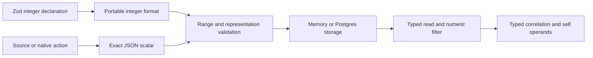

# relate

> Development baseline (`0.0.0-dev.0`), for discussion and contribution only.
> Not ready for application use. APIs and behavior are incomplete and may change
> without notice.

Define a business graph in TypeScript and compile it into a portable model.
Private and unpublished while implementation is in progress.

## Responsibility

`relate` owns the authoring API and the compiled-model contract:

- `relate`: `defineSource`, `defineObject`, `defineRelationship`,
  `defineAccess`, `defineAction` and `defineGraph`; the property constructors
  `objectId`, `from`, `native` and `reference`; `source` and `nativeMembership`;
  `implementAction`; and the boundary helpers `referenceInput` and
  `assertFields`; `bind`, `defineApp`, and `isAppDefinition`.
- `relate/consumer`: the typed consumer facade shared by every surface:
  `createConsumer(description, operations)` builds `objects.Customer.get`,
  `objects.Customer.query`, `objects.Customer.traverse.invoices`,
  `actions.addAccountReview`, `describe()` and `receipts.get` over the
  `ConsumerOperations` contract from `@relate/protocol`; the compiler supplies
  the versioned `ConsumerDescription` the facade needs; `createQuery` and
  `createPagedQuery` page lazily; the `Consumer`, `ObjectOperations`,
  `QueryOptions`, `ObjectResult` and `QueryResult` types. Browser safe: no
  compiler, engine or Node import.
- `relate/connectors`: resource adapter contracts (`SourceConnector`,
  `SourceRecord`, `SourceVersion`, `SourceBinding`) and `SourceAccessDenied`.
- `relate/storage`: type-only storage adapter contracts used by application
  setup and the runtime. Implementations and ordering remain in their owning
  runtime/storage packages.
- `relate/compiler`: `compile(graph)` validates a definition and returns an
  immutable, serializable `CompiledModel` with a deterministic `sha256:`
  definition revision and a typed `consumer` routing artifact. The facade
  accepts `createConsumer(model.consumer, operations)` and checks model
  compatibility.
- `relate/model`: the manifest schema, `validateManifest`, and the types that
  runtime integrations consume.
- `relate/diagnostics`: platform-neutral issue types (`ModelIssue`, `IssuePath`,
  `SourceSite`), stable `ModelIssueCode`s, and the `CompileError` /
  `ManifestValidationError` classes thrown by authoring, compilation and
  manifest validation. It imports nothing.

It does not fetch, store, authorize or serve anything at runtime. Authoring
imports stay free of compiler and Node dependencies.

## How it fits

- Depends on `zod` and `@relate/protocol` (result and evidence types).
- `@relate/node` compiles an authored graph, binds the engine to
  `ConsumerOperations` per principal and returns `createConsumer` over it. The
  planned `@relate/client` returns the same facade over HTTP.
- `@relate/runtime` uses `relate/model`, `relate/connectors`, and
  `relate/storage`; it executes compiled manifests without importing graph
  authoring.
- Connector implementations depend on `relate/connectors`, not the Node host or
  runtime implementation.

## Public API

### From graph definition to running application

An app author uses three steps:

1. Define sources, objects, relationships, actions, and policies with `relate`.
   The graph describes the model; it contains no live provider clients.
2. Wrap the graph in `defineApp({ graph, setup })` from `relate`. Inside setup,
   open provider clients, bind each source with `bind`, and register cleanup.
   `bind` only creates a binding; it performs no I/O.
3. In a Node server entry point, call `startApp(app)` from `@relate/node`. The
   host runs setup, compiles the graph, and supplies the bindings to the
   runtime. It returns the typed consumer API and drains work before cleanup.

```ts
// app.ts — openBindings is an application-owned setup helper.
import { defineApp } from 'relate';
import { graph } from './graph.js';

export default defineApp({
  graph,
  async setup({ onDispose }) {
    const { openBindings } = await import('./bindings.js');
    const bindings = await openBindings();
    onDispose(() => bindings.close());
    return { bindings: bindings.bindings };
  },
});
```

```ts
// server.ts — only explicit embedding needs the Node host import.
import { startApp } from '@relate/node';
import app from './app.js';

const relate = await startApp(app);
// A server supplies an authenticated actor and a previously adopted object ID.
const customer = await relate.as(actor).objects.Customer.get(customerId);
await relate.close();
```

`relate dev` reads `app.graph` without calling setup. Top-level application
imports must therefore remain safe to evaluate without credentials. Importing
`relate` does not import the runtime or the Node host, even through its types.

A connector author implements `SourceConnector` from `relate/connectors` for one
selected resource. On a read, the runtime applies policy, verifies provider
identity, and fetches through that adapter when freshness requires it. The
runtime validates and retains observations and returns authorized fields with
evidence. The app author does not call the adapter directly for consumer reads.

See the runnable
[connected sources example](../../examples/02-connected-sources/src/app.ts) for
the complete chain with HTTP and SQLite sources. See
[Connecting Sources](../../apps/docs/content/authoring/connections.md) for the
available SQLite, Stripe, and Salesforce connectors and the custom connector
contract.

### Graph authoring

```ts
import { z } from 'zod';
import {
  defineAccess,
  defineGraph,
  defineObject,
  defineRelationship,
  defineSource,
  from,
  objectId,
  reference,
  source,
} from 'relate';
import { compile } from 'relate/compiler';

// Sources keep ownership of their records.
const crm = defineSource({
  id: 'crm.customers',
  idField: 'id',
  schema: z.object({ id: z.string(), name: z.string(), region: z.string() }),
});
const billing = defineSource({
  id: 'billing.invoices',
  idField: 'id',
  schema: z.object({ id: z.string(), customer_id: z.string() }),
});

// Roles, claims and field groups are declared once and checked by TypeScript.
const access = defineAccess({
  roles: ['sales'],
  claims: { region: z.string() },
  fieldGroups: ['ordinary'],
});

const Customer = defineObject({
  id: 'business.customer',
  membership: source(crm),
  properties: {
    id: objectId({ id: 'business.customer.id' }),
    name: from(crm.fields.name, { id: 'business.customer.name' }),
    region: from(crm.fields.region, { id: 'business.customer.region' }),
  },
});

const Invoice = defineObject({
  id: 'business.invoice',
  membership: source(billing),
  properties: {
    id: objectId({ id: 'business.invoice.id' }),
    customer: reference(Customer, {
      id: 'business.invoice.customer',
      from: billing.fields.customer_id,
    }),
  },
});

const CustomerInvoices = defineRelationship({
  id: 'business.customer-invoices',
  via: Invoice.properties.customer,
  forward: 'invoices',
  reverse: 'customer',
});

const graph = defineGraph({
  id: 'business',
  objects: { Customer, Invoice },
  relationships: { CustomerInvoices },
  access,
  policies: {
    Customer: {
      read: {
        gate: access.role('sales'),
        where: { region: { eq: access.claims.region } },
        evidenceMaxAgeMs: 30_000,
      },
    },
    Invoice: {
      read: {
        gate: access.role('sales'),
        where: { customer: { region: { eq: access.claims.region } } },
        evidenceMaxAgeMs: 30_000,
      },
    },
  },
});

const model = compile(graph);
model.manifest.objects.map((o) => o.apiName); // ['Customer', 'Invoice']
model.definitionRevision; // 'sha256:…', deterministic for this definition
```

Registry keys such as `Customer` are the public API names. `id` values are
stable definition identities that survive renames. Applications normally pass
`graph` to `@relate/node`, which compiles it for them; call `compile` directly
when you need the manifest itself.

## Diagnostics

Validation failures are structured. `compile(graph)` collects every independent
issue, skips checks that depend on a failed prerequisite, and throws one
`CompileError` whose `issues` are deduplicated and ordered by path:

```ts
import { CompileError } from 'relate';
import { compile } from 'relate/compiler';

try {
  compile(graph);
} catch (error) {
  if (error instanceof CompileError)
    for (const issue of error.issues)
      console.log(issue.code, issue.message, issue.definitionId, issue.path);
  // policy.unknown-role  Unknown policy role 'finanse' in policy Invoice.read
  //   example.invoice  { root: 'graph', segments: ['policies', 'Invoice', 'read', 'gate'] }
}
```

Paths name their root: `graph` for the object passed to `compile`, `definition`
for an early failure inside `defineObject`/`defineAction`, and `manifest` for
`validateManifest` input. Issues found while lowering to a Manifest are
translated back to authored registry keys when that mapping is unambiguous;
otherwise they keep the explicit `manifest` root. Consumers branch on `code`,
never on message text.

Development hosts can record where definitions were declared with
`enableDefinitionProvenance()` before importing user modules and read the raw
capture with `definitionProvenance(definition)`. Capture is off by default,
stays outside the Manifest and never changes `definitionRevision`.

## Status

Implemented: one membership source per object, scalar fields, source-backed and
native references, relationships, declarative read and create policies, native
action contracts. Not implemented: multi-source enrichment, schema evolution and
model migrations, external actions.

## Further reading

- [CONTRACT.md](./CONTRACT.md): detailed authoring, policy, reference,
  relationship and `assertFields` behavior, including migration notes.
- [Native objects](../../examples/01-native-objects/README.md): the smallest
  runnable graph.
- [Native actions](../node/NATIVE_ACTIONS.md): `defineAction` and
  `implementAction` end to end.

## Many-to-many relationships

`defineRelationship` also accepts an explicit junction:

```ts
const PlaylistSongs = defineRelationship({
  id: 'playlist.songs',
  forward: 'songs',
  reverse: 'playlists',
  through: {
    from: Membership.properties.playlist,
    to: Membership.properties.song,
  },
});
```

The endpoints are inferred from two distinct references on the same registered
junction object. Both directions have cardinality `many`. Register the junction
and endpoints in `objects` and provide their policies. Use either `via` or
`through`. Consumers receive distinct destination objects; membership metadata
remains accessible separately. See the
[modeling guide](../../apps/docs/content/authoring/graph.md#many-to-many-relationships)
and
[traversal guide](../../apps/docs/content/runtime/reading-data.md#many-to-many-traversal).

## Integer properties

Use `z.int32()` for signed 32-bit integers and `z.int64()` for signed 64-bit
integers in source fields, native properties, action payloads and claims.
Optional and nullable wrappers are supported; integer refinements and coercion
are rejected. Other bigint schemas and `z.number().int()` are not supported.

```ts
const totalMinor = native(z.int64(), { id: 'invoice.total-minor' });
// Typed reads, native writes, action payloads and filters all use JSON strings:
const where = { totalMinor: { gt: '9007199254740992' } };
```

`int32` values are JSON numbers in `[-2147483648, 2147483647]`. `int64` values
are canonical decimal strings in `[-9223372036854775808, 9223372036854775807]`,
including small values such as `'2'`. Leading zeros, `'-0'`, fractions, numbers
and JavaScript bigints are rejected at ordinary value boundaries. Use
`BigInt(value)` explicitly for local arithmetic. Discovery reports
`{ type: 'number', format: 'int32' }` or `{ type: 'string', format: 'int64' }`.
Filters compare integers numerically without rounding, and keep their strings in
encrypted cursor scope. Integer properties can supply matching dataset
correlation keys and `self` operands in calculations.



## Timestamp properties and query predicates

Declare timestamps with `z.iso.datetime({ offset: true, precision: 3 })` in a
source schema or a `native(...)` property. Optional and nullable wrappers are
supported. These are ISO strings with a timezone (`Z` or an explicit offset) and
exactly three fractional-second digits. Date-only values, local times, other
precisions, and `z.string().datetime()` are not supported timestamp schemas.
Normalize provider timestamps before supplying records to Relate. Query operands
are more lenient: any timezone-qualified ISO instant with at most millisecond
precision, such as `2026-10-01T00:00:00Z`, is accepted.

```ts
const events = defineSource({
  id: 'events',
  idField: 'id',
  schema: z.object({
    id: z.string(),
    occurredAt: z.iso.datetime({ offset: true, precision: 3 }),
  }),
});
```

Map `events.fields.occurredAt` using `from(...)` as usual. `QueryOptions` infers
scalar equality and `eq`/`in` for every property, plus `gt`/`gte`/`lt`/`lte` for
numbers, int64 values and timestamps. References retain their object-ID brand
inside `in`. Timestamp equality and ranges compare instants, so different
offsets can match; returned property values preserve the supplied string.
Ordinary strings have no range operators. See
[reading data](../../apps/docs/content/runtime/reading-data.md#querying-objects-query)
for consumer examples and
[the runtime contract](../runtime/CONTRACT.md#graph-queries) for validation,
evidence and pagination rules.

## Portable analytical contracts

`relate/analytics` owns SQL representation types and shared scalar codecs. The
Node host uses them for computed object get/query reads. The entry point has no
compiler, SQL parser implementation or database driver.

```ts
import { encodeAnalyticalValue, decodeAnalyticalValue } from 'relate/analytics';

const type = { type: 'int64', nullable: false } as const;
encodeAnalyticalValue(9007199254740993n, type); // '9007199254740993'
decodeAnalyticalValue('9007199254740993', type); // 9007199254740993n
```

Int64 values always encode as decimal strings. Millisecond instants decode to
`Date`; microsecond instants remain canonical UTC strings so no digits are lost.
Codecs reject overflow, nonfinite numbers, malformed timestamps and mismatched
JSON values. `parseAnalyticalValue` resolves typed JSON parameters and
normalizes instant offsets without rounding. Null is valid only for nullable
results.

`decodeComputed` from `relate/consumer` applies these codecs using a record's
`meta.computed` entries:

```ts
import { decodeComputed } from 'relate/consumer';

const record = await consumer.objects.Customer.get(customerId, {
  compute: { logins: { sql: 'SELECT COUNT(*) FROM self.events' } },
});
const fields = decodeComputed(record);
// fields.logins is 2n when the returned JSON value was "2".
```

The helper returns a separate bag of present computed fields, for both caller
aliases and declared calculations. It accepts get results and individual query
records in either evidence mode. Ordinary fields and the original evidence stay
unchanged. Missing fields stay missing; SQL null stays null. Not-found results
and records without computed metadata return `{}`. Decode pages with
`page.data.map(record => decodeComputed(record))`.

Malformed present values or their type metadata throw `AnalyticalValueError`
from `relate/analytics`, without including the input value. Result fields remain
optional in TypeScript; SQL result types are known at runtime. Keep the original
record for JSON transport; the decoded bag is for local use.

`relate/connectors` also defines the analytical connector boundary:
`AnalyticalConnector.plan(authorizedQuery)` returns an opaque `PreparedPlan`,
and `execute(plan, { signal, timeoutMs })` returns portable values by object
slot. Physical names and generated SQL remain connector-owned. See the
[connector contract](./CONTRACT.md#analytical-connector-boundary).

## Analytical dataset declarations

`defineDataset` declares rows without an object identity. Each column owns its
schema, stable ID, access group and optional description. `DatasetRow` infers
the row type, and `dataset.schema` is derived from those same column schemas.
Bind datasets to SQLite or PostgreSQL resources with `bind(...)` and start the
application with `startApp`. Object `get` and `query` support caller expressions
and declared calculations through the same authorized execution path; computed
filters and ordering evaluate the matching scope before choosing a page.

```ts
import { z } from 'zod';
import { defineAccess, defineDataset } from 'relate';
import type { DatasetRow } from 'relate';

const access = defineAccess({
  roles: ['analyst'],
  fieldGroups: ['ordinary'],
  claims: {},
});
const Events = defineDataset({
  id: 'analytics.events',
  description:
    'One row per recorded event. Duplicate events remain separate rows.',
  columns: {
    customerId: {
      id: 'analytics.events.customer-id',
      schema: z.string(),
      access: access.groups.ordinary,
    },
  },
});
type Event = DatasetRow<typeof Events>; // { customerId: string }
```

Register datasets under `defineGraph({ datasets: { Events }, ... })`. An object
associates itself through
`datasets: { events: { id, dataset: Events, on: [{ column: 'customerId', property: 'externalId' }] } }`.
The property belongs to the containing object; the column belongs to the
selected dataset. Multiple pairs combine with AND. Policies declare both
`Customer.datasets.events.gate` and the dataset's column `groups`; ordinary-only
datasets use an empty policy. See the
[dataset contract](./CONTRACT.md#dataset-and-association-compilation).

A named calculation is declared alongside ordinary properties:

```ts
import { computed } from 'relate';

const loginCount = computed({
  id: 'customer.login-count',
  access: access.groups.ordinary,
  sql: "SELECT COUNT(*) FROM self.events WHERE eventType = 'login'",
});
// Use in defineObject({ properties: { ...ordinaryProperties, loginCount }, ... }).
```

Compilation keeps calculation IDs, access, descriptions and SQL in the graph
revision. Calculations cannot be native action write targets, row-policy inputs
or correlation keys. Their TypeScript values are optional JSON scalars; SQL
result types are inferred by runtime preparation. `startApp` validates every
declared calculation, including unselected properties, before returning the
runtime. Object reads execute declared and caller calculations on SQLite and
PostgreSQL. Traversal and action-bound readers reject calculated selections,
including defaults, while explicit ordinary-property selections remain
supported.
