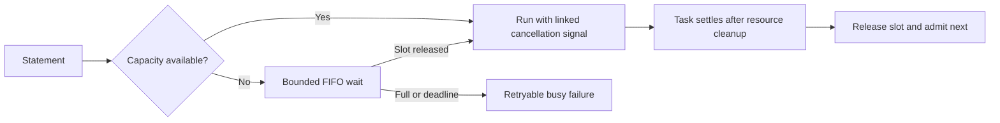
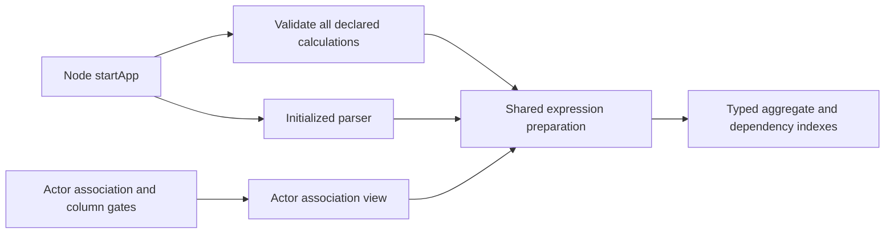
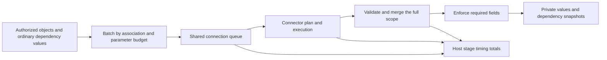
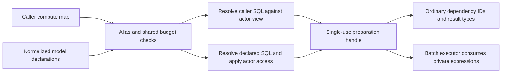
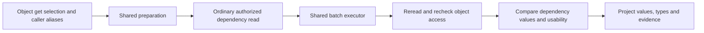
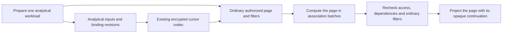

# @relate/runtime contract

Public runtime `read` and transaction-scoped action-context `read` return a
complete protocol `ObjectResult`. Successful reads include the resolved record's
canonical `id` even when its ID property is not selected; `not-found` remains
unchanged. Node and transport adapters do not reconstruct identity. Internal
resolution supplies full evidence before the existing presentation step.

`createDiscovery(model, principal)` receives the compiled manifest and revision
together. The runtime verifies the compiled revision during construction and
passes that verified model to discovery.

Detailed behavior of the current slice. For an overview of the package, see
[README.md](./README.md).

Embedded read and native-action execution with explicit source and storage
contracts. Private and unpublished.

`createRuntime` composes a compiled model, installed graph ID, optional storage
adapter, source bindings and an optional clock. Consumer `read` applies
default-deny policy, field groups, selection, freshness and evidence. Trusted
host `adopt` fetches a known source record ID and durably establishes
membership. It is not a consumer-authorized creation action.

`@relate/runtime/storage` is the supported adapter extension boundary. Storage
owns atomic observation acceptance through `ObservationStore`; the runtime owns
the shared pure ordering rule. Concrete adapters are injected, never imported.
Modules separate authorization, observation validation/ordering and resolution.

Reads retain successful source observations. Retention failure can return a
validated authorized transient value with explicit durability/ordering warnings;
it cannot renew permission evidence. Provider versions precede fetch-start
ordering. Without provider versions, order is best effort and cannot prove
upstream recency. Deletion and denial are never undone by fallback.

An explicitly selected known field denied by its field group returns only
`{ status: 'forbidden' }`; unknown fields and omitted stale values remain
`{ status: 'unavailable' }`. Both make the selection partial and fail
`requireComplete`. Permission-only omission does not set `degraded`; unavailable
fields and freshness, refresh, retention or ordering problems still do. This
applies to source reads, native reads and traversal results. Default selection
continues to omit forbidden fields entirely. Whole-object denial remains
`not-found`, with no field or policy evidence. These paths share the summary
rule in `src/reads/evidence.ts`.

A deleted reference target does not delete a referring native object or clear
its stored link. Reads withhold the unresolved reference with
`status: 'unavailable'` field evidence; other fields remain readable when the
object's own policy permits it. See
[deleted references and future deletion policies](../node/NATIVE_ACTIONS.md#references-after-a-target-is-deleted)
for the Task example, future edit rules, and deferred opt-in cascading deletes.

Each source identity check and record fetch wait defaults to 3 seconds (maximum
10 seconds), including non-cooperative connectors. The Postgres adapter
separately bounds pool, lock, and statement waits; this is not a whole-request
deadline guarantee. Connectors must honor cancellation to stop their own
outstanding I/O. Each read uses at most one source fetch in this slice.

Only explicit shared service-account source bindings are supported. Delegated
credential partitions, automatic sync workers and arbitrary collection
predicates are not implemented. Source-backed traversal and synchronous native
actions are implemented; see
[native account reviews](../node/NATIVE_ACTIONS.md). Engine results remain
partial JSON records. `@relate/node` composes this engine with authored
definitions and provides typed `relate.as(principal).objects.Customer.get(...)`
reads.

Connectors throw `SourceAccessDenied` for an explicit provider permission
denial. The affected read returns `not-found` rather than falling back to
retained data. This is not a deletion or a persisted revocation: retained
observations remain, and a cached read does not perform a provider authorization
check for the individual record. Applications requiring that check must request
refresh of source-backed fields. Record-fetch errors remain temporary
unavailability with authorized fallback subject to the binding’s identity mode
and current Relate policy evidence.

Provider-verified bindings require an expected `providerAccountId` alongside
`connectionId`. `SourceConnector.identify({ signal })` authenticates current
credentials and returns the provider's stable account ID. It must not echo
configuration or reuse identity evidence after credentials change. The runtime
checks identity before using cached source observations and again before
disclosure after asynchronous work. Identity mismatch or explicit denial
withholds the object; failed or timed out verification raises sanitized
`ReadError('unavailable')`, without fallback. Every `SourceRecord`, including
deletion, must carry `providerAccountId` from the authenticated response or the
immutable credential context that fetched it. Missing or mismatched response
identity withholds the result without retention or stale fallback. Never stamp
the expected binding ID onto an unverified response. Connectors remain a trusted
integration boundary.

Application-owned connectors implement `ApplicationSourceConnector` with
`identity: 'application'`, `fetch()`, and no `identify()`. Bindings and results
omit `providerAccountId`. The host owns the logical source identity through
`connectionId`: relocation of the same source preserves it; replacement with a
different logical source requires a new ID. The runtime does not authenticate a
provider account in this mode and cannot detect substitution under the same ID.
Never emulate verification by returning a configured label from `identify()`.
Policy checks, record denial, freshness and deletion evidence still apply. A
fresh cached read need not access the provider in application mode.

Storage scopes include provider account identity (`null` for application-owned
connections, distinct from every verified account and unknown legacy
provenance). Switching identity modes creates a separate scope and requires
adoption there. Changing accounts under the same connection ID creates a
separate alias and object ID when explicitly adopted. Existing object IDs,
reference resolution, scans and traversal cursors cannot cross account scopes.
Provider account IDs stay out of consumer evidence.

Use
[`assertFields` from `relate`](../relate/CONTRACT.md#require-values-after-a-read)
to require specific values on an existing result. It narrows an `ok` result and
the checked fields, preserves valid `null` and stale values, and throws
`ReadError('incomplete')` when required values are missing. Other fields and the
read's evidence stay unchanged; freshness remains a separate requirement.

## Storage

Omit `store` for an isolated in-memory store with no database setup:

```ts
const runtime = createRuntime({ model, graphId, sources });
```

Supply `createMemoryStore()` from `@relate/runtime` to share memory between
runtimes, or a Postgres/custom `ObservationStore` for persistent retention.
Memory supports the same identity, ordering, authorization and fallback behavior
within its lifetime. It does not retain data across process restarts.

Field evidence separates write outcome (`retention`) from storage guarantee
(`retentionDurability: 'volatile' | 'persistent'`). Both built-in stores run the
same conformance suite. `pnpm test:unit` runs the memory and pure unit tests
without Postgres.

See [Writing a store](STORE_CONTRACT.md) for the public interface's behavioral
contract, errors, lifecycle and adapter verification requirements.

## Pagination

The engine returns one authorized `Page` per `query` or to-many `traverse` call.
Lazy, awaitable `QueryResult` handles are built by `createQuery` and
`createPagedQuery` in [`relate/consumer`](../relate/CONTRACT.md#pagination); the
facade and native action contexts use them over the engine's pages. The engine
owns stable query binding, real scan progress, cursor scope, ordering and
resource budgets; the helper only validates page envelopes and follows
continuations.

## Graph queries

`runtime.query(principal, objectDefinitionId, request?)` returns one
`PageResult`. The `relate/consumer` facade and action APIs expose
`objects.Invoice.query(options?)` as an awaitable, async-iterable `QueryResult`.
Portable request/result types live in `@relate/protocol`; typed `QueryOptions`
and object records live in `relate`.

- Omit `where` or pass `{}` to enumerate. Scalar values are equality shorthand;
  operator objects support `eq` and `in` on every property, and `gt`, `gte`,
  `lt`, `lte` on numbers and timestamps. Properties and operators combine with
  AND. `eq`/`in` operands must satisfy the property's compiled schema. Range
  operands must match the property's type (finite numbers, or timestamps) but
  are not limited by its declared value bounds, and cannot be null. A bare array
  is rejected with a pointer to `in`. References and object-ID properties use
  canonical Relate IDs. `null` matches explicit null; known absent optional
  values never match. Empty `in` matches nothing, but does not bypass evidence
  checks. Contradictory bounds match nothing. Reject empty operator objects,
  unknown operators, undefined operands and incompatible types before scanning.
  At most 100 filter properties and 100 operands per `in` are accepted. No
  recursive predicates, sorting or aggregation are supported.
- Timestamp properties compile from
  `z.iso.datetime({ offset: true, precision: 3 })` (optionally
  nullable/optional). The manifest marks these strings with
  `format: 'timestamp'`. Source, native and action values are validated as
  timezone-qualified ISO instants with exactly three fractional digits. Query
  operands accept any timezone-qualified ISO instant with at most millisecond
  precision, so normalization to milliseconds stays exact. Equality, sets and
  ranges compare instant milliseconds, not text; returned values retain their
  original representation. Plain strings do not acquire timestamp semantics by
  resembling a date.
- Predicate compilation normalizes equality shorthand, timestamp operands,
  operator order and set order/duplicates once per request. Cursor binding uses
  those normalized predicates. Evaluation still follows bounded authorized
  reads; this implementation does not introduce indexes or storage pushdown.
- Membership is adopted source identities or native records in this graph and
  revision. Source queries may refresh known records through existing `get`
  behavior, but never discover/adopt provider records. Exhaustion describes this
  scan, not provider-wide coverage. Direct source queries and sync are planned.
- Validate filter names, values and field access before scanning, even if there
  are no records. Invalid or forbidden filters reject with `invalid-request`. A
  filterable property is one the actor's discovery lists, so a reference whose
  target type the actor cannot read is not filterable. Whole-object policies
  filter candidates before caller predicates. Missing or unavailable filter
  evidence on a readable candidate rejects with `incomplete`, rather than
  silently treating an unknown match as false. `stale: 'allow'` can match
  authorized stale values; `stale: 'omit'` cannot. Source denials/deletions
  follow the existing read path and do not resurrect retained data.
- Filter fields need not be selected and do not appear in projected results.
  `requireComplete` applies to the final selection of matching records. Records
  preserve field evidence, freshness and warnings from reads. Authorization and
  filter freshness are checked again before emitting pending matches. A match
  whose filter evidence expired meanwhile is read again once; it rejects with
  `incomplete` only if that evidence is still unavailable.
- Ascending canonical object ID supplies deterministic keyset order. `limit`
  defaults to 25 and accepts integers 1–100; it is a maximum page size. Each
  page examines at most 100 candidates. Filtering and denial can yield short or
  empty non-final pages. Continue until `meta.exhausted`; no total count is
  reported.
- Encrypted cursors expire after 15 minutes and bind graph, revision, principal,
  object type, source bindings, filters, selection and read options/page size. A
  shared `cursorKey` allows continuation across trusted runtime instances.
  Action cursors additionally bind their transaction; they cannot escape it. The
  runtime checks actual scan progress, not just changing cursor strings.
- Pages are not a snapshot. Concurrent insertions before the cursor may be
  missed, later insertions may appear, and values/access may change between
  pages. Native queries within actions see earlier native writes in the same
  transaction; source observations do not join that transaction.
- Action queries use the executor's deadline and failure handling. A failed page
  aborts native effects even if its rejection is caught by the handler. Receipt
  dependencies include fields inspected while evaluating readable candidates,
  including filter-only fields and non-matches. Receipt replay checks current
  access to those dependencies; it does not rerun the query or promise the
  historical population still matches.

Shared acceptance cases in `tests/support/query-contract.ts` execute on memory
and Postgres. Type probes cover caller/action filters, reference IDs, selection
and iteration; installed-package smoke checks exercise graph query execution.

## Traversal filters

To-many traversals accept the query `where` (`reads/predicates.ts`
`compileWhere`/`predicateMatcher`); to-one traversals reject it as
`not-supported`.

- Filters address the destination object's properties. Membership in the
  relationship and the filters combine with AND; a `through` junction's own
  properties are not filterable from the traversal. The filterable set is the
  destination's discoverable properties for this actor, validated with the
  starting ID and every other option before any read.
- Reference traversal reads each scanned owner record with the selection plus
  filter fields, then evaluates predicates under the caller's freshness rules.
  Unavailable filter evidence on a readable member rejects with `incomplete`.
- Through traversal reads a destination during the junction pass only when it
  could still enter the pass's candidate set, and admits only matches. A
  destination that fails within one call is not read again in that call. Final
  destination reads re-evaluate the filter before link and destination
  authorization are rechecked.
- Before emitting, every path re-evaluates filter evidence at the current time.
  Evidence that expired after matching is read once more, with authorization
  captured on that read; members that no longer match are withheld. Through
  traversals also recheck junction authorization after the destination refresh,
  withholding members whose link evidence expired during that read.
- Normalized predicates join the traversal cursor scope, so equivalent filters
  continue a cursor and changed filters reject it as `invalid-cursor`.

Shared acceptance cases in `tests/support/traversal-filter-contract.ts` execute
on memory and Postgres.

## Request errors and operation contracts

- `reads/options.ts` owns the read option table. Request validation, discovery
  (`describe().sdk.options`) and error messages all read it, so a described
  option is exactly an accepted option for get, query, to-many and to-one
  traversal. Unknown options are rejected for every operation, including get.
- `ReadError('invalid-request', { operation, issues, acceptedOptions? })`
  reports every option, argument and filter issue at once, before membership,
  records or sources are consulted. Issues are a pure function of the request,
  operation and actor's static discovery.
- Issues name only request options, arguments and properties or traversals the
  actor can discover. A hidden and a missing filter property produce the same
  issue; `accepted` lists the discoverable names. A traversal outside
  `availableTraversals` (missing, unsupported, role-hidden, or from an
  unreadable start type) gets one neutral `unknown-traversal` issue before its
  options or ID are checked, so the error does not reveal cardinality. Every
  cursor rejection (forged, altered, expired, other scope) is one
  `invalid-cursor` issue.
- Operation names in errors use the object's API name only when the actor may
  read that type; otherwise they echo the caller-supplied definition ID
  (`business.customer.query`).
- Alias hints (`pageSize` → `limit`, `offset` → cursor paging) are generic SDK
  vocabulary, never graph- or task-specific.
- Root discovery returns complete name-keyed object and action maps. Object
  entries contain authorized traversal directions, using `availableTraversals`
  just like detailed discovery. Action `creates` lists only readable API names.
  Metadata discovery never reads records or source systems. All maps and nested
  values are frozen; empty maps and unauthored descriptions remain compact.
- Root `sdk` guidance summarizes the SDK once. Its option inventory, defaults
  and accepted operation kinds come from `reads/options.ts`; `sdk.errors` shares
  read-error guidance with the full contract. The exported `operationContracts`
  and its `OperationContract` / `OperationContracts` types belong to this
  package and remain the full frozen read contract for tooling, outside the root
  response. Object detail adds per-object `returns`, per-traversal `returns` and
  per-property `filter` text. Call paths belong to the consumer surface
  (`@relate/node` adds `call`), not to the runtime.

## Native actions

`invoke` runs a compiled action through its registered handler and optional
`store.native` transaction capability. Runtime owns action gates, input/output
validation, authorized get/create, reference membership, abort tracking and
final create-policy validation. Successful native effects and receipt evidence
commit atomically. `@relate/node` binds typed implementations and caller
methods; it does not own transaction or authorization semantics.

`actionTimeoutMs` bounds the native callback after lock acquisition: 60,000 ms
by default, with host-configured integer values from 1 to 60,000. Expiry revokes
object/native transaction access and rejects the callback so the adapter rolls
back and releases its resources even if the handler never returns. Late handler
completion cannot save a receipt or commit. This budget ends before COMMIT and
does not include installation, lock/pool waiting or database cleanup.

Memory serializes native transactions per graph using isolated working copies;
Postgres provides the same behavior with adapter-owned transactions. Source
observation retention stays separate. Current execution returns confirmed
success or throws sanitized `ActionError`. `getReceipt` and matching-key replay
recover success under originating-actor and current-access checks, including the
handler's saved object/field read dependencies. They do not invoke the handler.
Durable pending execution and failed receipts remain subsequent slices. See
[receipt recovery](../node/NATIVE_ACTIONS.md#wait-for-completion-lookup-and-recovery).

## Local calendar datetimes

Declared local calendar fields support `eq`, `in`, `gt`, `gte`, `lt` and `lte`
in queries and to-many traversal filters. Comparisons use calendar tuples at the
declared precision; invalid stored calendar values fail filtering with
`incomplete` rather than silently excluding a row. No source pushdown occurs.
See the [owning scalar contract](../relate/CONTRACT.md#local-calendar-datetimes)
for validation, clock-domain semantics and migration requirements.

## Analytical statement admission

`createStatementQueue` is the public composition factory for analytical
statement admission. Node supplies one queue per configured connection to
analytical object reads.

A **running statement** owns a connection slot until its task settles after
resource cleanup. A **waiting statement** has no connection slot. By default,
there are four running slots, at most 32 waiting statements and a two-second
maximum wait. Waiting work starts in arrival order. Host options are
`concurrency`, `maxQueued` and `maxWaitMs`; zero queue depth or wait disables
waiting. Invalid limits fail before admission.

```ts
const queue = createStatementQueue();
const result = await queue.run(
  (signal) => connector.execute(plan, { signal, timeoutMs: 5000 }),
  { signal: operationSignal },
);
await queue.retire(); // drain before application-owned connection disposal
```



Queue full and wait expiry raise `AnalyticalBusyError` inside analytics with a
retryable busy reason. Cancellation removes queued work immediately. For running
work it aborts the linked signal, retains capacity until cleanup settles, and
rejects any late successful result. A task's synchronous throw also releases its
slot. Listeners and wait timers are removed when no longer needed.

`retire()` is idempotent: it rejects new admission, cancels waiting work, aborts
running work and waits for its cleanup. The connector must obey the bounded
cancellation contract; the queue cannot free a slot while the backend still owns
resources. Retirement never closes the application-owned connection itself.

## Calculated fields on restricted read surfaces

Traversal and transaction-bound action readers reject selections, filters or
ordering that reference declared calculations. They report `invalid-request`
with a `not-supported` issue before source reads or analytical execution. A
default selection is rejected if it would include a readable calculation;
calculations excluded by field-group access do not enter that default selection.
Explicitly selecting ordinary fields retains the existing read behavior.

The check uses compiled calculation metadata through `reads/calculations.ts`.
Traversal applies it after resolving a visible traversal and before reading its
origin or members. Action get/query apply it after the object type's gate and
before resolving records or enumerating membership. This also rejects computed
filters on empty populations. The guard does not disclose SQL or hidden object
names. Native creation independently rejects supplied calculation values and
stores only ordinary fields.

## Analytical expression preparation

`analytics/prepare.ts` is the pure shared boundary for expression parsing and
resolution. It accepts an injected parser and an actor's association view. It
checks SQL and parameter sizes, resolves quoted names exactly and unquoted names
by case folding, infers scalar and aggregate result types, binds exact literal
and parameter values, and records column and ordinary property dependencies. No
source or dataset reads occur during preparation. Unsupported property types,
computed dependencies, missing/unused parameters and conflicting inferred
parameter types fail with sanitized issues and original source spans.

`authorization/analytics.ts` owns association and column access decisions.
Hidden associations are absent and resolve like unknown names. Denied referenced
columns and non-correlation `self` properties mark an expression forbidden. A
denied correlation property is tracked separately for unavailable dependency
handling. Neither decision grants permission to execute a dataset query.

`validateDeclaredCalculations(manifest, parser)` composes a trusted declaration
view with the same preparation code, validates every calculation, and returns a
frozen stable-ID map of inferred result types. It aggregates preparation
failures into `CompileError` issues with authored paths. Node invokes it before
creating an engine. Portable compilation itself remains independent of a SQL
parser.



Object `get` and membership-first `query` use this resolver and access view for
caller expressions and selected declarations. Computed filtering/order remain in
progress.

### Analytical batch execution (internal)

`analytics/computeFields` accepts a preparation handle and a finite set of
already authorized objects with materialized ordinary dependencies. This is an
internal execution stage used by object `get` and `query`. It does not fetch
dependencies, authorize membership, or perform final dependency revalidation.
Its returned dependency snapshots are private execution state, including values,
and must never be projected as consumer evidence.

| Module       | Responsibility                                                                                                                                                |
| ------------ | ------------------------------------------------------------------------------------------------------------------------------------------------------------- |
| `batch.ts`   | Snapshot usable dependencies, group by association, remap shared keys, assign one slot per object, mask each aggregate, and size every batch before execution |
| `execute.ts` | Execute through the shared connection queue; cancel and await every active statement before returning or rejecting                                            |
| `merge.ts`   | Validate result framing and scalar types, withdraw failed aliases across the full scope, and enforce required fields                                          |
| `timings.ts` | Aggregate fixed host-only stages into bounded count, total and maximum durations                                                                              |

A missing `self.since` masks only calculations that use it. A valid `COUNT(*)`
can still be supplied for that object. Objects with matching correlation values
retain distinct slots. A parameter budget that cannot fit one slot rejects the
request before any connector statement is planned or executed.

Malformed row framing invalidates every alias carried by that statement across
the full scope. A scalar that violates one alias's result type invalidates that
alias across earlier and later batches while leaving unrelated aliases intact.
Provider failures are sanitized. A required filter/order field or a projected
field under `requireComplete` causes `AnalyticalIncompleteError` when any object
cannot supply it. Filter/order-only declarations are omitted from projection
metadata.

Cancellation never becomes a partial successful scope. Request-local workers
stop admitting further batches and wait for active connector cleanup. The shared
queue retains capacity until each connector promise settles. Queue admission
observers report one wait duration, including rejection/cancellation; observer
errors cannot alter execution. Timing summaries contain only fixed stage names
and numeric aggregates, with no SQL, parameters, object identifiers or physical
binding details. Persisting these summaries in operation activity and displaying
them in Inspector remain separate integration work.



`prepareCompute` now supplies the batch executor's single-use opaque handle. The
read owner passes selected/required declarations with stable IDs, projection
flags and property access decisions, separately from the untrusted `compute`
map. Caller aliases cannot collide with any property, including unselected or
denied properties. Both forms count toward the same default eight-expression
limit and obey SQL/parameter limits before candidate reads. Required caller
aliases must exist in the caller map; required declarations retain their own
identity and projection flag.

Caller SQL resolves only against the actor's association view. Trusted declared
SQL resolves against model declarations, then its referenced association,
columns and ordinary dependencies are checked against the actor view. A hidden
association withholds the declared value without exposing its name or SQL;
caller references to a hidden association remain indistinguishable from unknown
names. A denied correlation key retains `correlation-unavailable`; denied other
inputs yield `forbidden`. Rejected declaration diagnostics name only the
selected property. Startup continues to report authored SQL errors to the
application owner.

Preparation exposes only frozen dependency IDs and projected result metadata;
private resolved expressions and parameter values live in a weak map. It clones
the request/model inputs before asynchronous reads, rejects forged handles and
consumes each handle once. Preparation timing is recorded on success and error.
Object `get`/`query` normalization, dependency materialization/revalidation and
response projection live in the composition owner `analytical-read.ts`. Computed
filter/order validation and scope-first execution remain in progress.



### Analytical object get

`analytical-read.ts` composes ordinary authorized reads with preparation and
execution. It preserves ordinary reads when no calculation is requested. For an
analytical read, it privately includes correlation/self dependencies, runs the
batch, rereads ordinary values, rechecks object access, and compares every used
value before projection. Changed values are withheld without recomputation.
Hidden associations and denied columns withhold computed fields; denied
correlation keys remain `correlation-unavailable`. A required-complete read
reports omitted field names and safe reasons.

Computed evidence is retained in compact mode because its input freshness is
unverified. Healthy unverified analytical evidence alone does not degrade the
read; stale or failed-refresh dependency evidence does. Metadata includes
logical result types in both evidence modes. Dependency values, SQL, private
column footprints and physical resource names are not projected. The host hashes
connection identity, resource identity and column mapping for the public binding
revision. Caller deadlines and host retirement cancel analytical work and wait
for connector cleanup before the operation settles.



### Membership-first analytical query

The same composition owner prepares a query before candidate reads, delegates
ordinary authorization/filtering/paging to `queries`, computes one workload for
the selected page, and revalidates ordinary values and filters before
projection. It never computes one independent request per object.
Correlation/self and ordinary filter fields remain private unless selected.
Empty scopes still validate expressions but execute no statements. Page-wide
statement/scalar failures use the batch executor's existing withdrawal rules.

`queries` accepts a trusted `QueryContext` separately from the consumer request.
It supplies additional cursor scope, candidate freshness controls and a
cancellation signal. Candidate reads use the stricter dependency freshness
budget while ordinary filters retain caller freshness semantics. Every admitted
read is joined before a failure is returned, and cancellation stops later scan
batches. Transaction readers never enter the analytical path.

Cursor scope adds the caller compute map, original projection/completeness
options, and every referenced dataset's binding revision. Definition revision,
principal, source bindings and ordinary filters remain in the existing scope.
The same authenticated encrypted cursor codec is used, with no second cursor
layer. Parameter values and SQL are not exposed in the token or diagnostics.
Changing evidence mode leaves continuation valid; changing analytical inputs
invalidates it. Final checks may return an empty non-final page without exposing
which object was withheld.


