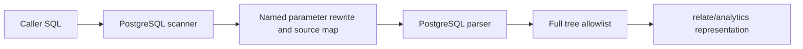

# @relate/sql-parser

The analytical SQL boundary for Relate. It parses PostgreSQL grammar and accepts
only one aggregate over a declared `self.<association>`. This package does not
resolve model names, grant access, generate SQL, or execute database statements.

A **syntax tree** is PostgreSQL's parsed representation. **Lowering** validates
that entire tree and converts it into Relate's smaller portable representation.
A **source span** identifies text using zero-based UTF-16 offsets into the
original caller SQL, even after named parameters have been rewritten.

```ts
import { createSqlParser } from '@relate/sql-parser';

const parser = await createSqlParser(); // initialize at application startup
const result = parser.parse(
  'SELECT COUNT(*) FROM self.events WHERE eventType = $kind',
); // synchronous: { ok: true, query } or { ok: false, issues }
```



Supported syntax: `COUNT(*)`, `COUNT(x)`, `COUNT(DISTINCT x)`, `SUM`, `AVG`,
`MIN`, `MAX`, and `COALESCE(aggregate, non-null literal)`. Predicates support
comparisons, `AND`, `OR`, `NOT` and `IS [NOT] NULL`. Operands can name columns,
ordinary `self` properties, literals and named parameters. Type compatibility,
parameter values and name disclosure remain runtime responsibilities.

The full query must fit the subset. Joins, CTEs, subqueries, casts, windows,
caller aggregate filters, output aliases, grouping, ordering, paging, table
functions, qualified functions and multiple statements are rejected. Numeric
literals retain exact text; quoted identifiers retain exact case. PostgreSQL
escape strings and Unicode identifier escapes are supported.

Initialization shares the WASM load, including concurrent calls. Default limits
are 4 KiB of UTF-8 SQL, 256 parsed objects/arrays and 16 distinct named
parameters; trusted hosts may configure these through `createSqlParser(limits)`.
Parser errors are sanitized and never echo literals or PostgreSQL diagnostics.

The adapter pins `libpg-query@18.1.5`, grammar version `180004`. Its
implementation uses the
[upstream parser and scanner API](https://github.com/constructive-io/libpg-query-node/tree/main/versions/18).
Parser upgrades must pass the shared corpus in `tests/support/sql-corpus` and
the package's fail-closed tree tests.
