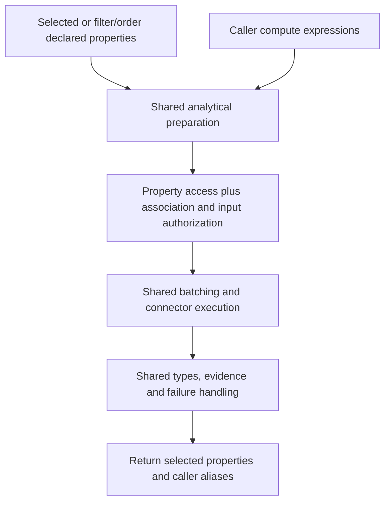
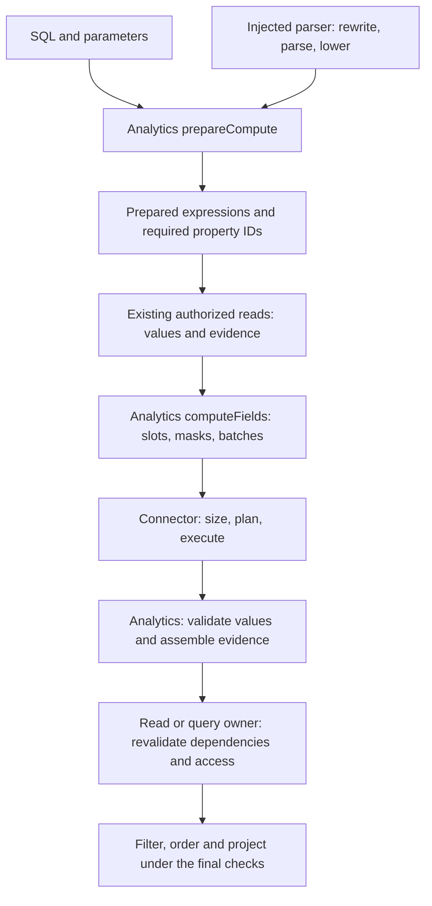
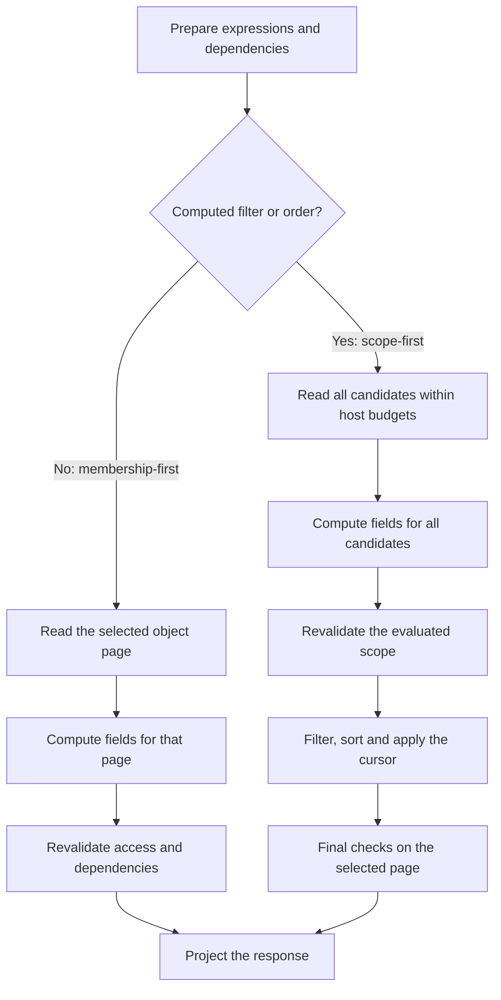
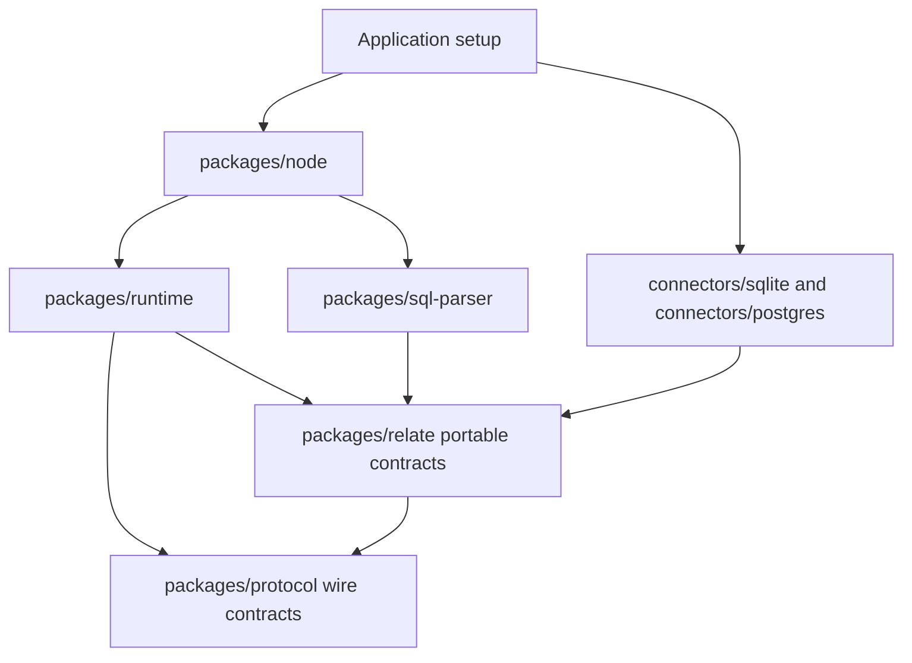

# 2026-10-18: Analytical datasets and computed fields

**Status:** design agreed on 2026-10-18, revised the same day after review, and
revised on 2026-10-21 to include declared computed properties and the Cube
design review, alongside the findings of the
[spike (#37)](https://github.com/relatehq/relate/pull/37). Implementation is
underway in [PR #38](https://github.com/relatehq/relate/pull/38); analytical
execution is not yet implemented. [Decisions](#decisions) lists each decision
with its status, [Open questions](#open-questions) lists what is still undecided
and which step settles it, and [Revision notes](#revision-notes) record what
each revision changed.

**Reading guide.** Start with the example for caller behavior. [Model](#model),
[Binding](#binding-and-schema-checks) and [Authorization](#authorization)
explain application setup. [Request](#request), [Response](#response) and
[Failures](#failures-and-errors) define the public contract.
[Execution](#execution) and [Ownership](#ownership) are the implementation
design. [Delivery](#delivery) lists the decisions and checks needed before
build.

## Outcome

A Relate application often sits next to tables that are not business objects:
events, page views, invoice lines, usage meters. A caller wants "customers with
their October login count", but logins are not customers. Adopting each event as
an object would give millions of rows Relate IDs, policies and evidence they do
not need, and still would not answer the question, because the answer is an
aggregate.

This spec adds **datasets**: typed, policy-governed row collections that are
declared in the graph, bound to an existing table, and associated with objects
by a correlation key. A caller then sends an aggregate **expression** over
`self.<association>` with an object `get` or `query`, and gets a **computed
field** back on each object, with evidence that says how it was produced. In v1
a `query` can also filter and order by a computed field.

Why this shape:

- **Aggregates stay aggregates.** Rows are never adopted and never written to
  the object. The object owns the question; the dataset owns the rows.
- **SQL is the expression language.** Agents already write SQL, and Relate will
  offer one uniform SQL interface: these per-object expressions now, and a
  graph-wide SQL API later
  ([Future](#future-graph-sql-sync-and-performance-optimization)). One dialect,
  one parser, one set of rules. A structured expression shape may be added
  later, but it would be a second surface, not a replacement.
- **Caller expressions and declared properties together.** Developer-declared
  computed properties (`loginCount: computed(...)`) ship in v1 through the same
  preparation, authorization, execution, typing and evidence contracts as caller
  expressions. A reusable business calculation is defined once and selected,
  filtered or ordered by name.
- **Postgres and SQLite first.** Both are already in the stack and need no
  native build. DuckDB, Parquet and warehouses are later backends behind the
  same contract.

## In one example

A caller reads customers with their login count for October. The model declares
no `loginCount` property. The caller asks for the calculation:

```ts
const page = await ana.objects.Customer.query({
  select: ['name'],
  compute: {
    loginsOct: {
      sql: `SELECT COUNT(*) FROM self.events AS e
            WHERE e.eventType = 'login'
              AND e.occurredAt >= $since AND e.occurredAt < $until`,
      parameters: {
        since: '2026-10-01T00:00:00Z',
        until: '2026-11-01T00:00:00Z',
      },
    },
  },
});
// page.data.map((c) => c.data):
// [ { name: 'Acme',    loginsOct: '2' },
//   { name: 'Globex',  loginsOct: '1' },
//   { name: 'Initech', loginsOct: '0' } ]
```

The rows come from an `events` table in an analytics database. Those rows are
not adopted, have no Relate IDs, and are never written to the customer. The
value is computed per customer, per read, over the event rows Ana may use.

The rest of this spec explains each piece: how the developer declares the
dataset and links it to Customer (`self.events`), how it is bound to a table,
who may use it, what types and evidence come back, and what happens when
something fails.

## Running example

All examples use this data. Anything outside it is marked as such.

**Customers** (CRM source `crm.customers`, SQLite file `crm.sqlite`). Dates in
this table abbreviate midnight UTC; `customerSince` is a timestamp in the model
and in execution.

| CRM key        | name     | portfolio         | customerSince |
| -------------- | -------- | ----------------- | ------------- |
| `crm_acme`     | Acme     | `portfolio_north` | 2026-09-30    |
| `crm_globex`   | Globex   | `portfolio_north` | 2026-10-01    |
| `crm_initech`  | Initech  | `portfolio_north` | 2026-01-15    |
| `crm_umbrella` | Umbrella | `portfolio_south` | 2026-05-01    |

**Events** (dataset `analytics.events`, table `events` in Postgres database
`analytics`):

| customer_id    | event_type  | occurred_at            | user_id |
| -------------- | ----------- | ---------------------- | ------- |
| `crm_acme`     | `login`     | `2026-09-28T08:00:00Z` | `u_1`   |
| `crm_acme`     | `login`     | `2026-10-02T09:00:00Z` | `u_1`   |
| `crm_acme`     | `login`     | `2026-10-09T10:30:00Z` | `u_2`   |
| `crm_acme`     | `page_view` | `2026-10-09T10:31:00Z` | `u_2`   |
| `crm_globex`   | `login`     | `2026-10-03T14:00:00Z` | `u_7`   |
| `crm_umbrella` | `login`     | `2026-10-04T11:00:00Z` | `u_9`   |

Initech has no events. Umbrella is outside Ana's portfolio.

**Actors.** Both work in `portfolio_north`. Nobody in the example holds the
`support` role.

| Actor | Roles                         | May use `Customer.events` | May read `userId` |
| ----- | ----------------------------- | ------------------------- | ----------------- |
| Ana   | `employee`, `account-manager` | yes                       | no                |
| Fin   | `employee`, `finance`         | no                        | no                |

**Expected values for Ana.**

| Expression                                         | Acme                         | Globex                       | Initech   | Umbrella     |
| -------------------------------------------------- | ---------------------------- | ---------------------------- | --------- | ------------ |
| October logins, `COUNT(*)`                         | `'2'`                        | `'1'`                        | `'0'`     | not returned |
| All-time logins                                    | `'3'`                        | `'1'`                        | `'0'`     | not returned |
| Logins since `self.customerSince`                  | `'2'`                        | `'1'`                        | `'0'`     | not returned |
| Distinct October users, `COUNT(DISTINCT e.userId)` | forbidden                    | forbidden                    | forbidden | not returned |
| Last login, `MAX(e.occurredAt)`                    | `'2026-10-09T10:30:00.000Z'` | `'2026-10-03T14:00:00.000Z'` | `null`    | not returned |

### Terms

| Term               | Meaning                                                             | Running example                                |
| ------------------ | ------------------------------------------------------------------- | ---------------------------------------------- |
| Connector          | Integration code for a database or API                              | the Postgres connector                         |
| Connection         | A configured connector instance; owns access and lifecycle          | `postgres({ connectionId: 'analytics', url })` |
| Resource           | An existing table or view on a connection                           | the `events` table                             |
| Source definition  | Unbound contract for keyed records that back objects                | `crm.customers`                                |
| Dataset definition | Unbound contract for analytical rows; no key, duplicates meaningful | `analytics.events`                             |
| Binding            | Maps a source or dataset definition to a resource                   | `bind(Events, analytics.table('events'))`      |
| Association        | Declared correlation between an object and dataset rows             | `Customer.events`, on the CRM key              |
| Expression         | What a caller sends: `{ sql, parameters }` over one association     | the `loginsOct` SQL above                      |
| Alias              | The caller's name for an expression; the key in `compute`           | `loginsOct`                                    |
| Computed field     | The value and evidence an expression produces on one object         | `loginsOct: '2'` on Acme                       |

The execution sections also use these terms:

| Term               | Meaning                                                             | Example                                           |
| ------------------ | ------------------------------------------------------------------- | ------------------------------------------------- |
| Correlation key    | Values that match an object to its dataset rows                     | `Customer.externalId = Events.customerId`         |
| Dependency         | An object property needed to evaluate an expression                 | `externalId`, or `self.customerSince`             |
| Candidate          | An object being considered for a query result                       | Acme before applying `where.loginsOct`            |
| Slot               | One object's position in a SQL batch; distinct even when keys match | Acme is slot `0`                                  |
| Validity mask      | Whether an expression has usable dependencies for that slot         | `m1 = false` when `customerSince` is missing      |
| Batch              | Candidates evaluated in one database statement                      | Up to 1,000 customers                             |
| Evaluated scope    | All objects whose computed values must succeed together             | One page, or all candidates for computed ordering |
| Membership-first   | Choose the object page, then compute its fields                     | A query that only displays `loginsOct`            |
| Scope-first        | Compute all candidates before choosing the page                     | A query ordered by `loginsOct`                    |
| Binding revision   | Identity of a particular definition-to-resource mapping             | Changes when `Events` is rebound                  |
| Opaque handle      | A value only its owner can interpret                                | A connector's prepared execution plan             |
| Conformance corpus | Shared examples that define accepted syntax and results             | The same `COUNT(*)` case on both backends         |

**Decision status:** Agreed means accepted design, Proposed means a
recommendation still to settle, and Deferred means outside v1. None means
implemented.

In parser discussions, **AST** means the parser's syntax tree. **Lowering**
converts that tree into Relate's smaller expression representation. A **source
map** connects positions in rewritten SQL back to the caller's original text, so
an error can point to the right character.

### Statuses used in this spec

These already exist in the protocol
([`packages/protocol/src/index.ts:47`](../packages/protocol/src/index.ts) and
[`:152`](../packages/protocol/src/index.ts)). This table says when each one
appears for computed fields.

| Status                                  | Level   | Appears here when                                                                        |
| --------------------------------------- | ------- | ---------------------------------------------------------------------------------------- |
| `not-found`                             | object  | The object fails its own read policy. No expression is evaluated.                        |
| `ReadError('invalid-request')`          | request | The SQL, an alias, a parameter, a filter or an order entry is rejected before execution. |
| `RequestIssue.problem: 'not-supported'` | request | Valid SQL outside the v1 subset, or a computed filter scope above the host limit.        |
| `forbidden`                             | field   | The actor may use the association but not every referenced column.                       |
| `unavailable`                           | field   | The field could not be produced: correlation key missing, backend failure, bad result.   |
| `completeness: 'partial'`               | read    | At least one field on the object was omitted.                                            |
| `ReadError('incomplete')`               | request | An omitted field was required: `requireComplete: true`, or the alias filters or orders.  |

## What exists today

- Read and query options
  ([`packages/relate/src/operations.ts:32`](../packages/relate/src/operations.ts),
  [`:119`](../packages/relate/src/operations.ts)) select declared properties and
  filter adopted members. No aggregates, and no caller-defined order.
- [`SourceConnector`](../packages/relate/src/connectors.ts) (`:26`) fetches one
  record by key. It has no analytical capability.
- [`connect(...)`](../packages/relate/src/app.ts) (`:19`) returns a per-source
  binding named `Connection`, and setup returns `connections`. This spec renames
  both.
- [`FieldEvidence`](../packages/protocol/src/index.ts) (`:47`) describes native
  or source observations only.
- Persisted observations are scoped by `connectionId`
  ([`packages/postgres/src/index.ts:80`](../packages/postgres/src/index.ts)).
- Object timestamps accept one format
  ([`packages/relate/src/portable-schema.ts:113`](../packages/relate/src/portable-schema.ts)).
- The SQLite connector ([`connectors/sqlite`](../connectors/sqlite/README.md))
  reads keyed records through `node:sqlite`; the Postgres package uses `pg`.
  Neither executes aggregates.
- `QueryRequest` is an alias of `TraversalRequest`, which extends `ReadRequest`
  ([`packages/protocol/src/index.ts:6`](../packages/protocol/src/index.ts),
  [`:138`](../packages/protocol/src/index.ts),
  [`:145`](../packages/protocol/src/index.ts)). Adding `compute` to any of them
  today would also add it to traversal.
- `createGraphQuery`
  ([`packages/runtime/src/queries/query.ts:40`](../packages/runtime/src/queries/query.ts))
  scans at most 100 candidates per call, reads each through `readObject`
  ([`packages/runtime/src/runtime.ts:212`](../packages/runtime/src/runtime.ts))
  with concurrency 8, fills the page, then rechecks authorization before
  projection. Source-backed reads may refresh from the source. Continuations use
  the encrypted, scope-bound `cursorCodec`
  ([`packages/runtime/src/reads/cursors.ts:6`](../packages/runtime/src/reads/cursors.ts)).
- The runtime module graph is checked
  ([`tests/architecture/runtime-boundaries.ts`](../tests/architecture/runtime-boundaries.ts)):
  `queries` may depend on `authorization`, `reads`, `storage` and `activity`.

The [README status table](../README.md#status) stays unchanged until this ships.

## Model

### Declaring a dataset

```ts
const Events = defineDataset({
  id: 'analytics.events',
  description: 'One row per recorded customer event.',
  columns: {
    customerId: {
      id: 'analytics.events.customer-id',
      schema: z.string(),
      access: ordinary,
    },
    eventType: {
      id: 'analytics.events.event-type',
      schema: z.string(),
      access: ordinary,
    },
    occurredAt: {
      id: 'analytics.events.occurred-at',
      schema: z.iso.datetime({ offset: true, precision: 3 }),
      access: ordinary,
    },
    userId: {
      id: 'analytics.events.user-id',
      description:
        'Identifier of the user who performed the event; null for anonymous events.',
      schema: z.string().nullable(),
      access: identifying,
    },
  },
});
```

- A dataset has typed columns, a description of what one row means, access and a
  binding. It has no key. Duplicate rows are meaningful: `COUNT(*)` counts them.
- **Agreed:** `columns` is the single declaration of each column's `schema`,
  stable `id`, `access` group and optional `description: string`.
  `defineDataset` derives the row Zod schema and inferred TypeScript row type
  from these column schemas; there is no separate top-level `schema` or second
  list of column names.
- Column descriptions explain meaning, units, conventions and null semantics.
  They are preserved in compiled metadata and exposed unchanged in authorized
  discovery, including MCP descriptions. Omit the discovery `description` field
  when none is supplied. Descriptions follow the same disclosure rules as the
  column itself and do not change its type or access policy.
- Every column has an explicit stable `id`, as object properties do. Renaming
  `userId` keeps its ID. Evidence, policy and errors use IDs internally and
  names at the API.
- A dataset exposes one existing resource. Filters, computed columns and
  aggregations that manufacture a "login events" dataset from `events` are
  views, and views are deferred. Callers filter `eventType = 'login'` in SQL.

### Declared computed properties

**Agreed scope:** declared computed properties ship with caller expressions in
v1. This example extends the running Customer model; the earlier caller-only
example remains valid without any declared computed property.

```ts
properties: {
  loginCount: computed({
    id: 'business.customer.login-count',
    access: ordinary,
    sql: `SELECT COUNT(*) FROM self.events AS e WHERE e.eventType = 'login'`,
  }),
}

await ana.objects.Customer.query({
  select: ['name', 'loginCount'],
  where: { loginCount: { gte: '1' } },
  orderBy: [{ field: 'loginCount', direction: 'desc' }],
});
// Acme: loginCount '3'; Globex: loginCount '1'. All-time counts.
```

A declared property is a named expression with a stable property ID and access
group. Its values are computed on reads, never persisted, adopted, assigned or
used as writable action targets. Its definition participates in the graph's
`definitionRevision`; changing SQL changes the revision without changing the
property ID. Cursors must reject a changed calculation definition.

The following integration rules apply throughout this spec wherever execution
sections refer to a computed field or alias:

- Object `get` and `query` support both forms. A selected declared calculation
  joins caller expressions in the same prepared workload. A declared calculation
  referenced only in `where` or `orderBy` is evaluated and required, but is not
  returned unless selected. Default selection follows existing property
  selection rules, including declared calculations in the default property set.
- The property access group supplements object visibility, association gates,
  dataset column access and dependency checks. Naming a calculation never grants
  access to its inputs. A denied property is forbidden under existing field
  rules; hidden associations must not leak through discovery or diagnostics.
- Declared SQL uses the same subset and type inference as caller SQL. In v1 it
  has no unbound named parameters: use literals or ordinary `self` properties;
  parameterized reusable definitions are deferred. Result types are inferred by
  runtime preparation, not guessed from TypeScript string literals. Selected
  declared calculations therefore use the same JSON scalar union and omission
  semantics as caller aliases; ordinary properties retain their existing types.
- Computed properties cannot depend on other computed properties, including
  themselves. Correlation keys and `self` dependencies must be ordinary object
  properties. Validate all declarations at startup using the injected parser and
  model metadata, before serving requests; report definition errors even for
  unused declarations. Runtime preparation still checks actor access.
- Both forms use `meta.computed`, `decodeComputed`, computed evidence, limits,
  dependency revalidation and statement failure rules. Metadata is included for
  returned computed fields, not hidden filter/order dependencies. A
  declaration's stable ID is available in model discovery; SQL and parameter
  values remain excluded from evidence and activity.
- Traversal and transaction-bound action readers reject requests that would
  select, filter or order by declared calculations with `invalid-request` /
  `not-supported`, before analytical I/O, including default selections. An
  explicit selection of ordinary properties remains supported. This closes the
  same boundary as rejecting caller `compute` on those surfaces.

The public authoring helper and exact consumer generic implementation are
settled in Contracts. The required behavior above is in scope, not an optional
follow-up. The portable compiler stores definition metadata; Node supplies the
parser for startup validation, preserving the existing package boundaries.



### Column types (Proposed)

Every dataset column has a logical type. The physical column must match it on
the bound backend.

| Zod declaration                                  | Logical type   | Postgres           | SQLite (declared affinity, storage)             |
| ------------------------------------------------ | -------------- | ------------------ | ----------------------------------------------- |
| `z.boolean()`                                    | boolean        | `BOOLEAN`          | `INTEGER`, values `0`/`1`                       |
| `z.string()`                                     | string         | `TEXT`, `VARCHAR`  | `TEXT`                                          |
| `z.int32()`                                      | int32          | `INTEGER`          | `INTEGER`                                       |
| `z.int64()`                                      | int64          | `BIGINT`           | `INTEGER`                                       |
| `z.number()`                                     | float64        | `DOUBLE PRECISION` | `REAL`                                          |
| `z.iso.datetime({ offset: true, precision: 3 })` | timestamp (ms) | `TIMESTAMPTZ`      | `TEXT`, canonical `YYYY-MM-DDTHH:MM:SS.sssZ`    |
| `z.iso.datetime({ offset: true, precision: 6 })` | timestamp (µs) | `TIMESTAMPTZ`      | `TEXT`, canonical form with six fraction digits |
| `.nullable()` on any of the above                | nullable       | nullable column    | column without `NOT NULL`                       |

- **Decimal columns are deferred (Proposed, after spike).** The spike found that
  Postgres `AVG(numeric)` returns `'1.6666666666666667'` rather than a fixed
  scale, `ROUND` is half-away-from-zero (`ROUND(1.2345645, 6)` is `'1.234565'`,
  half-even requires `'1.234564'`), and SQLite has no exact decimal aggregate.
  Store money as int64 minor units. A `NUMERIC` column fails the bind-time check
  with that suggestion. See [open question 1](#open-questions).
- Object properties keep today's single timestamp format. Datasets also accept
  microsecond precision because analytical stores commonly use it. The spike
  tested milliseconds only; microsecond comparison and encoding are corpus cases
  before this row is agreed.
- A Postgres `TIMESTAMP` without a time zone is rejected; Relate does not guess
  a zone.
- SQLite has no timestamp type. A timestamp column is `TEXT` in the canonical
  UTC form, and comparisons are textual. The bind-time check validates the
  declared affinity and nullability from `PRAGMA table_info`; values are
  trusted, as on every backend. A value that is not in canonical form is an
  `invalid-result` failure when it reaches a result, and is otherwise compared
  as text.

### Associating a dataset with an object

```ts
const Customer = defineObject({
  id: 'business.customer',
  membership: source(customerRecords),
  properties: {
    id: objectId({ id: 'business.customer.key', access: ordinary }),
    externalId: from(customerRecords.fields.id, {
      id: 'business.customer.external-id',
      access: ordinary,
    }),
    name: from(customerRecords.fields.name, {
      id: 'business.customer.name',
      access: ordinary,
    }),
    customerSince: from(customerRecords.fields.customerSince, {
      id: 'business.customer.customer-since',
      access: ordinary,
    }),
  },
  datasets: {
    events: {
      id: 'business.customer.events',
      dataset: Events,
      on: [{ column: 'customerId', property: 'externalId' }],
    },
  },
});

const graph = defineGraph({
  id: 'customer-workspace',
  objects: { Customer },
  datasets: { Events },
  // ...
});
```

- `on` is a non-empty array of `{ column, property }` pairs, including for a
  single match. `column` names a declared column of the associated dataset;
  `property` names a property of the containing object. Each pair requires
  equality, and all pairs must match (AND). Array order does not change meaning.
  Both names are checked at compile time and resolved to stable IDs. Unknown
  names, empty arrays and duplicate dataset-column mappings are compile errors.
- These are logical names, not physical database column names. Physical names
  are mapped separately by `bind(..., { columns: ... })` in application setup;
  see [Binding](#binding-and-schema-checks).
- The Relate object ID is not the CRM key, so the mapping goes through
  `externalId`. **Proposed:** `on` may also target the `objectId` property, for
  datasets that record Relate IDs, such as events about Relate-owned objects.
- Composite keys use several pairs. Outside the running example:

  ```ts
  on: [
    { column: 'tenantId', property: 'tenantId' },
    { column: 'customerId', property: 'externalId' },
  ],
  ```

- **Proposed:** both sides must have the same logical type (table below).
  `string = int64` is a compile error; there is no implicit cast.
- **Proposed:** the target property need not be unique. Two customers sharing an
  `externalId` use the same event rows. Their results may differ when an
  expression also uses another property, such as `self.customerSince`.
- The association is a model fact, so it appears in discovery. Correlating
  objects to rows only inside caller SQL is not an accepted alternative.

### Logical types of object properties (Proposed)

`on` and `self.<property>` compare object properties with dataset columns, so
object property schemas need logical types too.

| Object property schema                           | Logical type   | Notes                                                                  |
| ------------------------------------------------ | -------------- | ---------------------------------------------------------------------- |
| `z.boolean()`                                    | boolean        |                                                                        |
| `z.string()`, `objectId(...)`                    | string         | Object IDs compare as strings                                          |
| `z.int32()`                                      | int32          |                                                                        |
| `z.int64()`                                      | int64          |                                                                        |
| `z.number()`                                     | float64        | Not usable in `on`; equality on floats is a compile error              |
| `z.iso.datetime({ offset: true, precision: 3 })` | timestamp (ms) | Comparable with µs columns; the ms side is exact                       |
| `LocalDateTimeSchema`                            | none           | No instant semantics; a compile error in `on` and in `self.<property>` |
| Reference properties                             | none           | Compile error; correlate on a scalar instead                           |
| `.nullable()` / `.optional()`                    | nullable       | A null or absent value makes the field `unavailable`                   |

## Binding and schema checks

In application setup:

```ts
const crm = sqlite({ connectionId: 'crm', path: './crm.sqlite' });
const analytics = postgres({
  connectionId: 'analytics',
  url: process.env.ANALYTICS_DATABASE_URL,
});
context.onDispose(() => crm.close());
context.onDispose(() => analytics.close());

return {
  bindings: [
    bind(customerRecords, crm.table('customers')),
    bind(Events, analytics.table('events'), {
      columns: {
        customerId: 'customer_id',
        eventType: 'event_type',
        occurredAt: 'occurred_at',
        userId: 'user_id',
      },
    }),
  ],
};
```

A dataset may also be bound to a SQLite table, for example
`bind(Events, crm.table('events'))` in a single-file example.

- `columns` is needed only where physical names differ from declared names.
  Physical identifiers are always quoted in generated SQL.
- One connection serves many bindings. A connector implements each capability
  explicitly: keyed reads for sources, analytical execution for datasets.
  Binding `customerRecords` to a connector without keyed reads fails at startup,
  as does binding `Events` to one without analytical execution.
- Hosts, URLs, tables and credentials are host configuration. Caller SQL can
  only name declared datasets through `self.<association>`.
- Persisted observations are scoped by `connectionId` today. Once one connection
  serves several bindings, the scope key becomes connection plus resource, so
  that two tables on one connection never share observations. This is a Postgres
  migration in `packages/postgres`. In development mode existing observation
  rows are dropped by that migration; a rewrite is not needed before the first
  release.

**Proposed bind-time check.** When the runtime starts, the connector reports the
physical schema. Relate compares it with the declaration and refuses the binding
on a mismatch:

```text
Binding analytics.events → analytics:events is invalid:
  occurredAt: declared timestamp (ms, with offset), found TIMESTAMP
    (no time zone). Store TIMESTAMPTZ or convert in the source table.
  customerId: declared non-nullable, found nullable VARCHAR.
    Declare z.string().nullable() or add NOT NULL.
```

Rows are not validated individually; at analytical scale that is a scan.
Declared types are trusted once the physical schema matches. The check runs
again on every `relate dev` reload. A schema change under a running production
binding is detected only when a statement fails or returns a mismatched type,
which is an `execution-failed` or `invalid-result` failure.

## Authorization

Reading a customer does not authorize reading its events. A computed field needs
three checks: the customer is visible, the association may be used, and every
referenced column is readable. That includes columns used only in `WHERE`.

**Policy shape (agreed in this revision).** Association policy and dataset
policy are separate:

```ts
policies: {
  Customer: {
    read: {
      gate: access.role('employee'),
      where: { portfolio: { eq: access.claims.portfolio } },
      evidenceMaxAgeMs: 30000,
    },
    // Who may use self.events.
    datasets: {
      events: { gate: access.role('account-manager') },
    },
  },
  // Column groups for the dataset, wherever it is used.
  Events: {
    groups: { identifying: access.role('support') },
    // Row policy for uncorrelated use (future graph SQL) only:
    // read: { gate, where: { region: { eq: access.claims.region } } },
  },
},
```

Why two policies: `self.events` has already passed Customer's row policy, so
"Acme's events" are scoped by Acme's visibility. A future
`SELECT COUNT(*) FROM datasets.Events` has no customer to inherit from, and
Events has no `portfolio` column. It needs its own row policy over dataset
columns. Keeping them separate means v1 needs no cross-source row policy, and
using one never implies the other.

**Missing policy is a compile error**, as it is for objects today
([`packages/relate/src/compiler.ts:457`](../packages/relate/src/compiler.ts),
`policy.missing`). Every association needs a `datasets.<name>` entry under its
object, and every dataset with a column outside `ordinary` needs a `groups`
entry. Silent denial is not an option: a developer who forgets a policy learns
it at compile time, not from an agent reporting an unknown name.

**Disclosure.** Gates hide; groups refuse. This mirrors objects, where a failed
gate is `not-found` and a restricted field group is `forbidden`.

- An association the actor may not use is absent from their discovery, and a
  reference to it is `invalid-request` with `problem: 'unknown-property'`,
  exactly like an unknown name. Fin cannot learn that events exist.
- A column the actor may not read is listed in discovery with `readable: false`,
  and an expression that references it is `forbidden`, like selecting a
  restricted property. Ana learns that `userId` exists and that a role she lacks
  is required; she never learns a value.

What each actor gets for `loginsOct` on Acme:

| Actor | Request                    | Result                                                                                  |
| ----- | -------------------------- | --------------------------------------------------------------------------------------- |
| Ana   | `loginsOct`                | `loginsOct: '2'`                                                                        |
| Fin   | `loginsOct`                | `invalid-request`: `self.events` is not in Fin's discovery, so it is an unknown name    |
| Ana   | `COUNT(DISTINCT e.userId)` | field omitted; evidence `{ status: 'forbidden' }`, because `userId` is in `identifying` |
| Ana   | Umbrella's ID with `get`   | `{ status: 'not-found' }`; no statement runs                                            |

- Caller SQL cannot weaken scope. Relate ANDs the correlation and policy
  predicates outside the caller's `WHERE`, so `OR 1 = 1` widens nothing.
- A correlation property that is forbidden, unavailable, stale-omitted, null or
  absent makes the field `unavailable` with `reason: 'correlation-unavailable'`.
  It never widens the scan and never yields `0`.
- `self.<property>` other than the correlation key follows the same rule: a
  property the actor may not read makes the field `forbidden`; one that is
  unavailable or null makes it `unavailable`.
- Tenancy is not assumed. One database may hold events for many customers. A
  tenant rule, where one exists, is ordinary dataset or association policy.

## Request

### The `compute` option

```ts
interface AnalyticalExpression {
  readonly sql: string;
  readonly parameters?: Readonly<Record<string, Json>>;
}

interface AnalyticalReadOptions {
  readonly compute?: Readonly<Record<string, AnalyticalExpression>>;
}

interface AnalyticalQueryOptions extends AnalyticalReadOptions {
  /** Property filters as today, plus computed aliases. */
  readonly where?: Record<string, PropertyFilter | ComputedFilter>;
  /** Caller aliases and declared computed properties in v1. */
  readonly orderBy?: readonly { field: string; direction: 'asc' | 'desc' }[];
}
```

`compute` is added to object `get` and `query` options only, not to traversal,
source fetch or action input. Transaction-bound action readers have the
[additional v1 restriction](#dependency-changes-and-consistency-proposed).
Traversal is excluded because its page is a relationship's members, not an
object scope; computing over traversed objects is deferred with graph SQL. The
same JSON travels across the embedded, HTTP (request body) and MCP (tool input)
paths, and every execution boundary validates it.

**Protocol split (Proposed, after spike).** Because `QueryRequest` aliases
`TraversalRequest` today, common read controls are split from object read and
query extensions first, as its own change. Existing property types are omitted
below to show the inheritance change:

```ts
// packages/protocol/src/index.ts
// Before
export interface ReadRequest {
  evidence?;
  select?;
  maxAgeMs?;
  refresh?;
  stale?;
  requireComplete?;
  timeoutMs?;
}
export interface TraversalRequest extends ReadRequest {
  limit?;
  cursor?;
  where?;
}
export type QueryRequest = TraversalRequest;

// After
export interface ReadControls {
  evidence?;
  select?;
  maxAgeMs?;
  refresh?;
  stale?;
  requireComplete?;
  timeoutMs?;
}
export interface ObjectReadRequest extends ReadControls {
  readonly compute?: Readonly<Record<string, AnalyticalExpression>>;
}
export interface ObjectQueryRequest extends ObjectReadRequest {
  readonly limit?: number;
  readonly cursor?: string;
  readonly where?: Readonly<Record<string, FilterScalar | FilterOperators>>;
  readonly orderBy?: readonly OrderEntry[];
}
export interface TraversalRequest extends ReadControls {
  limit?;
  cursor?;
  where?;
}
```

`ReadRequest` and `QueryRequest` remain as names only if a consumer needs them;
[open question 10](#open-questions).

**Caller typing (spike-tested for aliases; declared-property extension
untested).** `ComputedPropertyNames<O>` below denotes only declared computed
properties, not ordinary properties. The compile-only probe
(`dev/analytical-properties/test/api.typecheck.ts` in #37) shows the shape works
over the existing `ObjectResult`, `ReadOptions`, `QueryOptions` and
`QueryResult` types:

```ts
type Expressions = Readonly<Record<string, AnalyticalExpression>>;

// Aliases that collide with a property name or an unsafe key become `never`.
type Compute<O, C extends Expressions> = {
  readonly compute?: C &
    Record<Extract<keyof C, PropertyNames<O> | '__proto__' | 'constructor' | 'prototype'>, never>;
};

query<K extends PropertyNames<O> = PropertyNames<O>, const C extends Expressions = {}>(
  options: Omit<QueryOptions<O, K>, 'where'> &
    Compute<O, C> & {
      readonly where?: QueryOptions<O, K>['where'] & {
        readonly [A in keyof NoInfer<C>]?: ComputedFilter;
      };
      readonly orderBy?: readonly {
        field: Extract<keyof NoInfer<C> | ComputedPropertyNames<O>, string>;
        direction: 'asc' | 'desc';
      }[];
    },
): QueryResult<WithComputed<ObjectResult<O, K>, C>>;
// WithComputed adds `data[A]?: string | number | boolean | null` and
// `meta.computed[A]: { type; nullable }` for every alias A in C.
```

- `NoInfer<C>` stops a typo in `orderBy` or `where` from silently inferring a
  new alias; it is a compile error instead.
- A computed alias is `string | number | boolean | null | undefined`.
  `undefined` is required because forbidden or unavailable fields are omitted.
- Selected properties keep their declared types; an alias that collides with a
  property name is a compile error.
- The probe does not yet preserve the evidence-mode generic in every case. The
  build must keep it.
- TypeScript cannot infer a result type from SQL text, so `meta.computed` and
  `decodeComputed` remain necessary, and runtime validation remains required for
  JavaScript callers and remote JSON.

```ts
const lastLogin = {
  sql: `SELECT MAX(e.occurredAt) FROM self.events AS e
        WHERE e.eventType = 'login'`,
};

const acme = await ana.objects.Customer.get(acmeId, {
  select: ['name'],
  compute: { lastLogin },
});
// acme.data: { name: 'Acme', lastLogin: '2026-10-09T10:30:00.000Z' }

const initech = await ana.objects.Customer.get(initechId, {
  select: ['name'],
  compute: { lastLogin },
});
// initech.data: { name: 'Initech', lastLogin: null }   // no logins; valid SQL null
```

- An alias may not equal any declared property name, selected or not, and must
  be safe as an object key (`__proto__` is rejected).
- Two aliases with the same expression are evaluated independently. Aliases are
  not stable IDs and cannot reference each other.
- `compute` adds result fields; it does not change what `select` means. Calls
  without `compute` behave as today unless they select, filter or order by a
  declared computed property.

### `self`

- `self.events` means "rows of the `events` association for this object". It
  applies `Events.customerId = self.externalId`.
- `self.<property>` reads a property of the current object, under ordinary
  authorization and freshness. It need not be selected and is not returned:

  ```sql
  SELECT COUNT(*) FROM self.events AS e
  WHERE e.eventType = 'login' AND e.occurredAt >= self.customerSince
  ```

  For Ana this gives Acme `'2'` (the 28 September login is before 30 September),
  Globex `'1'`, Initech `'0'`.

- `self` is reserved. It is not a table or a parameter, and aliases cannot
  shadow it.

### Parameters and literals

- Parameters are values only. A parameter cannot stand in for a table, column,
  SQL fragment or `self`.
- Types come from context: `$since` compared with `occurredAt` is a timestamp,
  so `'2026-10-01T00:00:00Z'` is parsed as an instant. A parameter whose type
  cannot be inferred from a comparison, such as `SELECT $x` or `$a < $b`, is
  `invalid-request`; v1 has no casts to resolve it. One parameter used in two
  places with different inferred types is `invalid-request`.
- Parameters are written `$name`. Postgres grammar accepts only positional `$1`,
  so the parser adapter rewrites named parameters in a lexical pass that skips
  single- and double-quoted strings, dollar-quoted strings, line comments and
  nested block comments. Caller positional parameters (`$1`) are rejected so
  they cannot collide with rewritten ones. Rewriting shifts offsets, so the
  adapter keeps a source map for `location` in errors.
- Literals are typed too. Generated SQL binds every literal and parameter with
  an explicit backend type: the spike showed that `2 < 10`, rewritten as untyped
  `$1 < $2`, is compared as text on Postgres. This is a backend invariant and a
  corpus case.
- Input encoding mirrors the output encoding. A value that does not match is
  `invalid-request` with `problem: 'invalid-value'`:

  | Logical type | Parameter JSON                                        | Literal in SQL                                                                             |
  | ------------ | ----------------------------------------------------- | ------------------------------------------------------------------------------------------ |
  | boolean      | `true`                                                | `TRUE`, `FALSE`                                                                            |
  | int32        | number, integral                                      | `42`                                                                                       |
  | int64        | decimal string, or number when safe                   | `42`                                                                                       |
  | float64      | number                                                | `12.5`                                                                                     |
  | string       | string                                                | `'login'`                                                                                  |
  | timestamp    | ISO instant with offset                               | `'2026-10-01T00:00:00Z'` compared with a timestamp column; a date-only literal is rejected |
  | null         | `null` (only in `IS [NOT] NULL` contexts via literal) | `NULL`                                                                                     |

  A string literal takes the type of the column it is compared with. A literal
  that cannot be read as that type is `invalid-request`.

### SQL subset

Relate's SQL dialect is Postgres grammar. The v1 subset:

- One `SELECT` with one output column, `FROM self.<association>` with an
  optional alias.
- `COUNT(*)`, `COUNT(x)`, `COUNT(DISTINCT x)`, `SUM`, `AVG`, `MIN`, `MAX`.
- In `WHERE`: typed comparisons, `AND`, `OR`, `NOT`, `IS [NOT] NULL`.
- Column references, `self.<property>`, literals, `$named` parameters and
  `COALESCE(<aggregate>, <literal>)` as the whole output.
- **No casts in v1 (Proposed, after spike).** Parameter and literal types always
  come from the comparison they appear in, and result types come from the
  [result type table](#result-type-of-each-expression-proposed), so v1 has no
  expression that needs a cast. Adding an allowlist later is not breaking.

Rejected: joins, CTEs, subqueries, `GROUP BY`, windows, `UNION`, `ORDER BY`,
`LIMIT`, table functions, UDFs, schema-qualified functions, aggregate `FILTER`
written by the caller, `ONLY`, output column aliases (`AS n`), multiple
statements and anything other than a query. An unknown node fails closed: the
parser adapter has an explicit key allowlist for every node it consumes, so a
grammar upgrade cannot silently widen the subset.

The spike rejected `COALESCE` and all casts and tested a smaller corpus of the
remaining syntax. Its passing tests do not establish the full v1 type matrix.
`COALESCE(<aggregate>, <literal>)`, escape strings (`E'…'`) and Unicode
identifier escapes (`U&"…"`) are parser work for the build, each with corpus
cases.

```sql
-- Accepted
SELECT COUNT(DISTINCT e.userId) FROM self.events AS e
WHERE e.eventType = 'login' AND e.occurredAt >= $since

-- Rejected: not-supported (must return one value per customer)
SELECT e.eventType, COUNT(*) FROM self.events AS e GROUP BY e.eventType

-- Rejected: not-supported (table function; also impossible after generation)
SELECT COUNT(*) FROM pg_read_file('/etc/passwd')
```

Empty input still returns one row: `COUNT` is `'0'`; `SUM`, `AVG`, `MIN` and
`MAX` are `null`. `COUNT(*)` counts duplicate rows, `COUNT(x)` skips nulls and
`COUNT(DISTINCT x)` counts distinct non-null values.

### Identifiers (Proposed, after spike)

Postgres grammar folds unquoted identifiers: `e.eventType` parses as
`e.eventtype`. Declared names are camelCase. The rules:

```sql
SELECT COUNT(*) FROM self.events AS e WHERE e.eventType = 'login'    -- folds to eventtype → eventType
SELECT COUNT(*) FROM self.events AS e WHERE e."eventType" = 'login'  -- exact quoted model name
SELECT COUNT(*) FROM self.events AS e WHERE e.EVENTTYPE = 'login'    -- folds to eventtype → eventType
SELECT COUNT(*) FROM self.events AS e WHERE e."EventType" = 'login'  -- unknown-property
```

- Unquoted identifiers resolve through a folded namespace: each declared dataset
  column, association and object property is matched by its lowercase form.
- A quoted identifier must match the declared name exactly.
- Two declarations that collide after folding (`userId` and `userid` on one
  dataset, or among an object's properties) are a compile error, so folding is
  never ambiguous.
- Discovery, errors and suggestions always use the declared names.
- Whether a quoted lowercase name such as `e."eventtype"` also resolves is
  [open question 5](#open-questions). The spike accepted it.

### Filtering and ordering by computed fields

A `query` may use a caller computed alias or declared computed property in
`where` and in `orderBy`. Both have the same computed filter semantics:

```ts
// Customers with no October logins, most recently active first.
const page = await ana.objects.Customer.query({
  select: ['name'],
  compute: { loginsOct, lastLogin },
  where: { loginsOct: { eq: '0' } },
  orderBy: [{ field: 'lastLogin', direction: 'desc' }],
  limit: 20,
});
// page.data: [ { name: 'Initech', loginsOct: '0', lastLogin: null } ]
```

- `where` on an alias accepts the same operators as a property of the same
  logical type: scalar equality, `eq`, `in`, and `gt`, `gte`, `lt`, `lte` for
  numbers and timestamps. Values use the parameter encoding above, so an int64
  bound is a string. A mismatched value is `invalid-request`.
- `null` never satisfies a comparison. To select "no last login", write the
  expression with `COALESCE` and compare with the fallback. `COUNT` is never
  null, so `eq: '0'` is the natural "none" test.
- `orderBy` is new. In v1 its entries name computed aliases or declared computed
  properties; ordering by ordinary properties stays deferred, and today's rule
  that query results have no caller-defined order still holds for queries
  without `orderBy`. Nulls sort last in both directions. Ties break on object ID
  ascending, so the order is total and the continuation cursor can encode
  `(values, id)`. Int64 values compare as integers, not strings (`'10' > '9'`).
- The continuation is the existing encrypted, authenticated, expiring
  `cursorCodec`. Its scope adds the compute map, parameter values, `orderBy` and
  the definition revision of declared calculations and binding revisions of
  every association used, next to today's principal, query and source binding
  scope. A cursor from a different expression, parameter set or binding is
  `invalid-cursor`. Parameter values may appear in the encrypted cursor; they
  never appear in evidence or in any public expression identity.
- An alias used in `where` or `orderBy` is **required**: if its evaluation fails
  for any object in scope, the query fails with `ReadError('incomplete')` naming
  the alias and reason, whatever `requireComplete` says. A filtered or ordered
  result built on missing values would be wrong, not partial.
- A caller alias must be declared in `compute` and is returned. A declared
  computed property is resolved from the model and is returned only if selected.
- Ordinary property filters and policy decide the candidate set; computed
  filters narrow it. See [How a query executes](#how-a-query-executes) for the
  scope limit this implies.

### Collection semantics

| Operation                                                | Ana's result                            |
| -------------------------------------------------------- | --------------------------------------- |
| `Customer.get(acmeId)` with `loginsOct`                  | Acme, `loginsOct: '2'`                  |
| `Customer.query()` with `loginsOct`                      | Acme `'2'`, Globex `'1'`, Initech `'0'` |
| `Customer.query({ where: { loginsOct: { gte: '1' } } })` | Acme `'2'`, Globex `'1'`                |
| Total October logins across Ana's customers              | `'3'`: future graph SQL, not `compute`  |

- `self` is always one object, never the matching collection.
- Without computed filters or order, paging selects customers first and each
  value covers that customer's full authorized event scope, not a page of
  events. `compute` never changes membership.
- Different pages and different connections are not one snapshot. A value can
  change between two pages of one query; the cursor positions on `(value, id)`
  as last observed.

## Response

### Result type of each expression (Proposed)

Relate decides the result type from the declared input types. The backend's
native result type is checked against it, never passed through. This keeps the
JSON encoding identical across backends: Postgres's `SUM(INTEGER)` is `int8` and
SQLite's is a 64-bit integer, and both return a Relate int64.

| Expression                                  | Input type            | Result type | Notes                                |
| ------------------------------------------- | --------------------- | ----------- | ------------------------------------ |
| `COUNT(*)`, `COUNT(x)`, `COUNT(DISTINCT x)` | any                   | int64       | never null                           |
| `SUM(x)`                                    | int32, int64          | int64       | overflow is an execution failure     |
| `SUM(x)`                                    | float64               | float64     |                                      |
| `AVG(x)`                                    | int32, int64, float64 | float64     | use `SUM`/`COUNT` for exact averages |
| `MIN(x)`, `MAX(x)`                          | T                     | T           |                                      |
| `COALESCE(agg, literal)`                    | T, literal of type T  | T, non-null |                                      |

`MAX(x)` on an int32 column is a JSON number while `SUM(x)` on the same column
is a string. That follows from the result type, not the column; `meta.computed`
says which.

Spike results that shape this table:

- Int64 `SUM` and `COUNT` round-trip exactly on both backends as strings
  (Postgres `int8` text, SQLite `readBigInts`). A result that overflowed or was
  rounded is rejected as `invalid-result`.
- Integer `AVG` is generated as `CAST(AVG(x) AS double precision)` on Postgres
  (which otherwise returns `numeric`) and matches SQLite on the corpus. This is
  not a claim of bit-identical floating point for every input; the corpus states
  float64 equality per case.
- Decimal rows are removed with decimal columns
  ([Column types](#column-types-proposed)).

### JSON encoding (agreed)

| Logical type | JSON                                     | Example                                |
| ------------ | ---------------------------------------- | -------------------------------------- |
| boolean      | boolean                                  | `true`                                 |
| int32        | number                                   | `42`                                   |
| int64        | decimal string                           | `"42"`, `"9007199254740993"`           |
| float64      | number                                   | `12.5`; NaN and ±Infinity are failures |
| string       | string                                   | `"Acme"`                               |
| timestamp    | UTC ISO string at the declared precision | `"2026-10-09T10:30:00.000Z"`           |
| SQL null     | `null`                                   | `null`                                 |

Values never change representation with magnitude. `COUNT` is a string even when
it is `"0"`. Postgres already returns `int8` as a string in `pg`; SQLite results
are read with `readBigInts` so that large values are never rounded.

### Types in every response (Proposed)

Compact evidence omits routine fields, but a caller cannot decode `"2"` without
knowing it is an int64. Types therefore get their own metadata entry, present in
both evidence modes:

```ts
{
  status: 'ok',
  id: acmeId,
  data: { name: 'Acme', loginsOct: '2', lastLogin: '2026-10-09T10:30:00.000Z' },
  meta: {
    evidence: 'compact',
    completeness: 'complete',
    degraded: false,
    definitionRevision: 'sha256:…',
    computed: {
      loginsOct: { type: 'int64', nullable: false },
      lastLogin: { type: 'timestamp', precision: 3, nullable: true },
    },
  },
}
```

The type comes from the expression, not the data, so it is the same on every row
of a query page.

### Decoding computed values (agreed in this revision)

TypeScript typing of `data` for computed aliases is the JSON scalar union. A
decoder ships in v1 with `relate/consumer`, so no caller has to parse `"2"` by
hand:

```ts
import { decodeComputed } from 'relate/consumer';

const acme = await ana.objects.Customer.get(acmeId, {
  compute: { loginsOct, lastLogin },
});
const fields = decodeComputed(acme); // uses acme.meta.computed
fields.loginsOct; // 2n in this successful response, assuming plain bigint
fields.lastLogin; // Date in this response; null for a customer with no logins
```

Missing computed fields stay missing; the decoder does not turn an unavailable
value into zero or null. The proposed plain-value form returns `bigint` for
int64 and `Date` for millisecond timestamps. A wrapper offering a range-checked
`toNumber()` is an alternative, not a method on JavaScript `bigint`. Microsecond
decoding remains [open question 8](#open-questions).

The JSON codecs for every logical type (parameter input, result output,
decoding) live in one place in `packages/relate`, so the runtime, connectors and
`decodeComputed` cannot drift. The exact helper name and whether it returns
wrapped or plain values is [open question 6](#open-questions).

### Evidence

**Proposed.** `FieldEvidence` gains a computed variant. It does not pretend to
be a source observation. The existing variants are elided below; see
[`packages/protocol/src/index.ts:47`](../packages/protocol/src/index.ts) for
their full shape.

```ts
type FieldEvidence =
  | { status: 'forbidden' }
  | {
      status: 'unavailable';
      reason?: ComputedUnavailableReason;
      retryable?: boolean;
    }
  | {
      status: 'available' | 'absent';
      source: 'native' | 'source'; /* …as today */
    }
  | {
      status: 'available';
      source: 'computed';
      freshness: 'unverified'; // input assumed current; see below
      computedAt: string;
      inputs: {
        associationId: string; // 'business.customer.events'
        datasetId: string; // 'analytics.events'
        bindingRevision: string; // changes when the binding changes
        readAt: string; // when the statement started, after queue admission
        modifiedAt?: string; // when the backend can report input modification
      }[];
      coverage: 'complete'; // every row in the authorized scope was evaluated
      dependencies: Record<string, FieldEvidence>; // e.g. externalId
    };

type ComputedUnavailableReason =
  'correlation-unavailable' | 'execution-failed' | 'invalid-result' | 'busy';
```

Ana's full-evidence read of `loginsOct` on Acme:

```json
{
  "status": "available",
  "source": "computed",
  "freshness": "unverified",
  "computedAt": "2026-10-18T09:41:07.212Z",
  "inputs": [
    {
      "associationId": "business.customer.events",
      "datasetId": "analytics.events",
      "bindingRevision": "sha256:…",
      "readAt": "2026-10-18T09:41:07.180Z"
    }
  ],
  "coverage": "complete",
  "dependencies": {
    "externalId": {
      "status": "available",
      "source": "source",
      "freshness": "fresh",
      "observedAt": "2026-10-18T09:40:51.003Z"
    }
  }
}
```

- `freshness: 'unverified'` exists because v1 assumes analytical inputs are
  current and checks nothing about the ingestion pipeline. Reporting `'fresh'`
  would be the exact false claim evidence exists to prevent. Evidence still says
  what is known: `readAt` is when the rows were read, and `modifiedAt` is
  present when the backend can report when the input last changed (a SQLite
  file's modification time; absent for Postgres, which does not track table
  modification without triggers). Synchronization will introduce verified
  freshness ([Future](#future-graph-sql-sync-and-performance-optimization)).
- `coverage: 'complete'` means every row in the authorized scope was read. It
  does not mean the table holds every real-world login.
- `evidenceMaxAgeMs`, `maxAgeMs`, `refresh` and `stale` apply to `dependencies`
  only. A policy author who sets `evidenceMaxAgeMs: 30000` on Customer gets that
  bound on `externalId`, not on the event count. The access-control docs and the
  policy compiler's error messages must say so, and discovery states it under
  `compute.freshness`.
- Raw SQL, parameter values, hosts and credentials never appear in evidence or
  activity. A public expression identity, if added, must not hash guessable
  parameters.
- No results are cached across requests or deduplicated across object slots in
  v1. Sharing a statement is batching, not sharing an object's answer. A future
  deduplication key must include the expression, parameters, every correlation
  and `self` dependency value and usability state, actor scope and binding
  revision. A correlation key alone is insufficient.

## Failures and errors

Failure granularity has three levels (Proposed, after spike; replaces "per page
and per alias"):

| Failure                                                                 | Decided            | Omits the alias on                                    |
| ----------------------------------------------------------------------- | ------------------ | ----------------------------------------------------- |
| `forbidden`, `correlation-unavailable` on a correlation or `self` value | per object, before | that object only                                      |
| `invalid-result` (overflow, NaN, non-canonical timestamp, wrong type)   | per alias          | every object in the evaluated scope, for that alias   |
| `execution-failed`, `busy` (statement error, timeout, queue)            | per statement      | every object in the scope, for every alias it carried |
| `invalid-result` from malformed rows or failed connector decoding       | per statement      | every object in the scope, for every alias it carried |

- A database error, such as an aggregate overflow on Postgres, aborts the whole
  statement. Every alias sharing that statement becomes unavailable, not just
  the one that overflowed. Isolating one alias would need a statement per alias
  or a retry, which changes the batching and work-budget contract; v1 does not.
- The **evaluated scope** is the page on the membership-first path, and the
  whole candidate set on the scope-first path
  ([How a query executes](#how-a-query-executes)). A failure in a later batch
  also withdraws that alias's values from earlier successful batches. A result
  must never mix values from a healthy batch with omissions from a failed one,
  because a filter or an order over it would be silently wrong.
- A result is validated alias by alias over the whole statement before any of
  its values are published.
- Backend failures are sanitized: SQL text, parameter values and driver error
  messages never reach evidence, errors or activity.

| Situation                                                                                                 | Outcome                                                                                                                 |
| --------------------------------------------------------------------------------------------------------- | ----------------------------------------------------------------------------------------------------------------------- |
| Bad SQL, unsupported construct, alias collision, missing or mistyped parameter, bad filter or order entry | Request rejected with `invalid-request` before any execution                                                            |
| Column not readable by the actor                                                                          | Field omitted, `forbidden`; read is `partial`                                                                           |
| Correlation property or `self.<property>` unavailable or null                                             | Field omitted, `unavailable` (`reason: 'correlation-unavailable'`)                                                      |
| Backend unreachable, statement fails, or statement exceeds its time budget                                | Every alias in the statement omitted in scope, `unavailable` (`reason: 'execution-failed'`, `retryable: true`)          |
| Analytical queue full or wait exceeded                                                                    | Every alias in the statement omitted in scope, `unavailable` (`reason: 'busy'`, `retryable: true`)                      |
| Overflow, NaN, unsupported temporal value, non-canonical SQLite timestamp                                 | That alias omitted in scope, `unavailable` (`reason: 'invalid-result'`); Postgres overflow is a statement error instead |
| Any of the above with `requireComplete: true`                                                             | `ReadError('incomplete')` naming the alias and reason                                                                   |
| Any of the above on an alias used in `where` or `orderBy`                                                 | `ReadError('incomplete')`, regardless of `requireComplete`                                                              |
| Computed filter or order over more objects than the host scope limit                                      | `ReadError('invalid-request')`, `problem: 'not-supported'`, message asks for a narrower property filter                 |
| Caller `timeoutMs` expires on the whole read                                                              | The read's own timeout error, as today; never a partial count                                                           |
| Valid empty input                                                                                         | `'0'` for `COUNT`, `null` for the others; not a failure                                                                 |

Two clocks, two outcomes: the analytical statement's host time budget makes the
field `unavailable` and lets the rest of the read succeed; the caller's
`timeoutMs` on the read fails the read. The statement is cancelled in both
cases.

Errors extend today's `RequestIssue`
([`packages/protocol/src/index.ts:152`](../packages/protocol/src/index.ts)) with
SQL location and a suggestion:

```ts
{
  code: 'invalid-request',
  operation: 'Customer.get',
  issues: [{
    path: ['compute', 'loginsOct', 'sql'],
    problem: 'unknown-property',
    message: 'Unknown column occuredAt on self.events. Did you mean occurredAt?',
    location: { line: 2, column: 15 }, // 1-based line, 1-based UTF-16 column; to be fixed in protocol review
    accepted: ['customerId', 'eventType', 'occurredAt', 'userId'],
    suggestion: 'occurredAt',
  }],
}
```

Suggestions come only from the actor's discovery. Execution failures are never
reported as bad SQL, so an agent does not keep rewriting a correct query during
an outage.

## Execution

### Pipeline



### Contracts (Proposed, after spike)

The spike's interfaces (`dev/analytical-properties/contracts.ts` in #37) are the
starting point. These are proposed contracts for the build, with implementation
details omitted where they do not affect the boundary.

**Parser.** Initialization is asynchronous; parsing is not.

```ts
// packages/sql-parser (new; @relate/sql-parser suggested). Sole libpg-query dependency.
export function createSqlParser(): Promise<SqlParser>; // loads the WASM once

export interface SqlParser {
  /** libpg_query grammar version, e.g. 180004. Upgrades are gated by the corpus. */
  readonly grammarVersion: number;
  parse(sql: string): ParseResult; // synchronous, no database, no I/O
}

export type ParseResult =
  | { readonly ok: true; readonly query: RelateSqlQuery }
  | { readonly ok: false; readonly issues: readonly SqlIssue[] }; // problem + original-source location
```

`packages/node` awaits `createSqlParser()` once during startup and injects the
instance. No request waits for WASM. Spike measurements (`libpg-query@18.1.5`,
one Node process, macOS ARM64): WASM 1,717,872 bytes, import 6.39 ms, first
parse 9.48 ms, warm parse p50 0.0143 ms and p95 0.0230 ms. A Relate-owned
fallback parser is not needed.

**Representation.** Portable, in `packages/relate`. This is what the parser
returns and what runtime resolution inspects. Parser-specific syntax trees never
enter runtime code.

```ts
export interface SourceSpan {
  readonly start: number;
  readonly end: number;
} // original-source offsets

export type Name = {
  readonly name: string;
  readonly quoted: boolean;
  readonly at: SourceSpan;
};

export type Operand =
  | ({ readonly kind: 'column' } & Name) // e.eventType
  | ({ readonly kind: 'self' } & Name) // self.customerSince
  | {
      readonly kind: 'parameter';
      readonly name: string;
      readonly at: SourceSpan;
    } // $since
  | {
      readonly kind: 'literal';
      readonly value: string | number | boolean | null;
      readonly at: SourceSpan;
    };

export type Predicate =
  | {
      readonly kind: 'compare';
      readonly op: '=' | '<>' | '>' | '>=' | '<' | '<=';
      readonly left: Operand;
      readonly right: Operand;
    }
  | {
      readonly kind: 'boolean';
      readonly op: 'and' | 'or' | 'not';
      readonly args: readonly Predicate[];
    }
  | { readonly kind: 'null'; readonly value: Operand; readonly not: boolean };

export interface RelateSqlQuery {
  readonly association: Name; // self.<association>
  readonly aggregate: 'count' | 'sum' | 'avg' | 'min' | 'max';
  readonly argument: Operand | '*';
  readonly distinct: boolean;
  readonly predicate?: Predicate;
  readonly fallback?: Operand & { readonly kind: 'literal' }; // COALESCE(<aggregate>, <literal>)
}
```

`quoted` carries what [Identifiers](#identifiers-proposed-after-spike) needs;
the parser does not resolve names.

**Authorized dataset query.** Built only by the runtime, never accepted from a
wire. It names declared dataset columns, not physical ones: the connector's
resource handle, created at bind time, owns the physical table and the `columns`
mapping. (In the spike the runtime carried physical names; the build moves them
behind the resource.)

```ts
// packages/relate (relate/connectors)
export type TypedValue =
  | { readonly type: 'boolean'; readonly value: boolean }
  | { readonly type: 'string'; readonly value: string }
  | { readonly type: 'int32' | 'float64'; readonly value: number }
  | { readonly type: 'int64'; readonly value: bigint }
  | {
      readonly type: 'timestamp';
      readonly precision: 3 | 6;
      readonly value: string;
    } // canonical UTC
  | { readonly type: LogicalType; readonly value: null };

export type ResolvedOperand =
  | {
      readonly kind: 'column';
      readonly column: string;
      readonly type: LogicalType;
    } // declared column
  | { readonly kind: 'key'; readonly key: number; readonly type: LogicalType } // self.<property>
  | { readonly kind: 'value'; readonly value: TypedValue }; // parameter or literal, always bound

export interface AuthorizedDatasetQuery {
  readonly resource: DatasetResource; // connector handle from bind(...)
  /** Correlation properties first, then every self.<property> the aggregates use. */
  readonly keys: readonly { readonly type: LogicalType }[];
  readonly correlation: readonly {
    readonly column: string;
    readonly key: number;
  }[];
  readonly slots: readonly {
    readonly values: readonly TypedValue[]; // one per key
    readonly valid: readonly boolean[]; // one per aggregate; false = dependency missing
  }[];
  readonly aggregates: readonly {
    readonly aggregate: 'count' | 'sum' | 'avg' | 'min' | 'max';
    readonly argument: ResolvedOperand | '*';
    readonly distinct: boolean;
    readonly predicate?: ResolvedPredicate; // Predicate over ResolvedOperand
    readonly fallback?: TypedValue;
    readonly result: ResultType; // { type, precision?, nullable }
  }[];
}
```

**Analytical connector capability.**

```ts
// packages/relate (relate/connectors)
export interface AnalyticalConnector {
  readonly limits: { readonly maxParameters: number }; // Postgres 65,535; SQLite 32,766
  describe(
    resource: DatasetResource,
    options: { signal: AbortSignal },
  ): Promise<PhysicalSchema>;
  /** Pure. Includes all generated parameters; no SQL or physical names escape. */
  parameterBudget(query: Omit<AuthorizedDatasetQuery, 'slots'>): {
    readonly fixed: number;
    readonly perSlot: number;
  };
  /** Pure and synchronous. The plan is opaque: the runtime never sees SQL text. */
  plan(query: AuthorizedDatasetQuery): PreparedPlan;
  execute(
    plan: PreparedPlan,
    options: { signal: AbortSignal; timeoutMs: number },
  ): Promise<DatasetExecution>;
}

export interface DatasetExecution {
  readonly rows: readonly SlotRow[];
  /** Connector clock at statement execution, after admission and client/process startup. */
  readonly readAt: string;
  /** Optional backend observation, not an ingestion watermark or snapshot identity. */
  readonly modifiedAt?: string;
}

/** Portable decoded values, one per aggregate; no driver-specific objects. */
export interface SlotRow {
  readonly slot: number;
  readonly values: readonly (string | number | bigint | boolean | null)[];
}
```

The connection owns `close()`; its analytical capability does not expose a
second disposal path. `DatasetResource` and `PreparedPlan` are opaque,
connection-owned handles. A plan belongs to the resource and binding revision
that created it and cannot execute on a different connection or after
retirement.

Invariants each connector relies on or guarantees, each with a corpus or
contract test:

- Every identifier in generated SQL comes from the resource and is quoted. Every
  value is bound with an explicit backend type, including generated constants
  and masks.
- Correlation and validity masks are ANDed outside the caller's predicate, so
  `OR 1 = 1` widens nothing.
- `execute` returns exactly one row per slot in `rows`, in slot order; anything
  else is `invalid-result`.
- The connector decodes driver representations into portable scalars without
  losing precision. Runtime analytics validates those values against the
  Relate-defined result type and performs JSON encoding. Driver date objects,
  parser nodes and driver-specific numeric wrappers never cross the boundary.
- The connector reports `readAt` for the actual statement, not queue admission
  or connection startup. Each object's evidence uses its own batch's timestamp;
  `modifiedAt`, when available, describes the backend observation made for that
  execution and is not a consistency guarantee.
- `parameterBudget` is a conservative bound for the exact generator used by
  `plan`, including masks, repeated placeholders and generated constants. `plan`
  verifies the actual count against the connection's parameter limit. Runtime
  batching does not inspect SQL or reproduce dialect-specific counting.
- After bounded client/process startup, the statement settles within `timeoutMs`
  plus the connector's cancellation bound. It settles only after its resources
  are released; the queue relies on this to free capacity. The whole-operation
  deadline also covers startup and can cancel it earlier.
- Result validation and JSON encoding are the runtime's, using the shared codecs
  in `packages/relate`. A connector does not decide a result's type.

Connector failures use a portable `DatasetExecutionError` contract with
`code: 'execution-failed' | 'invalid-result'` and `retryable: boolean`.
`invalid-result` here means the connector could not losslessly decode or frame
the returned rows; it invalidates every alias in that statement. Logical value
validation remains per alias in runtime. Driver errors may be retained as an
internal cause but are never serialized. Queue admission owns `busy`; runtime
owns public `ReadError` and `FieldEvidence` construction. Caller abort and
runtime retirement propagate through the operation signal rather than becoming
retryable field failures.

### Runtime module split (Proposed, after spike)

The spike's single orchestration closure (`runtime.ts` in #37) becomes a new
runtime owner, `packages/runtime/src/analytics/`, made mostly of pure stages so
that each can be tested without a database:

| File         | Pure | Responsibility                                                                               |
| ------------ | ---- | -------------------------------------------------------------------------------------------- |
| `request.ts` | yes  | Alias rules, expression and parameter limits, computed `where` and `orderBy` validation      |
| `resolve.ts` | yes  | Name folding, types, column access, dependencies → `ResolvedExpression`                      |
| `batch.ts`   | yes  | Slots, validity masks, keys and parameter budget per statement → `AuthorizedDatasetQuery[]`  |
| `prepare.ts` | yes  | Compose request validation and resolution; expose dependency IDs before candidate reads      |
| `execute.ts` | no   | Queue admission, connector sizing, `plan` and `execute`, cancellation                        |
| `merge.ts`   | yes  | Result validation, failure granularity, required aliases, `meta.computed`, computed evidence |
| `order.ts`   | yes  | Computed filter, `(values, id)` sort, cursor boundary                                        |
| `index.ts`   |      | Public module entry: `prepareCompute(...)` and `computeFields(...)`                          |

Before preparation, the read/query owner expands selection and resolves declared
calculation names from compiled metadata. It supplies one normalized
`ComputeRequest` containing both caller expressions and selected or required
declared calculations, their property access decisions, definition identities
and projection flags. Normalization preserves caller aliases separately from
stable property IDs; it does not turn declared properties into caller aliases or
bypass collision checks. Preparation returns result metadata for both forms. All
expression, SQL-size and operation budgets include both forms, so selecting many
declared properties cannot bypass caller limits. Ordinary property filters alone
participate in initial candidate enumeration.

`analytics` does not import `queries`, `authorization`, `storage` or the source
resolver. Preparation discovers dependencies before any candidates are read; the
read/query owner then materializes them through the existing authorized read
path. It does not parse SQL or reach into analytics internals to discover the
selection. The actor-filtered association view, parser, dependency results,
connection queue and connector arrive as arguments:

```ts
// packages/runtime/src/analytics/index.ts
export function prepareCompute(input: {
  readonly parser: SqlParser;
  readonly associations: ActorAssociations; // actor-filtered: hidden ones are absent
  readonly request: ComputeRequest; // normalized caller and declared calculations, where, orderBy
  readonly limits: AnalyticsLimits;
}): PreparedCompute;

export interface PreparedCompute {
  readonly dependencies: readonly string[]; // stable object property IDs
  readonly results: Readonly<Record<string, ResultType>>; // by caller alias or declared property name
  // Resolved expressions, required aliases and binding revisions remain opaque.
}

export interface AuthorizedCandidate {
  readonly id: string;
  readonly dependencies: Readonly<
    Record<
      string,
      {
        readonly value?: TypedValue; // present only for a usable value
        readonly evidence: FieldEvidence;
      }
    >
  >; // keyed by stable property ID; includes unavailable/forbidden states
}

export function computeFields(input: {
  readonly prepared: PreparedCompute;
  readonly candidates: readonly AuthorizedCandidate[];
  readonly connections: (resource: DatasetResource) => {
    connector: AnalyticalConnector;
    queue: StatementQueue;
  };
  readonly limits: AnalyticsLimits;
  readonly signal: AbortSignal;
}): Promise<ComputedScope>;
```

Preparation is request-local and runs even for an empty candidate set so invalid
expressions do not become valid on empty data. `PreparedCompute` is an internal
opaque handle; it cannot be supplied over a transport or reused for a different
principal, graph or binding revision. The dependency read strips `compute` and
computed filters/order so it cannot recursively invoke analytics. Internal
dependency selections do not leak extra properties into the public result.

`computeFields` returns computed values, statuses and their dependency evidence.
The existing read/query owner retains responsibility for the public object/page
envelope, projection and final access checks. The `authorization` module owns
association gates and column access decisions; preparation and discovery consume
the same actor-filtered view rather than implementing separate gate evaluators.

Boundary policy:

```ts
// tests/architecture/runtime-boundaries.ts
// Before
queries: ['authorization', 'reads', 'storage', 'activity'],
// After
queries: ['authorization', 'reads', 'storage', 'activity', 'analytics'],
composition: [/* … */, 'analytics'],
analytics: ['reads'], // evidence and cursor helpers only
```

Application setup creates connections and registers their disposal once through
`context.onDispose`, as `startApp` does today. `packages/node` receives those
connections through bindings, creates the parser once and one `StatementQueue`
per configured connection, and runs `describe` at bind time and on every reload.
It does not construct backend-specific connectors or import their packages. All
bindings and actors on one connection share its queue and capabilities;
conflicting connection instances with the same configured identity fail startup.

Shutdown or reload stops admission, drains or cancels tracked operations, then
application disposal closes each owned connection once. Startup failure disposes
already-registered connections. A retired request cannot publish a result from
the previous binding generation. Internal dependency reads reuse the existing
authorization path in `runtime.ts:readObject`; analytics never decides object
visibility.

### How a query executes

First, `prepareCompute` validates the request and identifies its dependencies.
Then `queries` chooses one of two paths:



Adding analytics after today's page selection would return wrong pages for a
computed order, so the scope-first path is separate and does not reuse the
100-candidate scan bound.

**One statement per association, per connection, per batch.** Ana's page with
`loginsOct` and a `self.customerSince` expression (`loginsSinceStart`) on
Postgres:

```sql
WITH keys(slot, k0, k1, m0, m1) AS (
  VALUES (0, $1::text, $2::timestamptz, $3::boolean, $4::boolean),   -- Acme
         (1, $5::text, $6::timestamptz, $7::boolean, $8::boolean),   -- Globex
         (2, $9::text, $10::timestamptz, $11::boolean, $12::boolean) -- Initech
),
agg AS (
  SELECT k.slot,
         COUNT(*) FILTER (WHERE k.m0 AND (e."event_type" = $13::text
                            AND e."occurred_at" >= $14::timestamptz
                            AND e."occurred_at" < $15::timestamptz)) AS v0,
         COUNT(*) FILTER (WHERE k.m1 AND (e."event_type" = $16::text
                            AND e."occurred_at" >= k.k1))           AS v1
  FROM keys AS k
  JOIN "events" AS e ON e."customer_id" = k.k0     -- correlation, outside caller SQL
  GROUP BY k.slot
)
SELECT k.slot, COALESCE(a.v0, 0) AS v0, COALESCE(a.v1, 0) AS v1
FROM keys AS k LEFT JOIN agg AS a ON a.slot = k.slot
ORDER BY k.slot;
-- slot 0 → 2, 2;  slot 1 → 1, 1;  slot 2 → 0, 0
```

- **Group by slot, not by correlation key.** This replaces the previous
  revision's `GROUP BY e.customer_id`, which cannot tell apart two objects that
  share an `externalId` but have different `customerSince`. The spike's test
  with duplicate Acme keys returns `2` and `1`, not one shared answer.
- **Inner join, then left join.** Joining real rows before aggregating prevents
  a phantom `COUNT(*)` row on empty input; the final left join gives every slot
  one row, `0` for `COUNT` and `NULL` for the others.
- **Validity masks (Proposed).** `m0`, `m1` are per slot and per aggregate. When
  an object's `self.<property>` is unavailable, only the aggregates that need it
  are masked for that slot; the object keeps its other aliases, and the page
  still runs one statement. A masked value is discarded by the runtime, which
  has already marked the field `correlation-unavailable`. An object whose
  correlation key is missing is left out of `keys` entirely. The spike
  partitioned statements by available alias set instead; masks keep the
  one-statement criterion and are what the build tests.
- SQLite runs the same shape with `?` placeholders and `CAST(? AS INTEGER)` for
  int64. The spike's SQLite plan uses the correlation index; the Postgres plan
  chose a hash join and a sequential scan of `events` on its dataset. One
  statement is not a promise of one physical access path.

**Batch size.** Keys per statement is the smaller of the host limit and the
parameter budget reported by the connector:

```text
{ fixed, perSlot } = connector.parameterBudget(queryWithoutSlots)
batchSize = min(keysPerStatement, floor((connector.limits.maxParameters − fixed) / perSlot))
```

Many `self` properties therefore shrink batches instead of failing at the
backend's parameter ceiling. For the SQL above, `perSlot` is four (two keys and
two masks). The connector accounts for all other bound values in `fixed`. A
budget that cannot fit even one slot rejects the request as `not-supported`
before any analytical statement runs.

**Scope-first path.**

1. **Enumerate candidates.** Every object that passes object policy and the
   ordinary property filters, read through the same authorized `readObject` path
   as today, with each expression's dependencies (correlation and `self`
   properties) added to the read selection. The host's computed scope limit
   (default 10,000) is a **per-query** limit on objects that pass. At limit + 1
   the query is rejected with `not-supported` before any SQL runs. How these
   reads interact with source refresh and freshness options is
   [open question 11](#open-questions).
2. **Compute** over every candidate, in batches.
3. **Revalidate the scope.** Check access and dependency usability before using
   any computed value to decide membership or order. Apply the invalidation
   rules below.
4. **Filter, sort and resume.** Apply computed `where`, sort by `(values, id)`,
   skip to after the cursor position, take `limit`.
5. **Recheck the page** immediately before projection. A dependency refresh
   cannot silently replace values underneath a calculation already used to sort.

Each page repeats these steps. Nothing is cached between pages in v1.

### Dependency changes and consistency (Proposed)

Internally, each computed value retains the dependency values and evidence used
to produce it. Dependency values are not added to public output unless selected;
the response uses the evidence shape above. For example, a count using
`externalId = 'crm_acme'` and `customerSince = '2026-09-30'` cannot be attached
unchanged to a refreshed object whose `externalId` or `customerSince` differs.

The read/query owner uses the existing authorization and freshness checks, with
these additional rules:

| Change before the response is returned                                                | Outcome                                                                                   |
| ------------------------------------------------------------------------------------- | ----------------------------------------------------------------------------------------- |
| Object is no longer visible                                                           | Withhold the object under the existing read/query rules                                   |
| Association is hidden or a referenced column is no longer readable                    | Withhold affected computed values; use the same disclosure rules as initial authorization |
| Dependency evidence expires, becomes unusable, or a reread changes a dependency value | Invalidate every alias that used that dependency                                          |
| Runtime or binding generation is retired                                              | Fail with `runtime-retired`; never publish the old generation's result                    |

An invalidated dependency uses the initial-read failure rules: an unusable
correlation key makes the alias unavailable with `correlation-unavailable`;
denied access to another `self` property makes it forbidden. If the alias is
required by a computed filter/order or by `requireComplete`, fail the read with
`incomplete`. Otherwise omit it and return a partial result. Rechecking hidden
associations must not reveal their names through new diagnostics.

**No automatic recomputation in v1.** A refreshed dependency with the same value
and usable evidence may preserve the result. A changed value may not. This
avoids unbounded retries and prevents refreshing only one page member from
silently changing an order calculated over the whole scope. The scope-first path
validates all candidates before filtering and ordering; final checks still apply
to the selected page.

**Consistency is per statement.** Batches on the same connection may observe
different database states, including within one query. Each object reports its
own batch's `readAt`; a page does not claim a shared snapshot. Cursor pagination
is stable while inputs are unchanged. Changed inputs can move objects across the
cursor position. Snapshot-backed reads remain future work.

**Action transactions.** For v1, a `compute` request, or a request selecting,
filtering or ordering by a declared computed property, made through a
transaction-bound action reader is rejected with `invalid-request` /
`not-supported` before analytical I/O. Dataset connections do not participate in
the native action transaction. Ordinary transactional reads keep their existing
behavior. Supporting external analytical reads inside an action needs a separate
consistency contract; it must not be implied by adding `compute` to shared
reader types.

### Candidate enumeration budget (Proposed)

The matching-object cap alone does not bound the cost of finding matches. The
scope-first path needs four independent, host-configured budgets:

| Budget                   | Counts                                                                        | On exhaustion                                                            |
| ------------------------ | ----------------------------------------------------------------------------- | ------------------------------------------------------------------------ |
| Candidates scanned       | Every candidate inspected, including rejected objects                         | Reject with `not-supported`; never return a truncated computed order     |
| Source refreshes         | Provider calls needed for candidate and dependency reads                      | Reject with `not-supported`; ask for a narrower ordinary property filter |
| Candidates admitted      | Objects passing object policy and ordinary filters                            | Reject at the scope limit plus one, before analytical SQL                |
| Whole-operation deadline | Enumeration, refreshes, queue waits, startup, all statements and final checks | Cancel outstanding work and fail the read under its timeout contract     |

Source reads retain their existing freshness options; exhausting a refresh
budget does not authorize stale data. The effective deadline is the earlier of
the host deadline and any caller deadline. It is never reset for a new batch.
Statement timeouts remain a separate bound on each database execution.

Choose numeric defaults for scan, refresh and whole-operation budgets from the
full-path benchmark before implementing computed filtering/order. The 10,000
admitted-candidate default is provisional. Every scope-first implementation must
have finite budgets, even if a caller supplies no timeout. Repeating enumeration
on every page is the proposed v1 behavior; a retained candidate snapshot would
be a separate design.

### What the benchmark covers

Spike benchmark (100,000 synthetic events, 10,000 customers, index on the
correlation key, a 25-object page ordered by a computed alias, one sample each,
including disposable connection or process start):

| Backend  | Candidates | Statements |          Observed elapsed |
| -------- | ---------: | ---------: | ------------------------: |
| SQLite   |      1,000 |          1 |                   78.5 ms |
| SQLite   |     10,000 |         10 |                  380.4 ms |
| Postgres |      1,000 |          1 |                   46.9 ms |
| Postgres |     10,000 |         10 |                  281.2 ms |
| Both     |     10,001 |          0 | rejected before execution |

These figures start with candidate values already read. They do **not** include
enumeration, which on today's path is one authorized read per candidate
(concurrency 8) and, for source-backed objects, possibly a source fetch. The
build must benchmark the whole path before the 10,000 default is agreed.
Computed filter push-down into SQL is not justified by this evidence and is not
in v1.

### Host limits and concurrency

Defaults are host configuration. A caller timeout can tighten these, never raise
them. The candidate scan, refresh and whole-operation budgets above must be
settled separately; the spike did not measure them.

| Limit                                       | Default                                     | When exceeded                                         |
| ------------------------------------------- | ------------------------------------------- | ----------------------------------------------------- |
| SQL length per expression                   | 4 KiB                                       | `invalid-request`                                     |
| Parsed nodes per expression                 | 256                                         | `invalid-request`                                     |
| Parameters per expression; size per value   | 16; 1 KiB                                   | `invalid-request`                                     |
| Expressions per request                     | 8                                           | `invalid-request`                                     |
| Keys per statement                          | 1,000, reduced by the parameter budget      | batched internally                                    |
| Bound parameters per statement              | connector `limits.maxParameters`            | batched internally                                    |
| Objects in a computed filter or order scope | 10,000 per query                            | `invalid-request`, `not-supported`                    |
| Time per statement                          | 5 s                                         | `unavailable`, `execution-failed`, `retryable`        |
| Connection or process start per statement   | connector-specific, separate from the above | `unavailable`, `execution-failed`, `retryable`        |
| Concurrent statements per connection        | 4, shared by all bindings and actors        | queued                                                |
| Queue depth; maximum wait                   | 32; 2 s                                     | `unavailable`, `busy`, `retryable`                    |
| Memory per statement                        | backend-specific                            | Postgres: optional `SET LOCAL work_mem`; SQLite: none |

- The queue belongs to the configured connection. A caller cannot obtain another
  budget by creating another binding to the same connection. A slot is released
  only after the statement's resources are released, including a killed process.
  Queue-full, wait expiry and abort while queued were tested in the spike.
  Per-actor fairness is not in v1; it needs workload tests first.
- The connector reports `readAt` when the statement starts, after queue
  admission and client/process startup, not when the request arrives.
- `relate dev` reloads rebind every dataset, re-run the schema check and close
  the old connections after in-flight statements finish or are cancelled. A
  request that straddles a reload gets `runtime-retired`, as today.
- Caller SQL cannot reach `SET`, `ATTACH`, table functions or multiple
  statements because it is never executed; only generated SQL is.

**Cancellation (Proposed, after spike).** Replaces the previous revision's
progress-handler and worker-thread plan, which the spike disproved.

- **Postgres.** Each statement runs in `BEGIN READ ONLY` with a local
  `statement_timeout`. On caller abort, a separate control connection calls
  `pg_cancel_backend(pid)`. The statement's client is then destroyed, never
  reused, so a late cancel cannot hit its next query. Connection start has its
  own bound. Tested in the spike. Not yet designed: pooled client reuse, the
  protocol-level CancelRequest, and cancellation when the control connection is
  lost ([open question 13](#open-questions)).
- **SQLite.** On Node 26.9.0 with SQLite 3.53.4, `DatabaseSync` has no progress
  handler, and `Worker.terminate()` did not settle while a native statement ran
  (still running after 500 ms; tests hit their 15 s timeout). Statements
  therefore run in a read-only **child process**. On timeout or abort the
  connector kills the process and awaits its exit before the statement settles.
  Values cross IPC with advanced serialization, so bigints survive. The
  connector ships the child entry point and owns a small process pool per
  connection. Behaviour on Node 22 and 24 is
  [open question 12](#open-questions). A SQLite driver with a verified native
  interrupt may replace the process pool later, behind the same contract.

### Backends in v1

| Backend  | Package                                  | Notes                                                                                                                                                     |
| -------- | ---------------------------------------- | --------------------------------------------------------------------------------------------------------------------------------------------------------- |
| Postgres | `connectors/postgres` (new, over `pg`)   | Separate from `packages/postgres`, which persists Relate's own observations. Analytical tables live in the user's database.                               |
| SQLite   | `connectors/sqlite` gains the capability | `node:sqlite` in a read-only child process per running statement, `readBigInts` on, killed on timeout or abort. Enough for examples and single-file apps. |

The example that ships with this feature keeps `events` in the same SQLite file
as the CRM tables, so a reader needs nothing beyond Node.

## Discovery, activity and Inspector

**Discovery.** Declared computed properties appear with stable IDs, descriptions
when provided, inferred logical result types and access information. Discovery
uses the same property/association disclosure checks as execution and does not
expose the underlying SQL. Agents must learn the association, its columns and
the SQL rules before writing SQL. Proposed shape for Ana:

```json
{
  "object": "Customer",
  "datasets": {
    "events": {
      "description": "One row per recorded customer event.",
      "columns": {
        "customerId": { "type": "string" },
        "eventType": { "type": "string" },
        "occurredAt": { "type": "timestamp", "precision": 3 },
        "userId": {
          "type": "string",
          "nullable": true,
          "readable": false,
          "description": "Identifier of the user who performed the event; null for anonymous events."
        }
      },
      "correlation": "customerId = self.externalId"
    }
  },
  "compute": {
    "syntax": "SELECT <aggregate> FROM self.<dataset> [AS e] [WHERE …]",
    "aggregates": ["COUNT", "COUNT DISTINCT", "SUM", "AVG", "MIN", "MAX"],
    "encoding": "int64 results are JSON strings",
    "identifiers": "unquoted names match declared names case-insensitively; quoted names match exactly",
    "filters": "where and orderBy accept computed aliases and declared computed properties; null never matches",
    "freshness": "inputs are read live and not verified against the source system",
    "example": "SELECT COUNT(*) FROM self.events AS e WHERE e.eventType = 'login'"
  }
}
```

Fin's discovery has no `datasets.events`. Discovery is served by the existing
describe methods; MCP includes it in the tool descriptions it already builds
from discovery and does not re-read it per call.

**Activity** ([2026-10-13 spec](./2026-10-13-activity.md)). A read using caller
or declared calculations records the association and dataset IDs used, the
number of expressions, whether computed filters or order were used, and the
failure reason of each failed calculation. Declared calculations use their
stable property IDs. It records no SQL, parameters or aliases.

**Inspector.** Shows datasets as nodes with association edges to objects, and
columns with their access groups. Exact presentation is left to the Inspector.

## Conformance corpus

The corpus is the executable definition of the SQL subset. It is consumed by
three packages (the parser, both connectors), so it lives with the shared
acceptance contracts in `tests/support/sql-corpus/` (Proposed, after spike; the
previous revision put it in `packages/relate/test/`), as one JSON file per case.
The spike's corpus (`dev/analytical-properties/test/corpus.ts` in #37) seeds it:
COUNT variants, SUM/MIN/AVG on int64, exact large values, timestamps, `self`
properties, empty input, composite keys, duplicate keys with different `self`
values, typed generated literals (`2 < 10`), and injection and scope cases. Its
accepted and rejected lists describe the spike, not the final subset.

```json
{
  "name": "count-filtered-by-timestamp-parameter",
  "sql": "SELECT COUNT(*) FROM self.events AS e WHERE e.occurredAt >= $since",
  "parameters": { "since": "2026-10-01T00:00:00Z" },
  "expect": {
    "representation": { "...": "canonical Relate SQL representation" },
    "resultType": { "type": "int64", "nullable": false }
  }
}
```

A rejected case has
`"expect": { "issue": { "problem": "not-supported", "path": [...] } }` instead.
Three suites consume the corpus:

- the parser suite (any `SqlParser` must produce the expected representation or
  issue);
- the generation suite per backend (the generated SQL for each accepted case
  runs against a seeded copy of the running example and yields the expected
  values);
- the identifier suite, which fixes folding, quoting, collisions and reserved
  words ([Identifiers](#identifiers-proposed-after-spike)).

The parser package owns the parser suite, runtime analytics owns the identifier
suite (resolution happens there), and each connector owns its generation suite.
A parser or backend upgrade is a corpus run. Package tests consume the corpus
from `tests/support`, never from `dev/`.

### Correctness across execution strategies

**Agreed.** A different backend, batch size or future optimization must preserve
result types, null behavior, meaningful duplicate rows, authorized scope and
exactness for the same inputs. Rewrites must also preserve failure behavior and
must not turn unavailable inputs into zero, null or a successful partial total.
The conformance corpus tests Postgres/SQLite equivalence in v1; later execution
strategies must pass equivalent cases before becoming eligible.

**Grain** means what one row represents (for example, one recorded event). The
dataset description declares that meaning; v1 does not add a required key or
automatic deduplication. Identical rows still count separately.

**Join multiplication** means a join repeats input rows: one customer with three
events and two invoices produces six rows when both collections are joined.
Counting events or summing invoice amounts over those rows gives wrong totals.
V1 keeps one association per expression and no caller joins. Multiple computed
fields over different associations are evaluated independently and attached by
object slot, never by joining the raw row collections. Future graph SQL must
model grain/cardinality and prove aggregate correctness; it cannot assume the
primary-key deduplication Cube uses is valid for keyless Relate datasets.

**Aggregate state** is the information needed to combine partial calculations.
These are constraints for future partitioned execution and rollups (stored
summaries), not new v1 connector methods:

| Calculation               | State and valid combination over disjoint partitions                                            |
| ------------------------- | ----------------------------------------------------------------------------------------------- |
| `COUNT(*)`, `COUNT(x)`    | Sum partial counts; preserve null exclusion for `COUNT(x)`                                      |
| `SUM(x)`                  | Sum partial sums while preserving the all-null/empty result and overflow rules                  |
| `MIN(x)`, `MAX(x)`        | Combine partial extrema, preserving null/empty semantics                                        |
| `AVG(x)`                  | Retain sum and non-null count; divide only after combining, under the defined numeric semantics |
| Exact `COUNT(DISTINCT x)` | Retain enough information to deduplicate across partitions; never sum partial distinct counts   |

A valid combination must meet Relate's numeric contract, including float
behavior; algebraic similarity alone does not prove equivalence. Approximate
sketches cannot silently substitute for exact queries. Final scalar results in
`DatasetExecution` stay unchanged until a strategy needs partial states.

**Reuse eligibility.** Future caches and rollups must account for the expression
or declared definition revision, parameters, every correlation and `self`
dependency value and usability state, authorized scope, binding revision and
snapshot/freshness requirements. A rollup must retain the dimensions necessary
to enforce the actor's row scope before aggregation; a global count cannot serve
a restricted actor if that scope cannot be recovered. An exact cache identity
alone does not prove a rollup is eligible. Serving a summary must cite its input
snapshot/watermark rather than presenting cache-read time as source freshness.
V1 still has no cross-request cache, immutable snapshots, partial-state protocol
or rollup builder. These constraints belong to this design now; implementation
waits for an actual execution strategy that needs them.

## Future: graph SQL, sync and performance optimization

Not in v1; recorded so the v1 boundaries leave room for them.

**Graph SQL** is the uniform interface this spec's dialect is chosen for:

```ts
// Actor-bound top-level SQL over objects, relationships and datasets.
await ana.query({
  sql: `SELECT COUNT(*) FROM datasets.Events AS e WHERE e.eventType = 'login'`,
});
// Needs an Events row policy (see Authorization). Does not inherit a filter
// from any object read.

// "How many customers have logged in more than 10 times?"
await ana.query({
  sql: `SELECT COUNT(*) FROM objects.Customer AS c
        WHERE (SELECT COUNT(*) FROM c.events AS e
               WHERE e.eventType = 'login') > 10`,
});
```

Object `get`/`query` remain when graph SQL arrives.

**Synchronization** will own ingestion, watermarks and immutable snapshot
versions. A query resolves each dataset to one snapshot and cites it: a query
that starts on snapshot A (two Acme logins) still reads A after B (three)
publishes. That replaces `freshness: 'unverified'` with verified freshness.

**Other backends** (DuckDB over local files and Parquet, BigQuery, Athena,
third-party APIs) implement `AnalyticalConnector`. An API backend translates the
representation into requests and does not need to parse SQL. A backend that
cannot execute an expression exactly returns `not-supported`, never an
approximation or an unbounded download. For DuckDB specifically the earlier
draft settled three points worth keeping: files are opened read-only and updated
by atomic replacement, because DuckDB allows one writer per file; lockdown
(`enable_external_access = false`, extension autoloading off,
`lock_configuration = true`) is part of acceptance, not left to parsing; and the
DuckDB version is pinned because its parser output changes between releases.
DuckDB also adds a native addon to a stack that is otherwise pure JavaScript
plus built-in SQLite, which is why it is not first.

### Deferred technology evaluation after API stability

**Deferred by agreement.** First implement the feature and establish a stable
public API across embedded and remote calls, including policy, result types,
evidence and failures. Then profile representative workloads and evaluate the
following during performance optimization. This is an evaluation list, not a
commitment to adopt dependencies or replace the v1 parser. Correctness gates,
cancellation tests and finite-budget benchmarks required for v1 still happen
before shipping; they are not deferred performance work.

| Technology                                                                                   | What we would evaluate                                                                                 | Evidence needed before adoption                                                                                              |
| -------------------------------------------------------------------------------------------- | ------------------------------------------------------------------------------------------------------ | ---------------------------------------------------------------------------------------------------------------------------- |
| [Apache DataFusion](https://datafusion.apache.org/library-user-guide/index.html)             | Extensible query planning/execution, custom sources and potential graph-wide or cross-source analytics | A workload needing these capabilities, preserved authorization/semantics, and justified Rust integration and deployment cost |
| [egg](https://github.com/egraphs-good/egg)                                                   | Exploring equivalent expressions to choose an execution plan                                           | Multiple meaningful plan alternatives and a measured benefit over simple rules, with bounded optimization time               |
| [sqlparser-rs](https://github.com/apache/datafusion-sqlparser-rs)                            | Rust SQL parsing if a Rust execution component is introduced                                           | Dialect, source-location and rejection-corpus parity; a reason to replace or supplement libpg_query WASM                     |
| [Apache Arrow](https://arrow.apache.org/) and [arrow-rs](https://github.com/apache/arrow-rs) | Arrow's columnar representation and its Rust implementation for batch interchange and execution        | Measured data movement or batch-processing bottlenecks; preserved types/precision and benefits exceeding conversion cost     |
| [Cube Store](https://github.com/cube-js/cube/tree/master/rust/cubestore)                     | Reference architecture, or possible reuse, for materialized analytical summaries                       | A demonstrated rollup need, operational fit, and the reuse/freshness guarantees above                                        |

Apache Arrow and arrow-rs are listed together because arrow-rs implements Arrow
in Rust; they are not two competing engines. Cube uses DataFusion, Arrow and
egg, and its
[SQL API manifest](https://github.com/cube-js/cube/blob/master/rust/cubesql/cubesql/Cargo.toml)
references Cube forks of DataFusion, sqlparser-rs and egg. Evaluate upstream
libraries independently; copying Cube's dependency set is not an adoption plan.
Cube's
[schema compiler](https://github.com/cube-js/cube/tree/master/packages/cubejs-schema-compiler)
and
[query orchestrator](https://github.com/cube-js/cube/tree/master/packages/cubejs-query-orchestrator)
are also design references, not selected dependencies.

The optimization review must report baseline and candidate measurements,
conformance results, cancellation/resource bounds and operational costs. Keep
engine-specific APIs behind parser/connector boundaries and preserve the stable
consumer contract. Broader SQL syntax or graph-wide joins require an explicit
capability design, even if a new engine happens to support them.

## Ownership

Portable contracts sit below execution code. Runtime uses those contracts;
parser and connectors implement them. Node injects the parser and the connector
instances supplied by application setup. Only parser and connector adapters
import their respective parser library or database driver.



| Area                                               | Owns                                                                                                                                                                                                                                                                                                      |
| -------------------------------------------------- | --------------------------------------------------------------------------------------------------------------------------------------------------------------------------------------------------------------------------------------------------------------------------------------------------------- |
| `packages/relate`                                  | `defineDataset`, `computed`, declared calculation metadata, `datasets` associations, `bind`, `RelateSqlQuery`, `SqlParser` and `AnalyticalConnector` contracts, `AuthorizedDatasetQuery`, logical-type JSON codecs, typed `compute`, `where` and `orderBy` options, `decodeComputed` in `relate/consumer` |
| `packages/protocol`                                | `ReadControls` / `ObjectReadRequest` / `ObjectQueryRequest` split, `AnalyticalExpression`, `orderBy`, `meta.computed`, computed `FieldEvidence`, discovery and `RequestIssue` additions                                                                                                                   |
| `packages/runtime/src/analytics/` (new owner)      | Preparation of declared and caller calculations, name/type resolution against authorized metadata, batching, execution, computed filtering/order and evidence                                                                                                                                             |
| `packages/runtime/src/queries/`                    | Choosing the query path, candidate enumeration through `readObject`, cursor scope, dependency revalidation and final projection                                                                                                                                                                           |
| `packages/runtime/src/authorization/`              | Shared association gates and column access decisions used by analytics preparation and discovery                                                                                                                                                                                                          |
| `packages/node`                                    | Parser injection and startup validation of declared SQL, one queue per supplied connection, bindings and bind-time `describe`, operation draining and retirement                                                                                                                                          |
| Application setup and `startApp`                   | Creating connections, registering their disposal, closing them after operations drain                                                                                                                                                                                                                     |
| `packages/sql-parser` (new; `@relate/sql-parser`)  | libpg_query WASM adapter, named-parameter rewrite, source map, lowering; the only place parser node types appear; parser suite                                                                                                                                                                            |
| `connectors/postgres` (new), `connectors/sqlite`   | `AnalyticalConnector`: physical schema, SQL generation, execution, cancellation, generation suites                                                                                                                                                                                                        |
| `tests/support/sql-corpus/`                        | The shared conformance corpus                                                                                                                                                                                                                                                                             |
| `packages/client`, `packages/http`, `packages/mcp` | Carry the contract; no SQL semantics of their own                                                                                                                                                                                                                                                         |
| `packages/postgres`                                | Existing persistence; observation scope key becomes connection plus resource. Not the analytical Postgres connector.                                                                                                                                                                                      |

`relate`, `relate/consumer` and `packages/protocol` stay free of parser, `pg`,
`node:sqlite` and Node. `packages/runtime` imports neither the parser package
nor a driver. `tests/architecture/package-boundaries.ts` and
`tests/architecture/runtime-boundaries.ts` enforce both; the spike's
`architecture.test.ts` is the model.

### Portable entry points (Proposed)

Keeping a type in `packages/relate` is not enough: its public import path must
also preserve the compiler and runtime boundaries. Use these entry points:

| Import                   | Owns                                                                               | May be used by                                                    |
| ------------------------ | ---------------------------------------------------------------------------------- | ----------------------------------------------------------------- |
| `relate`                 | Dataset/association and computed-property authoring, `bind`                        | Applications                                                      |
| `relate/model`           | Compiled dataset, association and computed-property metadata                       | Runtime and compiler consumers                                    |
| `relate/analytics` (new) | `SqlParser`, portable SQL representation, logical types and codecs                 | Parser adapter, runtime, connector contracts and consumer decoder |
| `relate/connectors`      | Dataset resources, analytical capability, authorized query and execution contracts | Connectors, runtime, Node and application setup                   |
| `relate/consumer`        | Typed `compute` options and `decodeComputed`                                       | Embedded and remote callers                                       |
| `@relate/protocol`       | Expression JSON, request/result/evidence/error shapes                              | All consumer boundaries                                           |

Put portable SQL types and codecs together under
`packages/relate/src/analytics/` and re-export them through `src/analytics.ts`.
They depend only on portable protocol contracts and local pure helpers.
`src/connectors.ts` may import this subtree; it may not import the compiler,
authoring model, parser adapter or a driver. The parser adapter imports
`relate/analytics`, never runtime internals. Consumer decoding uses the same
codecs as runtime validation.

This deliberately changes today's entry-point policy, which allows
`src/connectors.ts` to reach only connector/storage files. Add the narrowly
allowed analytics subtree and test its transitive imports. Do not remove that
check or allow the whole package. Runtime's public composition API supplies the
queue factory needed by Node; Node must not import an internal analytics file.

### Implementation file map

These are planned changes, not files created by this spec revision.

| Files                                                                              | Change   | Purpose                                                                               |
| ---------------------------------------------------------------------------------- | -------- | ------------------------------------------------------------------------------------- |
| `packages/relate/src/analytics.ts`, `src/analytics/`                               | New      | Portable expression types and shared codecs                                           |
| `packages/relate/src/connectors.ts`, authoring/compiler/model and consumer modules | Modified | Dataset and computed declarations, compiled metadata, bindings and public read typing |
| `packages/protocol/src/index.ts`                                                   | Modified | Separate request types and add computed response/error contracts                      |
| `packages/runtime/src/analytics/`                                                  | New      | Keep preparation, batching, execution and computed result semantics together          |
| Runtime composition, queries, authorization and discovery modules                  | Modified | Integrate through module entries and reuse policy decisions                           |
| `packages/sql-parser/`, `connectors/postgres/`                                     | New      | Parser adapter and analytical Postgres connector                                      |
| `connectors/sqlite/`                                                               | Modified | Analytical execution, schema checks and cancellation                                  |
| `packages/node/`                                                                   | Modified | Bind capabilities, initialize parser and manage operation/queue lifecycle             |
| `packages/postgres/` migrations                                                    | Modified | Observation scope includes the resource                                               |
| `tests/support/sql-corpus/`                                                        | New      | Shared parser and backend acceptance cases                                            |
| `tests/architecture/package-boundaries.ts`, `runtime-boundaries.ts`                | Modified | Enforce the new entry points and dependency directions                                |

Transport, Inspector, documentation and example changes follow in the delivery
steps below. No production package imports the spike under `dev/`.

## Delivery

0. **Rename first, as its own change (Proposed):** `connect` → `bind`,
   `connections` → `bindings`, `connectionId` on the connection, observation
   scope by connection plus resource with its migration. Update examples and
   docs. No analytical code.
1. **Spike: done** ([#37](https://github.com/relatehq/relate/pull/37)). Its
   findings are folded into this revision.
2. **Protocol split, as its own change:** `ReadControls`, `ObjectReadRequest`,
   `ObjectQueryRequest`; traversal stops sharing the query request type. No
   analytical behaviour.
3. **Contracts:** settle open questions 1–8, 10, 14–16. Agree the preparation
   and execution interfaces, dependency invalidation, connector results/errors,
   parameter sizing, portable entry points and single-owner connection disposal.
   Include policy syntax, column IDs, evidence, type tables and the corpus
   format. Include declared-property authoring/typing, startup validation,
   revision identity, selection and policy integration.
4. **Candidate enumeration:** settle open question 11 and benchmark the whole
   scope-first path, including dependency reads. Agree finite scan, refresh,
   admitted-candidate and whole-operation budgets before building computed
   filters/order. Confirm the per-statement consistency contract and behavior
   inside action transactions.
5. **Build**, in this order, each through a real public path:
   1. Portable contracts and codecs in `packages/relate`; corpus.
   2. `packages/sql-parser`.
   3. Declared-property authoring and startup validation;
      `runtime/src/analytics` and the membership-first path through `get` and
      `query` for both forms, with the SQLite connector.
   4. `connectors/postgres`.
   5. The scope-first path: declared properties and caller aliases in computed
      `where` and `orderBy`, encrypted cursors including definition revisions.
   6. `decodeComputed`.
6. **Ship:** discovery, MCP, Inspector, docs, and an example using a general
   `events` table in the example's SQLite file with both a caller-side login
   filter and a declared `loginCount` property. Update the README status table.

### Implementation progress

[PR #38](https://github.com/relatehq/relate/pull/38) implements the complete v1
scope below. A checked foundation does not establish analytical execution.

- [x] Rename `connect`/`connections` to `bind`/`bindings` across source, docs,
      examples and installed-package programs.
- [x] Scope observations and cursors by connection plus resource; migrate
      Postgres observations without inventing resource identity.
- [x] Configure identity on SQLite, Stripe and Salesforce connections; bind
      selected resources using the source definition's key and fields.
- [x] Separate object read/query requests from traversal and transaction reads.
- [ ] Finalize portable SQL, logical types, codecs, execution contracts and the
      conformance corpus, including the open decisions below.
- [x] Add column-derived dataset authoring, compiled association pairs and
      policy metadata, preserving stable IDs and descriptions.
- [ ] Complete integer object-property support and declared-calculation
      compilation and startup validation.
- [x] Parse the complete restricted SQL subset through `@relate/sql-parser`.
- [x] Define the opaque analytical connector boundary and implement bounded
      statement admission, cancellation and retirement; host wiring remains
      below.
- [ ] Execute authorized caller and declared calculations through object get and
      membership-first query on SQLite and Postgres, including cancellation,
      limits, failure granularity and dependency revalidation.
- [ ] Benchmark authorized candidate enumeration and set finite budgets.
- [ ] Execute computed filtering/order through the scope-first path with opaque,
      revision-bound cursors and full-scope revalidation.
- [ ] Ship `decodeComputed`, authorized discovery, MCP, Inspector, documentation
      and the events example with caller SQL and declared `loginCount`.
- [ ] Verify every acceptance criterion on both backends, run repository and
      installed-package checks, and mark the PR ready for review.

## Acceptance criteria

The shared analytical path must also establish:

- Association `on` accepts a non-empty array of `{ column, property }` pairs.
  Single and composite matches use equality with AND semantics, independent of
  pair order. Unknown names, empty arrays, duplicate column mappings and the old
  object-map form are rejected. Physical column mappings remain in bindings.

- Optional column descriptions survive compilation and authorized discovery/MCP
  unchanged; absent descriptions remain omitted. Hidden associations do not
  expose their column descriptions.

- Dataset row schema and TypeScript inference derive from column-owned schemas,
  preserving nullability and timestamp precision. A separate top-level dataset
  schema is rejected; binding checks, discovery and authorization consume the
  same column definitions.

- In the extended model, selecting declared `loginCount` returns all-time counts
  Acme `'3'`, Globex `'1'`, Initech `'0'`; an equivalent caller expression has
  identical values, types, evidence semantics and failures on unchanged inputs.
- Declared calculations filter/order through the scope-first path. Unselected
  filter/order dependencies do not appear in data or `meta.computed`.
- Default selection includes declared properties. Restricted read surfaces
  reject analytical default selections before I/O; explicit ordinary selections
  work.
- A declared property's access never bypasses association or column checks;
  revocation before projection withholds the value under the same shared rules.
- Invalid declared SQL, named parameters and references to computed dependencies
  (including self-reference) fail startup validation even when unselected.
- Changed declared SQL changes `definitionRevision` and invalidates old cursors;
  property renaming preserves its explicitly supplied stable ID.
- Declared calculations appear in authorized discovery with inferred result
  types, and use `decodeComputed`, compact/full metadata and omission semantics.
- Every relevant case runs through both declared and caller forms on Postgres
  and SQLite. Duplicate rows, empty/all-null input, exact distinct counts and
  multiple associations are covered without raw-join multiplication. Performance
  changes cannot weaken these checks.

Every row of the tables in [Failures and errors](#failures-and-errors),
[Column types](#column-types-proposed), [JSON encoding](#json-encoding-agreed)
and [Host limits](#host-limits-and-concurrency) has a test. Beyond those, using
the running example:

- Ana's `Customer.query` with `loginsOct` returns Acme `'2'`, Globex `'1'`,
  Initech `'0'`, and does not return Umbrella. No `loginCount` property is
  declared.
- `where: { loginsOct: { eq: '0' } }` returns only Initech;
  `orderBy: [{ field: 'lastLogin', direction: 'desc' }]` returns Acme, Globex,
  Initech, with the null last; paging through that order with a cursor neither
  skips nor repeats an object while data is unchanged.
- A cursor reused with different parameters, a different compute map or a
  changed binding is `invalid-cursor`.
- A failing statement on an alias used in `where` fails the query with
  `incomplete` even when `requireComplete` is unset.
- Values are independent of page size. A page runs one statement per association
  per connection per batch, however many aliases it carries.
- Two customers sharing an `externalId` with different `customerSince` get their
  own "logins since `self.customerSince`" values.
- Preparation reports dependency IDs before candidate reads and rejects invalid
  expressions even when there are no candidates. Dependency reads never recurse
  into `compute`, and internal selections do not appear in returned object data.
- A dependency that changes or becomes unusable after calculation invalidates
  its aliases. A required alias fails with `incomplete`; no page member keeps a
  value calculated from a different dependency read.
- Scope-first revalidation covers all candidates before computed filtering and
  ordering. A revoked association or column never leaks a computed value.
- Hitting a scan or refresh budget never returns a truncated computed order; the
  whole-operation deadline cancels pending work across batches.
- Transaction-bound action readers reject `compute` before analytical I/O.
- A customer whose `customerSince` is unavailable keeps `loginsOct`; only the
  `self`-dependent alias is `correlation-unavailable`, and the page still runs
  one statement.
- A database error on one aggregate makes every alias in that statement
  `execution-failed`; an invalid result on one alias leaves the others
  available.
- `WHERE 2 < 10` is a numeric comparison on both backends.
- A page whose bound parameters would exceed the connector's maximum runs as
  more statements and does not fail.
- A computed scope of 10,001 objects is rejected with no statement run.
- A statement over its time budget, or aborted by the caller, settles within the
  budget plus the cancellation bound on both backends; its queue slot is
  released only after the process exits or the client is destroyed; the next
  statement on that connection succeeds.
- Fin gets `invalid-request` for `self.events`. Ana's `COUNT(DISTINCT e.userId)`
  is `forbidden`. Umbrella via `get` is `not-found`, with no statement run.
- `WHERE e.eventType = 'login' OR 1 = 1` still counts only Acme's events.
- `e.eventType`, `e."eventType"` and `e.EVENTTYPE` resolve to `eventType`;
  `e."EventType"` is `unknown-property`. Declarations that collide after folding
  fail to compile.
- A graph with an association and no `datasets.events` policy fails to compile
  with `policy.missing`.
- `meta.computed` is present in compact and full modes. Full evidence reports
  `source: 'computed'`, `freshness: 'unverified'`, and the connector's `readAt`
  after admission and startup. Each object cites its own batch. Optional
  `modifiedAt` never implies a shared snapshot.
- Connector parameter sizing bounds the actual generated placeholders, including
  constants and masks. Opaque plans cannot execute through another connection or
  after their binding retires.
- Multiple bindings share one connection queue. Startup failure, shutdown and
  reload each dispose owned connections once, after work is drained or
  cancelled.
- `decodeComputed` returns `2n` for `loginsOct` and a `Date` for `lastLogin`.
- The same corpus passes on Postgres and SQLite with identical JSON.
- Embedded, HTTP and MCP callers get identical validation and errors.
- Traversal requests do not accept `compute`, at compile time and at runtime.
- Parser and driver types never appear outside their packages, and
  `packages/runtime` imports neither (architecture checks). Calls without
  `compute` or declared calculations behave as before.

## Decisions

| Decision                                                                                                                                         | Status   |
| ------------------------------------------------------------------------------------------------------------------------------------------------ | -------- |
| [Execution equivalence, grain, combination and reuse constraints](#correctness-across-execution-strategies)                                      | Agreed   |
| [Evaluate DataFusion, egg, sqlparser-rs, Arrow/arrow-rs and Cube Store after API stability](#deferred-technology-evaluation-after-api-stability) | Deferred |
| Datasets are separate from objects: no adoption, no object IDs, no persisted values                                                              | Agreed   |
| SQL is the expression language; Postgres grammar is the dialect ([why](#outcome))                                                                | Agreed   |
| [Declared computed properties ship in v1 through the same analytical path](#declared-computed-properties)                                        | Agreed   |
| `defineDataset`, object `datasets` associations with `on: [{ column, property }]`, SQL `self.<association>`                                      | Agreed   |
| `bind(definition, resource)`; setup returns `bindings`; `connectionId` lives on the connection                                                   | Agreed   |
| `compute` on `get` and `query` means one value per object, never a collection total                                                              | Agreed   |
| [`query` may filter/order by caller aliases and declared calculations](#filtering-and-ordering-by-computed-fields); both are required when used  | Agreed   |
| [Aggregate-only SQL subset](#sql-subset)                                                                                                         | Agreed   |
| [Postgres and SQLite are the first backends; DuckDB is deferred](#backends-in-v1)                                                                | Agreed   |
| Analytical inputs are assumed fresh; no watermarks, sync or cached results in v1                                                                 | Agreed   |
| [Int64 values are JSON strings; `COUNT` is always a string; a decoder ships in v1](#decoding-computed-values-agreed-in-this-revision)            | Agreed   |
| Failure omits the field and marks the read partial; never `0` or `null` in its place                                                             | Agreed   |
| [Association policy separate from dataset policy; missing policy is a compile error](#authorization)                                             | Agreed   |
| [Gates hide, groups refuse](#authorization)                                                                                                      | Agreed   |
| Existing [host limit defaults](#host-limits-and-concurrency); scope, scan, refresh and whole-operation defaults await the full-path benchmark    | Agreed   |
| [Vocabulary: expression, alias, computed field](#terms)                                                                                          | Agreed   |
| Relate-defined views, top-level graph SQL, sync, traversal compute, ordering by ordinary properties                                              | Deferred |
| [Defer decimal columns and aggregates](#column-types-proposed); use int64 minor units in v1                                                      | Proposed |
| [Column-owned schemas, stable IDs and access groups; derive the row schema/type](#declaring-a-dataset)                                           | Agreed   |
| [Column type tables and bind-time schema checks](#column-types-proposed)                                                                         | Proposed |
| [Logical types of object properties](#logical-types-of-object-properties-proposed)                                                               | Proposed |
| [Relate-owned result types for each aggregate](#result-type-of-each-expression-proposed)                                                         | Proposed |
| [`meta.computed` carries types in every evidence mode](#types-in-every-response-proposed)                                                        | Proposed |
| [Computed evidence with `freshness: 'unverified'`, `readAt` and `modifiedAt`](#evidence)                                                         | Proposed |
| [libpg_query WASM as the parser](#contracts-proposed-after-spike), created once at startup, synchronous `parse`; no fallback parser              | Proposed |
| [`bind`/`bindings` rename ships first, as its own change](#delivery)                                                                             | Proposed |
| [Protocol split of read controls from object read and query requests, as its own change](#the-compute-option)                                    | Proposed |
| [Failure granularity: per object, per alias, per statement](#failures-and-errors) (replaces "per page and per alias")                            | Proposed |
| [No casts in v1; `COALESCE(<aggregate>, <literal>)` only](#sql-subset)                                                                           | Proposed |
| [Folded identifier namespace; exact quoted names; fold collisions are compile errors](#identifiers-proposed-after-spike)                         | Proposed |
| [Every generated value bound with an explicit backend type](#parameters-and-literals)                                                            | Proposed |
| [Runtime `analytics` owner; parser, connectors and queue injected](#runtime-module-split-proposed-after-spike)                                   | Proposed |
| [Connector plans are opaque; the runtime never sees SQL text or physical names](#contracts-proposed-after-spike)                                 | Proposed |
| [Batches group by object slot, with per-aggregate validity masks and a parameter budget](#how-a-query-executes)                                  | Proposed |
| [Membership-first and scope-first query paths](#how-a-query-executes)                                                                            | Proposed |
| [Computed scope limit is per query, host-configured; no computed filter push-down in v1](#host-limits-and-concurrency)                           | Proposed |
| [One statement queue per connection, shared across bindings and actors](#host-limits-and-concurrency)                                            | Proposed |
| [SQLite statements in a killable read-only child process; Postgres cancel via control connection](#host-limits-and-concurrency)                  | Proposed |
| [Computed cursors use `cursorCodec`, scoped to compute, parameters and binding revisions](#filtering-and-ordering-by-computed-fields)            | Proposed |
| [Conformance corpus in `tests/support/sql-corpus/`](#conformance-corpus)                                                                         | Proposed |
| [Separate preparation from execution; preserve dependency values and evidence](#runtime-module-split-proposed-after-spike)                       | Proposed |
| [Invalidate changed dependencies without automatic recomputation](#dependency-changes-and-consistency-proposed)                                  | Proposed |
| [Per-statement consistency; reject compute in action transactions](#dependency-changes-and-consistency-proposed)                                 | Proposed |
| [Connector-owned execution timestamps, portable results/errors and parameter sizing](#contracts-proposed-after-spike)                            | Proposed |
| [Separate scan, refresh, admitted-candidate and whole-operation budgets](#candidate-enumeration-budget-proposed)                                 | Proposed |
| [Portable analytics entry point and narrowly permitted dependencies](#portable-entry-points-proposed)                                            | Proposed |
| Application setup owns connections and disposal; Node owns queues and operation draining                                                         | Proposed |
| No cross-object deduplication in v1; preserve every object's dependency values                                                                   | Proposed |

## Open questions

Each question names the delivery step that settles it.

1. **Decimals.** Is deferring decimal columns acceptable for v1, or does a first
   user need them? If needed, the design is an exact `SUM`/`COUNT` from the
   backend plus shared half-even rounding in Relate, with precision and overflow
   tests; the `decimal(...)` helper name follows the representation.
   (Contracts.)
2. Policy syntax details: nesting association policy under the object versus a
   top-level key, and how column `access` interacts with field groups from
   `defineAccess`. (Contracts.)
3. Connector and resource interface names, and the capability contract that lets
   one connection serve sources and datasets without merging provider scopes.
   Where `bind(...)`'s `columns` mapping is held: proposed inside the
   connector's `DatasetResource`. (Contracts.)
4. Exact protocol names: unavailable reasons (today's `unavailable` variant has
   no `reason`), `location` units and whether they are UTF-16 columns, the
   `meta.computed` key, expression identity. (Contracts.)
5. **Quoted lowercase names.** Does `e."eventtype"` resolve to `eventType` (the
   spike's behaviour) or is it `unknown-property` (strict Postgres)? Strict is
   recommended so the future graph SQL behaves like Postgres. Also: may a
   declared name be a reserved word (`order`), usable only quoted? (Contracts.)
6. **Settled in implementation:** `decodeComputed` returns plain `bigint` for
   int64. Shared scalar codecs enforce signed int64 bounds without number
   rounding.
7. **Statement-level failure.** Is it acceptable that one alias's database error
   fails every alias in its statement? The alternative is a bounded retry of the
   remaining aliases without the failed one, which costs extra statements
   against the queue and time budget. (Contracts.)
8. **Settled in implementation:** keep microsecond columns in v1. Decoding
   returns their canonical UTC string, preserving all six fractional digits;
   millisecond values decode to `Date`. The scalar corpus covers offset
   normalization, pre-epoch instants and precision-loss rejection. Backend
   comparison and execution cases remain required before shipping.
9. Package names: `@relate/sql-parser` is suggested; name of the Postgres
   connector package. Whether `packages/node` depends on the parser always (1.7
   MB WASM, loaded at startup) or only when a graph declares datasets. (Build.)
10. **Settled in implementation:** keep `ReadRequest` and `QueryRequest` as
    aliases of `ObjectReadRequest` and `ObjectQueryRequest`. Traversal and
    transaction readers depend on the common controls, so extending object
    requests does not extend those restricted surfaces.
11. **Candidate enumeration budgets.** Benchmark actual authorized reads and
    source refreshes, then set finite scan, refresh, admitted-candidate and
    whole-operation limits. Confirm that honoring existing freshness options
    within these budgets, and repeating enumeration on every page without a
    retained snapshot, is acceptable for v1. See
    [the proposed budget contract](#candidate-enumeration-budget-proposed). This
    is a gate before building computed filtering/order, not a later performance
    improvement.
12. **SQLite cancellation on other Node lines.** The finding is from Node 26.9.0
    only. Which Node versions are supported, does the child-process design hold
    on each, what is the pool size per connection, and is there a SQLite driver
    with a verified native interrupt worth adopting instead? (Build.)
13. **Postgres cancellation under failure.** Pooled client reuse after a cancel,
    the protocol CancelRequest versus a `pg_cancel_backend` control connection,
    and behaviour when the control connection itself is lost. (Build.)
14. **Execution evidence.** Confirm connector-owned `readAt`, each object citing
    its own batch, and the documented lack of a shared snapshot. Decide whether
    the page also needs a machine-readable consistency descriptor. (Contracts.)
15. **Dependency changes and action transactions.** Confirm the proposed v1
    rules: changed or unusable dependencies invalidate aliases without automatic
    recomputation, required aliases fail the read, and transaction-bound action
    readers reject `compute`. (Contracts, before either public read path.)

16. **Declared-property API details.** Finalize `computed(...)` authoring types,
    the `ComputedPropertyNames<O>` consumer generic and startup diagnostic
    shape. Preserve the agreed shared execution, scalar-union result typing, no
    named parameters or computed dependencies, revision and selection rules
    above. (Contracts, before building either form.)

Settled by the spike, from the previous list: the parser's load time and size
are acceptable and no fallback parser is needed (was 7); identifier rules are
proposed in [Identifiers](#identifiers-proposed-after-spike) and casts are
dropped from v1 (was 5, except the quoted-lowercase case, now 5); the computed
scope limit is per query and host-configured, with no push-down before graph SQL
(was 8); `AVG(decimal)` does not give scale `s + 4` or half-even rounding on
Postgres (was 1, now a scope question).

## Revision notes

### 2026-10-21: Explicit association pairs

- Replaced the ambiguous `on` object map with a non-empty array of
  `{ column, property }` pairs. Defined dataset/object ownership, composite AND
  semantics and validation, and distinguished logical association names from
  physical column mappings in bindings.

### 2026-10-21: Column descriptions

- Added optional column descriptions to authoring, compiled metadata and
  authorized discovery/MCP, with an example and acceptance criteria.

### 2026-10-21: Unified dataset column declarations

- Each `columns` entry owns its Zod `schema`, stable `id` and `access` group.
  Derive the row schema and TypeScript type from those entries, removing the
  duplicate top-level schema declaration.

### 2026-10-21: Cube design review and cohesive feature scope

- Declared computed properties now ship with caller expressions through one
  analytical path, including selection, filtering/order, authorization,
  discovery, revisions, response typing and evidence.
- Added execution equivalence, dataset grain and join-multiplication
  constraints, aggregate combination rules and authorization/freshness
  requirements for reuse.
- Deferred Apache DataFusion, egg, sqlparser-rs, Apache Arrow/arrow-rs and Cube
  Store evaluation until the feature API is stable and measured performance
  needs justify it. No dependency adoption or rollup implementation in v1.
- Updated ownership, delivery and acceptance to cover the expanded feature.

### 2026-10-21: architecture and readability review

- Split preparation from execution so callers can read the required dependencies
  without duplicating expression resolution.
- Added dependency invalidation, per-statement consistency and a proposed
  restriction on analytical reads inside action transactions.
- Made connector execution timing, portable results/errors and parameter sizing
  explicit. Application setup owns connections; Node drains work before
  disposal.
- Specified portable import paths, architecture checks and the planned file map.
- Added separate enumeration and whole-operation budgets as build gates.
- Removed cross-object deduplication and made decimal deferral consistently
  Proposed, pending its scope decision.
- Added a reading guide, execution glossary and diagrams; aligned delivery,
  acceptance criteria and open questions with the contracts.

### 2026-10-21: spike findings

Revised with the findings of the
[analytical properties spike (#37)](https://github.com/relatehq/relate/pull/37).

- **Batching.** Statements group by object slot, not by correlation key; the
  previous SQL gave two objects sharing a key one answer. Inner join then left
  join, so empty input has no phantom `COUNT` row. Validity masks keep one
  statement when some `self` values are missing. Batch size respects the
  backend's parameter ceiling.
- **Contracts.** Pipeline contracts rewritten: parser created once and parsing
  synchronously, `RelateSqlQuery` with source spans and `quoted`,
  `AuthorizedDatasetQuery` over declared column names with typed values,
  `AnalyticalConnector` with opaque plans and stated invariants.
- **Module split.** New runtime `analytics` owner of pure stages, its boundary
  entry, and node composition of parser, connector and queue.
- **Query paths.** Membership-first and scope-first are separate; the
  scope-first path's enumeration cost is an open question, and the spike's
  benchmark is recorded with what it excludes.
- **Protocol.** Read controls split from object read and query requests, because
  `QueryRequest` currently aliases `TraversalRequest`. Caller typing recorded
  from the type probe.
- **Failures.** Granularity is per object, per alias or per statement; a
  database error fails every alias in its statement; a later batch's failure
  withdraws earlier values.
- **Types.** Proposed deferring decimal columns and aggregates. No casts in v1.
  Named parameters rewritten lexically with a source map; positional ones
  rejected. Generated values bound with explicit types. Identifier folding rules
  added.
- **Cancellation.** SQLite progress handler and worker-thread termination
  replaced by a killable child process; Postgres control-connection cancel. The
  queue is per connection and frees a slot only after resources are released.
  `readAt` is taken after queue admission.
- **Cursors** reuse `cursorCodec` with compute, parameters and binding revisions
  in scope.
- **Corpus** moved to `tests/support/sql-corpus/`, seeded from the spike.
- **Delivery, acceptance criteria, decisions and open questions** updated.

### 2026-10-18: review

Revised after review on the day it was agreed. Changes from the first draft:

- **Backends.** Postgres and SQLite replace DuckDB as the first backends; both
  are already dependencies and need no native build. DuckDB, its file
  replacement pattern and lockdown moved to Future.
- **Parser.** libpg_query via WASM replaces DuckDB's `json_serialize_sql`.
  Postgres grammar is Relate's dialect for these expressions and for the planned
  graph-wide SQL API. The reason for SQL at all is recorded in Outcome.
- **Filter and order.** `query` accepts computed aliases in `where` and in a new
  `orderBy`. Such aliases are required. The execution section defines the
  candidate-set path and the scope limit.
- **Declared computed properties** are recorded as a planned extension with
  their shape, so v1 contracts leave room for them.
- **Freshness.** Evidence gains `readAt` and optional `modifiedAt`; discovery
  states that inputs are unverified; the `evidenceMaxAgeMs` boundary must be
  documented.
- **Policy.** A missing association or dataset policy is a compile error, as for
  objects. Gates hide, groups refuse, recorded as agreed.
- **Decoder.** `decodeComputed` ships in v1.
- **Host limits** have defaults and a concurrency model with a `busy` reason.
- **Failures.** Granularity is per page and per alias; the two timeout clocks
  are distinguished.
- **Types.** Object property logical types and the parameter and literal input
  encoding are specified.
- **Conformance corpus** is defined and owned.
- **Document.** Outcome section added, Decisions moved after the body, terms and
  statuses tabulated, running example closed (`customerSince` added, extras
  marked), `page.items` corrected to `page.data`, vocabulary reduced to
  expression, alias and computed field.

## References

- [libpg_query](https://github.com/pganalyze/libpg_query) and its
  [WASM binding](https://github.com/constructive-io/libpg-query-node): the
  proposed parser.
- [node-postgres int8 handling](https://github.com/brianc/node-pg-types) and
  [`node:sqlite` `readBigInts`](https://nodejs.org/api/sqlite.html): precedent
  for string and bigint handling of exact values.
- [SQLite aggregate `FILTER` clause](https://www.sqlite.org/lang_aggfunc.html#aggfilter):
  available since 3.30.
- [Securing DuckDB](https://duckdb.org/docs/current/operations_manual/securing_duckdb/overview)
  and [DuckDB concurrency](https://duckdb.org/docs/current/connect/concurrency):
  kept for the deferred DuckDB backend.
- Parser alternatives considered: DuckDB
  [`json_serialize_sql`](https://duckdb.org/docs/current/data/json/sql_to_and_from_json)
  (needs a DuckDB instance), [SQLGlot](https://github.com/tobymao/sqlglot)
  (Python runtime cost),
  [DataFusion sqlparser-rs](https://github.com/apache/datafusion-sqlparser-rs).
