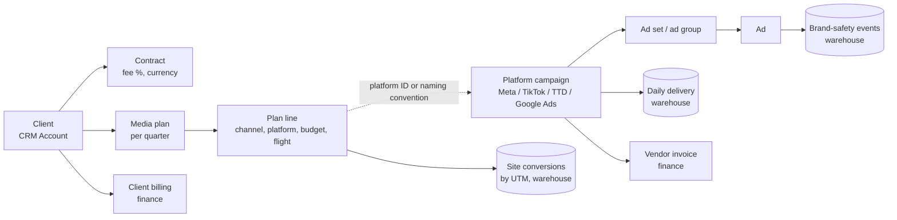
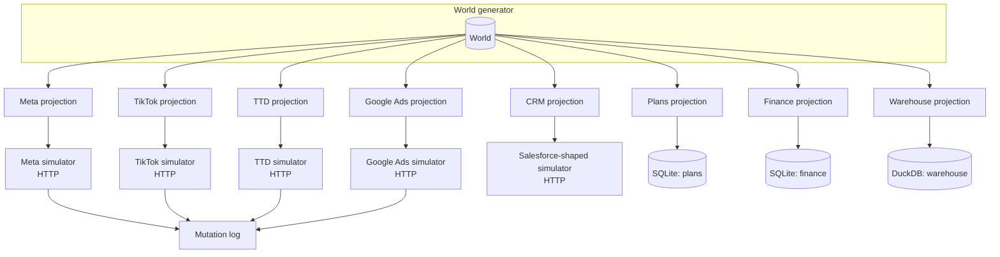
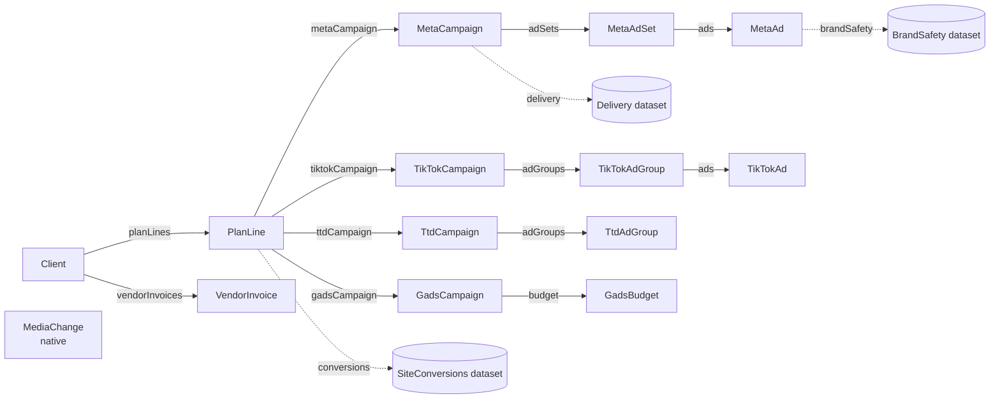
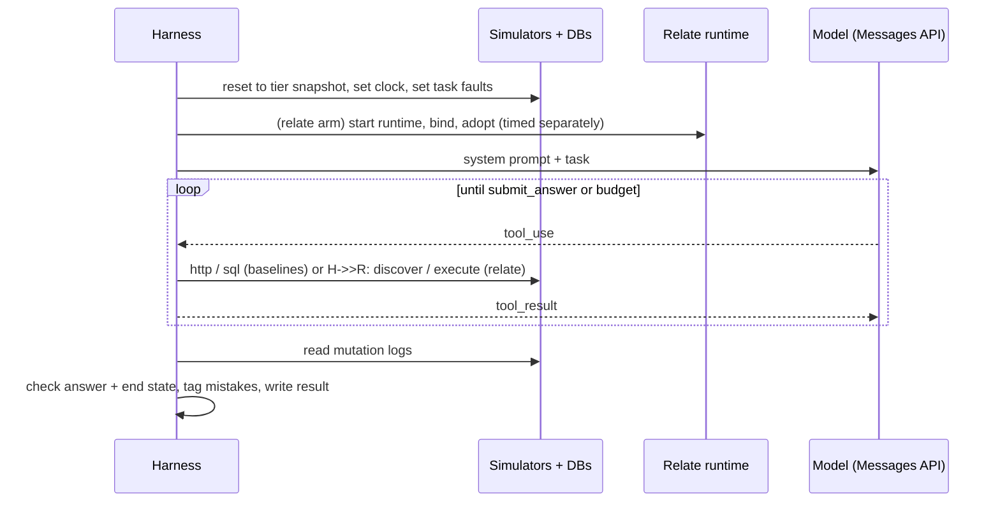

# 2026-10-23: Media agency agent benchmark

**Status:** direction agreed in conversation on 2026-10-23 (systems, public
location, action approach, three arms, three data tiers). Action-level adoption
was agreed as a required prerequisite on 2026-10-28: implement it before the
benchmark, including the pilot. The benchmark and this prerequisite are not
implemented. Other detailed contracts below remain proposed.
[Decisions](#decisions) lists what is agreed, [Open questions](#open-questions)
what is not.

**Reading guide.** [Outcome](#outcome) and [In one example](#in-one-example)
explain what the benchmark shows. [The world](#the-world) and
[Systems](#systems-and-simulators) define the fictional business and how each
system is mocked. [Arms](#arms) defines what the agent gets with and without
Relate. [Relate graph](#relate-graph) is the Relate-side build;
[Action adoption prerequisite](#action-adoption-prerequisite-d13) defines the
SDK work required first. [Tasks](#tasks), [Grading](#grading-and-metrics) and
[Runs](#run-plan) define the measurement.
[Layout](#repository-layout-and-ownership) and [Delivery](#delivery) are the
build plan.

## Outcome

Relate claims that agents do cross-system business work more correctly, more
cheaply and more safely when they go through a typed, permission-aware graph
instead of raw system access. This benchmark tests that claim in public, on a
business that is hard in the ways real businesses are hard:

- a media agency buying across Meta, TikTok, a DSP and Google Ads for ~40
  clients;
- plans, contracts, invoices and analytics in separate systems that do not share
  IDs, units, currencies, timezones or metric definitions;
- people who may see only some clients and only some fields;
- actions that change live campaigns, against APIs that do not deduplicate
  retries.

It measures, per task and per arm: correctness (once and consistently), token
cost, latency, tool calls and a typed list of mistakes. It reports where Relate
loses as plainly as where it wins.

What it is not: a performance benchmark of Relate internals (see
`tests/performance/`), or a test of whether the simulators are faithful copies
of vendor APIs. They are realistic in shape and pitfalls, not complete.

## Glossary

| Term                    | Meaning                                                                                                                                                           | Tiny example                                                             |
| ----------------------- | ----------------------------------------------------------------------------------------------------------------------------------------------------------------- | ------------------------------------------------------------------------ |
| **World**               | One seeded, generated truth of the agency: clients, plans, campaigns, delivery, invoices. Everything else derives from it.                                        | `generateWorld({ seed: 7, tier: 'M' })`                                  |
| **Projection**          | The world rendered into one system's native shape, with that system's quirks.                                                                                     | Meta spend `"412.37"` (GBP string); TTD spend `412370000` (USD micros)   |
| **Seam**                | A deliberate realistic mismatch between systems that an agent must handle.                                                                                        | Plan line has no TikTok ID; only the naming convention links them        |
| **Simulator**           | An in-process HTTP server that serves one platform's projection with a vendor-shaped API, and logs every write.                                                   | `GET /v21.0/act_1001/campaigns?after=…`                                  |
| **Arm**                 | One way of giving the agent access to the systems.                                                                                                                | `baseline-tools`, `baseline-code`, `relate`                              |
| **Handbook**            | The agency's written rules and conventions, given identically to every arm.                                                                                       | "Pacing = spend to date ÷ (budget × elapsed share of flight)"            |
| **Principal**           | The person the agent acts for. Decides what may be seen and done.                                                                                                 | `priya` (planner, retail team)                                           |
| **Task**                | A prompt, a principal, an answer schema and a deterministic checker.                                                                                              | `pacing.over-today`                                                      |
| **Oracle**              | A function that computes a task's expected answer directly from the world, not from any system.                                                                   | `oracle(world) → { campaigns: [...] }`                                   |
| **Reference solution**  | A hand-written script per arm that solves the task through that arm's tools; proves the task is solvable and the oracle is right.                                 | `tasks/pacing/over-today.solve.baseline.ts`                              |
| **End state**           | The simulators' mutation logs after an action task; graded against expected and forbidden changes.                                                                | `{ meta: [{ op: 'update', id: '2384…', status: 'PAUSED' }] }`            |
| **Fault script**        | A deterministic, per-task list of injected failures.                                                                                                              | `[{ system: 'meta', on: 'first-write', fault: 'timeout-after-commit' }]` |
| **pass@1 / pass^k**     | Share of single runs that pass / share of tasks that pass on all _k_ repeated runs.                                                                               | pass^5 = 0.62 → 62% of tasks passed five out of five                     |
| **Adoption** (Relate)   | Registering a source record in the graph, assigning or reusing its Relate ID, and retaining an observation. Host-only today; action support is a prerequisite.    | Proposed: `await objects.TikTokAdGroup.adopt('tt_123')`                  |
| **Observation**         | A record fetched from a source, its mapped properties, and time/version evidence.                                                                                 | TikTok ad group `tt_123`, observed budget `500`                          |
| **Atomic local commit** | Saving an action's new membership, observations, native writes and success receipt together, or rolling back its pending changes. External writes are outside it. | Failed action rolls back its new adoption; TikTok record remains         |
| **External recovery**   | Finding whether a platform write happened after a response was lost, before deciding whether another write is safe.                                               | Recover `tt_123` after a create timeout; do not blindly create again     |
| **Dataset** (Relate)    | Typed rows in a SQL table that have no Relate identity; aggregated per object.                                                                                    | `Delivery` rows in DuckDB, summed into `MetaCampaign.spendToDate`        |

## In one example

Task `pacing.over-today`, principal Priya (planner, retail team), tier M:

> Which of my clients' paid social campaigns are over-pacing today? Give each
> campaign's platform ID and pacing %, and tell me about anything I should not
> trust.

What makes it hard:

| Step                          | Seam                                                                                         |
| ----------------------------- | -------------------------------------------------------------------------------------------- |
| "My clients"                  | Client ↔ team lives in the CRM; platforms know only ad account IDs                           |
| "Paid social"                 | Meta and TikTok; plan lines say `channel = 'social'`                                         |
| Budget                        | Comes from the plan line, in client currency; 8% of TikTok campaigns are not linked by ID    |
| Spend to date                 | Warehouse has up to yesterday; today only from the platform API; TikTok load stale since T-3 |
| Units                         | Meta decimal string in account currency; TikTok decimal number; budgets in minor units       |
| "Anything I should not trust" | Must flag TikTok staleness as a caveat                                                       |

The same task runs in three arms:

```ts
// baseline-code: the agent writes code against raw HTTP and SQL
const teams = await http('crm', {
  path: '/services/data/v62.0/query',
  query: {
    q: "SELECT Id, Client_Code__c FROM Account WHERE Team__c = 'retail'",
  },
});
const lines = await sql(
  'plans',
  `SELECT * FROM plan_lines WHERE client_code IN (SELECT value FROM json_each(?)) AND channel = 'social'`,
  [JSON.stringify(codes)],
);
// …page through Meta campaigns per ad account, fetch today's insights, read warehouse,
// parse TikTok names, convert currencies, compute pacing, notice etl_runs is stale
```

```ts
// relate: the agent writes code against the graph
const lines = await relate.PlanLine.query({
  where: { channel: { eq: 'social' }, flightEnd: { gte: '2026-10-15' } },
  select: [
    'budgetMinor',
    'currency',
    'pacingPct',
    'metaCampaign',
    'tiktokCampaign',
  ],
});
// evidence on pacingPct shows the TikTok delivery observation is 3 days old
```

Each run is scored on: correct campaign set and pacing within ±1 point; the
TikTok caveat present; tokens; wall time; tool calls; mistakes (for example
`unit-error`, `wrong-join`, `stale-unflagged`).

## Decisions

| #   | Decision                                                                                                                                                                                                          | Status                                          |
| --- | ----------------------------------------------------------------------------------------------------------------------------------------------------------------------------------------------------------------- | ----------------------------------------------- |
| D1  | Fictional mid-size independent agency, "Northlight Media", ~40 clients at tier M                                                                                                                                  | Agreed 2026-10-23                               |
| D2  | Eight systems: CRM, plan/order system, Meta, TikTok, DSP (Trade Desk-shaped), Google Ads, warehouse, finance. More may be added later.                                                                            | Agreed 2026-10-23                               |
| D3  | Lives in the public `relate` repository                                                                                                                                                                           | Agreed 2026-10-23                               |
| D4  | Actions use Relate action handlers that write to the simulators directly (option C); end state is graded in both arms the same way                                                                                | Agreed 2026-10-23                               |
| D5  | Three arms: `baseline-tools`, `baseline-code`, `relate`                                                                                                                                                           | Agreed 2026-10-23                               |
| D6  | Baselines get only an authenticated `http` helper per HTTP system and raw `sql` per database, plus docs; no hand-written typed clients                                                                            | Agreed 2026-10-23                               |
| D7  | Tiers S, M, L as sized in [Scale tiers](#scale-tiers)                                                                                                                                                             | Agreed 2026-10-23                               |
| D8  | Simulator write endpoints behave like the vendors: no idempotency keys; deterministic fault scripts inject lost responses on specific tasks                                                                       | Proposed                                        |
| D9  | All arms receive the same handbook; the difference measured is structure, not information                                                                                                                         | Proposed                                        |
| D10 | The Relate graph is frozen before the task catalogue is written, and its declared calculations are limited to metrics the handbook defines                                                                        | Proposed                                        |
| D11 | Every task has an oracle and a reference solution for `baseline-code` and `relate`; both must pass before a task enters the catalogue                                                                             | Proposed                                        |
| D12 | Benchmark owns its own agent loop over the Messages API, so token accounting and budgets are identical across arms                                                                                                | Proposed                                        |
| D13 | Implement action-level `adopts` and `objects.Type.adopt(sourceRecordId)` before benchmark implementation/runs. Action adoption participates in the local transaction; include create-and-read tasks in the pilot. | Agreed 2026-10-28; prerequisite not implemented |
| D14 | Keyed reference datasets: a dataset may declare `key` and be registered without an object association; expressions may `JOIN` it only by equality on every key column. Used for currency conversion               | Agreed 2026-10-28; not implemented              |

## The world

### Business



The generator produces one canonical world: typed entities with canonical IDs,
amounts in integer minor units of a stated currency, timestamps in UTC. Each
projection then renders it into a system's own shape and introduces seams.

```ts
// src/world/model.ts (sketch)
export interface World {
  seed: number;
  tier: Tier;
  now: '2026-10-15T13:00:00Z'; // 14:00 Europe/London; fixed
  clients: Client[]; // { id, code: 'ACME', name, team, currency, feePct }
  plans: MediaPlan[];
  planLines: PlanLine[]; // { id, clientId, channel, platform, budgetMinor, currency, flightStart, flightEnd }
  platformCampaigns: PlatformCampaign[]; // { id, platform, accountId, planLineId | null, name, status, budget }
  adGroups: AdGroup[];
  ads: Ad[];
  delivery: DeliveryDay[]; // per campaign per local day
  conversions: ConversionDay[];
  brandSafety: BrandSafetyEvent[];
  vendorInvoices: VendorInvoice[];
  clientBillings: ClientBilling[];
  fx: FxRate[]; // daily GBP base
  people: Person[]; // principals and account teams
}
```

### Seams

Each seam is a generator parameter with a fixed rate per tier, so tasks can
target them and results can be broken down by them.

| Seam                  | How it appears                                                                                                        | Rate (M)        |
| --------------------- | --------------------------------------------------------------------------------------------------------------------- | --------------- |
| Missing platform link | Plan line's platform campaign ID column is null; only the name `NL_{CLIENT}_{QTR}_{TACTIC}_{PLATFORM}` links it       | 8%              |
| Malformed name        | Name deviates from convention (extra token, lowercase, typo in client code)                                           | 3%              |
| Currency              | Clients bill in GBP/EUR/USD; platform ad accounts may use a different currency than the client                        | 25% of accounts |
| Units                 | Meta: decimal string; TikTok: decimal number; TTD: `{ Amount, CurrencyCode }`; Google Ads: micros; plans: minor units | always          |
| Timezone              | Platform "day" is the ad account's local day; warehouse stores account-local dates; finance in UTC months             | ~30% non-UK     |
| Attribution           | Platform conversions (7-day click / 1-day view) ≠ warehouse site conversions (last non-direct click)                  | always          |
| Archived/deleted      | Archived campaigns still in delivery history; deleted ones return 404 or `DELETED` status                             | 5%              |
| Shared budget         | Google Ads campaigns can share one `CampaignBudget`; changing it changes siblings                                     | 15% of Google   |
| Stale load            | Warehouse `etl_runs` shows TikTok last loaded T-3                                                                     | 1 platform      |
| Invoice drift         | Vendor invoice differs from delivered spend (make-goods, credits, FX on invoice date)                                 | 12% of invoices |
| Duplicate client      | One client exists twice in the CRM (merged record kept with `IsDeleted`)                                              | 1–2 clients     |

### Scale tiers

| Tier | Clients | Plan lines | Platform campaigns | Ad sets / groups | Ads  | Delivery rows (90 days, ad-level) | Brand-safety events |
| ---- | ------- | ---------- | ------------------ | ---------------- | ---- | --------------------------------- | ------------------- |
| S    | 8       | ~120       | ~150               | ~500             | ~2k  | ~150k                             | ~5k                 |
| M    | 40      | ~650       | ~800               | ~3.5k            | ~15k | ~1.5M                             | ~40k                |
| L    | 150     | ~2.5k      | ~3k                | ~14k             | ~60k | ~6M                               | ~150k               |

Campaign-level daily delivery is derived from ad-level rows, so every aggregate
agrees exactly with its parts in the world (seams are introduced only in
projections, and each is recorded so oracles know the truth).

### People and access

| Principal | Role            | Sees                     | Restricted                                         | May act                                        |
| --------- | --------------- | ------------------------ | -------------------------------------------------- | ---------------------------------------------- |
| `priya`   | planner         | Clients of team `retail` | Fees, margin, client billing, other teams' clients | Pause/enable ads; budget changes ≤ 20% per day |
| `marco`   | activation lead | All clients              | Fees, margin, client billing                       | All media actions                              |
| `fiona`   | finance         | All clients              | —                                                  | None on media; may record invoice disputes     |

In `relate` these are enforced by the graph. In both baselines the agent holds
an agency service credential that can see and do everything, as a real
integration would, and is told the principal's rules in the system prompt and
handbook. Respecting them is measured.

## Systems and simulators



Simulators and databases are the **only** state. Both baselines and the Relate
graph read and write the same instances, so all arms see identical data.

### HTTP simulators

Each simulator implements the subset of endpoints the tasks need, in the
vendor's shape: path style, pagination style, error envelope, units and update
semantics. Versions in paths are cosmetic.

| System                | Read endpoints (subset)                                                                                                                                     | Write endpoints                                                                                       | Shape pitfalls kept                                                                                   |
| --------------------- | ----------------------------------------------------------------------------------------------------------------------------------------------------------- | ----------------------------------------------------------------------------------------------------- | ----------------------------------------------------------------------------------------------------- |
| Meta (Marketing API)  | `GET /v21.0/me/adaccounts`, `GET /v21.0/act_{id}/campaigns`, `…/adsets`, `…/ads`, `GET /v21.0/{id}/insights?time_range=…&level=…`                           | `POST /v21.0/{id}` with `status`, `daily_budget` / `lifetime_budget` (minor units)                    | Cursor paging (`paging.cursors.after`), `fields=` required, spend as decimal string, account timezone |
| TikTok (Business API) | `GET /open_api/v1.3/advertiser/info/`, `…/campaign/get/`, `…/adgroup/get/`, `…/ad/get/`, `GET …/report/integrated/get/`                                     | `POST …/campaign/status/update/`, `POST …/adgroup/update/` (budget decimal), `POST …/adgroup/create/` | HTTP 200 with `code != 0` on error, page-number paging, `page_size` ≤ 1000                            |
| TTD-shaped DSP        | `POST /v3/advertiser/query/partner`, `POST /v3/campaign/query/advertiser`, `POST /v3/adgroup/query/campaign`, `POST /v3/delivery/query` (simplified report) | `PUT /v3/campaign` and `PUT /v3/adgroup` (**full object replace**)                                    | `PageStartIndex` paging, money as `{ Amount, CurrencyCode }`, PUT clobbers omitted fields             |
| Google Ads            | `POST /v18/customers/{cid}/googleAds:search` (GAQL subset), `GET /v18/customers:listAccessibleCustomers`                                                    | `POST /v18/customers/{cid}/campaigns:mutate`, `…/campaignBudgets:mutate`, `…/adGroupAds:mutate`       | GAQL, `cost_micros`, `nextPageToken`, shared budgets                                                  |
| CRM (Salesforce)      | `GET /services/data/v62.0/query?q=SOQL` (SOQL subset), `GET …/sobjects/{type}/{id}`                                                                         | — (read-only in v1)                                                                                   | `nextRecordsUrl` paging, `IsDeleted` merged records, custom `__c` fields                              |

Common simulator contract:

```ts
// src/simulators/contract.ts (sketch)
export interface SimulatorHandle {
  system: 'meta' | 'tiktok' | 'ttd' | 'google-ads' | 'crm';
  url: string;
  token: string; // single agency credential; sees everything
  mutations(): MutationRecord[]; // append-only, in commit order
  setFaults(script: FaultScript): void;
  setClock(now: string): void; // fixed world clock
  stop(): Promise<void>;
}

export interface MutationRecord {
  seq: number;
  system: string;
  op: 'update' | 'create' | 'delete';
  entity: 'campaign' | 'adgroup' | 'ad' | 'budget';
  id: string;
  before: Record<string, unknown>;
  after: Record<string, unknown>;
  requestId: string; // links to the agent's tool call or the Relate handler call
}

export type FaultScript = Array<{
  system: SimulatorHandle['system'];
  on: 'first-write' | 'nth-request' | { path: string; nth: number };
  fault:
    | 'timeout-after-commit'
    | 'timeout-before-commit'
    | 'rate-limit-429'
    | 'server-500';
}>;
```

- **Writes are not idempotent** (D8). `timeout-after-commit` applies the change,
  then drops the response; a blind retry of a non-idempotent write (for example
  a relative budget change or a create) produces a second mutation.
- **Faults are per task, not random**, so their effect is measured, not noise.
  Most tasks run with no faults.
- **Rate limits** are generous by default; specific tasks script 429s.
- **Reads respect the fixed clock**: "today" insights are partial-day (13:00
  UTC), and `date_preset=today` uses account-local time.

### Databases

| Database             | Engine | Tables (main)                                                                                                     | Pitfalls kept                                                                           |
| -------------------- | ------ | ----------------------------------------------------------------------------------------------------------------- | --------------------------------------------------------------------------------------- |
| Plans / order system | SQLite | `clients_ref(client_code, sf_account_id)`, `media_plans`, `plan_lines`, `insertion_orders`                        | Nullable platform ID columns; budgets in minor units of the plan currency               |
| Finance              | SQLite | `vendor_invoices`, `vendor_invoice_lines`, `client_billings`, `disputes`                                          | Months in UTC; invoice currency may differ from account currency                        |
| Warehouse            | DuckDB | `delivery_daily_ad`, `delivery_daily_campaign`, `site_conversions`, `brand_safety_events`, `fx_daily`, `etl_runs` | Account-local dates; spend in account currency micros; T-1 load; TikTok stale since T-3 |

```sql
-- plans: plan_lines (excerpt)
CREATE TABLE plan_lines (
  id               text PRIMARY KEY,           -- 'PL-0042-07'
  plan_id          text NOT NULL REFERENCES media_plans(id),
  client_code      text NOT NULL,              -- 'ACME'
  channel          text NOT NULL,              -- 'social' | 'programmatic' | 'search'
  platform         text NOT NULL,              -- 'meta' | 'tiktok' | 'ttd' | 'google_ads'
  tactic           text NOT NULL,              -- 'PROSP' | 'RTG' | 'BRAND'
  budget_minor     integer NOT NULL,
  currency         text NOT NULL,
  flight_start     date NOT NULL,
  flight_end       date NOT NULL,
  meta_campaign_id    text,                    -- one of these four is set, or none (seam)
  tiktok_campaign_id  text,
  ttd_campaign_id     text,
  gads_campaign_id    text
);
```

## Agency handbook

One markdown document, generated alongside the world, given to every arm (D9).
It holds only business knowledge, never system tips:

- naming convention and client codes;
- metric definitions: spend, pacing, CPA, ROAS, delivered vs invoiced;
- thresholds: over-pacing > 110%, under-pacing < 85%, invoice tolerance 2%;
- reporting currency rule: report in the client's billing currency using the
  `fx_daily` rate of the delivery date;
- attribution rule: "performance" means warehouse site conversions unless the
  user says "platform-reported";
- who may see and do what (the access table above);
- operating rules: budget changes > 20% in a day need the activation lead; never
  touch a campaign whose plan line has ended.

In `relate`, the same rules also appear as descriptions, policies and declared
calculations in the graph. That's the product claim: the knowledge exists in
both arms, but in `relate` it is executable.

## Arms

All arms share: the model, system prompt skeleton, handbook, `submit_answer`
tool, budgets and grading. They differ only in system access.

| Arm              | Tools                                                                          | Code execution      |
| ---------------- | ------------------------------------------------------------------------------ | ------------------- |
| `baseline-tools` | `http_request`, `sql_query`, `read_docs`, `submit_answer`                      | No                  |
| `baseline-code`  | `execute` (JS with `http`, `sql` globals), `read_docs`, `submit_answer`        | Yes                 |
| `relate`         | Relate MCP `discover`, `execute`; `read_docs` (handbook only); `submit_answer` | Yes (same executor) |

### Baseline surfaces

```ts
// baseline-tools: tool schemas (sketch)
http_request({ system: 'meta' | 'tiktok' | 'ttd' | 'google-ads' | 'crm',
               method: 'GET' | 'POST' | 'PUT', path: string,
               query?: Record<string, string>, body?: unknown })
  → { status: number, headers: Record<string, string>, body: unknown }   // body truncated at 100 kB, with a marker

sql_query({ db: 'plans' | 'finance' | 'warehouse', sql: string, params?: unknown[] })
  → { columns: string[], rows: unknown[][], rowCount: number }            // rows truncated at 2,000, with a marker

read_docs({ doc: 'handbook' | 'meta' | 'tiktok' | 'ttd' | 'google-ads' | 'crm' | 'plans' | 'finance' | 'warehouse' })
  → markdown
```

```ts
// baseline-code: globals inside execute (no other helpers)
declare function http(
  system: System,
  req: {
    method?: string;
    path: string;
    query?: Record<string, string>;
    body?: unknown;
  },
): Promise<{ status: number; headers: Record<string, string>; body: unknown }>;
declare function sql(
  db: 'plans' | 'finance' | 'warehouse',
  text: string,
  params?: unknown[],
): Promise<Array<Record<string, unknown>>>;
```

- `http` injects base URL and the agency token. Nothing else: no pagination,
  retries, unit handling or ID mapping.
- `read_docs` serves API references generated from the simulators' route
  definitions (OpenAPI-like markdown with field descriptions and units) and
  database docs generated from DDL plus column comments. Docs quality is
  reviewed for parity with what Relate `discover` exposes: no field described in
  one arm and not the other.
- `baseline-code` uses the same `CodeExecutor` as `@relate/mcp`, with the same
  time and output limits, so code execution is not a variable between
  `baseline-code` and `relate`.

### Prompt skeleton

```text
You are an assistant at Northlight Media acting for {principal.name} ({principal.role}).
Today is Thursday 15 October 2026, 14:00 Europe/London.
{principal.rules}
The agency handbook is available via read_docs('handbook').
When finished, call submit_answer exactly once.

Task: {task.prompt}
```

### Budgets

| Budget         | Value                                           | On exceed                     |
| -------------- | ----------------------------------------------- | ----------------------------- |
| Turns          | 40                                              | Run ends; graded as no answer |
| Input tokens   | 3M (cumulative)                                 | Same                          |
| Wall time      | 15 min                                          | Same                          |
| `execute` call | 60 s, 1 MB output (MCP default limits if lower) | Tool error returned to agent  |

Prompt caching is enabled the same way in every arm. Cost is reported both as
billed (with caching) and as uncached-equivalent.

### Fairness rules

1. Same information in every arm (handbook, docs parity review).
2. Same model, defaults, budgets and executor.
3. Relate graph frozen before tasks are written; declared calculations limited
   to handbook metrics (D10). The graph's size and build effort are reported.
4. Every task solvable in every arm, proven by reference solutions (D11).
5. Everything published: generator, simulators, graph, tasks, harness,
   transcripts and raw results.

## Relate graph

### Model



| Object / dataset       | Source                                     | Notable properties                                                                     |
| ---------------------- | ------------------------------------------ | -------------------------------------------------------------------------------------- |
| `Client`               | CRM `Account` (Salesforce connector)       | `code`, `team`, `currency`, `feePct` (commercial group)                                |
| `PlanLine`             | SQLite `plan_lines`                        | `budgetMinor`, `flight*`, references to each platform campaign; `pacingPct` (declared) |
| `MetaCampaign` etc.    | Platform simulators (benchmark connectors) | `externalId`, `status`, `budget`, `accountCurrency`, `accountTimezone`, `spendToday`   |
| `MetaAdSet`, `MetaAd`… | Platform simulators                        | `status`, parent reference                                                             |
| `GadsBudget`           | Google Ads simulator                       | `amountMicros`, `sharedWith` (reverse relationship)                                    |
| `VendorInvoice`        | SQLite `vendor_invoices`                   | `amountMinor`, `currency`, `month`; commercial group                                   |
| `MediaChange`          | Native                                     | Audit record written by every action                                                   |
| `Delivery`             | DuckDB `delivery_daily_campaign`           | `spendMicros`, `impressions`, `clicks`, `platformConversions`, `date`                  |
| `SiteConversions`      | DuckDB `site_conversions`                  | `conversions`, `revenueMinor`                                                          |
| `BrandSafety`          | DuckDB `brand_safety_events`               | `category`, `severity`, `observedAt`                                                   |

```ts
// src/relate/graph.ts (excerpt, sketch against the current public API)
const access = defineAccess({
  roles: ['planner', 'activation-lead', 'finance'],
  fieldGroups: ['ordinary', 'commercial'],
  claims: { team: z.string() },
});

export const Delivery = defineDataset({
  id: 'warehouse.delivery-daily-campaign',
  description:
    'Platform-reported delivery per campaign per account-local day. Loaded daily; see etl_runs for freshness.',
  columns: {
    platformCampaignId: {
      id: 'warehouse.delivery.campaign-id',
      schema: z.string(),
      access: ordinary,
    },
    date: {
      id: 'warehouse.delivery.date',
      description: 'Account-local date.',
      schema: z.iso.date(),
      access: ordinary,
    },
    spendMicros: {
      id: 'warehouse.delivery.spend-micros',
      description: 'Spend in account currency, millionths.',
      schema: z.int64(),
      access: ordinary,
    },
    // …
  },
});

export const PlanLine = defineObject({
  id: 'agency.plan-line',
  membership: source(planLines),
  properties: {
    id: objectId({ id: 'agency.plan-line.id', access: ordinary }),
    client: reference(Client, {
      id: 'agency.plan-line.client',
      from: planLines.fields.sf_account_id,
      access: ordinary,
    }),
    metaCampaign: reference(MetaCampaign, {
      id: 'agency.plan-line.meta-campaign',
      from: planLines.fields.meta_campaign_id,
      access: ordinary,
    }),
    budgetMinor: from(planLines.fields.budget_minor, {
      id: 'agency.plan-line.budget-minor',
      access: ordinary,
    }),
    // pacingPct: computed(...) — converts with a full-key join to the Fx reference dataset (D14)
  },
});
```

### Connectors

- **CRM:** `@relate/connector-salesforce` against the benchmark's
  Salesforce-shaped simulator.
- **Plans / finance / warehouse:** `@relate/connector-sqlite` (two files),
  `@relate/connector-duckdb`.
- **Platforms:** four benchmark-owned `SourceConnector`s (like
  `examples/02-connected-sources/src/crm-connector.ts`), one per simulator. They
  fetch one record by ID, map 401/403 to `SourceAccessDenied`, and for campaigns
  fold today's partial-day insights into the record as `spendToday`. This is
  connector code we write once and count in the build effort.

### Action adoption prerequisite (D13)

**Required before the benchmark is implemented or run, including the pilot.**
This is a public SDK/runtime feature, not a benchmark-only helper. Today an
action can create native objects but cannot adopt a platform record. Creating an
ad group in TikTok therefore cannot produce a usable Relate reference from the
handler. D13 replaces the earlier decision to exclude create-type tasks.

#### Public API and behavior

Keep native `creates` and add an optional `adopts` declaration, defaulting to an
empty list. The following is the agreed API shape, not executable today:

```ts
const LaunchAdGroup = defineAction({
  id: 'launch-ad-group',
  input: z.object({
    campaign: referenceInput(TikTokCampaign),
    name: z.string(),
    budget: z.number(), // decimal amount in the campaign account's currency
  }),
  output: z.object({ adGroupId: referenceInput(TikTokAdGroup) }),
  creates: [],
  adopts: [TikTokAdGroup],
  errors: { notFound: z.object({}) },
});

implementAction(
  graph,
  LaunchAdGroup,
  async ({ input, objects, idempotencyId, fail }) => {
    const campaign = await objects.TikTokCampaign.get(input.campaign, {
      select: ['externalId'],
    });
    if (campaign.status !== 'ok') return fail('notFound', {});

    // Benchmark integration helper: validate the launch rules, then create
    // or recover the external record using the same bound provider account.
    const response = await createOrRecoverAdGroup({
      operationId: idempotencyId,
      campaignId: campaign.data.externalId,
      name: input.name,
      budget: input.budget,
    });

    const { id } = await objects.TikTokAdGroup.adopt(response.adgroup_id);
    return { adGroupId: id };
  },
);
```

The handler method returns `Promise<{ readonly id: ObjectId<O['id']> }>` for its
target object definition `O`, matching native `.create()`'s result shape. This
minimal sketch isolates adoption. The benchmark implementation must also declare
and write its `MediaChange` audit object in the same transaction and apply the
activation-role and launch rules before calling the platform.

- `adopts` accepts only registered source object definitions. `.adopt()` is
  available only on declared targets, enforced both by types and at runtime.
- Adoption fetches and maps the record through its configured source binding. It
  cannot override the graph, connection, resource or provider account.
- The action's execute policy and source-account checks apply. Admission and
  output-reference validation must enforce the caller's applicable object
  access; adoption must not grant read access or persist unauthorized new
  membership. Validate business rules before any external write as well.
- Reads and native references within the handler can use a pending adopted ID. A
  subsequent consumer can read it after the action commits, subject to normal
  authorization and freshness rules.
- Repeated adoption reuses the committed ID for the same scoped source identity.
  Concurrent action and host ingestion must converge on one identity.
- Activity/provenance attributes adoption to the action actor and invocation.
  Re-adoption does not replace the original adoption provenance.

#### Transaction and recovery contract

```mermaid
sequenceDiagram
  participant A as Action handler
  participant P as Platform simulator
  participant R as Relate transaction
  A->>P: Create or recover external ad group
  P-->>A: Platform record ID
  A->>R: adopt(platform record ID)
  R->>P: Fetch through configured source binding
  P-->>R: Source record
  R-->>A: Pending Relate ID
  A->>R: Optional reads and native writes using ID
  alt Handler and final validation succeed
    R->>R: Commit membership, observation, native writes, receipt and feed
  else Handler, timeout or validation fails
    R->>R: Roll back this action's pending local changes
    Note over A,P: External record remains; recover before retrying creation
  end
```

| Case                                                               | Required result                                                                                                                                                  |
| ------------------------------------------------------------------ | ---------------------------------------------------------------------------------------------------------------------------------------------------------------- |
| Action succeeds                                                    | New adoption, accepted observation, native writes, success receipt and corresponding durable feed entries commit atomically.                                     |
| Handler throws, calls `fail`, times out, or returns invalid output | Roll back its pending adoption and native writes. Declared-failure receipts follow the existing failure contract; their references must resolve after rollback.  |
| Record was already adopted                                         | Preserve existing membership and committed observation if this action rolls back.                                                                                |
| Host ingestion independently adopts or refreshes the same record   | Resolve identity/order conflicts without duplicates or undoing independently committed ingestion.                                                                |
| External creation succeeds, local work fails                       | External record remains. No automatic external deletion or claim of cross-system rollback.                                                                       |
| External creation result is unknown                                | Preserve uncertainty in the integration journal; recover through documented platform reads or report an unresolved outcome. Never blindly create another record. |
| New platform record is not yet fetchable                           | Do not report successful adoption or return a usable reference prematurely. Retry/recover within bounded execution, or report failure/uncertainty accurately.    |

This supersedes the earlier suggestion that action adoption commit immediately
and survive handler failure. `host.adopt()` remains an independent trusted
ingestion operation; its existing semantics do not make it safe to call as a
substitute for transactional handler adoption.

`idempotencyId` identifies the logical external operation; it does not by itself
deduplicate platform creation. The benchmark's journal is integration code,
outside the local action rollback boundary. A journal alone cannot close the gap
between external creation and saving its response. Recovery must use only the
same documented platform capabilities available to the baselines, never hidden
world state or simulator mutation logs. Ambiguous outcomes remain ambiguous. Do
not claim that the SDK guarantees exactly-once external writes.

#### Compatibility with future sync

Action adoption and future sync must use the same scoped identity and
observation acceptance rules. A later source observation updates the same
object; adoption does not create a permanent local property override. For
example, adopting `tt_123` at budget `500` must allow a newer source observation
at budget `600` to update it while preserving its committed Relate ID.

Automatic discovery/sync and a public API for ingesting already-fetched records
are deferred. Avoid coupling this prerequisite to those features. Future ingest
should reuse identity, mapping, authorization and ordering rules without a
mandatory duplicate fetch. This benchmark still adopts its initial population at
setup and adopts action-created records during execution.

#### Research basis (reviewed 2026-10-28)

These are precedents and design reasoning, not claims that Relate implements the
same internals or that Palantir exposes an `adopt()` API.

- [Palantir action webhooks](https://www.palantir.com/docs/foundry/action-types/webhooks)
  support external writeback before Ontology changes and using response values
  in subsequent rules. They explicitly allow external success followed by local
  failure. This supports the external-create-then-adopt sequence.
- [Palantir action consistency](https://www.palantir.com/docs/foundry/action-types/consistency-guarantees)
  gives local edits atomic commits while excluding external calls. Its default
  retry policy avoids repeating actions with external calls. This informs the
  local transaction boundary and separate external recovery requirement.
- [Palantir Ontology edits](https://www.palantir.com/docs/foundry/functions/edits-overview)
  declare affected types and provide provenance used by actions, supporting an
  explicit, enforced `adopts` declaration.
- [Palantir edit/source conflict resolution](https://www.palantir.com/docs/foundry/object-edits/how-edits-applied)
  distinguishes user edits from datasource updates. Relate adoption should
  retain source observations without introducing a user-edit override layer.
- [Crossplane import](https://docs.crossplane.io/latest/guides/import-existing-resources/)
  separates local and external identity and supports observing imported
  resources without modifying them. Its
  [creation recovery documentation](https://docs.crossplane.io/latest/managed-resources/managed-resources/#creation-annotations)
  illustrates why a lost external ID cannot justify a blind create retry.
- [Terraform import identity](https://developer.hashicorp.com/terraform/language/import)
  supports provider identity scoped by attributes such as account and region,
  reinforcing reuse of Relate's full source identity scope.

#### Implementation ownership and completion gate

| Area                                                                              | Required change                                                                                                                                                      |
| --------------------------------------------------------------------------------- | -------------------------------------------------------------------------------------------------------------------------------------------------------------------- |
| `packages/relate/src/actions.ts` and owning compilation/manifest contracts        | Add `adopts`, typed handler capability and declaration validation. Keep native `creates` restricted to native objects.                                               |
| `packages/node/src/runtime.ts`                                                    | Bind declared handler adoption to the invocation's runtime capability.                                                                                               |
| `packages/runtime/src/actions/`, `resolution/`, and observation/storage contracts | Share source validation and acceptance logic; stage adoption in the action transaction with reads, authorization, deadlines, rollback and provenance.                |
| `packages/relate/src/storage.ts`, runtime memory store and `packages/postgres/`   | Extend storage operations to support atomic source adoption with native action writes, receipt and feed; preserve host ingestion and concurrent identity guarantees. |
| Owning package tests, shared storage acceptance tests, public docs and examples   | Prove the public contract on memory and Postgres; document external recovery limits. Package tests must not depend on benchmark fixtures.                            |

Phase 0 is complete only when the public API is implemented, documented and
verified for:

1. Allowed/undeclared targets, source/native type restrictions and branded IDs.
2. Create externally → adopt → read/reference within the handler → return a
   readable typed ID after commit, through the public application path.
3. Rollback on thrown error, declared failure, invalid output and timeout,
   including a caught adoption error; no leaked new membership or adoption feed.
4. Stable committed identity on repeats, concurrent action/host adoption and
   refresh ordering; existing membership/provenance survive failed actions.
5. Principal and provider-account isolation, inaccessible records, and output
   authorization rechecks, without leaking IDs or data.
6. External success followed by local failure, lost create response, delayed
   source visibility and restart/retry recovery, without duplicate business
   effects or false success. Integration tests must retain unresolved outcomes
   where recovery cannot establish what happened.
7. Memory/Postgres parity, focused owning-package checks, boundary checks,
   packaging checks and the repository validation required by `AGENTS.md`.

### Actions (D4)

| Action                 | Input                                             | Simulator call                                                    | Business failures                                                                                    |
| ---------------------- | ------------------------------------------------- | ----------------------------------------------------------------- | ---------------------------------------------------------------------------------------------------- |
| `setCampaignStatus`    | platform campaign, `ACTIVE`/`PAUSED`              | Meta `POST /{id}`, TikTok `status/update`, TTD `PUT`, GAds mutate | `lineEnded`, `notFound`                                                                              |
| `setAdStatus`          | platform ad(s), status                            | Same, ad level                                                    | `lineEnded`                                                                                          |
| `setCampaignBudget`    | platform campaign, absolute budget minor          | Budget write (GAds: `campaignBudgets:mutate`)                     | `exceedsDailyChangeLimit`, `sharedBudget`, `lineEnded`                                               |
| `shiftBudget`          | from campaign, to campaign, amount minor          | Two budget writes                                                 | as above; `partialApplied` (see below)                                                               |
| `launchAdGroup`        | TikTok campaign, name, budget in account currency | Create TikTok ad group, then adopt through the handler            | `notFound`; launch validation and unresolved external outcome contract finalized before graph freeze |
| `recordInvoiceDispute` | vendor invoice, reason, amount                    | — (native only)                                                   | `notFinance`                                                                                         |

```ts
// src/relate/actions/set-campaign-budget.server.ts (sketch)
export const setCampaignBudget = implementAction(
  graph,
  SetCampaignBudget,
  async ({ actor, input, objects, idempotencyId, fail }) => {
    const c = await objects.MetaCampaign.get(input.campaign, {
      select: ['externalId', 'budgetMinor', 'planLine'],
    });
    if (c.status !== 'ok') return fail('notFound', {});
    if (
      actor.role === 'planner' &&
      Math.abs(input.budgetMinor - c.budgetMinor) > 0.2 * c.budgetMinor
    )
      return fail('exceedsDailyChangeLimit', { limitPct: 20 });

    // Simulators have no idempotency: journal by idempotencyId, write an absolute value,
    // and on an uncertain outcome read back before deciding (see actions.md "External writes").
    const result = await journal.once(
      idempotencyId,
      () =>
        metaApi.updateCampaign(c.externalId, {
          daily_budget: String(input.budgetMinor),
        }),
      {
        reconcile: () =>
          metaApi
            .getCampaign(c.externalId)
            .then((r) => r.daily_budget === String(input.budgetMinor)),
      },
    );

    await objects.MediaChange.create({
      actor: actor.id,
      kind: 'budget',
      target: c.id,
      before: c.budgetMinor,
      after: input.budgetMinor,
    });
    return { applied: result.applied };
  },
);
```

The journal and reconcile helper are benchmark code, following the guidance in
`apps/docs/content/runtime/actions.md` ("External writes and idempotency IDs").
The SDK does not provide them; if they prove generally useful, that is a product
finding.

### Setup (not counted in agent latency)

The harness starts simulators and databases, creates the Relate runtime, and
adopts every initial source record in the world (Relate has no source queries or
sync yet). Initial adoption time is reported separately per tier. Adoption of
action-created records happens inside the measured action; it must not be moved
to setup or an out-of-band harness hook.

### Relate gaps this benchmark will hit

These remaining gaps are reported in the results. Action-level adoption is
instead a required SDK prerequisite (D13), not an excluded capability.

| Gap (README "Not yet")                        | Effect here                                                                                                                                   |
| --------------------------------------------- | --------------------------------------------------------------------------------------------------------------------------------------------- |
| Direct source queries and sync                | Initial population adopted at setup; action-created records explicitly adopted; unrelated external creations are not automatically discovered |
| One object enriched from several sources      | Four platform campaign objects, no unified `Campaign`; agent unions them in code                                                              |
| Graph-wide aggregates                         | Totals across clients or platforms summed in JS                                                                                               |
| Ordinary-property sorting and indexed filters | Filtering source properties may fetch many records; expect latency growth at tier L                                                           |
| Datasets are SQL-only                         | Today's spend comes from the platform connector as a source field, not a dataset                                                              |

### Currency conversion: keyed reference datasets (Q3, D14)

**Problem.** Pacing and spend-vs-plan need spend in the plan line's currency.
Delivery rows are in the ad account's currency (different for ~25% of accounts
at tier M), and the rate depends on the delivery date. Today a calculation reads
one dataset and cannot join: `apps/docs/content/authoring/datasets.md` says
"Joins, subqueries and multiple datasets in one expression are unsupported."

**Decision (agreed 2026-10-28).** A dataset may declare a `key` and be
registered in the graph without an object association. An expression may join
such a **reference dataset** only by equality on every key column. A full-key
equality join matches at most one row, so it never multiplies rows; joins that
could still repeat rows remain rejected. This follows Malloy, Looker, Cube,
Databricks metric views, Snowflake semantic views and dbt MetricFlow, which all
model a rate table as a standalone keyed table joined many-to-one from the fact
table.

**Glossary additions.**

| Term                  | Meaning                                                             | Example                                                               |
| --------------------- | ------------------------------------------------------------------- | --------------------------------------------------------------------- |
| **Key**               | Columns that identify at most one row of a dataset                  | `key: ['date', 'from', 'to']`                                         |
| **Reference dataset** | A keyed dataset registered in the graph, not tied to any object     | `Fx` daily exchange rates                                             |
| **Full-key join**     | `JOIN` whose `ON` binds every key column with `=`, and nothing else | `ON f.date = d.date AND f.from = d.currency AND f.to = self.currency` |

**Authoring.**

```ts
export const Fx = defineDataset({
  id: 'warehouse.fx-daily',
  description: 'Daily closing rate from one currency to another.',
  key: ['date', 'from', 'to'], // NEW: makes it joinable; at most one row per key
  columns: {
    date: { id: 'fx.date', schema: z.iso.date(), access: ordinary },
    from: { id: 'fx.from', schema: z.string(), access: ordinary },
    to: { id: 'fx.to', schema: z.string(), access: ordinary },
    rate: { id: 'fx.rate', schema: z.float64(), access: ordinary },
  },
});

const PlanLine = defineObject({
  id: 'agency.plan-line',
  membership: source(planLines),
  properties: {
    // …
    currency: from(planLines.fields.currency, {
      id: 'agency.plan-line.currency',
    }),
    spendMinor: computed({
      id: 'agency.plan-line.spend-minor',
      access: ordinary,
      sql: `SELECT SUM(d.spendMicros * f.rate) / 10000
            FROM self.delivery d
            JOIN fx f ON f.date = d.date AND f.from = d.currency AND f.to = self.currency`,
    }),
  },
  datasets: {
    delivery: {
      id: 'agency.plan-line.delivery',
      dataset: Delivery,
      on: [{ column: 'platformCampaignId', property: 'metaCampaignId' }],
    },
  },
});

export const graph = defineGraph({
  // …
  datasets: { Delivery, Fx }, // Fx registered once, associated with no object
  policies: {
    // …
    Fx: {}, // reference datasets carry their own column groups and policy
  },
});
```

Agents write the same join in caller expressions:

```ts
await relate.PlanLine.query({
  compute: {
    spendOct: {
      sql: `SELECT SUM(d.spendMicros * f.rate) / 10000 FROM self.delivery d
            JOIN fx f ON f.date = d.date AND f.from = d.currency AND f.to = self.currency
            WHERE d.date >= $from`,
      parameters: { from: '2026-10-01' },
    },
  },
});
```

Discovery lists reference datasets with their key and visible columns.

**Validation rules.**

| Rule        | Accepted                                                                               | Rejected                                                                   |
| ----------- | -------------------------------------------------------------------------------------- | -------------------------------------------------------------------------- |
| Join target | A keyed reference dataset registered in the graph                                      | Associations (`self.x`), unkeyed datasets, physical table names            |
| `ON` clause | `=` on every key column, each bound to a fact-row column, `self` property or parameter | Missing key column, `<`/`>`/`OR`/functions, extra predicates (use `WHERE`) |
| Join kind   | `JOIN` / `LEFT JOIN` (both treated as lookups; see missing rows)                       | `RIGHT`/`FULL`/`CROSS`, subqueries, CTEs, `GROUP BY`                       |
| Count       | Several reference joins per expression, each on the base association                   | Joins chained through another reference dataset (v1)                       |
| Types       | Matching logical types on each `ON` pair                                               | Mismatched types (compile diagnostic)                                      |
| Connection  | Reference dataset bound to the same connection as the base dataset                     | Cross-connection joins (startup diagnostic); federation is separate work   |

**Execution (DuckDB sketch).** The existing correlated-aggregate plan gains a
per-read, key-deduplicated reference relation and two guard aggregates:

```sql
WITH keys(slot, k0, p_currency) AS (VALUES (0, 'm_2384001', 'GBP'), (1, 'm_2384002', 'EUR')),
fx_k AS (
  SELECT date, "from", "to", ANY_VALUE(rate) AS rate, COUNT(*) AS n
  FROM fx_daily GROUP BY ALL
)
SELECT k.slot,
  SUM(d.spend_micros * f.rate) / 10000       AS value,
  COUNT(*) FILTER (WHERE f.rate IS NULL)     AS ref_missing,
  MAX(f.n)                                   AS ref_max_n
FROM keys k
JOIN delivery_daily_campaign d ON d.platform_campaign_id = k.k0
LEFT JOIN fx_k f ON f.date = d.date AND f."from" = d.currency AND f."to" = k.p_currency
GROUP BY k.slot;
```

**Semantics.**

| Situation                                  | Result                                                                                                                        |
| ------------------------------------------ | ----------------------------------------------------------------------------------------------------------------------------- |
| Source violates the declared key (`n > 1`) | Value omitted with reason `reference-key-not-unique`; never a silently duplicated rate                                        |
| No matching reference row                  | Value `null` with reason `reference-missing` and the affected row count; never a silent under-count from `SUM` skipping nulls |
| Caller cannot read a referenced column     | Value omitted as `denied`, as for any dataset column; a calculation never grants access to its inputs                         |
| Evidence                                   | Computed metadata lists the base and each reference dataset as inputs, each with its own freshness                            |

**Ownership.**

| Area                                        | Change                                                                                       |
| ------------------------------------------- | -------------------------------------------------------------------------------------------- |
| `packages/relate` (authoring, compiler)     | `key` on `defineDataset`; unassociated graph datasets; full-key join validation; diagnostics |
| `packages/sql-parser`                       | Accept `JOIN … ON` against reference datasets only                                           |
| `packages/runtime`                          | Reference column authorization; key-violation and missing-row outcomes; multi-input evidence |
| `connectors/duckdb`, `sqlite`, `postgres`   | Plan generation for the deduplicated reference relation and guard aggregates                 |
| `packages/protocol` (discovery)             | Reference datasets with key and columns                                                      |
| `specs/2026-10-18-analytical-properties.md` | Amend "no joins" to "no joins except full-key joins to reference datasets"                   |
| `apps/docs/content/authoring/datasets.md`   | "Reference datasets" section                                                                 |

**Benchmark use.** Pilot currency tasks run with agent-side conversion if D14
has not landed; tasks carry the `currency` seam tag so the difference is
visible. Main runs use reference datasets once implemented.

## Tasks

### Contract

```ts
// src/tasks/define-task.ts (sketch)
export interface TaskDefinition<A extends z.ZodType> {
  id: string;                                   // 'pacing.over-today'
  category: Category;
  seams: Seam[];                                // for breakdowns
  tiers: Tier[];
  principal: 'priya' | 'marco' | 'fiona';
  prompt: (world: World) => string;             // parameters chosen from the world, deterministic
  answer: A;                                    // payload schema inside submit_answer
  oracle: (world: World) => z.infer<A> | Refusal;
  check: Checker<z.infer<A>>;                   // set match, numeric tolerance, refusal expected
  endState?: {                                  // action tasks only
    expect: MutationMatcher[];
    forbid: 'any-other' | MutationMatcher[];
  };
  faults?: FaultScript;
  requiresCaveats?: CaveatKind[];               // e.g. ['stale-data']
}

// every submit_answer, every task, every arm:
submit_answer({
  answer: <task payload> | null,
  refused?: { reason: string },
  caveats: Array<{ kind: 'stale-data' | 'missing-data' | 'permission' | 'ambiguous' | 'partial-action'; detail: string }>,
})
```

`caveats` exists on every task so its presence is not a hint.

### Catalogue (~80 templates)

| Category          | Count | Example                                                                                                                         | Principal |
| ----------------- | ----- | ------------------------------------------------------------------------------------------------------------------------------- | --------- |
| Lookup            | 8     | "What's ACME's Q4 TikTok budget and flight?"                                                                                    | priya     |
| Cross-system join | 12    | "Which ACME platform campaigns don't belong to any plan line?"                                                                  | marco     |
| Aggregation       | 14    | "Spend vs plan by channel for ACME, 1–14 Oct, in the client's currency."                                                        | priya     |
| Reconciliation    | 10    | "Which September vendor invoices differ from delivered spend by more than tolerance?"                                           | fiona     |
| Permissions       | 10    | As priya: "What fee margin are we making on ACME?" → refuse; "Show me Harbor Bank's spend" (other team) → refuse                | priya     |
| Freshness         | 8     | "Is anything over-pacing today?" (TikTok stale)                                                                                 | priya     |
| Action            | 10    | "Pause every ad with a high-severity brand-safety event in the last 7 days."                                                    | marco     |
| Diagnose → act    | 8     | "Move 15% of under-pacing Meta budget to TikTok for my three worst-pacing clients." (fault: first write times out after commit) | priya     |

Each template draws its parameters (client, platform, window) from the world
with the task's seeded RNG, so the same task id asks a different but equivalent
question per tier.

The existing Action allocation includes TikTok ad-group creation; it is no
longer excluded. Include create → read and lost-create-response/recovery
coverage among the 20 pilot tasks. Follow-up reads must use the returned
identity, and all arms must have documented access to the same create/read and
recovery capabilities. Keep the proposed total at ~80 by selecting these within
the Action allocation rather than silently increasing the run count.

Grade the created platform record, account/campaign, properties and duplicate
business effects equally across arms. Validate the Relate output reference
against that record as an additional SDK integration check; do not require
baselines to return a Relate ID. The oracle must match generated records by
expected business properties rather than guess a newly assigned platform ID.

### Validity checks (before a task enters the catalogue)

1. Oracle output is stable across two generator runs with the same seed.
2. Reference solutions for `baseline-code` and `relate` both pass the checker
   (D11).
3. For permission tasks, the oracle's restricted values are recorded so leaks
   can be detected anywhere in the transcript.
4. A human reads the prompt and agrees it is unambiguous given the handbook.

## Grading and metrics

### Answer checking

| Checker            | Used for                                                               |
| ------------------ | ---------------------------------------------------------------------- |
| `exact`            | IDs, statuses, counts                                                  |
| `numeric(tol)`     | Money (±0.5% or ±1 minor unit), percentages (±1 pt)                    |
| `setMatch(key, …)` | Lists of entities; reports precision and recall too                    |
| `refusal`          | Permission tasks: refused, and no restricted value in answer           |
| `caveat(kind)`     | Freshness and partial-action tasks                                     |
| `endState`         | Mutation log equals expected changes; nothing forbidden; no duplicates |

A run passes only if every applicable checker passes.

### Mistake taxonomy

Tagged per run; most are detected automatically, the rest by an LLM judge with a
human audit of a 10% sample.

| Tag                  | Detected by                                                                  |
| -------------------- | ---------------------------------------------------------------------------- |
| `wrong-entity`       | Answer IDs not in oracle set; mutation on unexpected entity                  |
| `wrong-join`         | Entity correct in isolation but linked to wrong plan line / client           |
| `unit-error`         | Numeric miss by ~10⁶, ~10², or a currency factor                             |
| `timezone-error`     | Numeric miss equals one boundary day's delivery                              |
| `fabricated-id`      | ID that exists in no system                                                  |
| `permission-leak`    | Restricted value appears in answer or in agent-visible text sent to the user |
| `stale-unflagged`    | Used stale source without `stale-data` caveat                                |
| `forbidden-write`    | Mutation matched `forbid`                                                    |
| `duplicate-write`    | Two mutations for one intended change (typically after a retry)              |
| `partial-unreported` | Some intended writes applied, run claims success                             |
| `clobber`            | TTD `PUT` erased fields the task did not ask to change                       |
| `gave-up` / `budget` | No answer, or a budget exceeded                                              |

### Metrics per run

`passed`, `inputTokens`, `outputTokens`, `cacheReadTokens`, `costUsd`,
`costUsdUncached`, `wallMs`, `modelMs`, `toolMs`, `turns`, `toolCalls`,
`bytesReturnedByTools`, `mistakes[]`.

### Reported

- pass@1 and pass^k per arm × model × tier, with breakdowns by category and
  seam;
- cost per successful task (the headline efficiency number);
- median and p90 wall time;
- mistake frequency per 100 runs, by tag;
- curves of pass@1 and cost against tier (S → M → L);
- paired comparisons per task between arms, with bootstrap 95% intervals over
  tasks;
- Relate setup: graph lines of code, connector lines, adoption time per tier;
- "Relate gaps hit": tasks where Relate lost and why.

## Run plan

| Stage | Tier | Tasks | Models                          | Arms | k   | Runs  | Purpose                                 |
| ----- | ---- | ----- | ------------------------------- | ---- | --- | ----- | --------------------------------------- |
| Pilot | S    | 20    | Sonnet 5.5                      | 3    | 1   | 60    | Shake out harness, tasks, cost estimate |
| Main  | M    | 80    | Opus 5.5, Sonnet 5.5, Haiku 5.5 | 3    | 5   | 3,600 | Headline results                        |
| Scale | S, L | 80    | Sonnet 5.5                      | 3    | 3   | 1,440 | Size curve (M reused from Main)         |

The dollar budget is estimated from the pilot's measured cost per run before
Main is approved. Runs are resumable; each run writes one JSONL transcript plus
a result record, keyed by `(task, tier, arm, model, k)`.



## Repository layout and ownership

New top-level area `benchmarks/`, a private workspace package. It may import
public packages and connectors; nothing may import it; it must not import
`examples/` or `dev/fixtures/`.

```text
benchmarks/media-agency/
  README.md                 how to generate, run, report; result summary
  package.json              @relate/benchmark-media-agency (private)
  src/world/                generator.ts, rng.ts, names.ts, model.ts, tiers.ts, seams.ts
  src/projections/          meta.ts, tiktok.ts, ttd.ts, google-ads.ts, crm.ts, plans.ts, finance.ts, warehouse.ts
  src/simulators/           contract.ts, faults.ts, mutation-log.ts, meta/, tiktok/, ttd/, google-ads/, crm/
  src/databases/            plans.sql, finance.sql, warehouse.sql, load.ts
  src/docs/                 handbook.ts (renders handbook.md), api-reference.ts (from routes), db-reference.ts (from DDL)
  src/relate/               access.ts, graph.ts, connectors/, actions/, journal.ts, app.ts
  src/arms/                 prompt.ts, baseline-tools.ts, baseline-code.ts, relate.ts
  src/tasks/                define-task.ts, checkers.ts, catalogue/<category>/<task>.ts (+ .solve.baseline.ts, .solve.relate.ts)
  src/harness/              agent-loop.ts, budgets.ts, transcript.ts, run.ts, cli.ts
  src/grading/              end-state.ts, mistakes.ts, judge.ts
  src/report/               aggregate.ts, render.ts
  test/                     generator determinism, simulator contracts, task validity (oracles vs reference solutions), graph smoke
```

| File                                       | Change   | Why                                                                |
| ------------------------------------------ | -------- | ------------------------------------------------------------------ |
| `benchmarks/media-agency/**`               | new      | The benchmark                                                      |
| `pnpm-workspace.yaml`                      | modified | Add `benchmarks/*`                                                 |
| `tests/architecture/package-boundaries.ts` | modified | Policy for `benchmarks/media-agency`                               |
| `AGENTS.md`                                | modified | Add `benchmarks/*` row to the ownership table                      |
| `package.json`                             | modified | `bench:agency:generate`, `bench:agency:run`, `bench:agency:report` |
| `specs/README.md`                          | modified | Index this spec                                                    |

```sh
pnpm bench:agency:generate --tier M --seed 7          # world + snapshots
pnpm bench:agency:run --stage pilot                   # needs ANTHROPIC_API_KEY; no database or Docker
pnpm bench:agency:run --tier M --arm relate --model claude-sonnet-5-5 --task 'pacing.*' -k 5
pnpm bench:agency:report --out results/2026-11-…/
```

## Delivery

| Phase | Builds                                                                                              | Done when                                                                 |
| ----- | --------------------------------------------------------------------------------------------------- | ------------------------------------------------------------------------- |
| 0     | Implement public action adoption (D13), transactional storage support, docs and acceptance coverage | All prerequisite completion criteria pass before Phase 1 or any pilot run |
| 1     | World generator, projections, simulators, databases, handbook and docs (tier S)                     | Deterministic snapshots; simulator contract tests pass                    |
| 2     | Harness, baseline arms, 20 pilot tasks with oracles and `baseline-code` reference solutions         | Pilot runs end to end on `baseline-*`                                     |
| 3     | Relate graph (frozen), connectors, actions, journal; `relate` reference solutions for pilot tasks   | All 20 pilot tasks pass reference solutions in both code arms             |
| 4     | Pilot run, cost estimate, fixes                                                                     | Pilot report reviewed; Main budget approved                               |
| 5     | Remaining 60 tasks, tiers M and L, Main and Scale runs, report                                      | Published results and transcripts                                         |

## Open questions

| #   | Question                                                                                                                                     | Settled by              | Current lean                                                                                                                                                |
| --- | -------------------------------------------------------------------------------------------------------------------------------------------- | ----------------------- | ----------------------------------------------------------------------------------------------------------------------------------------------------------- |
| Q1  | Plans in Postgres or SQLite?                                                                                                                 | Owner                   | **Settled 2026-10-23:** SQLite, so the benchmark needs no database or Docker                                                                                |
| Q2  | Can the CRM simulator reuse `dev/salesforce` tooling under the boundary policy, or does the benchmark own its stand-in?                      | Phase 1, boundary check | Own stand-in if reuse needs a policy exception                                                                                                              |
| Q3  | How is spend converted to the plan currency inside Relate?                                                                                   | Owner                   | **Settled 2026-10-28:** keyed reference datasets with full-key joins (D14); see [Currency conversion](#currency-conversion-keyed-reference-datasets-q3-d14) |
| Q4  | Should the journal/reconcile helper become an SDK feature?                                                                                   | After Main results      | Decide from how often `duplicate-write` and `partial-unreported` differ between arms                                                                        |
| Q5  | Include one non-Anthropic model?                                                                                                             | Before Main             | Optional; harness keeps the model adapter thin so it is cheap to add                                                                                        |
| Q6  | Where do published results live: in the repo under `benchmarks/media-agency/results/`, or as release assets with only summaries in the repo? | Before first publish    | Summaries in repo, full transcripts as release assets (size)                                                                                                |
| Q7  | Create-type actions require handler adoption: implement before the benchmark or report a gap?                                                | Owner                   | **Settled 2026-10-28:** implement first as Phase 0 (D13); include create tasks in the pilot.                                                                |
| Q8  | Should reference joins support "latest rate on or before this date" (`ASOF JOIN`) in v1, for days without a rate?                            | Owner, before D14 build | Open                                                                                                                                                        |

## Revision notes

- 2026-10-23: first version, from the design conversation.
- 2026-10-28: require option 1 action adoption before the benchmark; record the
  API, atomic local transaction boundary, external recovery limits, sync
  compatibility, primary-source research and implementation acceptance gate.
  Replace the create-task exclusion with TikTok ad-group creation and pilot
  coverage; resolve Q7 and add Phase 0.
- 2026-10-28: settle Q3 with keyed reference datasets and full-key joins (D14),
  after comparing Malloy, Looker, Cube, Databricks metric views, Snowflake
  semantic views, dbt MetricFlow, Power BI and Palantir; add Q8 (as-of joins).
