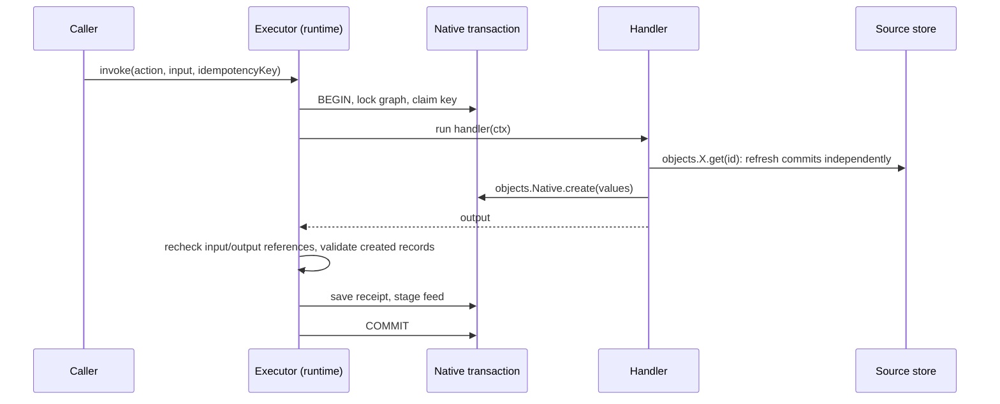
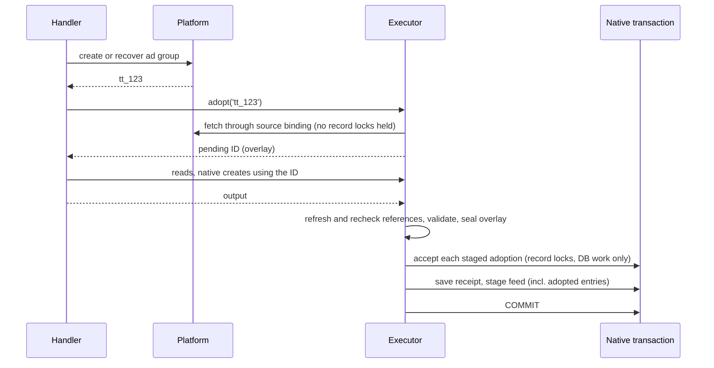

# 2026-10-28: Action adoption

**Status:** this spec defines the action-adoption contract. Nothing is
implemented. The public API and local atomicity rule were agreed on 2026-10-28.
This feature must ship before the
[media agency benchmark](./2026-10-23-media-agency-benchmark.md) is built,
because its create-type tasks depend on it.

| Part                                                               | Status            |
| ------------------------------------------------------------------ | ----------------- |
| `adopts` declaration and `objects.Type.adopt(id)` in handlers      | Agreed 2026-10-28 |
| Adoption commits or rolls back with the action's local changes     | Agreed 2026-10-28 |
| No exactly-once claim for external writes; recovery is integration | Agreed 2026-10-28 |
| Commit-time acceptance with a pending-object overlay               | Defined below     |
| Storage capability, acceptance and conflict validation             | Defined below     |
| `waitMs` and a typed connector absence signal                      | Defined below     |
| Query visibility, failure receipts and invocation provenance       | Defined below     |
| SDK helper for integration journals                                | Open              |

## The problem

An action handler can call a platform API to create something, such as a TikTok
ad group, but it cannot turn the new platform record into a Relate object. The
handler therefore cannot return a reference to what it created, and the caller
cannot read it through the graph.

```ts
implementAction(graph, LaunchAdGroup, async ({ objects }) => {
  const created = await tiktok.createAdGroup({ name: 'NL_ACME_Q4_RTG_TIKTOK' });
  // created.adgroup_id === 'tt_123'. Now what?
  // objects.TikTokAdGroup has get() and query() only: no way to register tt_123.
  return { adGroupId: ??? };
});
```

Relate can already register (adopt) a source record, but only through a trusted
host call made outside any action:

```ts
// packages/node/src/runtime.ts:396, today
const id = await app.host.adopt(graph.objects.TikTokAdGroup, 'tt_123');
```

The handler cannot simply call `host.adopt()`:

- it is not available in the handler context, by design: it is a host privilege,
  not a principal's;
- it commits on its own (`ObservationStore.accept`,
  `packages/postgres/src/index.ts:276`). If the action then fails, the adoption
  stays, so a failed action would leave behind a new graph member that nothing
  references.

This spec adds adoption as an action capability that commits **with** the
action's other local changes.

## Concepts

Read these in order; each builds on the previous ones.

| Term                    | Meaning                                                                                                                                   | Tiny example                                                                   |
| ----------------------- | ----------------------------------------------------------------------------------------------------------------------------------------- | ------------------------------------------------------------------------------ |
| **Source object**       | An object whose data lives in an external system and is fetched through a connector.                                                      | `TikTokAdGroup`, `membership: source(adGroups)`                                |
| **Native object**       | An object whose data Relate stores itself, created only by actions.                                                                       | `MediaChange`, `membership: native()`                                          |
| **Membership**          | The set of records that belong to an object type in this graph. A source record is not a member until it is adopted.                      | `tt_123` exists in TikTok but is not yet a `TikTokAdGroup`                     |
| **Relate ID**           | The stable ID Relate assigns to a member, distinct from the platform's own ID.                                                            | `0193…-…` for platform record `tt_123`                                         |
| **Source identity**     | One external record in a graph/object/source scope, connection, resource, account and partition. Adoption reuses this full key.           | `(graph, AdGroup, source, connection, resource, account, partition, 'tt_123')` |
| **Provider account**    | The external account a source binding is verified against. A record from another account is a different identity.                         | TikTok advertiser `adv_42`                                                     |
| **Observation**         | One fetched copy of a source record: raw fields, mapped values, fetch time and an ordering token.                                         | `tt_123` at budget `500`, token `918`                                          |
| **Acceptance**          | Storing an observation if it is newer than the stored one. Adoption is acceptance that also creates membership.                           | `store.accept(scope, { adopt: true, observation })`                            |
| **Adoption**            | Registering a source record as a member, assigning (or reusing) its Relate ID, and retaining its first observation.                       | `host.adopt(TikTokAdGroup, 'tt_123') → id`                                     |
| **Native transaction**  | The database transaction an action runs in. Native writes, the receipt and feed entries commit together or not at all.                    | `store.native.transaction(scope, …)`                                           |
| **Receipt**             | The saved result of one action invocation, keyed by the caller's idempotency key; replays return it.                                      | `{ state: 'succeeded', output: { adGroupId } }`                                |
| **Feed**                | The durable, ordered list of business changes (created, adopted, updated…), written atomically with the change.                           | `{ kind: 'adopted', object: TikTokAdGroup/0193… }`                             |
| **Idempotency ID**      | A stable ID for one logical action call, derived from the caller's key. Handlers pass it to external systems or journals.                 | `ctx.idempotencyId`                                                            |
| **External write**      | A call from a handler to a platform API. It is outside every Relate transaction.                                                          | `POST /adgroup/create/`                                                        |
| **Integration journal** | Application code that records external operations by idempotency ID so a retry can find what an earlier attempt did. Not part of the SDK. | `journal.once(idempotencyId, create, { recover })`                             |
| **Pending object**      | An object adopted during a running action that is not yet committed. Visible only inside that invocation.                                 | `adopt('tt_123')` returns an ID usable until the action ends                   |
| **Overlay**             | The invocation's pending objects and observations, consulted before committed storage. It also holds staged updates to existing members.  | `get(id)` reads the staged budget before commit                                |
| **Acceptance conflict** | The identity or observation used by the action can no longer be committed as validated; the action must retry.                            | A host refresh has already stored a newer deletion                             |
| **Temporary absence**   | A connector cannot currently find a record but has no affirmative deletion evidence. It is distinct from permission denial.               | A create returned an ID that its read API does not yet serve                   |

## How actions work today



Key facts from the source:

- The handler runs **inside** the native transaction, including any external
  calls it makes (`packages/runtime/src/actions/execute.ts:261`).
- Postgres takes a graph-wide lock for the whole transaction
  (`['native', graphId]`, `packages/postgres/src/native.ts:190`), so actions in
  one graph run one at a time.
- Reads of source objects inside a handler use the committed source store, not
  the transaction. A refresh during the handler commits immediately on another
  connection (`packages/runtime/src/resolution/refresh.ts:155`,
  `packages/runtime/src/native-memory.ts:17`: "observation refreshes are
  independently retained").
- Source acceptance holds a per-record lock and promises "No I/O under this
  lock" (`packages/postgres/src/index.ts:291`).
- Any failed operation, even one the handler catches, aborts the invocation
  (`run()` in `execute.ts`).
- A declared failure (`fail(code)`) rolls back a savepoint and saves a failed
  receipt. A thrown error or timeout rolls back everything and saves no receipt,
  so the key stays unclaimed and a retry runs the handler again.

## The API

Actions declare what they adopt, next to what they create:

```ts
const LaunchAdGroup = defineAction({
  id: 'launch-ad-group',
  input: z.object({
    campaign: referenceInput(TikTokCampaign),
    name: z.string(),
    budget: z.number(),
  }),
  output: z.object({ adGroupId: referenceInput(TikTokAdGroup) }),
  creates: [],
  adopts: [TikTokAdGroup], // NEW, optional, defaults to []
  errors: { notFound: z.object({}) },
});

implementAction(
  graph,
  LaunchAdGroup,
  async ({ input, objects, idempotencyId, fail }) => {
    const campaign = await objects.TikTokCampaign.get(input.campaign, {
      select: ['externalId'],
    });
    if (campaign.status !== 'ok') return fail('notFound', {});

    // Integration code: create in TikTok, or recover what an earlier attempt created.
    const { adgroup_id } = await createOrRecoverAdGroup(idempotencyId, {
      campaignId: campaign.data.externalId,
      name: input.name,
      budget: input.budget,
    });

    // NEW: register tt_… as a TikTokAdGroup in this action's transaction.
    const { id } = await objects.TikTokAdGroup.adopt(adgroup_id, {
      waitMs: 5_000,
    });

    const group = await objects.TikTokAdGroup.get(id); // reads the pending object
    return { adGroupId: id };
  },
);
```

Types:

```ts
// packages/relate/src/actions.ts (sketch)
type SourceObject = ObjectDefinition & {
  readonly membership: ReturnType<typeof source>;
};

export interface ActionDefinition<…, Adopts extends readonly SourceObject[] = readonly SourceObject[]> {
  readonly creates: Creates;
  readonly adopts: Adopts; // frozen [] when omitted
}

// Added to ActionContext.objects[K] only when G['objects'][K] extends A['adopts'][number]:
adopt(
  sourceRecordId: string,
  options?: { readonly waitMs?: number },
): Promise<{ readonly id: ObjectId<G['objects'][K]['id']> }>;
```

`adopt` returns `{ id }`, like native `create()`. `host.adopt()` keeps returning
a bare ID. `defineAction` infers the exact readonly `adopts` tuple; when omitted
its inferred type is `readonly []`, so omission does not grant every source
object an `adopt` method. The broad interface default above is for generic
constraints, like the existing `Creates` default.

## Behavior rules

**Declaration**

- `adopts` accepts only registered source objects; `creates` stays native-only.
  Both are checked at compile time (`packages/relate/src/compiler.ts:890`) and
  in the manifest (`packages/relate/src/model.ts:1071`), with a new
  `action.invalid-adopts` diagnostic.
- `adopt` exists only on declared targets, enforced by the handler type and at
  runtime (`ActionError('denied')`, as for undeclared `create`).
- Discovery lists `adopts` next to `creates` on `ActionDescription`
  (`packages/protocol/src/discovery.ts:198`), so agents know what an action can
  bring into the graph.

**Identity**

- Adoption uses the object's configured source binding. It cannot choose a
  different connection, resource or provider account.
- If the record is already a member, `adopt` returns its committed ID and stages
  a fresh observation. If not, the runtime assigns a new Relate ID that the
  invocation uses until commit.
- The first staged ID is fixed for the invocation. Repeated or concurrent
  adoption of the same identity returns that ID; a later host adoption with a
  different ID causes `unavailable`, never substitution of an ID already used in
  native records or output.
- Overlay keys contain every `StorageScope` field plus `sourceRecordId`
  (`packages/relate/src/storage.ts:21`). A second index uses scope plus Relate
  ID for `get` and canonical reference lookup. Identical provider keys in
  different object types or bindings never share an entry.
- Per-identity staging is serialized within the invocation. Fetches may run
  concurrently, but publication compares observations using `compareObservation`
  (`packages/runtime/src/observations/ordering.ts:14`), not completion order. An
  older response cannot replace a newer staged observation. Conflicting ordering
  evidence aborts the invocation; it is not silently overwritten.

**Authorization**

- The action's execute policy and the binding's provider-account check apply
  first.
- After fetching, the runtime evaluates the caller's object policy on the
  fetched observation. If the caller could not read the object, `adopt` fails as
  `not-found` and all staged work is discarded. Adoption never grants read
  access.
- Output references are rechecked as today, against the pending object, with
  current provider-account verification and policy evidence bounds. Adoption
  does not authorize related objects or fields implicitly.

**Reads inside the handler**

- `get`, `query`, native-reference validation and policy dependency resolution
  see pending objects through the same invocation-local overlay.
- Other invocations and consumers do not see a pending object. After commit it
  is an ordinary member, subject to normal authorization and freshness.
- Pending observations age normally. `refresh: true`, an expired `maxAgeMs`, or
  expired policy evidence triggers a fetch into the overlay, preserving its ID.
  This uses the ordinary read and authorization rules; it never calls the
  independently committing `ObservationStore.accept` for a staged identity.
  Fetches allocate their own tokens and retain their actual fetch-start times.
- Failed refreshes follow ordinary stale-data controls, but cannot authorize
  with expired evidence. Explicit provider denial, confirmed deletion or
  temporary absence cannot fall back to a previously readable observation.
  Adoption itself requires a present, readable fetch and has no stale fallback.
- Full evidence for staged source fields reports retention and ordering as
  `unconfirmed`, with the existing corresponding warnings, until commit. The
  backing store's durability is not a promise that staged data has been saved.
- Final reference validation may refresh the overlay before acceptance. Once
  acceptance begins the overlay is sealed: no more reads or source I/O. This
  preserves the current bounded-evidence authorization model; it does not claim
  a snapshot of external systems or prevent changes after commit.

### Queries and pagination

Source queries currently enumerate committed members, whereas native queries
scan the transaction (`packages/runtime/src/queries/query.ts:249`). Action
queries must merge the committed source scan with the overlay for the requested
scope before filtering or projecting:

1. Include newly staged members. For existing members, replace the committed
   candidate with its staged observation, including changes that make it enter
   or leave the query predicate.
2. Deduplicate by scoped source identity and Relate ID. Conflicting IDs for one
   identity abort with `unavailable`; never expose both versions.
3. Preserve the existing bytewise Relate-ID ordering, scan bounds, authorization
   and page-size rules. Apply `after` to the merged candidate stream; do not
   append pending records after a full committed page or count duplicates twice.
4. Keep cursors invocation-scoped, as today
   (`packages/runtime/src/queries/cursors.ts:31`). These are live keyset pages,
   not a snapshot: records adopted between pages at or before `after` are not
   revisited. Start a new query after further adoptions to enumerate the full
   resulting membership. Ordinary refreshes can also change predicate matches.

```ts
const { id } = await objects.TikTokAdGroup.adopt(adgroup_id);
const group = await objects.TikTokAdGroup.get(id);
const groups = objects.TikTokAdGroup.query();
// Enumerating groups includes id if it matches and remains authorized.
```

**Records that are not yet fetchable**

Platforms often return an ID before the record can be read. Because any failed
operation aborts the invocation, the handler cannot catch a not-found and try
again. `waitMs` retries only a typed temporary-absence signal within `adopt`;
intermediate absence does not escape through the executor's abort-on-error
wrapper.

The connector contract currently has only `present`, `deleted` and thrown errors
(`packages/relate/src/connectors.ts:20`). Add the following exported error
without changing the stored `Observation` states:

```ts
// packages/relate/src/connectors.ts — new contract
export class SourceNotFound extends Error {
  constructor(readonly providerAccountId?: string) {
    super('Source record is not currently available');
    this.name = 'SourceNotFound';
  }
}
```

- A connector throws `SourceNotFound` only for authenticated absence without
  affirmative deletion evidence. An ambiguous 404 that may mean denial must not
  be translated into retryable absence. `deleted` remains affirmative deletion
  evidence and is terminal for adoption.
- Provider connectors include the verified account; application-owned connectors
  omit it. `boundedFetch` validates this error's account evidence just as it
  validates successful results
  (`packages/runtime/src/observations/fetch.ts:29`). Missing or mismatched
  provider evidence is denial, never retryable absence.
- Outside action adoption, `SourceNotFound` is non-retrying: ordinary reads
  return `not-found` without stale fallback or a retained tombstone; host
  adoption rejects without membership and records a `not-found` outcome. A later
  read can fetch again. Existing authoritative `deleted` results keep their
  meaning; connectors must not relabel deletion merely to enable waiting.
- `waitMs` is a finite non-negative integer, default `0`. Zero means one initial
  fetch with no retries. A positive value bounds the visibility-fetch phase from
  adoption entry, including account checks, the initial fetch and backoff. After
  a present record is fetched, policy/dependency validation is bounded by the
  remaining action deadline, not this visibility budget.
- Each source call in that loop is bounded by the minimum of 3 seconds,
  remaining positive wait budget, and remaining action time. Waits and fetches
  receive the action cancellation signal. With zero, omit the wait-budget bound
  for the initial attempt. Exhausting the action deadline always returns
  `unavailable`.
- Retry only `SourceNotFound`, with backoff of 100, 200, 400, then at most 500
  ms, capped by the remaining budget. Exhausting the positive wait budget after
  confirmed absence returns `not-found`. A fetch or account check that times out
  without an absence response returns `unavailable`. Denial, malformed records
  and generic connector failures are never retried by this loop.

| `adopt` outcome                            | Effect on the invocation                 |
| ------------------------------------------ | ---------------------------------------- |
| Record fetched and readable by the caller  | Returns `{ id }`                         |
| Still not found after `waitMs` (default 0) | Aborts with `ActionError('not-found')`   |
| Caller cannot read it                      | Aborts with `ActionError('not-found')`   |
| Source denies the provider account         | Aborts with `ActionError('denied')`      |
| Source unavailable / deadline reached      | Aborts with `ActionError('unavailable')` |
| Record is deleted at the source            | Aborts with `ActionError('not-found')`   |
| Invalid ID, wait option or mapped record   | Aborts with `ActionError('invalid')`     |

**Provenance**

- A new adoption is attributed to the action's actor and invocation ID, like a
  native `created` record.
- Re-adopting an existing member does not replace its original provenance.

Extend the `adopted` branch of `ObjectProvenance`
(`packages/protocol/src/activity.ts:303`) with optional `invocationId: string`.
It is present for action adoption, absent for host adoption and legacy rows.
Persist it on the source object itself in a nullable `adopted_invocation_id`
column, and in the equivalent memory provenance entry. Read it through both
adapters' `provenance` methods; never infer it from retained feed entries. The
existing source columns are in `packages/postgres/src/migrations.ts:114`; the
reader is in `packages/postgres/src/index.ts:223`.

All source changes accepted by the action carry its invocation ID in the feed.
Extend the shared source-change draft helper to accept and copy that optional
attribution field; the transactional acceptance input requires it, while host
attribution omits it. Preserve the existing actor/triggered-by distinction for
adoption versus later source updates. Use the acceptance classifier's actual
kind (`adopted`, `updated`, `restored`, etc.); re-adoption is not always a new
`adopted` event. No change means no source change entry. Emit all business
changes before `invocation-succeeded` in the same atomic feed batch.

## How adoption commits with the action

Adoption commits or rolls back with the action. Use commit-time acceptance
(option B below). Option A explains the rejected alternative.

**Option A: accept immediately inside the transaction.** `adopt` writes the
membership on the transaction's connection when called.

- The per-record lock is held from `adopt` until COMMIT, across the handler's
  later external calls. That breaks "No I/O under this lock".
- If the handler then reads the same record and the read refreshes it, the
  refresh runs on a different connection and waits on that lock: a
  self-deadlock.
- Host ingestion of that record blocks for as long as the handler runs.

**Option B: commit-time acceptance.** `adopt` fetches and stages the observation
in memory; the executor accepts all staged adoptions on the transaction's
connection as the last step before saving the receipt.

The helpers below describe the new overlay, not existing APIs. Its per-identity
critical section does no source I/O; the invocation can still fetch different
records concurrently.

```ts
adopt: async (sourceRecordId, { waitMs = 0 } = {}) => {
  const key = overlayKey(scope, sourceRecordId); // full StorageScope + source ID
  const observation = await fetchWithWait(sourceRecordId, waitMs);
  const entry = await overlay.withIdentity(key, async () => {
    const staged = overlay.find(key);
    const existing = await store.resolve(scope, sourceRecordId);
    if (staged && existing && existing.objectId !== staged.objectId)
      throw new AdoptionConflict();
    // mergeOrdered keeps the first ID and orders incoming/committed/staged
    // observations with compareObservation. It never replaces by arrival order.
    return overlay.mergeOrdered(key, {
      scope,
      sourceRecordId,
      objectId: staged?.objectId ?? existing?.objectId ?? randomUUID(),
      isNew: staged?.isNew ?? !existing,
      existing,
      observation,
    });
  });
  await authorizeAsCaller(entry); // includes current account and dependencies
  return { id: entry.objectId };
};
```

Fetch results are private until validated. An entry being authorized is not
available to another operation as authorized evidence: every read evaluates its
own policy. Any failed adoption aborts the whole invocation even if caught.
Merging a committed or staged tombstone does not resurrect it with an older
present response; the winning state must be present and readable to return an
ID.



- No record lock is held during handler I/O. The lock order is always the graph
  lock, then record locks. Host ingestion never takes the graph lock, so there
  is no cycle.
- On a declared failure or any abort, staged adoptions are discarded. Nothing
  reached storage.
- **Race:** host ingestion may adopt the same record between `adopt` and commit.
  At commit the store finds a member with a different ID. The executor aborts
  with retryable `ActionError('unavailable')`, and nothing commits. A retry with
  the same key reruns the handler. The journal recovers the external record, and
  `adopt` now returns the committed ID. The overlay cannot rewrite the pending
  ID because native records and output may already use it.
- **Ordering:** the staged observation keeps the token from its fetch. If
  acceptance finds a newer committed observation, it throws `AdoptionConflict`
  and the whole action rolls back with retryable `unavailable`. This applies
  even if the newer observation appears readable or has the same mapped values.
  There is no successful `superseded` result on this transactional path: the
  action validated a different view. In particular, a newer deletion or policy
  change cannot produce a successful receipt referencing the old view.
- This is a conservative conflict rule for staged identities, not serializable
  isolation over every external read. Host adoption and ordinary refresh keep
  their existing supersession behavior. The executor never automatically reruns
  a handler; the caller retries with the same key and integration journal.

## Storage contract

`NativeTransaction` (`packages/relate/src/storage.ts:202`) gains an optional
method. `NativeStore` advertises support synchronously, so runtime construction
does not need to open a transaction to discover it.

```ts
// Additions to packages/relate/src/storage.ts.
export interface NativeStore {
  readonly capabilities?: { readonly actionAdoption?: true };
}

export interface NativeTransaction {
  // …existing scan, savepoint, load, insert, claim, findInvocation, saveInvocation, appendFeed

  /**
   * Accept and adopt a source observation as part of this transaction.
   * Postgres uses the transaction's connection and record locks; memory uses
   * prepared writes and commit-time generation validation as specified below.
   * Called only by the executor after the handler and all reads finish; no
   * I/O follows except other DB work in this transaction.
   * With no member, `objectId` becomes the new Relate ID.
   * Reject mismatched IDs or a superseded observation with AdoptionConflict.
   * Results are conditional on outer transaction success; commit may conflict.
   * Return a classified change; the executor stages its feed draft exactly once.
   * This method must not independently publish a feed batch.
   */
  accept?(
    scope: StorageScope,
    input: {
      sourceRecordId: string;
      objectId: string;
      adopt: true;
      observation: Observation;
      attribution: AcceptAttribution & { readonly invocationId: string };
    },
  ): Promise<{
    object: StoredObject;
    acceptance: Exclude<Acceptance, 'superseded'>;
    change?: AcceptedChange;
  }>;
}

// packages/runtime/src/storage.ts, alongside NativeConflict (line 203).
export class AdoptionConflict extends Error {}
```

Today `ObservationStore.accept` rejects a supplied `objectId` when there is no
member (`packages/runtime/src/memory.ts:169`). The transactional variant defines
the preassigned-ID case explicitly. Each input scope must match the
transaction's graph ID and definition revision, and only present observations
may be adopted. Duplicate acceptance of one scoped identity in the same
transaction is invalid; the executor submits each sealed overlay entry once.

Runtime startup rejects a graph whose actions declare `adopts` unless
`store.native?.capabilities?.actionAdoption === true`. Source-only graphs and
actions with no adoption declarations do not require this capability. Every
transaction from an advertising adapter must expose `accept`. The executor
checks the actual method before running an adopting handler, as it checks
`appendFeed` today (`execute.ts:265`). An inconsistent advertisement fails
before any external effect. Both `createRuntime` and `startRuntime` use this
check in shared composition.

The guarded transaction in `packages/runtime/src/actions/deadline.ts:31` must
forward `accept` through the same pre/post-operation checks as `insert`. The
deadline also supplies a cancellation signal and remaining time to fetches and
waits. Timeout, savepoint rollback and transaction closure revoke all staging
handles; late continuations cannot mutate the overlay or store.

**Memory store.** Observations and native records are separate maps today
(`packages/runtime/src/memory.ts:63`). Acceptance uses optimistic validation:

1. `accept` reads the committed identity and observation without yielding,
   validates the conflict rules, classifies the change, and prepares a private
   write. It captures an internal per-identity mutation generation, including
   absence. Every committed host acceptance/refresh advances that generation
   when it changes retained state, including observation metadata.
2. Return the prepared result to the executor for feed staging. Do not mutate
   shared source maps, provenance, history or feed. Savepoints restore both the
   prepared writes and their validation set.
3. After the transaction callback returns, run one synchronous commit step:
   verify every captured generation still matches; prepare and validate all
   source/native/provenance/history changes and the complete feed batch; then
   publish them together with no intervening await or fallible preparation.
4. Any generation mismatch throws `AdoptionConflict`; any preparation failure
   rolls back all prepared changes. Never recompute a different acceptance and
   publish the executor's old feed draft. A conflict on the second identity
   cannot leave the first adopted.

Thus an intervening host write can reject the transaction even after `accept`
resolved. The caller receives success only after outer commit. Shared ordering
and change-classification helpers keep memory and Postgres behavior aligned;
memory may conservatively abort when Postgres would have blocked a host writer.

**Postgres.** `accept` runs the existing acceptance SQL
(`packages/postgres/src/index.ts:276-…`) on the transaction's client, without
its own BEGIN/COMMIT or `publishFeed`. It holds record locks until outer commit,
checks identity and supersession before writes, and returns the classified
change. The executor stages its draft with native changes and the receipt event;
the adapter publishes the batch only as final work before COMMIT. A savepoint
can clean up a statement failure, but an adoption conflict still aborts the
whole action. An unconfirmed outer COMMIT retains the existing `uncertain`
outcome, rather than being mislabeled as a known conflict or rollback.

## Runtime changes

The existing executor drains registered operations and rolls back the handler
savepoint for a declared failure (`execute.ts:536-563`). Extend that boundary to
the overlay. The following finalization sketch uses new overlay helpers; keep
the existing error-detail parsing, deadline checks and receipt construction.

```ts
// packages/runtime/src/actions/execute.ts, finalization order (sketch)
await runHandlerBoundary(); // drain operations; rollback savepoint on fail()
if (domain) {
  const rolledBackIds = overlay.newMemberIds(); // fully scoped IDs
  overlay.discard(); // before any post-rollback authorization
  retainedReads = removeRolledBackReads(reads, created, rolledBackIds);
  await checkReferences(action.input, input);
  await checkReferences(action.errors[domain.code], domain.details);
  invocation = buildFailedInvocation(retainedReads);
  await authorizeReceipt(invocation); // committed view, no pending observations
} else {
  await checkReferences(action.input, input);
  await validateCreated();
  await checkReferences(action.output, output);
  await validatePendingAdoptions(); // present + readable, account/evidence checks
  checkCapturedValidation(); // local version/expiry checks; no source I/O
  const entries = overlay.seal(); // no further reads/source I/O after this point
  for (const entry of entriesInScopeOrder(entries)) {
    const accepted = await transaction.accept(entry.scope, entry.acceptInput);
    stageSourceChange(entry, accepted.change); // none on unchanged business state
  }
  invocation = buildSucceededInvocation(reads);
}
await transaction.saveInvocation(invocation);
await appendBusinessChangesThenInvocationEvent(); // one staged batch
// Adapter validates and commits; only then does invoke() return its receipt.
```

- `resolveEvidence` (`packages/runtime/src/runtime.ts:180`) checks the
  invocation overlay before the source store when called with an action context,
  for both source keys and canonical IDs. `source.read` also loads from that
  overlay before its direct store lookup (`resolution/source.ts:217`). Query
  candidate snapshots cannot bypass newer staged observations.
- The adopt fetch, waits and authorization reuse
  `createSourceOperations().adopt` logic, split so fetch-and-map can run without
  accepting. `host.adopt()` keeps its current self-committing path.
- Pending reads refresh into the overlay. Reads of identities never staged by
  this invocation keep their existing independently retained refresh behavior.
- Every validation records the overlay observations and policy dependency
  evidence it used. At the end, perform a local check that those observations
  are still the sealed versions and that the evidence has not expired. A later
  refresh that changed an earlier validation's view causes `unavailable` before
  acceptance; never keep an authorization decision for a replaced observation.
  This final check does no source I/O. Provider-account verification happens
  during the preceding reads and validation, not under acceptance locks. These
  checks also cover adoptions not returned or referenced by a native record.

### Declared failures and receipt dependencies

`adopt → get → fail('rejected', {})` must save a failed receipt that can be
looked up and replayed without adopting the discarded member. Extend the native
creation filtering at `packages/runtime/src/actions/execute.ts:598`:

- Revoke staging before rollback cleanup. Capture the set of new pending IDs,
  discard all pending observations, and remove reads of those new IDs from the
  failed receipt's dependencies, just as for rolled-back native creations.
- Keep reads of members that existed before this invocation, plus surviving
  input and source dependencies. Reauthorize them against committed data, not a
  discarded staged update. A dependency that is no longer readable rejects the
  invocation instead of saving an unauthorized failed receipt.
- Reference-valued failure details must resolve after rollback. A new pending ID
  in those details is invalid for the failed receipt and rejects with
  `not-found`; it is never made durable just to allow saving the error. A scalar
  detail may be derived from an authorized read of a rolled-back object, as for
  native creation today; it does not retain that nonexistent object as a replay
  dependency.
- Host adoption racing with rollback does not convert this invocation's
  discarded ID into a durable dependency. A later retry uses whatever identity
  was actually committed by the host.

## Failure cases

| Case                                                                 | Result                                                                                                                    |
| -------------------------------------------------------------------- | ------------------------------------------------------------------------------------------------------------------------- |
| Action succeeds                                                      | Membership, observation, native records, provenance, receipt and classified source/native feed changes commit atomically. |
| Handler throws, times out, returns invalid output                    | Transactional work rolls back; no receipt; staged adoptions discarded. Independent refreshes of unstaged members remain.  |
| Handler calls `fail(code)`                                           | Failed receipt saved after overlay cleanup and dependency reauthorization; references to new pending IDs reject.          |
| Record was already a member                                          | Membership and provenance are untouched by any rollback; on success only a newer observation is accepted.                 |
| Host adopts the same record during the action                        | Commit aborts with retryable `unavailable`; retry converges on the committed ID.                                          |
| A newer observation supersedes the staged one                        | Abort with `unavailable`, including newer deletion or policy changes; no successful receipt based on the old view.        |
| Host changes a memory acceptance's captured generation before commit | Abort with `unavailable`; no partial source/native writes or stale feed classification.                                   |
| Outer COMMIT acknowledgement is lost                                 | Existing `uncertain` outcome; recover the receipt with the same key, do not assume rollback.                              |
| External create succeeded, local work failed                         | External record remains. Relate never deletes it or claims cross-system rollback.                                         |
| External create result unknown (lost response)                       | Integration journal recovers by documented platform reads, or reports an unresolved outcome. Never a blind second create. |
| Record not yet fetchable                                             | `waitMs` retries, then `not-found`; no premature success.                                                                 |

## External writes and recovery

The SDK guarantees the local side only:

- `idempotencyId` names the logical operation across retries. It does not
  deduplicate anything in the platform.
- The journal (or the platform's own idempotency support) is integration code.
  It persists outside the action transaction, because a rollback must not erase
  the record of an external write.
- A journal cannot close the gap between "platform created it" and "journal
  saved the response". Recovery must look the record up with documented platform
  reads (for example by a name that embeds the idempotency ID). When that fails,
  report the outcome as unresolved.

Docs (`apps/docs/content/runtime/actions.md`, "External writes and idempotency
IDs") gain a create-then-adopt section showing this pattern.

## Compatibility with future sync

Adoption and future sync must share identity and acceptance rules:

- A later observation updates the same object. Adopting `tt_123` at budget `500`
  and later observing it at `600` keeps the Relate ID and shows `600`.
- Adoption creates no local override of source values.
- A future "ingest already-fetched records" API should reuse the same fetch-free
  acceptance step that commit-time acceptance introduces. Automatic discovery
  and sync are out of scope here.

## Files

Implementation ownership:

| File                                                                                                  | Change   | Why                                                                                             |
| ----------------------------------------------------------------------------------------------------- | -------- | ----------------------------------------------------------------------------------------------- |
| `packages/relate/src/actions.ts`                                                                      | modified | `adopts` on definitions; `adopt()` on handler context types                                     |
| `packages/relate/src/compiler.ts`, `src/model.ts`                                                     | modified | Validate and compile `adopts`; manifest field                                                   |
| `packages/relate/src/storage.ts`                                                                      | modified | Synchronous capability advertisement; transactional acceptance input/result contracts           |
| `packages/relate/src/connectors.ts`                                                                   | modified | Typed, account-scoped `SourceNotFound` signal                                                   |
| `packages/node/src/runtime.ts`                                                                        | modified | Bind declared `adopt`; share startup capability checks across both constructors                 |
| `packages/runtime/src/actions/execute.ts`                                                             | modified | Pending overlay, commit-time acceptance, feed staging, conflict mapping                         |
| `packages/runtime/src/actions/adoption.ts`                                                            | new      | Invocation-owned overlay, scoped identity serialization, ordered staging and bounded retry loop |
| `packages/runtime/src/actions/deadline.ts`                                                            | modified | Forward guarded `accept`; cancel retries and late staging                                       |
| `packages/runtime/src/storage.ts`                                                                     | modified | Export `AdoptionConflict` alongside existing adapter errors                                     |
| `packages/runtime/src/resolution/source.ts`, `src/resolution/refresh.ts`, `src/observations/fetch.ts` | modified | Split fetch/map from retention; verify typed absence; refresh pending observations locally      |
| `packages/runtime/src/runtime.ts`, `src/queries/query.ts`                                             | modified | Overlay-aware reads, policy resolution and merged source scans                                  |
| `packages/runtime/src/native-memory.ts`, `src/memory.ts`                                              | modified | Prepare acceptance, validate generations, publish atomically; retain invocation provenance      |
| `packages/postgres/src/native.ts`, `src/index.ts`, `src/migrations.ts`                                | modified | Transactional acceptance without separate feed publication; provenance column and reader        |
| `packages/runtime/src/activity-store.ts`, `src/activity/feed.ts`                                      | modified | Attach action invocation to source changes; order all business changes before the receipt event |
| `packages/runtime/src/discovery/index.ts`, `packages/protocol/src/discovery.ts`                       | modified | `adopts` in `ActionDescription`                                                                 |
| `packages/protocol/src/activity.ts`                                                                   | modified | Optional invocation ID on adopted-object provenance                                             |
| `tests/support/adoption-action-contract.ts`                                                           | new      | Shared memory/Postgres acceptance suite with a test-owned fake platform                         |
| `packages/relate/README.md`, `packages/runtime/README.md`, `packages/runtime/STORE_CONTRACT.md`       | modified | Public authoring, connector absence, runtime and adapter contracts                              |
| `apps/docs/content/runtime/actions.md`                                                                | modified | Adopting created records, read/query behavior, failure receipts and recovery limits             |

## Done when

Tested through the public application path on memory and Postgres. Package tests
use a test-owned fake platform and journal, never benchmark code.

1. Declaration: undeclared targets, native targets in `adopts`, source targets
   in `creates` and branded ID types are rejected or checked.
2. Create externally → adopt → read and reference within the handler → typed ID
   readable after commit when source state and authorization remain unchanged.
3. Rollback on throw, `fail`, invalid output, timeout and a caught adoption
   error, with no leaked membership or `adopted` feed entry.
4. Repeat and concurrent adoption preserve the first pending ID. Host adoption
   between two calls produces a conflict, never ID substitution. Same provider
   key across types/accounts stays isolated; reverse fetch completion preserves
   the newer observation and rejects conflicting ordering evidence.
5. Principal and provider-account isolation; unreadable records fail as
   `not-found` without leaking IDs or data.
6. Adopt → await beyond `maxAgeMs` or policy evidence age → read/output
   validation refreshes into the overlay. Explicit refresh works. Expired
   evidence, denial, temporary absence and deletion never authorize stale
   values; rollback retains none of those staged observations.
7. Query-after-adopt includes pending members; re-adoption can change predicate
   matches. Test ordering, deduplication, scan bounds, page boundaries and
   invocation-scoped cursors, including adoption between pages and a restarted
   query. Committed scan snapshots cannot override staged values.
8. Adopt → get → fail saves a failed receipt that survives lookup, replay and
   Postgres restart. Reads of new pending IDs are pruned; dependencies on
   existing members are retained and reauthorized. New pending IDs in reference
   error details reject without a saved receipt. Test host adoption racing with
   rollback and a native creation that referenced the discarded adoption.
9. A newer committed observation, including deletion and policy changes, causes
   acceptance conflict and full rollback. Retry with the same key converges
   without rerunning a journaled external effect. No successful `superseded`
   acceptance is returned by the transaction.
10. Memory: inject host writes after `accept` resolves but before commit; reject
    generation mismatches with no source/native/provenance/feed mutation. Also
    fail the second of multiple adoptions and feed preparation after acceptance;
    verify that all earlier prepared writes roll back. Postgres: verify host
    contention, outer rollback and exactly one atomic feed publication.
11. Test zero/positive/invalid `waitMs`, typed absence followed by visibility,
    budget exhaustion, terminal deletion, account mismatch, generic failure,
    cancellation during backoff/fetch and a connector resolving after timeout.
    Verify ordinary reads and host adoption handle typed absence without
    retries, stale disclosure or tombstone creation.
12. Missing capability advertisement rejects startup for adopting graphs on both
    constructors; inconsistent transaction methods reject before handler
    execution. The guarded transaction forwards `accept` and revokes it after
    timeout/closure. Non-adopting graphs keep working with existing adapters.
13. Action adoption persists invocation provenance independently of activity
    retention, including after restart. Host/legacy provenance omits it;
    re-adoption preserves it. Feed kinds reflect actual accepted transitions,
    include the invocation ID and precede the invocation event; no-op acceptance
    emits no source change. Staged reads report unconfirmed evidence.
14. Lost create response, delayed visibility and retry after restart produce no
    duplicate business effects or false success under the test integration's
    journal/recovery contract; unresolved external outcomes remain unresolved. A
    lost local COMMIT acknowledgement returns `uncertain` and is recovered by
    receipt replay rather than assumed rollback.
15. `pnpm check` (or `pnpm test:unit` without a test database, reported as
    such), `pnpm check:boundaries` and `pnpm test:packaging`.

## Open questions

| Question                                         | Lean                          |
| ------------------------------------------------ | ----------------------------- |
| Should the journal pattern become an SDK helper? | Decide from benchmark results |

## Appendix: research basis (reviewed 2026-10-28)

These are precedents for the design, not claims that Relate copies their
internals.

- [Palantir action webhooks](https://www.palantir.com/docs/foundry/action-types/webhooks):
  external writeback runs before Ontology edits and its response feeds later
  rules; external success followed by local failure is allowed. This matches
  create-then-adopt.
- [Palantir action consistency](https://www.palantir.com/docs/foundry/action-types/consistency-guarantees):
  local edits commit atomically and external calls are excluded; actions with
  external calls are not retried by default. This matches the local boundary and
  separate recovery.
- [Palantir Ontology edits](https://www.palantir.com/docs/foundry/functions/edits-overview)
  declare affected types, as `adopts` does.
- [Palantir edits vs datasource updates](https://www.palantir.com/docs/foundry/object-edits/how-edits-applied):
  Relate keeps source observations without a user-edit override layer.
- [Crossplane import](https://docs.crossplane.io/latest/guides/import-existing-resources/)
  and its
  [creation annotations](https://docs.crossplane.io/latest/managed-resources/managed-resources/#creation-annotations):
  local and external identity are separate, and a lost external ID never
  justifies a blind create.
- [Terraform import](https://developer.hashicorp.com/terraform/language/import):
  provider identity is scoped by account and region, like Relate's source
  identity.
