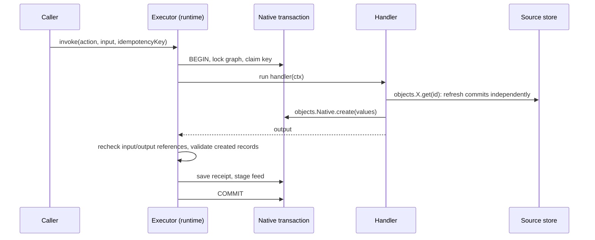
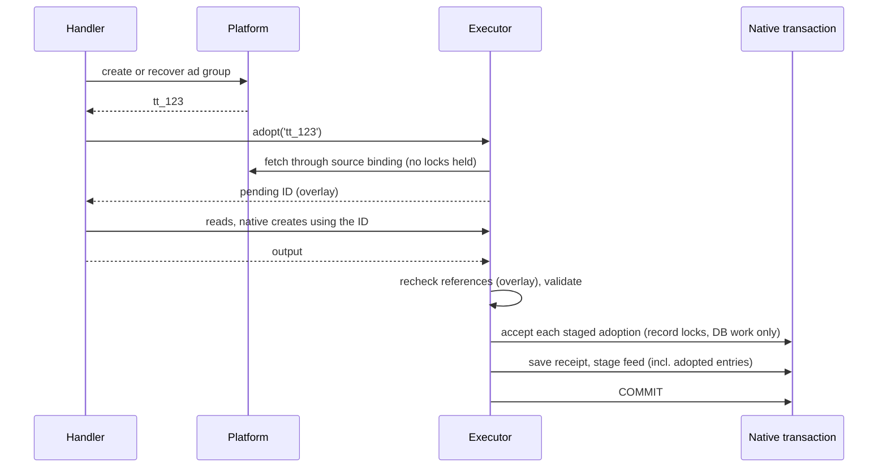

# 2026-10-28: Action adoption

**Status:** the public API and the rule that adoption commits with the action
were agreed on 2026-10-28. The storage strategy
([Commit-time acceptance](#how-adoption-commits-with-the-action)) and the
contract sketches below are proposed. Nothing is implemented. This feature must
ship before the [media agency benchmark](./2026-10-23-media-agency-benchmark.md)
is built, because its create-type tasks depend on it.

| Part                                                               | Status                 |
| ------------------------------------------------------------------ | ---------------------- |
| `adopts` declaration and `objects.Type.adopt(id)` in handlers      | Agreed 2026-10-28      |
| Adoption commits or rolls back with the action's local changes     | Agreed 2026-10-28      |
| No exactly-once claim for external writes; recovery is integration | Agreed 2026-10-28      |
| Commit-time acceptance with a pending-object overlay               | Proposed (recommended) |
| Storage contract: `NativeTransaction.accept`                       | Proposed               |
| `waitMs` for records that are not yet fetchable                    | Proposed               |

## The problem

An action handler can call a platform API to create something, such as a TikTok
ad group, but it cannot turn the new platform record into a Relate object. The
handler therefore cannot return a reference to what it created, and the caller
cannot read it through the graph.

```ts
implementAction(graph, LaunchAdGroup, async ({ objects }) => {
  const created = await tiktok.createAdGroup({ name: 'NL_ACME_Q4_RTG_TIKTOK' });
  // created.adgroup_id === 'tt_123'. Now what?
  // objects.TikTokAdGroup has get() and query() only: no way to register tt_123.
  return { adGroupId: ??? };
});
```

Relate can already register (adopt) a source record, but only through a trusted
host call made outside any action:

```ts
// packages/node/src/runtime.ts:396, today
const id = await app.host.adopt(graph.objects.TikTokAdGroup, 'tt_123');
```

The handler cannot simply call `host.adopt()`:

- it is not available in the handler context, by design: it is a host privilege,
  not a principal's;
- it commits on its own (`ObservationStore.accept`,
  `packages/postgres/src/index.ts:276`). If the action then fails, the adoption
  stays, so a failed action would leave behind a new graph member that nothing
  references.

This spec adds adoption as an action capability that commits **with** the
action's other local changes.

## Concepts

Read these in order; each builds on the previous ones.

| Term                    | Meaning                                                                                                                                   | Tiny example                                                 |
| ----------------------- | ----------------------------------------------------------------------------------------------------------------------------------------- | ------------------------------------------------------------ |
| **Source object**       | An object whose data lives in an external system and is fetched through a connector.                                                      | `TikTokAdGroup`, `membership: source(adGroups)`              |
| **Native object**       | An object whose data Relate stores itself, created only by actions.                                                                       | `MediaChange`, `membership: native()`                        |
| **Membership**          | The set of records that belong to an object type in this graph. A source record is not a member until it is adopted.                      | `tt_123` exists in TikTok but is not yet a `TikTokAdGroup`   |
| **Relate ID**           | The stable ID Relate assigns to a member, distinct from the platform's own ID.                                                            | `0193…-…` for platform record `tt_123`                       |
| **Source identity**     | The full key that names one external record: connection, resource, provider account and source record ID. Adoption reuses it.             | `(tiktok-conn, adgroups, adv_42, 'tt_123')`                  |
| **Provider account**    | The external account a source binding is verified against. A record from another account is a different identity.                         | TikTok advertiser `adv_42`                                   |
| **Observation**         | One fetched copy of a source record: raw fields, mapped values, fetch time and an ordering token.                                         | `tt_123` at budget `500`, token `918`                        |
| **Acceptance**          | Storing an observation if it is newer than the stored one. Adoption is acceptance that also creates membership.                           | `store.accept(scope, { adopt: true, observation })`          |
| **Adoption**            | Registering a source record as a member, assigning (or reusing) its Relate ID, and retaining its first observation.                       | `host.adopt(TikTokAdGroup, 'tt_123') → id`                   |
| **Native transaction**  | The database transaction an action runs in. Native writes, the receipt and feed entries commit together or not at all.                    | `store.native.transaction(scope, …)`                         |
| **Receipt**             | The saved result of one action invocation, keyed by the caller's idempotency key; replays return it.                                      | `{ state: 'succeeded', output: { adGroupId } }`              |
| **Feed**                | The durable, ordered list of business changes (created, adopted, updated…), written atomically with the change.                           | `{ kind: 'adopted', object: TikTokAdGroup/0193… }`           |
| **Idempotency ID**      | A stable ID for one logical action call, derived from the caller's key. Handlers pass it to external systems or journals.                 | `ctx.idempotencyId`                                          |
| **External write**      | A call from a handler to a platform API. It is outside every Relate transaction.                                                          | `POST /adgroup/create/`                                      |
| **Integration journal** | Application code that records external operations by idempotency ID so a retry can find what an earlier attempt did. Not part of the SDK. | `journal.once(idempotencyId, create, { recover })`           |
| **Pending object**      | An object adopted during a running action that is not yet committed. Visible only inside that invocation.                                 | `adopt('tt_123')` returns an ID usable until the action ends |

## How actions work today



Key facts from the source:

- The handler runs **inside** the native transaction, including any external
  calls it makes (`packages/runtime/src/actions/execute.ts:261`).
- Postgres takes a graph-wide lock for the whole transaction
  (`['native', graphId]`, `packages/postgres/src/native.ts:190`), so actions in
  one graph run one at a time.
- Reads of source objects inside a handler use the committed source store, not
  the transaction. A refresh during the handler commits immediately on another
  connection (`packages/runtime/src/resolution/refresh.ts:155`,
  `packages/runtime/src/native-memory.ts:17`: "observation refreshes are
  independently retained").
- Source acceptance holds a per-record lock and promises "No I/O under this
  lock" (`packages/postgres/src/index.ts:291`).
- Any failed operation, even one the handler catches, aborts the invocation
  (`run()` in `execute.ts`).
- A declared failure (`fail(code)`) rolls back a savepoint and saves a failed
  receipt. A thrown error or timeout rolls back everything and saves no receipt,
  so the key stays unclaimed and a retry runs the handler again.

## The API

Actions declare what they adopt, next to what they create:

```ts
const LaunchAdGroup = defineAction({
  id: 'launch-ad-group',
  input: z.object({
    campaign: referenceInput(TikTokCampaign),
    name: z.string(),
    budget: z.number(),
  }),
  output: z.object({ adGroupId: referenceInput(TikTokAdGroup) }),
  creates: [],
  adopts: [TikTokAdGroup], // NEW, optional, defaults to []
  errors: { notFound: z.object({}) },
});

implementAction(
  graph,
  LaunchAdGroup,
  async ({ input, objects, idempotencyId, fail }) => {
    const campaign = await objects.TikTokCampaign.get(input.campaign, {
      select: ['externalId'],
    });
    if (campaign.status !== 'ok') return fail('notFound', {});

    // Integration code: create in TikTok, or recover what an earlier attempt created.
    const { adgroup_id } = await createOrRecoverAdGroup(idempotencyId, {
      campaignId: campaign.data.externalId,
      name: input.name,
      budget: input.budget,
    });

    // NEW: register tt_… as a TikTokAdGroup in this action's transaction.
    const { id } = await objects.TikTokAdGroup.adopt(adgroup_id, {
      waitMs: 5_000,
    });

    const group = await objects.TikTokAdGroup.get(id); // reads the pending object
    return { adGroupId: id };
  },
);
```

Types:

```ts
// packages/relate/src/actions.ts (sketch)
export interface ActionDefinition<…, Adopts extends readonly SourceObject[] = readonly SourceObject[]> {
  readonly creates: Creates;
  readonly adopts: Adopts; // frozen [] when omitted
}

// Added to ActionContext.objects[K] only when G['objects'][K] extends A['adopts'][number]:
adopt(
  sourceRecordId: string,
  options?: { readonly waitMs?: number },
): Promise<{ readonly id: ObjectId<G['objects'][K]['id']> }>;
```

`adopt` returns `{ id }`, like native `create()`. `host.adopt()` keeps returning
a bare ID.

## Behavior rules

**Declaration**

- `adopts` accepts only registered source objects; `creates` stays native-only.
  Both are checked at compile time (`packages/relate/src/compiler.ts:890`) and
  in the manifest (`packages/relate/src/model.ts:1071`), with a new
  `action.invalid-adopts` diagnostic.
- `adopt` exists only on declared targets, enforced by the handler type and at
  runtime (`ActionError('denied')`, as for undeclared `create`).
- Discovery lists `adopts` next to `creates` on `ActionDescription`
  (`packages/protocol/src/discovery.ts:198`), so agents know what an action can
  bring into the graph.

**Identity**

- Adoption uses the object's configured source binding. It cannot choose a
  different connection, resource or provider account.
- If the record is already a member, `adopt` returns its committed ID and stages
  a fresh observation. If not, the runtime assigns a new Relate ID that the
  invocation uses until commit.
- Adopting the same record twice in one invocation returns the same ID.

**Authorization**

- The action's execute policy and the binding's provider-account check apply
  first.
- After fetching, the runtime evaluates the caller's object policy on the
  fetched observation. If the caller could not read the object, `adopt` fails as
  `not-found` and nothing is staged. Adoption never grants read access.
- Output references are rechecked as today, against the pending object.

**Reads inside the handler**

- `get` and reference checks see pending objects through an invocation-local
  overlay, using the observation fetched at adoption.
- Other invocations and consumers do not see a pending object. After commit it
  is an ordinary member, subject to normal authorization and freshness.

**Records that are not yet fetchable**

Platforms often return an ID before the record can be read. Because any failed
operation aborts the invocation, the handler cannot catch a not-found and try
again. Instead, `waitMs` lets the runtime retry the fetch, with backoff, for at
most `waitMs` and never past the action deadline. Each fetch keeps the existing
3-second bound (`boundedFetch`, `packages/runtime/src/resolution/source.ts`).

| `adopt` outcome                            | Effect on the invocation                 |
| ------------------------------------------ | ---------------------------------------- |
| Record fetched and readable by the caller  | Returns `{ id }`                         |
| Still not found after `waitMs` (default 0) | Aborts with `ActionError('not-found')`   |
| Caller cannot read it                      | Aborts with `ActionError('not-found')`   |
| Source denies the provider account         | Aborts with `ActionError('denied')`      |
| Source unavailable / deadline reached      | Aborts with `ActionError('unavailable')` |
| Record is deleted at the source            | Aborts with `ActionError('not-found')`   |

**Provenance**

- A new adoption is attributed to the action's actor and invocation ID, like a
  native `created` record.
- Re-adopting an existing member does not replace its original provenance.

## How adoption commits with the action

The rule is agreed: adoption commits or rolls back with the action. There are
two ways to implement it.

**Option A: accept immediately inside the transaction.** `adopt` writes the
membership on the transaction's connection when called.

```ts
adopt: async (sourceRecordId) => {
  const observation = await fetch(sourceRecordId);
  return transaction.accept(scope, {
    sourceRecordId,
    adopt: true,
    observation,
  }); // takes record lock now
};
```

- The per-record lock is held from `adopt` until COMMIT, across the handler's
  later external calls. That breaks "No I/O under this lock".
- If the handler then reads the same record and the read refreshes it, the
  refresh runs on a different connection and waits on that lock: a
  self-deadlock.
- Host ingestion of that record blocks for as long as the handler runs.

**Option B (recommended): commit-time acceptance.** `adopt` fetches and stages
the observation in memory; the executor accepts all staged adoptions on the
transaction's connection as the last step before saving the receipt.

```ts
adopt: async (sourceRecordId, { waitMs = 0 } = {}) => {
  const existing = await store.resolve(scope, sourceRecordId); // lookup, no lock
  const observation = await fetchWithWait(sourceRecordId, waitMs);
  await authorizeAsCaller(observation);
  const objectId =
    existing?.objectId ?? pending.get(sourceRecordId)?.objectId ?? randomUUID();
  pending.set(sourceRecordId, { objectId, observation, isNew: !existing });
  return { id: objectId };
};
```



- No record lock is held during handler I/O. The lock order is always the graph
  lock, then record locks. Host ingestion never takes the graph lock, so there
  is no cycle.
- On a declared failure or any abort, staged adoptions are discarded. Nothing
  reached storage.
- **Race:** host ingestion may adopt the same record between `adopt` and commit.
  At commit the store finds a member with a different ID. The executor aborts
  with retryable `ActionError('unavailable')`, and nothing commits. A retry with
  the same key reruns the handler. The journal recovers the external record, and
  `adopt` now returns the committed ID. The overlay cannot rewrite the pending
  ID because native records and output may already use it.
- **Ordering:** the staged observation keeps the token from its fetch. If a
  newer observation was committed meanwhile, acceptance returns `superseded`:
  membership is unchanged and the newer data wins.

## Storage contract

`NativeTransaction` (`packages/relate/src/storage.ts:202`) gains an optional
method. An adapter advertises the capability by providing it.

```ts
export interface NativeTransaction {
  // …existing scan, savepoint, load, insert, claim, findInvocation, saveInvocation, appendFeed

  /**
   * NEW. Accept (and optionally adopt) a source observation as part of this
   * transaction, under the record's lock, on this transaction's connection.
   * Called only by the executor after the handler and all reads finish; no
   * I/O follows except other DB work in this transaction.
   * With adopt=true and no member, `objectId` becomes the new Relate ID.
   * With a member whose ID differs from `objectId`, rejects with AdoptionConflict.
   * Feed entries for the change are staged with appendFeed's batch.
   */
  accept?(
    scope: StorageScope,
    input: {
      sourceRecordId: string;
      objectId: string;
      adopt: boolean;
      observation: Observation;
      attribution: AcceptAttribution & { readonly invocationId: string };
    },
  ): Promise<{
    object: StoredObject;
    acceptance: Acceptance;
    change?: AcceptedChange;
  }>;
}
```

Today `ObservationStore.accept` rejects a supplied `objectId` when there is no
member (`packages/runtime/src/memory.ts:169`). The transactional variant defines
the preassigned-ID case explicitly. Runtime startup rejects a graph whose
actions declare `adopts` when the store cannot provide `accept`. As a second
guard, the executor checks it before running the handler, the same way it checks
`appendFeed` today (`execute.ts:265`).

**Memory store.** Observations and native records are separate maps today
(`packages/runtime/src/memory.ts:63`). The memory native transaction buffers
`accept` calls and applies them in the same synchronous commit step as its
inserts, with the same compare-and-replace logic as `ObservationStore.accept`.
Shared helpers must keep the two paths identical.

**Postgres.** `accept` runs the existing acceptance SQL
(`packages/postgres/src/index.ts:276-…`) on the transaction's client, without
its own BEGIN/COMMIT, inside a savepoint so a conflict leaves a clear error.

## Runtime changes

```ts
// packages/runtime/src/actions/execute.ts, finalization order (sketch)
await executeHandler();                         // handler, reads via overlay
await checkReferences(action.input, input);     // overlay-aware
validateCreated();
await checkReferences(action.output, output);   // overlay-aware
if (domain) await authorizeReceipt(…);
if (!domain) for (const a of pending.values())  // NEW: last DB-only step
  adoptions.push(await transaction.accept!(a.scope, { …a, adopt: true }));
await transaction.saveInvocation(invocation);
await transaction.appendFeed?.([...invocationFeed(…), ...adoptedFeed(adoptions)]);
```

- `resolveEvidence` (`packages/runtime/src/runtime.ts:180`) checks the
  invocation overlay before the source store when called with an action context.
- The adopt fetch, waits and authorization reuse
  `createSourceOperations().adopt` logic, split so fetch-and-map can run without
  accepting. `host.adopt()` keeps its current self-committing path.
- A read that would refresh a pending object skips the refresh. Its staged
  observation is fresh by construction.

## Failure cases

| Case                                              | Result                                                                                                                    |
| ------------------------------------------------- | ------------------------------------------------------------------------------------------------------------------------- |
| Action succeeds                                   | Membership, observation, native records, receipt and feed (`created`, `adopted`) commit atomically.                       |
| Handler throws, times out, returns invalid output | Everything rolls back; no receipt; staged adoptions discarded.                                                            |
| Handler calls `fail(code)`                        | Failed receipt saved; staged adoptions discarded. Failure details must not reference a pending ID (it will not resolve).  |
| Record was already a member                       | Membership and provenance are untouched by any rollback; on success only a newer observation is accepted.                 |
| Host adopts the same record during the action     | Commit aborts with retryable `unavailable`; retry converges on the committed ID.                                          |
| External create succeeded, local work failed      | External record remains. Relate never deletes it or claims cross-system rollback.                                         |
| External create result unknown (lost response)    | Integration journal recovers by documented platform reads, or reports an unresolved outcome. Never a blind second create. |
| Record not yet fetchable                          | `waitMs` retries, then `not-found`; no premature success.                                                                 |

## External writes and recovery

The SDK guarantees the local side only:

- `idempotencyId` names the logical operation across retries. It does not
  deduplicate anything in the platform.
- The journal (or the platform's own idempotency support) is integration code.
  It persists outside the action transaction, because a rollback must not erase
  the record of an external write.
- A journal cannot close the gap between "platform created it" and "journal
  saved the response". Recovery must look the record up with documented platform
  reads (for example by a name that embeds the idempotency ID). When that fails,
  report the outcome as unresolved.

Docs (`apps/docs/content/runtime/actions.md`, "External writes and idempotency
IDs") gain a create-then-adopt section showing this pattern.

## Compatibility with future sync

Adoption and future sync must share identity and acceptance rules:

- A later observation updates the same object. Adopting `tt_123` at budget `500`
  and later observing it at `600` keeps the Relate ID and shows `600`.
- Adoption creates no local override of source values.
- A future "ingest already-fetched records" API should reuse the same fetch-free
  acceptance step that commit-time acceptance introduces. Automatic discovery
  and sync are out of scope here.

## Files

| File                                                     | Change   | Why                                                                     |
| -------------------------------------------------------- | -------- | ----------------------------------------------------------------------- |
| `packages/relate/src/actions.ts`                         | modified | `adopts` on definitions; `adopt()` on handler context types             |
| `packages/relate/src/compiler.ts`, `src/model.ts`        | modified | Validate and compile `adopts`; manifest field                           |
| `packages/relate/src/storage.ts`                         | modified | `NativeTransaction.accept`; `AdoptionConflict`                          |
| `packages/node/src/runtime.ts`                           | modified | Bind `adopt` for declared targets (next to `create`, line ~248)         |
| `packages/runtime/src/actions/execute.ts`                | modified | Pending overlay, commit-time acceptance, feed staging, conflict mapping |
| `packages/runtime/src/resolution/source.ts`              | modified | Split fetch-and-map from acceptance; `waitMs` retries                   |
| `packages/runtime/src/runtime.ts`                        | modified | Overlay-aware `resolveEvidence`                                         |
| `packages/runtime/src/native-memory.ts`, `src/memory.ts` | modified | Transactional acceptance in the memory store                            |
| `packages/postgres/src/native.ts`, `src/index.ts`        | modified | Shared acceptance SQL on the transaction client                         |
| `packages/runtime/src/discovery/index.ts`, protocol      | modified | `adopts` in `ActionDescription`                                         |
| `packages/runtime/STORE_CONTRACT.md`                     | modified | Document transactional acceptance                                       |
| `tests/support/adoption-action-contract.ts`              | new      | Shared memory/Postgres acceptance suite with a test-owned fake platform |
| `apps/docs/content/runtime/actions.md`                   | modified | Adopting created records; recovery limits                               |

## Done when

Tested through the public application path on memory and Postgres. Package tests
use a test-owned fake platform and journal, never benchmark code.

1. Declaration: undeclared targets, native targets in `adopts`, source targets
   in `creates` and branded ID types are rejected or checked.
2. Create externally → adopt → read and reference within the handler → typed ID
   readable after commit.
3. Rollback on throw, `fail`, invalid output, timeout and a caught adoption
   error, with no leaked membership or `adopted` feed entry.
4. Repeat adoption, concurrent host adoption (conflict then convergence) and
   newer observations preserve one identity and the original provenance.
5. Principal and provider-account isolation; unreadable records fail as
   `not-found` without leaking IDs or data.
6. Lost create response, delayed visibility (`waitMs`) and retry after restart
   produce no duplicate business effects or false success, and unresolved
   outcomes stay reported as unresolved.
7. `pnpm check` (or `pnpm test:unit` without a test database, reported as such),
   `pnpm check:boundaries` and `pnpm test:packaging`.

## Open questions

| Question                                                                                     | Lean                                                         |
| -------------------------------------------------------------------------------------------- | ------------------------------------------------------------ |
| Commit-time acceptance (B) or immediate acceptance in the transaction (A)?                   | B; A breaks the no-I/O-under-lock rule and can self-deadlock |
| Should an adoption conflict surface as `unavailable` (retryable) or a new `conflict` reason? | `unavailable`; the caller's correct move is to retry         |
| Default `waitMs`?                                                                            | 0; integrations opt in with a platform-appropriate value     |
| Should the journal pattern become an SDK helper?                                             | Decide from benchmark results                                |

## Appendix: research basis (reviewed 2026-10-28)

These are precedents for the design, not claims that Relate copies their
internals.

- [Palantir action webhooks](https://www.palantir.com/docs/foundry/action-types/webhooks):
  external writeback runs before Ontology edits and its response feeds later
  rules; external success followed by local failure is allowed. This matches
  create-then-adopt.
- [Palantir action consistency](https://www.palantir.com/docs/foundry/action-types/consistency-guarantees):
  local edits commit atomically and external calls are excluded; actions with
  external calls are not retried by default. This matches the local boundary and
  separate recovery.
- [Palantir Ontology edits](https://www.palantir.com/docs/foundry/functions/edits-overview)
  declare affected types, as `adopts` does.
- [Palantir edits vs datasource updates](https://www.palantir.com/docs/foundry/object-edits/how-edits-applied):
  Relate keeps source observations without a user-edit override layer.
- [Crossplane import](https://docs.crossplane.io/latest/guides/import-existing-resources/)
  and its
  [creation annotations](https://docs.crossplane.io/latest/managed-resources/managed-resources/#creation-annotations):
  local and external identity are separate, and a lost external ID never
  justifies a blind create.
- [Terraform import](https://developer.hashicorp.com/terraform/language/import):
  provider identity is scoped by account and region, like Relate's source
  identity.
