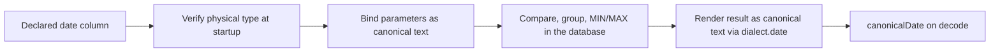

# 2026-10-28: Analytical calendar dates

| Part                                                                        | Status                                  |
| --------------------------------------------------------------------------- | --------------------------------------- |
| Date logical type for dataset columns and analytical values                 | Agreed 2026-10-28                       |
| Ships before the media benchmark freezes its physical `DATE` tables         | Agreed 2026-10-28; no ISO-text fallback |
| [Wire and calendar rules](#wire-values)                                     | Proposed after review                   |
| [Consumer value type](#consumer-value-type) (`string`, never `Date`)        | Proposed                                |
| [Connector behavior](#connector-behavior), including SQLite `__relate_date` | Proposed                                |
| Implementation                                                              | Not implemented                         |

## Problem

Daily FX and delivery tables use calendar dates.
[Reference datasets](./2026-10-28-reference-datasets.md) must join FX rates to
deliveries on those dates without treating them as UTC instants. Today
`LogicalType` has no date member (`packages/protocol/src/analytics.ts:4`), and
`datasetType` rejects `z.iso.date()` with "Unsupported dataset scalar format"
(`packages/relate/src/compiler/dataset-types.ts:47`).

This spec adds analytical dates only. Date functions, timezone conversion and
dates on ordinary object properties are out of scope.

## Glossary

| Term           | Meaning                                                                 | Example                                |
| -------------- | ----------------------------------------------------------------------- | -------------------------------------- |
| Calendar date  | A day in the Gregorian calendar, with no time or timezone               | `2026-10-01`                           |
| Timestamp      | An instant; converting it to a date requires a timezone rule            | `2026-10-01T23:30:00Z`                 |
| Logical type   | The portable type used in expressions, results and discovery            | `{ type: 'date' }`                     |
| Physical type  | The storage representation a connector verifies at startup              | Postgres `DATE`, SQLite `TEXT`         |
| Canonical text | The single accepted text spelling of a value                            | `'2026-02-29'` is invalid, not `03-01` |
| Dialect hook   | A per-connector function the shared SQL renderer calls to render a type | `dialect.timestamp(value, 3, bind)`    |
| Participating  | A row value an expression reads for a comparison, group or result       | `d.date` in `WHERE d.date >= $from`    |

## Authoring API

```ts
// Before: throws 'Unsupported dataset scalar format'.
// After: compiles to { type: 'date', nullable: false }.
date: { id: 'delivery.date', schema: z.iso.date(), access: ordinary }

// Nullable columns use the existing wrapper.
settledOn: { id: 'invoice.settledOn', schema: z.iso.date().nullable(), access: ordinary }
```

`z.iso.date()` with refinements or coercion stays rejected, the same as other
dataset scalars (`packages/relate/src/compiler/dataset-types.ts:17`).

## Types

```ts
// packages/protocol/src/analytics.ts:4
// Before
export type LogicalType =
  | { readonly type: 'boolean' | 'string' | 'int32' | 'int64' | 'float64' }
  | { readonly type: 'timestamp'; readonly precision: 3 | 6 };

// After
export type LogicalType =
  | { readonly type: 'boolean' | 'string' | 'int32' | 'int64' | 'float64' | 'date' }
  | { readonly type: 'timestamp'; readonly precision: 3 | 6 };

// packages/relate/src/analytics/values.ts:7: new TypedValue variant
| { readonly type: 'date'; readonly value: string }

// packages/relate/src/model/datasets.ts:11: manifest validation
type: z.enum(['boolean', 'string', 'int32', 'int64', 'float64', 'date']),
```

`ComputedResultType` gets the existing `nullable` flag automatically. Dataset
discovery already reports `ComputedResultType`
(`packages/protocol/src/discovery.ts:139`), so a date column appears in
discovery as `{ type: 'date', nullable }` without its own discovery shape. The
ordinary-property `ScalarSchema.format`
(`packages/protocol/src/discovery.ts:12`) is **not** changed.

## Expressions

```sql
-- Allowed
SELECT MIN(d.date), MAX(d.date), COUNT(d.date) FROM datasets.Delivery d
WHERE d.date >= $from AND d.date < $to

-- Rejected at preparation
SUM(d.date)            -- no date arithmetic or averaging
d.date + 1             -- no date arithmetic
d.date = d.label       -- date vs string
d.date = d.loadedAt    -- date vs timestamp
```

- `MIN`/`MAX` return `date`; `COUNT` stays `int64`. `SUM`, `AVG` and arithmetic
  on dates fail preparation.
- `eq`, `in`, `gt`, `gte`, `lt`, `lte` are allowed: `date` joins the orderable
  list in `packages/runtime/src/analytics/order.ts:22` and `:98`.
- Dates only compare with dates. `sameLogicalType` already compares `type`
  strings (`packages/runtime/src/analytics/resolve.ts:48`,
  `packages/node/src/bindings.ts:32`), so no implicit date/string or
  date/timestamp coercion exists in predicates or join keys.
- Named parameters take their type from the date operand they are compared with
  or joined to, the same as timestamps. The wire value is a JSON string:

```json
{ "sql": "… WHERE d.date >= $from", "parameters": { "from": "2026-10-01" } }
```

- Computed filters, ordering and cursor positions reuse the typed encoding and
  existing null rules.

## Wire values

- Exactly `YYYY-MM-DD`, with real Gregorian month/day lengths and leap years,
  from `0000-01-01` to `9999-12-31`. Year `0000` matches the existing timestamp
  range (`connectors/postgres/src/results.ts:42`).
- Rejected: timezone or time suffix, whitespace, unpadded parts, `infinity`,
  invalid days such as `2026-02-29`.
- Validation is a pure string check. Do not use JavaScript `Date`, which rolls
  `2026-02-29` over to March 1 and shifts days by timezone.
- Null means the value is absent. An invalid date is never turned into null,
  skipped or moved to another day.

```ts
// packages/relate/src/analytics/values.ts: new, next to canonicalTimestamp (:57)
export function canonicalDate(value: string): string; // throws AnalyticalValueError

// encodeAnalyticalValue (:124, :174), parseAnalyticalValue (:195) and
// decodeAnalyticalValue (:231) each add a 'date' case that calls canonicalDate.
```

## Consumer value type

The typed consumer facade decodes dates to their canonical `string`, never to
`Date`:

```ts
// packages/relate/src/consumer-computed.ts:17
type ValueTypes = {
  boolean: boolean;
  string: string;
  int32: number;
  int64: bigint;
  float64: number;
  timestamp: Date | string;
  date: string; // new
};

// A computed field declared as MIN(d.date) over a nullable result:
// meta.computed.firstDelivery: string | null, e.g. '2026-10-01'
```

`decodeAnalyticalValue` returns the encoded string unchanged for `date`.

## Connector behavior



The shared renderer gets a date hook beside the timestamp one
(`packages/relate/src/analytics/render.ts:152`, `:242`):

```ts
// packages/relate/src/analytics/render.ts, AnalyticalSqlDialect
date(value: string, bind: Bind): string;   // new: renders canonical YYYY-MM-DD text
readonly dateParameters: number;           // new: bound parameters the hook adds

// renderer, next to :152
if (aggregate.result.type === 'date') value = dialect.date(value, bind);
```

| Backend  | Physical check                                                                             | Binding                                                                                         | Result rendering (`dialect.date`)                                                                                                                                                                                                  |
| -------- | ------------------------------------------------------------------------------------------ | ----------------------------------------------------------------------------------------------- | ---------------------------------------------------------------------------------------------------------------------------------------------------------------------------------------------------------------------------------- |
| DuckDB   | `DATE` → `[{ type: 'date' }]` (`connectors/duckdb/src/schema.ts:38`)                       | `CAST(? AS DATE)`                                                                               | `strftime(value, '%Y-%m-%d')`; reject infinity and years outside 0–9999                                                                                                                                                            |
| Postgres | oid `1082` → `[{ type: 'date' }]` (`connectors/postgres/src/schema.ts:55`)                 | `$n::date`; map `0000-` to `0001-… BC` as for timestamps (`connectors/postgres/src/plan.ts:25`) | `CASE WHEN NOT isfinite(v) THEN 'infinity' ELSE to_char(v, 'YYYY-MM-DDAD') END`; decode maps `0001-…BC` back to `0000-` (`connectors/postgres/src/results.ts:42`). Rendering as text keeps the `pg` driver from creating a `Date`. |
| SQLite   | `TEXT`-affinity columns may declare `date` (`connectors/sqlite/src/analytics/child.ts:43`) | `CAST(? AS TEXT)` (`connectors/sqlite/src/analytics/plan.ts:32`)                                | Identity: the stored value is already the canonical text and is checked by `__relate_date`                                                                                                                                         |

### SQLite `__relate_date`

A `TEXT` schema check does not prove the column holds dates, and binary
comparison of malformed text gives the wrong order and wrong lookup matches.
SQLite therefore checks every participating value with a function registered
beside `__relate_instant` (`connectors/sqlite/src/analytics/child.ts:149`):

```ts
// connectors/sqlite/src/analytics/child.ts
database.function('__relate_date', { deterministic: true }, (value) => {
  if (value === null) return null;
  if (typeof value !== 'string' || !isCanonicalDate(value))
    throw new Error('invalid date'); // sanitized; reported as execution-failed
  return value;
});
```

```ts
// connectors/sqlite/src/analytics/plan.ts:40: operand()
if (type === 'date') text = `__relate_date(${text})`;
return type === 'string' || type === 'timestamp' || type === 'date'
  ? `(${text} COLLATE BINARY)`
  : text;
```

- The renderer wraps every date column reference in `__relate_date`: predicates,
  `GROUP BY`, `MIN`/`MAX` arguments and the reference-dataset key subquery. So a
  malformed row fails the value instead of comparing as text or dropping out of
  a lookup.
- Canonical dates sort correctly as binary text, so ordering needs nothing
  beyond the check.
- A thrown function error fails the statement. The connector reports it as
  `execution-failed`, never `invalid-result`, and keeps the input value out of
  diagnostics.
- `isCanonicalDate` is a copy kept in the connector, as the SQLite child does
  not import `relate` analytics code today. The cross-backend corpus checks that
  it agrees with `canonicalDate`.

### Failure mapping

| Situation                                            | Result                   |
| ---------------------------------------------------- | ------------------------ |
| Driver returns non-canonical text for a date result  | `invalid-result`         |
| SQLite `__relate_date` rejects a participating value | `execution-failed`       |
| Postgres/DuckDB infinity or out-of-range in a result | `invalid-result`         |
| Date compared with string/timestamp                  | Preparation error        |
| Parameter not canonical                              | Request validation error |

## Business meaning

The date type does not define which day a row belongs to. The benchmark
generator must write FX dates and account-local delivery dates in the same
convention. A currency conversion cannot infer that from the storage type.

## Scope

- No date properties on ordinary objects. Associations correlate dataset columns
  with ordinary properties through `analyticalSchemaType`
  (`packages/relate/src/model/datasets.ts:78`), which never returns `date`, so a
  date column cannot be an association key. Date joins use dataset columns or
  typed parameters.
- Deferred: date arithmetic, truncation, timezone functions, as-of joins.
- The benchmark uses physical `DATE`
  (`specs/2026-10-23-media-agency-benchmark.md:351`, `:361`). The ISO-text
  fallback is withdrawn.

## Files

| File                                                                                                  | Change   | Why                                                                                    |
| ----------------------------------------------------------------------------------------------------- | -------- | -------------------------------------------------------------------------------------- |
| `packages/protocol/src/analytics.ts:4`                                                                | modified | `date` member of `LogicalType`                                                         |
| `packages/relate/src/compiler/dataset-types.ts:28`                                                    | modified | Map `z.iso.date()` to `{ type: 'date' }`                                               |
| `packages/relate/src/model/datasets.ts:11`                                                            | modified | Accept `date` in `datasetTypeSchema`                                                   |
| `packages/relate/src/analytics/values.ts:7,57,124,174,195,231`                                        | modified | `TypedValue` variant, `canonicalDate`, encode/parse/decode cases                       |
| `packages/relate/src/consumer-computed.ts:17`                                                         | modified | `date: string` consumer value type                                                     |
| `packages/relate/src/analytics/render.ts:152,242,278`                                                 | modified | `dialect.date` hook and parameter count                                                |
| `packages/relate/src/analytics/query-validation.ts:70`                                                | modified | Typed date operands in key slots                                                       |
| `packages/runtime/src/analytics/resolve.ts:42,48`                                                     | modified | Date result types and comparison compatibility; reject date arithmetic and `SUM`/`AVG` |
| `packages/runtime/src/analytics/order.ts:22,98`                                                       | modified | Date range operators, ordering and cursor positions                                    |
| `packages/runtime/src/analytics/batch.ts:46`, `revalidate.ts:54`                                      | modified | Exhaustive type matching (no precision for dates)                                      |
| `packages/runtime/src/discovery/analytics.ts`                                                         | modified | Explain the `YYYY-MM-DD` encoding in compute discovery                                 |
| `packages/node/src/bindings.ts:32`                                                                    | modified | Binding type matching                                                                  |
| `connectors/duckdb/src/schema.ts:38`, `plan.ts:63`                                                    | modified | `DATE` check and `date` hook                                                           |
| `connectors/postgres/src/schema.ts:55`, `plan.ts:25,83`, `results.ts:42`                              | modified | oid 1082 check, year-zero binding, `date` hook, BC decode                              |
| `connectors/sqlite/src/analytics/child.ts:43,100,149`, `plan.ts:32,40,63`                             | modified | `TEXT` check, `__relate_date`, binding, operand wrapping                               |
| `apps/inspector/src/playground/Results.tsx:72`, `src/graph/map.ts:131`                                | modified | Show date values and column types                                                      |
| `tests/support/sql-corpus/scalars.ts`, `sql-corpus/index.ts:16`, `sql-properties/reference.ts:38,117` | modified | Cross-backend date corpus and reference oracle                                         |
| `tests/support/analytical-dates-contract.ts`                                                          | new      | Shared acceptance contract run by all three connectors                                 |
| `apps/docs/content/authoring/datasets.md` and owning package READMEs                                  | modified | Date authoring, wire format and consumer type                                          |

## Done when

1. All backends round-trip `2024-02-29`, `0000-01-01` and `9999-12-31`
   identically under `TZ=Pacific/Kiritimati` and `TZ=America/Adak` and with a
   non-UTC database session timezone. `2026-02-29`, `infinity` and years outside
   0–9999 fail as in [Failure mapping](#failure-mapping).
2. Date parameters, nullable columns, equality/range predicates, `MIN`/`MAX`,
   computed filters/order and cursor continuation have executable tests.
3. Full-key lookup grouping and equality agree across backends, and malformed
   SQLite text (`'2026-1-01'`, `'2026-10-01 '`) fails with `execution-failed`.
   Date/string and date/timestamp comparisons fail preparation.
4. Consumer `computed` values are typed `string` and are never `Date`.
5. Manifest validation, discovery, protocol encoding, Inspector and public docs
   recognize the type. `ScalarSchema.format` is unchanged.
6. Owning package tests, `pnpm check:boundaries`, `pnpm test:packaging` and
   `pnpm check` pass.
