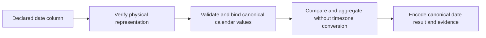

# 2026-10-28: Analytical calendar dates

| Part                                                             | Status                         |
| ---------------------------------------------------------------- | ------------------------------ |
| A date logical type for dataset columns and analytical values    | Proposed                       |
| Calendar, wire and connector rules below                         | Proposed after review          |
| Needed before the media benchmark freezes physical `DATE` tables | Open; ISO text is the fallback |
| Implementation                                                   | Not implemented                |

## Problem and concepts

Daily FX and delivery tables use calendar dates.
[Reference datasets](./2026-10-28-reference-datasets.md) must compare those
dates without treating them as UTC instants. Today `LogicalType` has no date
member (`packages/protocol/src/analytics.ts:4`), and `z.iso.date()` is rejected
by `packages/relate/src/compiler/dataset-types.ts:47`.

| Term          | Meaning                                                      | Example                        |
| ------------- | ------------------------------------------------------------ | ------------------------------ |
| Calendar date | A day in the Gregorian calendar, with no time or timezone    | `2026-10-01`                   |
| Timestamp     | An instant; converting it to a date requires a timezone rule | `2026-10-01T23:30:00Z`         |
| Logical type  | The portable type used in expressions and results            | `{ type: 'date' }`             |
| Physical type | The storage representation verified by a connector           | Postgres `DATE`, SQLite `TEXT` |

This proposal adds analytical dates, not date functions, timezone conversion or
a general redesign of ordinary object-property schemas.

## Proposed API and values

```ts
// Proposed dataset column; not accepted today.
date: { id: 'delivery.date', schema: z.iso.date(), access: ordinary }

// Proposed LogicalType member and TypedValue variant:
{ readonly type: 'date' }
{ readonly type: 'date'; readonly value: string }
```

`ComputedResultType` adds its existing nullable flag. `MIN(d.date)` and
`MAX(d.date)` return date values; `COUNT` remains numeric. Arithmetic on dates,
`SUM(date)` and `AVG(date)` are rejected. Named parameters infer the date type
from comparisons or join keys, using a JSON string such as `'2026-10-01'`.

- Wire values are exactly `YYYY-MM-DD`, with valid Gregorian month/day and leap
  years, in the range `0000-01-01` through `9999-12-31`.
- No timezone, time suffix, whitespace, unpadded component, infinity or invalid
  date is accepted. Do not pass dates through JavaScript `Date` or implicitly
  cast a timestamp to a date.
- Date/date equality, ordering and range comparisons use calendar order. A date
  and a string/timestamp are different logical types, even if their text looks
  similar. No implicit conversion in join keys or predicates.
- Computed date filters and ordering use the same typed encoding, existing null
  rules and cursor validation. Discovery reports `type: 'date'` explicitly.
- Nullability remains separate from validity; invalid dates cannot be converted
  to null, skipped or normalized into a different day.

## Connector behavior



| Backend  | Proposed representation and checks                                                                                              |
| -------- | ------------------------------------------------------------------------------------------------------------------------------- |
| DuckDB   | Physical `DATE`; encode explicitly as calendar text, validate supported year range and reject infinity                          |
| Postgres | Physical `DATE`; avoid driver timezone conversion, map ISO year zero to 1 BC and back, reject infinity/out-of-range dates       |
| SQLite   | Physical `TEXT` containing canonical dates; validate participating values before comparison/grouping, and use binary comparison |

All connectors must preserve calendar values exactly. Physical schema checks
alone cannot prove that SQLite text contains dates. Invalid participating data
makes the affected calculation unavailable; it must not compare as arbitrary
text or vanish from a lookup. The implementation must choose and test the
connector validation path before enabling the type. Invalid decoded results
retain the existing `invalid-result` handling; backend validation/execution
failures use `execution-failed`.

For lookup keys, normalization, grouping and comparison use this same date
contract. Date semantics do not define business meaning: the benchmark generator
must align FX dates with account-local delivery dates. A currency conversion
cannot infer that calendar convention from the storage type.

## Fallback and scope

If this feature is deferred, use `z.string()` with ISO text storage for both
sides of the lookup and validate dates in the benchmark generator. Change the
benchmark's physical DDL, column declarations and oracle fixtures together.
Declaring a string over a physical DuckDB/Postgres `DATE` is not the fallback.

Ordinary `self` date properties are not added by this proposal; date joins can
use base date columns or typed parameters. Extending ordinary property schema
formats requires a separate explicit change. Date arithmetic, truncation,
timezone functions and as-of joins remain deferred.

## Files and ownership

| File                                                                   | Change   | Why                                                                    |
| ---------------------------------------------------------------------- | -------- | ---------------------------------------------------------------------- |
| `packages/protocol/src/analytics.ts`                                   | modified | Logical date type used by expressions, evidence and discovery          |
| `packages/relate/src/compiler/dataset-types.ts`                        | modified | Accept `z.iso.date()` as a dataset scalar                              |
| `packages/relate/src/model/datasets.ts`                                | modified | Compiled manifest validation for the new type                          |
| `packages/relate/src/analytics/values.ts`                              | modified | Canonical date validation and typed wire values                        |
| `packages/runtime/src/analytics/resolve.ts`, `order.ts`                | modified | Date comparisons, result types, filters, ordering and cursor positions |
| `packages/runtime/src/discovery/analytics.ts`                          | modified | Explain date encoding in compute discovery                             |
| `packages/relate/src/analytics/query-validation.ts`, `render.ts`       | modified | Validate and render typed date operands                                |
| `connectors/duckdb`, `connectors/sqlite`, `connectors/postgres`        | modified | Physical checks, binding and calendar-safe decoding                    |
| `tests/support` and owning package tests                               | modified | Cross-backend date acceptance and rejection                            |
| Owning package contracts and `apps/docs/content/authoring/datasets.md` | modified | Date authoring and wire behavior                                       |

## Done when

1. All backends round-trip leap days, year zero and boundary years identically,
   independent of process and database timezone. Invalid dates, infinities and
   out-of-range years fail explicitly.
2. Date parameters, nullable columns, equality/range predicates, `MIN`/`MAX`,
   computed filters/order and cursor continuation have executable tests.
3. Full-key lookup grouping and equality agree, including SQLite validation of
   malformed physical text. Date/string and date/timestamp mismatches fail
   preparation rather than relying on backend coercion.
4. Manifest validation, discovery, protocol encoding and public docs recognize
   the type; ordinary-property date support is not implied.
5. Run owning tests and boundary/packaging checks for the changed public type,
   plus repository validation appropriate to the implementation.
