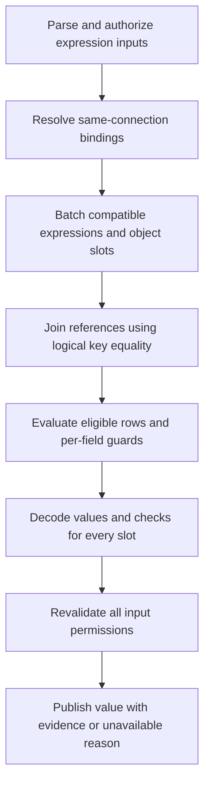

# 2026-10-28: Reference datasets

**Status:** direction agreed on 2026-10-28: keyed datasets that expressions may
join by equality on every key column. Grammar, plan, result and evidence
contracts below are proposed. Nothing is implemented. This extends
[Analytical datasets and computed fields](./2026-10-18-analytical-properties.md),
whose "no joins" rule becomes "no joins except full-key joins to reference
datasets". The [media agency benchmark](./2026-10-23-media-agency-benchmark.md)
needs it for currency conversion before its graph is frozen.

| Part                                                              | Status                                      |
| ----------------------------------------------------------------- | ------------------------------------------- |
| `key` on `defineDataset`; full-key equality joins only            | Agreed 2026-10-28                           |
| Missing or duplicate reference rows never silently change a value | Agreed 2026-10-28                           |
| SQL name `datasets.<Name>`                                        | Proposed                                    |
| `LEFT JOIN` only; base-only predicates; per-field lookup checks   | Proposed after review                       |
| [Row arithmetic](./2026-10-28-row-arithmetic.md) (`SUM(a * b)`)   | Proposed prerequisite                       |
| [Date logical type](./2026-10-28-analytical-dates.md)             | Agreed prerequisite; lands before benchmark |
| As-of joins ("latest rate on or before")                          | Deferred                                    |

## The problem

A plan line's budget is in the client's currency, but its delivery rows are in
the ad account's currency, which is different for about a quarter of accounts.
The exchange rate depends on the delivery date. To compare spend with budget,
each delivery row must be multiplied by that day's rate:

```text
plan line PL-0042-07   budget 50,000.00 GBP
delivery 2026-10-01    412.37 EUR   × rate(2026-10-01, EUR→GBP) 0.8612
delivery 2026-10-02    398.10 EUR   × rate(2026-10-02, EUR→GBP) 0.8604
…
```

Today an expression reads exactly one dataset. The rate table cannot be
referenced:

```ts
// rejected today: packages/sql-parser/src/lower.ts:98 allows one FROM item
sql: `SELECT SUM(d.spendMicros * f.rate) FROM self.delivery d JOIN fx f ON …`;
```

Conversion cannot currently be expressed in Relate. Converting only the final
sum would be wrong when rates change between delivery dates.

## Concepts

The terms build on the dataset concepts from the analytical-properties spec.

| Term                  | Meaning                                                                                                                           | Tiny example                                                                          |
| --------------------- | --------------------------------------------------------------------------------------------------------------------------------- | ------------------------------------------------------------------------------------- |
| **Dataset**           | Typed rows in a SQL table with no Relate identity, declared in the graph and bound to a physical table.                           | `Delivery` rows in DuckDB                                                             |
| **Association**       | A link from an object to a dataset by correlation columns; `self.<name>` in SQL means "this object's rows".                       | `PlanLine.datasets.delivery`, `FROM self.delivery d`                                  |
| **Expression**        | An aggregate or formula over an association, declared (`computed`) or sent by a caller (`compute`).                               | `SELECT SUM(d.spendMicros) FROM self.delivery d`                                      |
| **Key**               | Columns that identify at most one row of a dataset.                                                                               | `key: ['date', 'fromCurrency', 'toCurrency']`                                         |
| **Reference dataset** | A keyed dataset registered in the graph that expressions may join to. It needs no association.                                    | `Fx` daily exchange rates                                                             |
| **Base rows**         | The association rows an expression aggregates.                                                                                    | `self.delivery d`                                                                     |
| **Full-key join**     | A join whose `ON` binds every key column with `=` and nothing else. Requires at most one matching row; violations fail the value. | `ON f.date = d.date AND f.fromCurrency = d.currency AND f.toCurrency = self.currency` |
| **Lookup semantics**  | A reference join never adds or removes base rows: each base row gets zero or one reference row.                                   | A missing rate makes the value unavailable, not smaller                               |
| **Eligible row**      | A base row admitted by an aggregate's `WHERE` and `FILTER` predicates.                                                            | An October delivery in `WHERE d.date >= $from`                                        |
| **Slot**              | One object in a batched calculation, even when two objects share correlation values.                                              | Slot `0` is plan line `PL-0042-07`                                                    |
| **Guard**             | An internal check that prevents publishing a value computed from missing or duplicate lookup rows.                                | `referenceMissing: true`                                                              |

A join on fewer key columns can multiply sums. Full-key joins plus runtime
uniqueness checks preserve base-row multiplicity. A declared key is a contract,
not proof that the warehouse enforces it.

## Authoring

The following API is proposed. The date schemas require the separate
[date type proposal](./2026-10-28-analytical-dates.md); the multiplication
requires [row arithmetic](./2026-10-28-row-arithmetic.md). `Delivery.date` and
`Fx.date` must have the same logical type and calendar convention.

```ts
export const Fx = defineDataset({
  id: 'warehouse.fx-daily',
  description: 'Daily closing rate from one currency to another.',
  key: ['date', 'fromCurrency', 'toCurrency'], // NEW
  columns: {
    date: { id: 'fx.date', schema: z.iso.date(), access: ordinary }, // needs the date type, see below
    fromCurrency: { id: 'fx.from', schema: z.string(), access: ordinary },
    toCurrency: { id: 'fx.to', schema: z.string(), access: ordinary },
    rate: { id: 'fx.rate', schema: z.number(), access: ordinary }, // float64
  },
});

export const PlanLine = defineObject({
  id: 'agency.plan-line',
  membership: source(planLines),
  properties: {
    // …
    platform: from(planLines.fields.platform, {
      id: 'agency.plan-line.platform',
    }),
    platformCampaignId: from(planLines.fields.platform_campaign_id, {
      id: 'agency.plan-line.platform-campaign-id',
    }),
    currency: from(planLines.fields.currency, {
      id: 'agency.plan-line.currency',
    }),
    spendThroughYesterdayMinor: computed({
      id: 'agency.plan-line.spend-through-yesterday-minor',
      access: ordinary,
      description:
        'Approximate spend in plan-currency minor units; may be fractional.',
      sql: `SELECT SUM(d.spendMicros * f.rate) / 10000
            FROM self.delivery AS d
            LEFT JOIN datasets.Fx AS f
              ON f.date = d.date AND f.fromCurrency = d.currency AND f.toCurrency = self.currency`,
    }),
  },
  datasets: {
    delivery: {
      id: 'agency.plan-line.delivery',
      dataset: Delivery,
      on: [
        { column: 'platform', property: 'platform' },
        { column: 'platformCampaignId', property: 'platformCampaignId' },
      ],
    },
  },
});

export const graph = defineGraph({
  // …
  datasets: { Delivery, Fx }, // Fx needs no association
  policies: {
    PlanLine: { /* … */ datasets: { delivery: { gate: planner } } },
    Delivery: {},
    Fx: {}, // DatasetPolicy: column groups only, as today
  },
});
```

Callers write the same join:

```ts
await relate.PlanLine.query({
  compute: {
    spendOct: {
      sql: `SELECT SUM(d.spendMicros * f.rate) / 10000 FROM self.delivery AS d
            LEFT JOIN datasets.Fx AS f
              ON f.date = d.date AND f.fromCurrency = d.currency AND f.toCurrency = self.currency
            WHERE d.date >= $from`,
      parameters: { from: '2026-10-01' },
    },
  },
});
```

The `Minor` suffix identifies units, not an integer result type. With a
`float64` rate this is an approximate, nullable `float64` analytical amount:
`412.37 EUR × 0.8612 × 100 = 35513.3044` GBP minor units. No rounding occurs per
row or after summation. These examples assume GBP/EUR/USD, each with 100 minor
units per major unit. General currency scales are not inferred.

Invoice/settlement amounts remain integer minor units. Any task requiring an
integer converted amount must separately define rounding mode and stage; this
feature does not add monetary rounding or decimal arithmetic. Benchmark answers
use the existing numeric tolerance against the unrounded analytical amount. The
declared calculation reads all associated delivery rows; its name assumes the
benchmark warehouse contains only delivery through its last daily load.

What already works and what is new:

- Registering a dataset in `defineGraph({ datasets })` without any association
  already compiles (`packages/relate/src/compiler/datasets.ts`), and
  `DatasetPolicy` already governs column groups. Those parts need no change.
- New: `key`, the `JOIN` grammar, arithmetic inside aggregates, the plan shape,
  result reasons, evidence and discovery.

## Validation rules

**Key**

- Every key column must be a declared, non-nullable column.
- Columns must be unique, with at least one.
- Bad keys raise a new `dataset.invalid-key` diagnostic.
- An unkeyed dataset cannot be joined.
- A key grants eligibility for global lookup under column policies; it is not
  merely an optimizer hint. Reference lookups have no association or row gate.
  Full-key matching is not row authorization: callers can supply key operands.
  Bind only reference data safe for any principal allowed those columns.
  Row-scoped reference authorization is deferred.

Proposed addition to `defineDataset` and `DatasetDefinition`
(`packages/relate/src/datasets.ts:14` and `:24`):

```ts
type DatasetKey<C extends DatasetColumns> = readonly [
  Extract<keyof C, string>,
  ...Extract<keyof C, string>[],
];
// In the definition input (infer C from columns only):
readonly key?: DatasetKey<NoInfer<C>>;
// In the returned DatasetDefinition<C>:
readonly key?: DatasetKey<C>;
```

TypeScript checks nonempty keys and declared column names without widening the
inferred columns. Compilation still checks duplicates, nullability and untyped
callers. Copy and freeze the key; include it in the compiled manifest and model
revision.

**Names.** A reference dataset is written `datasets.<RegistryKey>` (for example
`datasets.Fx`). The `datasets` schema is reserved, like `self`, so a join can
never name a physical table. Every column must be qualified by an alias once an
expression has a join.

| Rule        | Accepted                                                                                                                 | Rejected                                                                                                        |
| ----------- | ------------------------------------------------------------------------------------------------------------------------ | --------------------------------------------------------------------------------------------------------------- |
| Base        | Exactly one `FROM self.<association> [AS] alias`, as today                                                               | No base; a reference dataset as the base                                                                        |
| Join target | `datasets.<Name>` where `Name` is a keyed dataset registered in the graph                                                | `self.x`, unkeyed datasets, unqualified or physical names                                                       |
| `ON` clause | `AND` of `ref.keyColumn = operand` covering every key column once; operand is a base column, `self.property` or `$param` | Missing or repeated key column, `<`, `OR`, functions, extra predicates (base-only predicates belong in `WHERE`) |
| Join kind   | `LEFT JOIN` with strict lookup checks                                                                                    | Bare `JOIN`, `INNER`, `RIGHT`, `FULL`, `CROSS`, `NATURAL`, `USING`, subqueries, CTEs                            |
| Predicates  | `WHERE` and aggregate `FILTER` use only base columns, `self`, parameters and literals                                    | Reference columns in either predicate, including `IS NULL`                                                      |
| Chaining    | Several reference joins, each `ON` binding only base columns, `self` or parameters                                       | A join whose `ON` uses another reference's columns (v1)                                                         |
| Types       | Equal logical types on each `ON` pair                                                                                    | Mismatched types (diagnostic)                                                                                   |
| Connection  | Reference dataset bound to the same connection as the base dataset                                                       | Cross-connection joins; federation is separate                                                                  |
| Aliases     | Unique, not `self` or `datasets`                                                                                         | Duplicates                                                                                                      |

A missing reference makes the value unavailable; `LEFT JOIN` does not offer
optional lookup/fallback behavior. `COALESCE` cannot turn a missing lookup into
a valid value. Discovery's `ComputeDescription` must state this rule and the
restriction on reference-dependent predicates.

Same connection means the same configured connection instance, not merely the
same database URL. Validate bindings at startup for declared calculations and
during request preparation, before data I/O, for caller SQL. Connector resource
ownership checks remain a second line of validation.

## Which rows require a reference?

For each aggregate leaf (for example, each `SUM` in `SUM(a) / SUM(b)`):

1. Start with the object's associated base rows.
2. Apply its SQL `WHERE` and aggregate `FILTER`. False or null means excluded.
3. Require exactly one match for every reference joined by that expression on
   each remaining row, even if that aggregate does not use a reference value.
4. Compute the aggregate only from valid rows, and withdraw the computed field
   if any eligible row failed a lookup check. Combine checks across all leaves
   in that field.

The checks use row eligibility, not aggregate argument nullability: a nullable
argument does not exempt an otherwise eligible row from lookup validation. A
null base join operand has no match and produces `reference-missing`. An
unavailable/null `self` dependency retains today's dependency behavior before
SQL execution; null parameters remain invalid.

| Case                                                      | Result                                                 |
| --------------------------------------------------------- | ------------------------------------------------------ |
| October selected; missing/duplicate September rate        | No effect on October                                   |
| October selected; missing October rate                    | `reference-missing`                                    |
| Duplicate October rate, even with identical payloads      | `reference-key-not-unique`                             |
| `WHERE f.rate > 0` or `FILTER (WHERE f.rate IS NOT NULL)` | Preparation error; cannot hide failed lookups          |
| No eligible rows, including an empty association          | Existing empty aggregate result; no lookup failure     |
| Unique matched row with a nullable payload                | Existing null aggregate rules; not a missing reference |

The parser currently merges `WHERE` and `FILTER` into each aggregate predicate
(`packages/sql-parser/src/lower.ts:387`). Keep that ownership: guards must use
the same predicate and per-field validity mask as their aggregate, never a
statement-wide count of all associated rows.

## Arithmetic inside aggregates

[Row arithmetic](./2026-10-28-row-arithmetic.md) owns the proposed
`RowExpression`, numeric promotion, intermediate overflow checks and zero
division behavior. Joins do not change those rules. Exact integer row arithmetic
must not rely on backend overflow behavior; the linked spec makes that a
separate implementation and acceptance requirement.

## Execution

The existing renderer correlates each object with its base rows and aggregates
per slot (`packages/relate/src/analytics/render.ts:198`). A reference join adds
a deduplicated relation and lookup checks for each output field.



This SQL is a relational sketch for one October aggregate. `eligible` stands for
that leaf's validity mask combined with its base-only predicates; the production
renderer binds values and emits dialect-specific comparisons, aggregates and
checked arithmetic.

```sql
WITH keys(slot, k0, k1, p_currency) AS (
  VALUES (0, 'meta', 'm_2384001', 'GBP')
),
fx_k AS (
  -- Group by logical keys; see the normalization rules below.
  SELECT date, from_currency, to_currency, MIN(rate) AS rate, COUNT(*) AS n
  FROM fx_daily
  GROUP BY date, from_currency, to_currency
),
joined AS (
  SELECT k.slot, d.spend_micros, f.rate, f.n,
         d.date >= :from AS eligible
  FROM keys k
  JOIN delivery_daily_campaign d
    ON d.platform = k.k0 AND d.platform_campaign_id = k.k1
  LEFT JOIN fx_k f ON f.date = d.date
    AND f.from_currency = d.currency AND f.to_currency = k.p_currency
),
agg AS (
  SELECT slot,
    SUM(CASE WHEN eligible AND n = 1 THEN spend_micros * rate END) / 10000.0 AS value,
    COUNT(*) FILTER (WHERE eligible AND n IS NULL) AS missing,
    COUNT(*) FILTER (WHERE eligible AND n > 1) AS duplicate
  FROM joined GROUP BY slot
)
SELECT k.slot, a.value,
       COALESCE(a.missing, 0) AS missing,
       COALESCE(a.duplicate, 0) AS duplicate
FROM keys k LEFT JOIN agg a ON a.slot = k.slot ORDER BY k.slot;
```

- Duplicate groups are collapsed solely to prevent row multiplication; their
  representative payload is never accepted as a value. Do not evaluate row
  arithmetic on missing/duplicate matches. Empty aggregates retain the existing
  `COUNT` and explicit fallback handling, omitted from this `SUM` sketch.
- Key grouping and joins must use **identical logical equality**. Strings use
  the portable binary comparison, regardless of physical collation. Timestamps
  group by normalized instants at declared precision, not raw text spelling.
  Apply the same normalization to both sides of lookup equality. Non-finite or
  malformed keys must not silently create matches.
- `GROUP BY` must explicitly use normalized key expressions. On SQLite a
  `NOCASE` column otherwise merges `USD` and `usd`; differently spelled equal
  timestamps can produce the opposite error. Existing comparison hooks live in
  `connectors/sqlite/src/analytics/plan.ts:40` and
  `connectors/postgres/src/plan.ts:41`; add a shared logical key rendering path.
- Representative payload aggregates also use dialect hooks. Do not hardcode
  `MIN` for every logical type: the Postgres dialect maps boolean minima to
  `BOOL_AND` (`connectors/postgres/src/plan.ts:59`). Read only authorized key
  and payload columns needed by the expression.
- Physical names and mappings stay connector-owned. Lookup checks and values
  come from the same statement; no separate preflight uniqueness query.

Plan contract:

```ts
// packages/relate/src/analytics/query.ts (sketch)
export interface AuthorizedDatasetQuery {
  readonly resource: DatasetResource; // base, unchanged
  readonly references: readonly {
    // NEW, statement indexes assigned by the batch planner
    readonly resource: DatasetResource;
    readonly key: readonly string[];
    readonly on: readonly {
      readonly column: string;
      readonly operand:
        | Exclude<ResolvedOperand, { kind: 'column' }>
        | (Extract<ResolvedOperand, { kind: 'column' }> & { relation: 'base' });
    }[];
  }[];
  // …keys, correlation, slots, aggregates
}

export type ResolvedOperand =
  | {
      kind: 'column';
      relation: 'base' | number;
      column: string;
      type: LogicalType;
    } // relation: NEW
  | { kind: 'key'; key: number; type: LogicalType }
  | { kind: 'value'; value: TypedValue };
```

### Batching and connector output

`planBatches` currently groups by association
(`packages/runtime/src/analytics/batch.ts:174`). For v1, refine that group by
the ordered reference resources, full-key operands and bound parameter values.
Compare ordinary dependencies by property ID before remapping their indexes.
Expressions with different lookups use separate statements; expressions without
joins retain their existing group. This avoids merging incompatible joins just
to share a base scan. Aliases are local names, not binding identities.

Within a group, remap each expression's `self` dependencies and reference
indexes to the statement indexes. Every field in the group requires the same
reference joins, so no separate per-field reference-use map is needed. Preserve
original aliases separately for evidence. Several joins to the same dataset
remain distinct when their operands differ. Every field's predicates, validity
mask and guards remain independent.

Proposed connector result extension
(`packages/relate/src/analytics/connectors.ts:33`):

```ts
export interface SlotRow {
  readonly slot: number;
  readonly values: readonly (string | number | bigint | boolean | null)[];
  // Exactly one entry per value; all false for an unused/invalid field mask.
  readonly checks: readonly {
    readonly referenceMissing: boolean;
    readonly referenceDuplicate: boolean;
    readonly arithmeticFailed: boolean; // row-arithmetic prerequisite
  }[];
}
```

- Connectors decode SQL guard counts to booleans. Keep one row per requested
  slot, in slot order, including empty associations. For a failed cell return a
  null placeholder and checks; runtime inspects checks before scalar encoding.
- Validate frame lengths and boolean types before merging. A malformed frame is
  `invalid-result`, as today. A valid lookup failure withdraws only that field
  on that slot, not other fields, objects or chunks. In particular, do not put
  lookup failures in `mergeBatch`'s alias-wide `failed` set
  (`packages/runtime/src/analytics/merge.ts:75`).
- Existing forbidden/unavailable dependency masks take precedence and remain
  unchanged. For an executable cell, reason precedence is duplicate reference,
  missing reference, then arithmetic failure (`execution-failed`). Backend
  statement failures retain existing statement-level failure handling.
- Count all ON parameters, row-expression literals and repeated guard bindings
  in `parameterBudget`; retain SQL/node/parameter limits, per-connection queue,
  cancellation and statement timeout. Grouping a reference may scan its table;
  v1 does not promise indexed lookup cost or a new independent scan budget.

## Results and evidence

| Situation                                         | Field evidence                                                                              |
| ------------------------------------------------- | ------------------------------------------------------------------------------------------- |
| Every eligible base row matched exactly one row   | `available`, value as computed                                                              |
| Some eligible base row has no reference row       | `unavailable`, reason `reference-missing`. Never a silently smaller sum                     |
| An eligible row matches a duplicate key (`n > 1`) | `unavailable`, reason `reference-key-not-unique`. Never a duplicated rate                   |
| No eligible base rows                             | Unchanged from today's empty-association behavior                                           |
| Caller cannot read a used reference column        | As for any unreadable dataset column today; a calculation never grants access to its inputs |

Protocol changes (`packages/protocol/src`):

```ts
// analytics.ts:21
export type ComputedUnavailableReason =
  | 'correlation-unavailable' | 'execution-failed' | 'invalid-result' | 'busy'
  | 'reference-missing' | 'reference-key-not-unique'; // NEW

// index.ts:84: one base entry, then one per authored reference alias
readonly inputs: readonly (
  | { role: 'base'; associationId: string; datasetId: string; bindingRevision: string; readAt: string; modifiedAt?: string }
  | { role: 'reference'; alias: string; datasetId: string; bindingRevision: string; readAt: string; modifiedAt?: string } // NEW
)[];

// discovery.ts:96, GraphDescription
readonly datasets?: Readonly<Record<string, ReferenceDatasetDescription>>; // NEW, visible reference datasets only
export interface ReferenceDatasetDescription {
  readonly datasetDefinitionId: string;
  readonly description?: string;
  readonly key: readonly string[];
  readonly columns: Readonly<Record<string, DatasetColumnDescription>>; // all declared columns, with readable flags
}
```

`role` makes `inputs` a discriminated union. That is a breaking change, which is
acceptable before the first release.

### Evidence and authorization

`DatasetExecution.readAt` remains the connector clock for the single statement
(`packages/relate/src/analytics/connectors.ts:39`). Every input read by that
statement receives that same time and its own binding revision. This is not an
ingestion watermark or a snapshot identity. Omit `modifiedAt` for joined inputs
unless the connector can attribute a backend observation to that input; do not
copy a base dataset's timestamp onto its references.

Keep `freshness: 'unverified'` and the existing ordinary-property dependency
evidence. The following is the proposed full-evidence field fragment for a
single eligible row worth exactly 80 minor units; outer result metadata is
unchanged. The revision strings stand for opaque runtime-generated revisions.

```ts
{
  data: { spendOct: 80 },
  meta: {
    // …existing full-read metadata
    computed: { spendOct: { type: 'float64', nullable: true } },
    fields: {
      spendOct: {
        status: 'available', source: 'computed', freshness: 'unverified',
        computedAt: '2026-10-28T12:00:00.010Z', coverage: 'complete',
        inputs: [
          { role: 'base', associationId: 'agency.plan-line.delivery',
            datasetId: 'warehouse.delivery', bindingRevision: '<delivery revision>',
            readAt: '2026-10-28T12:00:00.000Z' },
          { role: 'reference', alias: 'f', datasetId: 'warehouse.fx-daily',
            bindingRevision: '<fx revision>', readAt: '2026-10-28T12:00:00.000Z' },
        ],
        dependencies: { /* existing evidence for platform, campaign ID and currency */ },
      },
    },
  },
}
```

For an eligible row with no rate, omit `data.spendOct`, retain its result type,
and report
`meta.fields.spendOct = { status: 'unavailable', reason: 'reference-missing' }`.
Unavailable fields do not gain an `inputs` property. Existing partial-read and
required-field rules still apply, including computed filters/order and
`requireComplete`.

A reference is discoverable only when all key columns are readable. Otherwise
omit the dataset from actor discovery and caller SQL resolution, without leaking
key names in diagnostics. For a discoverable reference, include all declared
columns with `readable` flags, matching existing association discovery
(`packages/runtime/src/discovery/analytics.ts:49`). A denied payload column is
known but unusable, just like a denied base column. No separate dataset gate is
introduced.

Declared calculations still validate against the complete trusted model at
startup, then authorize all used columns against the actor. Missing key access
makes the declared field forbidden. `ON` keys, payload operands and ordinary
`self` properties all belong to the private authorization footprint. At final
revalidation, check every referenced dataset/column as well as the base
association and ordinary dependencies; revoke the result if access changed.
Extend `packages/runtime/src/analytics/revalidate.ts:14`, which currently checks
only base columns. Discovery and execution must share these visibility rules.

## Dates

The main example uses the
[analytical date type](./2026-10-28-analytical-dates.md). Today `z.iso.date()`
is rejected by `packages/relate/src/compiler/dataset-types.ts:47`. Date support
is an independent prerequisite, not implicitly delivered by adding reference
joins. `z.number()` remains the supported spelling for `float64`.

Date support lands before the benchmark freezes; the ISO-text fallback is
withdrawn. The join feature itself does not require a date type.

## Missing days

Daily rate tables usually skip weekends and holidays, but delivery happens every
day. With strict equality those rows are `reference-missing`. As-of joins
("latest rate on or before this date", DuckDB `ASOF JOIN`) are deferred. Until
then, data owners fill every calendar day, and every currency pair that is used,
including identity pairs (`GBP→GBP = 1`).

## Files

| File                                                                 | Change   | Why                                                                   |
| -------------------------------------------------------------------- | -------- | --------------------------------------------------------------------- |
| `packages/relate/src/datasets.ts`                                    | modified | `key` option; frozen on the definition                                |
| `packages/relate/src/compiler/datasets.ts`                           | modified | Key validation; reference registry for expression preparation         |
| `packages/relate/src/model/datasets.ts`                              | modified | Persist and validate keys in the manifest; update revision input      |
| `packages/relate/src/analytics/sql.ts`, `query.ts`                   | modified | `RowExpression`; `references` and `relation` in the plan              |
| `packages/sql-parser/src/lower.ts`                                   | modified | `JOIN datasets.X`, `ON` lowering, qualified columns, row arithmetic   |
| `packages/runtime/src/analytics/resolve.ts`, `prepare-*.ts`          | modified | Resolve reference columns, types and full-key coverage                |
| `packages/runtime/src/authorization/analytics.ts`                    | modified | Reference datasets in the expression scope; column authorization      |
| `packages/runtime/src/analytics/batch.ts`, `execute.ts`, `merge.ts`  | modified | Guard values → `reference-missing` / `reference-key-not-unique`       |
| `packages/relate/src/analytics/render.ts`, `query-validation.ts`     | modified | Logical key grouping, guards, plan validation and parameter budgeting |
| `packages/relate/src/analytics/connectors.ts`                        | modified | Per-cell checks in the connector result contract                      |
| `packages/runtime/src/analytics/execution-types.ts`, `revalidate.ts` | modified | Multiple input bindings and complete authorization footprint          |
| `packages/node/src/bindings.ts`                                      | modified | Binding identity for same-connection preparation checks               |
| `connectors/duckdb`, `connectors/sqlite`, `connectors/postgres`      | modified | Plan generation and physical checks for reference resources           |
| `packages/runtime/src/discovery/index.ts`, protocol                  | modified | Reference datasets in `GraphDescription`                              |
| `tests/support/analytical-*-contract.ts`, `sql-corpus/`              | modified | Accepted and rejected join corpus; guard semantics per backend        |
| `specs/2026-10-18-analytical-properties.md`                          | modified | Amend the "no joins" rule when this lands                             |
| `apps/docs/content/authoring/datasets.md`                            | modified | "Reference datasets" section                                          |

## Done when

1. Nonempty, duplicate-free, non-nullable keys are checked at compilation, with
   TypeScript tests for misspelled names and preserved column inference. Key
   changes affect the model revision. SQL errors identify their source span.
2. The acceptance corpus runs on DuckDB, SQLite and Postgres: full-key joins,
   multiple aliases, two joins to the same dataset, quoted names, nullable base
   keys, and rejection of every unsupported grammar form and cross-connection
   lookup. Cover startup and caller preparation separately.
3. Missing/duplicate rows inside the eligible range fail the value; failures
   outside it do not. Include `WHERE`, different aggregate `FILTER`s in one
   formula, null arguments, identical duplicate payloads, missing plus duplicate
   together, `COALESCE`, and rejection of reference-dependent predicates.
4. Key equality tests cover binary strings on nonbinary physical collations and
   equivalent timestamp spellings. Matched nullable payloads retain ordinary
   null behavior. Referenced boolean payloads work on all three backends.
5. Batched joined and unjoined fields retain independent results; one failing
   slot does not poison another slot, field or chunk. Empty slots are returned,
   validity masks suppress checks, and malformed guard frames fail safely.
6. All used reference columns are authorized for caller and declared SQL.
   Discovery tests cover denied keys and denied payloads. Final permission
   revalidation includes reference inputs, including permission loss after
   calculation but before publication.
7. Evidence lists the base and reference aliases with distinct binding revisions
   and the same statement `readAt`, with no invented per-resource modification
   time. Missing-rate fields retain metadata without publishing a value.
8. Parameter budgeting includes joins, guards and row expressions. Existing
   cancellation, queue and statement limits hold. Required-field failures in
   computed filters/order and `requireComplete` retain existing behavior.
9. The
   [row-arithmetic acceptance criteria](./2026-10-28-row-arithmetic.md#done-when)
   pass. Benchmark examples and oracles use unrounded float64 analytical amounts
   and their declared numeric tolerance, not implicit integer conversion.
10. The [date feature](./2026-10-28-analytical-dates.md#done-when) passes.
11. Update owning package contracts/docs, public dataset docs and the earlier
    analytical spec when implementation lands. Run `pnpm check` (or
    `pnpm test:unit` without a test database, reported as such) and
    `pnpm check:boundaries`.

## Open questions

| Question                                  | Current proposal                                                                    |
| ----------------------------------------- | ----------------------------------------------------------------------------------- |
| SQL namespace and spelling?               | `datasets.<Name>` and `LEFT JOIN` only; no inner-join alias                         |
| Reference predicates or chained lookups?  | Defer both; base-only predicates and independent full-key lookups in v1             |
| Monetary rounding or exact decimal rates? | Separate feature if required; current example returns unrounded float64 minor units |
| As-of joins?                              | Defer; require filled calendars and identity currency pairs                         |
