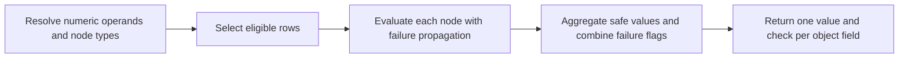

# 2026-10-28: Arithmetic inside aggregate arguments

| Part                                                                                                            | Status                                        |
| --------------------------------------------------------------------------------------------------------------- | --------------------------------------------- |
| Row arithmetic for reference-dataset currency conversion                                                        | Agreed prerequisite                           |
| [Types and parameter inference](#literal-and-parameter-inference)                                               | Agreed on 2026-10-28                          |
| [Floating-point behavior](#floating-point-behavior) and [checked accumulation](#checked-aggregate-accumulation) | Agreed on 2026-10-28                          |
| [Connector result checks](#connector-result-checks), owned here and extended by reference datasets              | Agreed on 2026-10-28                          |
| [Backend strategy](#backend-strategy): generated SQL only, no installed or registered helpers                   | Agreed on 2026-10-28; boundary tests required |
| Implementation                                                                                                  | In progress                                   |

## Problem and concepts

[Reference datasets](./2026-10-28-reference-datasets.md) need
`SUM(d.spendMicros * f.rate)`. Today aggregate arguments are single operands;
formulas can combine aggregate results but cannot multiply values within a row
(`packages/sql-parser/src/lower.ts:394`,
`packages/relate/src/analytics/sql.ts:77`). This feature also works without
joins.

| Term               | Meaning                                                                                              | Example                                          |
| ------------------ | ---------------------------------------------------------------------------------------------------- | ------------------------------------------------ |
| Operand            | A typed column, ordinary object property, parameter or literal                                       | `d.clicks`, `self.currency`, `$scale`, `1.0`     |
| Row expression     | Arithmetic evaluated separately for each eligible row                                                | `d.spendMicros * f.rate`                         |
| Eligible row       | A row admitted by an aggregate's `WHERE` and `FILTER`, with valid dependencies and reference matches | October deliveries with exactly one FX rate      |
| Aggregate leaf     | One aggregate within the output formula                                                              | `SUM(...)` in `SUM(...) / SUM(...)`              |
| Accumulator        | Internal running state used to combine rows; it can be wider than the output type                    | Exact integer total before the final int64 check |
| Underflow          | A nonzero result is too small to survive float64 rounding                                            | `1e-300 * 1e-300` rounds to zero                 |
| Subnormal          | A representable float64 value smaller than the smallest normal value                                 | `5e-324` remains nonzero                         |
| Checked evaluation | A value plus an internal failure flag; later operations cannot hide an earlier failure               | Overflow followed by subtraction still fails     |

## Authoring and types

No new consumer option is needed. Existing `compute` and `computed` accept the
extended SQL grammar once this feature lands:

```ts
await relate.PlanLine.query({
  compute: {
    scaledClicks: {
      sql: 'SELECT SUM(d.clicks * 1.0) FROM self.delivery AS d',
    },
  },
});
```

Proposed replacement for `SqlAggregate.argument` and the corresponding resolved
argument (`packages/relate/src/analytics/query.ts:60`):

```ts
type RowExpression<O> =
  | O
  | {
      readonly kind: 'arithmetic';
      readonly op: '+' | '-' | '*' | '/';
      readonly left: RowExpression<O>;
      readonly right: RowExpression<O>;
    };
// Parser: argument: RowExpression<Operand> | '*'
// Resolved plan: argument: RowExpression<ResolvedOperand> | '*'
```

Every resolved arithmetic node also carries its inferred logical type (`int64`
or `float64`); nullability follows from the operands at execution time. Preserve
source spans for operand and operator diagnostics. Plain operands retain their
existing types; only arithmetic operands must be numeric. Nested aggregates,
casts, arbitrary functions, row-level `COALESCE`/`NULLIF`, and arithmetic
predicates remain outside this addition. `COUNT(DISTINCT ...)` continues to
accept only a plain operand. Parentheses obey ordinary precedence.

| Operands                                         | Result and evaluation                                                                       |
| ------------------------------------------------ | ------------------------------------------------------------------------------------------- |
| int32/int64 `+`, `-`, `*` int32/int64            | Exact int64; check the result of every node against the signed 64-bit range                 |
| Either operand float64                           | Convert both operands to float64 before the operation; finite result required               |
| Numeric `/` numeric                              | Convert both operands to float64 **before** division; zero denominator fails                |
| Null operand                                     | Null value, unless a child expression already failed; aggregate null rules remain unchanged |
| String, boolean, date or timestamp in arithmetic | Preparation error                                                                           |

### Literal and parameter inference

Infer one logical type for each named parameter before decoding its supplied
value. Promotion belongs to an arithmetic operation; it does not rewrite the
parameter's type. A JSON value such as `0.5` must never select its own type.
These rules extend `packages/runtime/src/analytics/resolve.ts:357-434`:

1. Resolve column/property types and existing comparison constraints first.
   Conflicting comparison constraints remain a preparation error. A parameter
   fixed by a comparison keeps that type in every arithmetic use; numeric
   operands of different types may still be promoted by the operation.
2. Numeric literals inside row expressions use their spelling: integer tokens
   are int64; decimal/exponent tokens, including `1.0` and `1e0`, are float64.
   Keep existing contextual literal conversion in comparisons and aggregate
   fallbacks (`resolve.ts:119-153`). Quoted strings are not numeric row
   operands.
3. For a parameter without a comparison type, infer from the known type of its
   immediate sibling operand or subtree. Collect constraints from every row
   occurrence to a fixed point before committing types. Different candidate
   types for the same parameter are a preparation error, independent of
   traversal order. Do not propagate a parent's promoted result type down into
   children.
4. After row constraints settle, a still-untyped parameter also used in the
   outer formula receives the existing float64 default. Repeat propagation and
   conflict checks. A parameter already typed by a row context keeps that type
   in the outer formula, just as a comparison-typed parameter does today.
5. Reject remaining untyped parameters, nonnumeric arithmetic inputs and values
   that cannot be decoded as the inferred type. Preserve existing rejection of
   null parameters and NULL literals outside `IS NULL`; nullable columns still
   follow the null rules above. Declared calculations still reject parameters.

Assume `d.clicks: int64`, `d.small: int32` and `d.rate: float64`. Each row below
is an independent expression; omitted `FROM self.delivery AS d` is unchanged.

| Expression / additional constraint              | Parameter type | Consequence                                                              |
| ----------------------------------------------- | -------------- | ------------------------------------------------------------------------ |
| `SUM(d.clicks * $scale)`                        | int64          | `{ scale: 2 }` works; `{ scale: 0.5 }` fails preparation                 |
| `SUM(d.clicks * (1.0 * $scale))`                | float64        | `{ scale: 0.5 }` works                                                   |
| `SUM(d.clicks * $scale) + $scale`               | int64          | Outer use promotes the decoded integer to float64                        |
| `SUM(d.clicks / $scale)`                        | int64          | Division promotes both inputs to float64; the parameter remains int64    |
| `SUM(d.small * $scale)`                         | int32          | The int32 neighbor types it; `{ scale: 3000000000 }` fails preparation   |
| `SUM(d.clicks * $scale) WHERE d.rate = $scale`  | float64        | The comparison fixes the parameter; multiplication promotes clicks       |
| `SUM(d.rate * $scale) WHERE d.small = $scale`   | int32          | Fractional scale fails despite the float64 multiplication result         |
| `SUM(d.clicks * $scale) + SUM(d.rate * $scale)` | Conflict       | No comparison fixes the type; int64 and float64 row constraints disagree |
| `SUM($a * $b)`                                  | Ambiguous      | Neither parameter has a typed neighbor; reject                           |
| `SUM(($a * $b) * 1.0)`                          | Ambiguous      | The parent float64 operand does not type either child parameter          |
| `SUM(d.clicks) * $scale`                        | float64        | Existing outer-formula default remains unchanged                         |

An explicit float literal requests promotion at its own node. For example,
`(d.clicks + 1) * 1.0` must still fail if the integer addition overflows; the
outer multiplication cannot retroactively turn that addition into float64.
Converting int64 to float64 may lose precision. This remains approximate
arithmetic, not exact decimal or monetary arithmetic.

### Floating-point behavior

Use binary64 (the float64 representation) with rounding to the nearest
representable value, choosing the even significand at an exact halfway point.
The significand is the integer carrying the value's significant binary digits.
Round at every row arithmetic node; do not fuse or reassociate nodes.

| Situation                                                       | Checked result                                             |
| --------------------------------------------------------------- | ---------------------------------------------------------- |
| Finite rounded result, including a subnormal                    | Return that value                                          |
| Nonzero exact result rounds to zero                             | Return zero, with no arithmetic failure                    |
| Exact cancellation                                              | Return zero, with no arithmetic failure                    |
| Result rounds to infinity, or an arithmetic input is non-finite | Null placeholder plus `arithmeticFailed`                   |
| Division by positive or negative zero with non-null inputs      | Null placeholder plus `arithmeticFailed`                   |
| Null input                                                      | Follow child-failure precedence and null propagation above |

Normalize signed zero at the public value boundary as today
(`packages/relate/src/analytics/values.ts:170`). Underflow followed by division
can therefore fail at the division node: `1.0 / (1e-300 * 1e-300)` has a zero
denominator. Underflow must not hide an earlier child failure.

## Checked execution



- Evaluate only rows admitted by the leaf predicate and validity mask. With
  reference joins, also require exactly one reference match. Failed lookup rows
  contribute lookup checks, not arbitrary representative arithmetic.
- At every node, retain child failures; then apply null propagation; then
  evaluate the operation with its type-specific checks. An invalid operation
  yields an internal null placeholder plus a failure flag. It must not throw
  across unrelated cells or become an ordinary nullable value.
- OR failures across all eligible rows and aggregate leaves of the output field.
  Return `SlotRow.checks[i].arithmeticFailed` as specified in the
  [connector result contract](./2026-10-28-reference-datasets.md#batching-and-connector-output).
  This check is also required for expressions without reference joins.
- Runtime withdraws that field on that object with `execution-failed`. Neither
  an aggregate ignoring nulls nor an outer `COALESCE` may erase the failure.
  Arithmetic range errors covered by this contract must be converted to checks
  before a backend can throw. Unrelated backend statement failures, including
  cancellation and resource errors, keep their existing wider failure scope.
- Existing arithmetic **between aggregates** keeps its current contract,
  including null for division by zero
  (`packages/relate/src/analytics/render.ts:169`). Document the distinction: a
  null final ratio is visible, whereas silently skipping a bad row inside `SUM`
  changes the numerator.

### Connector result checks

This spec lands first, so it owns the per-cell check shape. Extend `SlotRow`
(`packages/relate/src/analytics/connectors.ts:33`):

```ts
export interface SlotRow {
  readonly slot: number;
  readonly values: readonly (string | number | bigint | boolean | null)[];
  /** Exactly one entry per value; all false for an unused/invalid field mask. */
  readonly checks: readonly { readonly arithmeticFailed: boolean }[];
}
```

[Reference datasets](./2026-10-28-reference-datasets.md#batching-and-connector-output)
later add `referenceMissing` and `referenceDuplicate` to the same entry.

| Failure                                                   | Scope                                                 |
| --------------------------------------------------------- | ----------------------------------------------------- |
| Malformed frame, including a missing or non-boolean check | Statement: every field in the batch, `invalid-result` |
| Valid frame, invalid scalar value                         | Alias: that field on every object, as today           |
| Valid frame, `arithmeticFailed: true`                     | Cell: that field on that object, `execution-failed`   |
| Driver error, cancellation, timeout, resource exhaustion  | Statement, as today                                   |

An arithmetic failure never enters `mergeBatch`'s alias-wide `failed` set
(`packages/runtime/src/analytics/merge.ts:75`). Runtime reads the check before
encoding the value, so the null placeholder never becomes a visible null.

### Checked aggregate accumulation

Row-node checks and accumulation checks have different boundaries. Every integer
row node must fit int64 immediately. An aggregate accumulator may exceed int64
while combining valid rows; check the final result against its output type. Do
not make success depend on the backend's row order or partial aggregation.

| Aggregate           | Accumulation and finalization                                                                                                        |
| ------------------- | ------------------------------------------------------------------------------------------------------------------------------------ |
| Integer `SUM`       | Accumulate exactly in a wider representation; only the final total must fit int64                                                    |
| Integer `AVG`       | Accumulate an exact total and count, divide before converting to float64; the total need not fit int64                               |
| Float `SUM` / `AVG` | Two scaled partial sums of the already-rounded row values (below); for AVG divide each by count before the final float64 range check |
| `MIN` / `MAX`       | Select among valid non-null values, but retain failures from every eligible row                                                      |
| `COUNT`             | Count non-null values (or rows for `*`), check the final int64 range, and retain failures even from null placeholders                |

Float aggregates retain approximate numeric results; ordinary last-bit rounding
variation is allowed. Their range checks must distinguish a genuinely
out-of-range final result from a temporary accumulator overflow. The parity
corpus specifies numeric tolerances for approximate results and exact agreement
for availability, nulls and failure flags.

Float accumulation splits rows at `B = 2^512` into two native sums that cannot
overflow, then recombines them once with a checked addition:

```sql
hi = SUM(CASE WHEN abs(x) >= 2^512 THEN x * 2^-512 END)  -- exact scaling; each term < 2^512
lo = SUM(CASE WHEN abs(x) <  2^512 THEN x END)           -- each term < 2^512
SUM = checked_add(hi * 2^512, lo)  -- fails when abs(hi) >= 2^512 or the addition overflows
AVG = checked_add((hi / n) * 2^512, lo / n)
```

Neither partial sum can overflow below `2^511` rows. Power-of-two scaling is
exact for these magnitudes, so the only rounding beyond native summation is the
final recombination. A nonzero `hi` is at least `2^-52`, so its rescaling never
underflows. The cost is two filtered sums per float leaf instead of one; no
per-row decoding is needed. `[1e308, 1e308, -1e308]` therefore sums to `1e308`
on every backend, and `AVG([1e308, 1e308])` is `1e308`.

Every accumulation or final conversion failure sets the same per-cell
`arithmeticFailed` check. Empty/all-null aggregate behavior and result types
remain unchanged. Checks run before outer fallbacks or formula projection.

This also applies to existing plain numeric aggregate leaves, such as `SUM(x)`
and `AVG(x)`, including leaves inside an outer formula. Otherwise `SUM(x)` and
`SUM(x + 0)` would have different overflow isolation, and batching an old field
with a new one could still abort both. This deliberately replaces current
statement-level integer aggregate overflow handling
(`connectors/sqlite/test/analytics.test.ts:433`,
`connectors/postgres/src/plan.ts:74`, `connectors/duckdb/src/plan.ts:55`).
Arithmetic operators between aggregate results keep their existing contract;
only their aggregate inputs gain checked accumulation.

Required examples, with `M = 9223372036854775807` and all rows eligible:

| Expression and rows                                          | Expected outcome                                                |
| ------------------------------------------------------------ | --------------------------------------------------------------- |
| `SUM(x + 0)` or `SUM(x)`, integers `[M, 1, -1]` in any order | Available, exact `M`                                            |
| `SUM(x + 0)` or `SUM(x)`, integers `[M, 1]`                  | Only that cell is unavailable with `execution-failed`           |
| `SUM((x + 1) - 1)`, integer `[M]`                            | Failure at the inner row addition despite cancellation          |
| `AVG(x + 0)` or `AVG(x)`, integers `[M, M]`                  | Available float64 approximation of `M`                          |
| `AVG(x * 1.0)` or `AVG(x)`, floats `[1e308, 1e308]`          | Available, approximately `1e308`                                |
| `SUM(x * 1.0)` or `SUM(x)`, floats `[1e308, 1e308]`          | Per-cell arithmetic failure                                     |
| `SUM(x)`, floats `[1e308, 1e308, -1e308]` in any order       | Available, approximately `1e308`; no temporary-overflow failure |

### Backend strategy

Native operators alone cannot implement the contract. SQLite promotes row
integer overflow to floating point and truncates integer division
([SQLite expressions](https://www.sqlite.org/lang_expr.html)); its native
integer SUM can throw before later rows cancel the excess
([SQLite aggregates](https://www.sqlite.org/lang_aggfunc.html)). PostgreSQL
float operations can throw on overflow or underflow before a post-operation
finite check runs
([PostgreSQL numeric types](https://www.postgresql.org/docs/current/datatype-numeric.html#DATATYPE-FLOAT)).

Every backend uses generated, read-only SQL with no installed, registered or
caller-visible helpers. Each row node is rendered once as a scalar subquery that
binds its children once, so SQL size stays linear in the expression:

```sql
(SELECT <checked op over z.l, z.r> FROM (SELECT <left> AS l, <right> AS r) AS z)
```

A failed node returns an in-band failure placeholder that no valid value can
take. Every node propagates its children's placeholder before applying null
propagation, so the failure survives later operations and cancellation. The
aggregate strips placeholders from its input and ORs a placeholder test into the
cell's check.

| Backend    | Integer nodes and placeholder                                               | Float nodes and placeholder                                                            | Accumulation                                                                    |
| ---------- | --------------------------------------------------------------------------- | -------------------------------------------------------------------------------------- | ------------------------------------------------------------------------------- |
| PostgreSQL | `numeric`, range-checked after each node; `'NaN'::numeric`                  | `float8` behind the exact guard below; `'NaN'::float8` (non-finite inputs also fail)   | Integer `SUM`/`AVG` over `numeric`; float two-bucket with guarded recombination |
| DuckDB     | `HUGEINT`, range-checked after each node; `2^100`                           | Native `DOUBLE` (never throws), then `isfinite` and zero-denominator checks; `nan`     | Integer `SUM` over `HUGEINT`; float two-bucket                                  |
| SQLite     | Native `INTEGER`; `typeof(result) = 'integer'` detects overflow; text `'!'` | Native `REAL` with finite-input, zero-denominator and finite-result checks; text `'!'` | Integer `SUM` as exact 32-bit high and low partial sums; float two-bucket       |

SQLite's native integer `SUM` throws on temporary overflow, so integer sums use
`SUM(x >> 32)` and `SUM(x & 0xFFFFFFFF)`, neither of which can overflow below
`2^31` rows, then carry the low part into the high part and range-check the
recombined value. Integer-to-float conversion goes through the backend's native
correctly rounded `int64 -> float64` conversion, never a two-part
`HUGEINT -> DOUBLE` cast.

Generated constants are SQL literals whose decimal spelling round-trips to the
exact power of two or limit; boundary tests confirm each backend parses them
exactly. Numbered binds (`$n` for PostgreSQL and DuckDB, `?NNN` for SQLite) let
one rendered operand be referenced several times without another bound value, so
the parameter budget counts each operand once. SQLite moves from anonymous `?`
to numbered binds for this.

#### PostgreSQL guard

Use generated read-only SQL, without installing database functions or
extensions:

PostgreSQL raises `value out of range` for float overflow, and for a nonzero
product or quotient that rounds to zero, even inside a native `SUM`. The guard
classifies each operation before PostgreSQL evaluates it:

1. Decode finite nonzero float64 operands to exact integer significands `M` and
   binary exponents `E` (`|x| = M * 2^E`) using `pg_catalog.float8send` and
   `pg_catalog.get_byte`. An ordinary float-to-numeric cast or decimal text
   approximation is not an exact boundary classifier.
2. Multiplication and division compare `Mx * My` or `Mx / My` against the
   binary64 boundaries by cross-multiplication in `numeric`: overflow at or
   above the halfway point `(2^54 - 1) * 2^970` above the largest finite value;
   round to zero at or below `2^-1075`, half the smallest subnormal. Shifts at
   or beyond 108 bits decide the comparison without computing a power. Overflow
   produces a failure; a result rounding to zero produces zero. Nonzero
   subnormals are preserved.
3. Addition and subtraction cannot round to zero with an error. When either
   magnitude reaches `2^1022` and the other is at least 1, compute
   `x * 0.5 + y * 0.5` exactly scaled; the operation overflows exactly when that
   rounded half reaches `2^1023`. A smaller second operand cannot carry a finite
   value past the largest finite value.
4. Put the native float operation only in the safe branch of a generated `CASE`.
   Supply harmless operands to that operation outside its safe branch as an
   additional defense against evaluation during planning. Apply child failures,
   nulls, row eligibility and validity masks before returning a value/check.

This is an implementation algorithm, not an existing helper API. It keeps range
classification exact while retaining native binary64 rounding for safe results.
The two-bucket recombination uses the same guarded addition. Qualify built-in
functions/operators as the current PostgreSQL dialect does
(`connectors/postgres/src/plan.ts:41-79`). Helpers remain generated-plan
internals, never caller SQL functions.

The first implementation slice must prove this strategy with parameterized,
constant, nested and excluded-row cases on all supported backends, including
PostgreSQL prepared plans. Cover adjacent representable values around overflow,
subnormal and round-to-zero boundaries, with unrelated fields in the same
statement. Do this before integrating the grammar and runtime so backend
limitations are discovered early. Equivalent helper implementations are allowed;
backend parity and per-cell isolation are release conditions.

## Files and ownership

| File                                                                   | Change   | Why                                                              |
| ---------------------------------------------------------------------- | -------- | ---------------------------------------------------------------- |
| `packages/relate/src/analytics/sql.ts`, `query.ts`                     | modified | Row-expression types and resolved result metadata                |
| `packages/sql-parser/src/lower.ts`                                     | modified | Arithmetic arguments and diagnostics                             |
| `packages/runtime/src/analytics/resolve.ts`, `batch.ts`                | modified | Type inference, authorization traversal and dependency remapping |
| `packages/relate/src/analytics/render.ts`, `query-validation.ts`       | modified | Checked node and accumulation rendering, check columns, budgets  |
| `packages/relate/src/analytics/connectors.ts`                          | modified | `SlotRow.checks`, later extended by reference datasets           |
| `connectors/duckdb`, `connectors/sqlite`, `connectors/postgres`        | modified | Dialect node, placeholder and accumulation SQL; decoded checks   |
| `packages/runtime/src/analytics/merge.ts`                              | modified | Per-cell arithmetic failure handling                             |
| `tests/support`, `packages/sql-parser/test`                            | modified | Portable accepted/rejected corpus and arithmetic contracts       |
| Owning package contracts and `apps/docs/content/authoring/datasets.md` | modified | Authoring, approximate numeric results and failure semantics     |

## Done when

1. Parser and type tests cover nesting, precedence, mixed numeric types,
   literals, every inference-table case (including reversed occurrence order),
   rejected nonnumeric operands and distinct arguments.
2. All three backends agree on `3 / 2 = 1.5`, integer limits, intermediate
   overflow followed by cancellation, multiplication overflow, float overflow,
   zero division, nulls and propagation of earlier failures. Include underflow
   to zero, preserved subnormals, rounding-boundary neighbors and a subsequent
   division by an underflowed zero.
3. Every accumulation-table example passes on all three backends, including
   reordered rows, plain aggregates, outer formulas and healthy sibling cells.
   Check exact integer results and failure flags; use explicit tolerances for
   approximate float aggregates. PostgreSQL arithmetic errors cannot escape the
   generated guards.
4. A bad row cannot disappear inside `SUM`, `AVG`, `MIN`, `MAX`, `COUNT` or a
   formula with multiple leaves. Outer fallback cannot hide a failure.
5. Excluded rows and failed reference matches do not introduce arithmetic
   failures. One bad cell leaves unrelated fields and object slots available.
6. Parameter budgets, authorization footprints, validity masks and backend
   cancellation still hold. No helper is installed or registered on any backend.
7. A float `SUM` or `AVG` over many rows stays within a small constant factor of
   the native aggregate on each backend (two filtered sums per leaf).
8. Update package/public documentation and run the owning tests, boundary checks
   and repository validation appropriate to the implementation.
