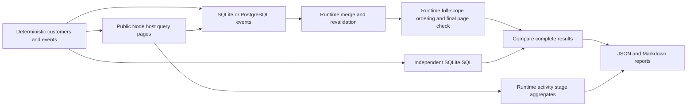

# Analytical properties performance harness

This suite measures real public Relate queries through the Node host and SQLite
PostgreSQL or DuckDB analytical connectors. It checks every result against
independent handwritten SQLite SQL. No latency threshold is a CI gate.

- **Candidate scanned:** a member returned by an actual storage scan, including
  objects subsequently rejected by policy or ordinary filters.
- **Candidate admitted:** an authorized ordinary match. For analytical scenarios
  this is the actual planned slot count: the fixed workload uses one
  association, one slot per object, complete dependencies and no concurrent
  changes. Ordinary queries count returned rows.
- **Batch:** an actual connector plan; **statement:** an actual execute call.
  These counters are independent of timing span counts.
- **Stage:** a runtime-owned activity timing aggregate. Stages can nest or
  overlap; their summed durations are not additive parts of request latency.
- **Reference:** independent handwritten SQL, not SQL generated by Relate.

For measurements that separate Relate overhead from generated-SQL execution, see
the [overhead harness](overhead/README.md). The original reference SQL below is
a correctness oracle, not an equivalent-work overhead baseline.

`both` preserves SQLite + PostgreSQL; `all` adds DuckDB. DuckDB uses a seeded
local file with non-null typed columns and pooled read-only connector workers.

## Run

```sh
pnpm bench:analytical --profile small --backend all
pnpm bench:analytical --profile capacity --backend both --out benchmark-results/capacity
pnpm bench:analytical --profile full --backend both --out benchmark-results/full
pnpm bench:analytical --profile capacity --customers 12500 --events 100000 --backend both --store postgres --freshness refresh --source-delay-ms 2 --capture enabled --out benchmark-results/refresh
```

Use Node 22.16+, 24 or 26. PostgreSQL runs require `RELATE_TEST_DATABASE_URL`
pointing to a dedicated disposable database. To load the worktree's environment,
prefix a command with `pnpm exec dotenvx run -f .env --`. No URL, credentials or
physical schema names are written to reports.

| Option                    | Values                                        | Default  |
| ------------------------- | --------------------------------------------- | -------- |
| `--backend`               | `sqlite`, `postgres`, `duckdb`, `both`, `all` | `sqlite` |
| `--store`                 | `memory`, `postgres`                          | `memory` |
| `--capture`               | `enabled`, `disabled`, `both`                 | `both`   |
| `--freshness`             | `cached`, `refresh`                           | `cached` |
| `--customers`, `--events` | Select matching workloads within the profile  | All      |
| `--source-delay-ms`       | Nonnegative integer; synthetic fetch delay    | `0`      |

| Profile  | Customer populations | Events per population | Warmups | Measured repetitions |
| -------- | -------------------- | --------------------- | ------- | -------------------- |
| small    | 100                  | 1,000                 | 1       | 3                    |
| capacity | 1,250; 12,500        | 100,000; 1,000,000    | 1       | 3                    |
| full     | 100; 1,000; 10,000   | 100,000; 1,000,000    | 3       | 30                   |

Twenty percent of customers belong to a different portfolio and fail object
policy. The capacity profile therefore admits 1,000 and 10,000 candidates. The
fixed seed is 42. Events have skewed activity, empty customers, non-login rows
and timestamps outside October 2026. Counts and latest-login timestamps use
`since <= occurredAt < until`. All three databases have an index on
`(customer, type, at)` and run `ANALYZE` before measurement.

Setup, generation, adoption, index creation and cleanup are outside timing.
SQLite owns a temporary file; the connector executes statements in a bounded
pool of isolated processes, reopening the read-only database for each statement.
PostgreSQL owns a uniquely named events schema. Optional Postgres object storage
uses the real persistence adapter; cleanup deletes only the run's graph rows.
The harness never resets the database's `relate` schema.

## What runs

| Scenario   | Public query work                                         | Additional benchmark work |
| ---------- | --------------------------------------------------------- | ------------------------- |
| objects    | First authorized page of 25                               | None                      |
| enrichment | First page with count and latest-login expressions        | None                      |
| ranking    | One full-scope computed order query with both expressions | None                      |

Every analytical page includes parsing/authorization, candidate and dependency
reads, generated SQL, connector lifecycle, result merging and revalidation.
`model.ts` owns the graph and binds the real dataset connector. The source
connector supplies synthetic customer records; `--source-delay-ms` applies only
to measured fetches, not adoption. It is not a production provider model.

Ranking now uses the runtime's scope-first `orderBy` path. It enumerates all
authorized ordinary matches, computes association batches, revalidates the whole
scope, sorts, then rechecks the selected 25 records. It is one public operation;
there is no benchmark-side sort. Ordinary page reads retain their 100-member
scan bound. The independent SQL oracle remains unchanged.



## Measurements and interpretation

`results.json` records configuration, workload/schema versions, commit and dirty
status, machine resources, Node/backend versions, raw samples and summaries.
Each sample records request spans, runtime stage aggregates and actual counters:
scanned/admitted candidates, storage scans/loads/resolutions, source fetches,
provider identity checks and their combined source-call count, planned batches,
executed statements, computed slots, captured operations and activity drops.
Storage counters count API calls, not inferred database round trips. Server-only
execution time and generated-SQL replay remain unavailable.

Activity capture follows the real host enablement path. Enabled samples collect
stage summaries from the storage append boundary. After stopping the request
latency clock, the harness waits for activity delivery before starting the next
sample. Drops or an undrained queue fail the sample. Disabled samples have no
stage summaries. Both configurations retain the same benchmark counters. The
report compares their median request times for each matching configuration.
These differences include activity capture, timing overhead and measurement
noise; they exclude waiting for delivery and are not causal measurements of
timing calls alone. Negative differences are retained.

Runs are sequential at concurrency one. Each scenario labels its first sample
`first-of-scenario`, followed by separate `warmup` and `warm` groups. Resources
are shared across scenarios, so first samples are not cold starts. p95 requires
at least 20 successful samples; capacity runs report medians only. Failures are
counted separately. SQL reference latency excludes authorization, evidence,
process/network startup and object storage, so it is not an equivalent-work
baseline for a Relate overhead ratio. `performanceComparisonEligible` remains
false while controlled concurrency and generated-SQL replay are absent.

Reports checkpoint completed workloads atomically per output file. Setup and
sample failures remain visible, subsequent workloads run, and any failure makes
the command exit unsuccessfully. JSON and Markdown are separate files rather
than a transactional pair. Default outputs are ignored under
`benchmark-results`. CI runs the small profile on both backends and uploads
reports even on failure.

## Historical measurements

The
[22 October verification of head 279a529](measurements/verification-2026-10-22/README.md)
retains 38 configurations and 5,316 passing samples. It predates the review
fixes below and measures end-to-end latency, not isolated Relate overhead.

Exploratory runs on 2026-10-21 used an Apple M2 Max, Node 26.9.0, 10,000
admitted customers from 12,500 scanned members, and three warm repetitions per
configuration. The following medians are historical context, before the review
fixes to candidate freshness, revalidation concurrency and indexed correlation.
They are not current performance claims or the basis for default limits.

| Backend    |    Events | Capture disabled | Capture enabled |
| ---------- | --------: | ---------------: | --------------: |
| SQLite     |   100,000 |      3,587.50 ms |     3,573.09 ms |
| PostgreSQL |   100,000 |      3,528.88 ms |     3,495.76 ms |
| SQLite     | 1,000,000 |      4,348.25 ms |     4,403.82 ms |
| PostgreSQL | 1,000,000 |      4,062.86 ms |     4,089.90 ms |

The source checkout included local edits, so those runs do not establish an
independently reproducible baseline. An earlier run rejected ranking queries at
a provisional source-call budget; it is not successful capacity evidence. Raw
exploratory samples are excluded from the repository. New runs write ignored
`benchmark-results` files; CI uploads these as artifacts associated with the
workflow's exact commit. Use a clean checkout and retain its source alongside
artifacts when recording deployment capacity. Report failures separately.

## Future performance comparisons

1. Replay generated plans beside the independent SQL reference, preserving actor
   scope, integer/null semantics and ordering.
2. Add controlled cold starts, concurrency, queue pressure and cancellation.
3. Use consistent deployment conditions and sufficient repetitions before
   publishing baselines or enabling performance regression gates.
