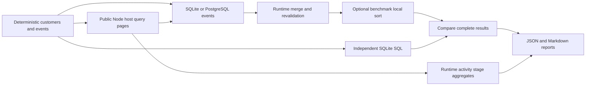

# Analytical properties performance harness

This suite measures real public Relate queries through the Node host and SQLite
or PostgreSQL analytical connectors. It checks every result against independent
handwritten SQLite SQL. No latency threshold is a CI gate.

- **Candidate scanned:** a member returned by an actual storage scan, including
  objects subsequently rejected by policy or ordinary filters.
- **Candidate admitted:** an authorized, matching row emitted by the query path.
  This fixed workload has complete dependencies and no concurrent changes, so no
  candidates disappear during revalidation.
- **Batch:** an actual connector plan; **statement:** an actual execute call.
  These counters are independent of timing span counts.
- **Stage:** a runtime-owned activity timing aggregate. Stages can nest or
  overlap; their summed durations are not additive parts of request latency.
- **Reference:** independent handwritten SQL, not SQL generated by Relate.

## Run

```sh
pnpm bench:analytical --profile small --backend both
pnpm bench:analytical --profile capacity --backend both --out benchmark-results/capacity
pnpm bench:analytical --profile full --backend both --out benchmark-results/full
pnpm bench:analytical --profile capacity --customers 12500 --events 100000 --backend both --store postgres --freshness refresh --source-delay-ms 2 --capture enabled --out benchmark-results/refresh
```

Use Node 22.16+, 24 or 26. PostgreSQL runs require `RELATE_TEST_DATABASE_URL`
pointing to a dedicated disposable database. To load the worktree's environment,
prefix a command with `pnpm exec dotenvx run -f .env --`. No URL, credentials or
physical schema names are written to reports.

| Option                    | Values                                       | Default  |
| ------------------------- | -------------------------------------------- | -------- |
| `--backend`               | `sqlite`, `postgres`, `both`                 | `sqlite` |
| `--store`                 | `memory`, `postgres`                         | `memory` |
| `--capture`               | `enabled`, `disabled`, `both`                | `both`   |
| `--freshness`             | `cached`, `refresh`                          | `cached` |
| `--customers`, `--events` | Select matching workloads within the profile | All      |
| `--source-delay-ms`       | Nonnegative integer; synthetic fetch delay   | `0`      |

| Profile  | Customer populations | Events per population | Warmups | Measured repetitions |
| -------- | -------------------- | --------------------- | ------- | -------------------- |
| small    | 100                  | 1,000                 | 1       | 3                    |
| capacity | 1,250; 12,500        | 100,000; 1,000,000    | 1       | 3                    |
| full     | 100; 1,000; 10,000   | 100,000; 1,000,000    | 3       | 30                   |

Twenty percent of customers belong to a different portfolio and fail object
policy. The capacity profile therefore admits 1,000 and 10,000 candidates. The
fixed seed is 42. Events have skewed activity, empty customers, non-login rows
and timestamps outside October 2026. Counts and latest-login timestamps use
`since <= occurredAt < until`. Both databases have an index on
`(customer, type, at)` and run `ANALYZE` before measurement.

Setup, generation, adoption, index creation and cleanup are outside timing.
SQLite owns a temporary file, because the real connector runs each statement in
an isolated process. PostgreSQL owns a uniquely named events schema. Optional
Postgres object storage uses the real persistence adapter; cleanup deletes only
the run's graph rows. The harness never resets the database's `relate` schema.

## What runs

| Scenario   | Public query work                                  | Additional benchmark work                         |
| ---------- | -------------------------------------------------- | ------------------------------------------------- |
| objects    | First authorized page of 25                        | None                                              |
| enrichment | First page with count and latest-login expressions | None                                              |
| ranking    | Iterate all authorized pages with both expressions | Sort by count descending, then object ID; take 25 |

Every analytical page includes parsing/authorization, candidate and dependency
reads, generated SQL, connector lifecycle, result merging and revalidation.
`model.ts` owns the graph and binds the real dataset connector. The source
connector supplies synthetic customer records; `--source-delay-ms` applies only
to measured fetches, not adoption. It is not a production provider model.

The current public query path scans at most 100 members per page. Ranking
therefore measures several real page operations and a separately labeled
`benchmark-local-sort`. It is **not** runtime computed ordering or one
scope-first operation. Do not use its page count as the eventual full-scope
batch count. It exposes candidate and refresh costs before implementing that
path; remeasure the actual scope-first path before treating its limits as
validated.

The benchmark selects `name` and the correlation `key` in all scenarios to keep
ordinary projection work consistent. Its result projection returns only `name`
and requested analytical values. Complete IDs, order, counts, timestamps and
nulls must match the SQL oracle. A missing or withheld calculation fails the
sample. The oracle must succeed before Relate results can be checked; the
benchmark cannot validate against itself.

Cached runs keep a controlled host clock and one-day policy evidence valid.
Refresh runs advance the host clock by two days before each measured request,
forcing initial candidate source refreshes while retaining normal runtime
freshness enforcement. This includes source calls for denied candidates.
Monotonic request and stage clocks continue to run normally. Concurrent changes,
refreshes expiring midway through a request and cancellation pressure are not
modeled by these scenarios.



## Measurements and interpretation

`results.json` records configuration, workload/schema versions, commit and dirty
status, machine resources, Node/backend versions, raw samples and summaries.
Each sample records request spans, runtime stage aggregates and actual counters:
scanned/admitted candidates, storage scans/loads/resolutions, source fetches,
planned batches, executed statements, computed slots, captured operations and
activity drops. Storage counters count API calls, not inferred database round
trips. Server-only execution time and generated-SQL replay remain unavailable.

Activity capture follows the real host enablement path. Enabled samples collect
stage summaries from the storage append boundary. After stopping the request
latency clock, the harness waits for activity delivery before starting the next
sample. Drops or an undrained queue fail the sample. Disabled samples have no
stage summaries. Both configurations retain the same benchmark counters. The
report compares their median request times for each matching configuration.
These differences include activity capture, timing overhead and measurement
noise; they exclude waiting for delivery and are not causal measurements of
timing calls alone. Negative differences are retained.

Runs are sequential at concurrency one. Each scenario labels its first sample
`first-of-scenario`, followed by separate `warmup` and `warm` groups. Resources
are shared across scenarios, so first samples are not cold starts. p95 requires
at least 20 successful samples; capacity runs report medians only. Failures are
counted separately. SQL reference latency excludes authorization, evidence,
process/network startup and object storage, so it is not an equivalent-work
baseline for a Relate overhead ratio. `performanceComparisonEligible` remains
false while scope-first ordering, controlled concurrency and generated-SQL
replay are absent.

Reports checkpoint completed workloads atomically per output file. Setup and
sample failures remain visible, subsequent workloads run, and any failure makes
the command exit unsuccessfully. JSON and Markdown are separate files rather
than a transactional pair. Default outputs are ignored under
`benchmark-results`. CI runs the small profile on both backends and uploads
reports even on failure.

## Remaining integration

The
[2026-10-21 exploratory measurements](measurements/candidate-path-2026-10-21.json)
retain warm ranking samples and environment metadata from 18 configurations (540
total samples, zero failures). On an Apple M2 Max with Node 26.9.0, 10,000
admitted candidates and 100,000 events took median 9.85 s with SQLite and 5.65 s
with PostgreSQL using cached memory storage and activity capture. With
PostgreSQL object storage and forced synthetic 2 ms source refreshes, medians
were 20.93 s and 17.16 s respectively. Each ranking scanned 12,500 members and
executed 125 analytical statements through the current page path. Only three
warm repetitions were collected per configuration. These results identify
candidate and refresh costs; they do not validate full-scope limits or establish
a performance baseline.

1. Replace local ranking with the actual scope-first filter/order path and
   retain the independent oracle. Record its single-operation candidate/batch
   counts.
2. Replay generated plans beside the independent SQL reference, preserving actor
   scope, integer/null semantics and ordering.
3. Add controlled cold starts, concurrency, queue pressure and cancellation.
4. Use consistent deployment conditions and sufficient repetitions before
   publishing baselines or enabling performance regression gates.
