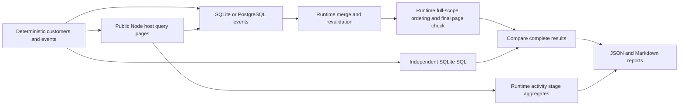

# Analytical properties performance harness

This suite measures real public Relate queries through the Node host and SQLite
or PostgreSQL analytical connectors. It checks every result against independent
handwritten SQLite SQL. No latency threshold is a CI gate.

- **Candidate scanned:** a member returned by an actual storage scan, including
  objects subsequently rejected by policy or ordinary filters.
- **Candidate admitted:** an authorized ordinary match. For analytical scenarios
  this is the actual planned slot count: the fixed workload uses one
  association, one slot per object, complete dependencies and no concurrent
  changes. Ordinary queries count returned rows.
- **Batch:** an actual connector plan; **statement:** an actual execute call.
  These counters are independent of timing span counts.
- **Stage:** a runtime-owned activity timing aggregate. Stages can nest or
  overlap; their summed durations are not additive parts of request latency.
- **Reference:** independent handwritten SQL, not SQL generated by Relate.

## Run

```sh
pnpm bench:analytical --profile small --backend both
pnpm bench:analytical --profile capacity --backend both --out benchmark-results/capacity
pnpm bench:analytical --profile full --backend both --out benchmark-results/full
pnpm bench:analytical --profile capacity --customers 12500 --events 100000 --backend both --store postgres --freshness refresh --source-delay-ms 2 --capture enabled --out benchmark-results/refresh
```

Use Node 22.16+, 24 or 26. PostgreSQL runs require `RELATE_TEST_DATABASE_URL`
pointing to a dedicated disposable database. To load the worktree's environment,
prefix a command with `pnpm exec dotenvx run -f .env --`. No URL, credentials or
physical schema names are written to reports.

| Option                    | Values                                       | Default  |
| ------------------------- | -------------------------------------------- | -------- |
| `--backend`               | `sqlite`, `postgres`, `both`                 | `sqlite` |
| `--store`                 | `memory`, `postgres`                         | `memory` |
| `--capture`               | `enabled`, `disabled`, `both`                | `both`   |
| `--freshness`             | `cached`, `refresh`                          | `cached` |
| `--customers`, `--events` | Select matching workloads within the profile | All      |
| `--source-delay-ms`       | Nonnegative integer; synthetic fetch delay   | `0`      |

| Profile  | Customer populations | Events per population | Warmups | Measured repetitions |
| -------- | -------------------- | --------------------- | ------- | -------------------- |
| small    | 100                  | 1,000                 | 1       | 3                    |
| capacity | 1,250; 12,500        | 100,000; 1,000,000    | 1       | 3                    |
| full     | 100; 1,000; 10,000   | 100,000; 1,000,000    | 3       | 30                   |

Twenty percent of customers belong to a different portfolio and fail object
policy. The capacity profile therefore admits 1,000 and 10,000 candidates. The
fixed seed is 42. Events have skewed activity, empty customers, non-login rows
and timestamps outside October 2026. Counts and latest-login timestamps use
`since <= occurredAt < until`. Both databases have an index on
`(customer, type, at)` and run `ANALYZE` before measurement.

Setup, generation, adoption, index creation and cleanup are outside timing.
SQLite owns a temporary file, because the real connector runs each statement in
an isolated process. PostgreSQL owns a uniquely named events schema. Optional
Postgres object storage uses the real persistence adapter; cleanup deletes only
the run's graph rows. The harness never resets the database's `relate` schema.

## What runs

| Scenario   | Public query work                                         | Additional benchmark work |
| ---------- | --------------------------------------------------------- | ------------------------- |
| objects    | First authorized page of 25                               | None                      |
| enrichment | First page with count and latest-login expressions        | None                      |
| ranking    | One full-scope computed order query with both expressions | None                      |

Every analytical page includes parsing/authorization, candidate and dependency
reads, generated SQL, connector lifecycle, result merging and revalidation.
`model.ts` owns the graph and binds the real dataset connector. The source
connector supplies synthetic customer records; `--source-delay-ms` applies only
to measured fetches, not adoption. It is not a production provider model.

Ranking now uses the runtime's scope-first `orderBy` path. It enumerates all
authorized ordinary matches, computes association batches, revalidates the whole
scope, sorts, then rechecks the selected 25 records. It is one public operation;
there is no benchmark-side sort. Ordinary page reads retain their 100-member
scan bound. The independent SQL oracle remains unchanged.



## Measurements and interpretation

`results.json` records configuration, workload/schema versions, commit and dirty
status, machine resources, Node/backend versions, raw samples and summaries.
Each sample records request spans, runtime stage aggregates and actual counters:
scanned/admitted candidates, storage scans/loads/resolutions, source fetches,
provider identity checks and their combined source-call count, planned batches,
executed statements, computed slots, captured operations and activity drops.
Storage counters count API calls, not inferred database round trips. Server-only
execution time and generated-SQL replay remain unavailable.

Activity capture follows the real host enablement path. Enabled samples collect
stage summaries from the storage append boundary. After stopping the request
latency clock, the harness waits for activity delivery before starting the next
sample. Drops or an undrained queue fail the sample. Disabled samples have no
stage summaries. Both configurations retain the same benchmark counters. The
report compares their median request times for each matching configuration.
These differences include activity capture, timing overhead and measurement
noise; they exclude waiting for delivery and are not causal measurements of
timing calls alone. Negative differences are retained.

Runs are sequential at concurrency one. Each scenario labels its first sample
`first-of-scenario`, followed by separate `warmup` and `warm` groups. Resources
are shared across scenarios, so first samples are not cold starts. p95 requires
at least 20 successful samples; capacity runs report medians only. Failures are
counted separately. SQL reference latency excludes authorization, evidence,
process/network startup and object storage, so it is not an equivalent-work
baseline for a Relate overhead ratio. `performanceComparisonEligible` remains
false while controlled concurrency and generated-SQL replay are absent.

Reports checkpoint completed workloads atomically per output file. Setup and
sample failures remain visible, subsequent workloads run, and any failure makes
the command exit unsuccessfully. JSON and Markdown are separate files rather
than a transactional pair. Default outputs are ignored under
`benchmark-results`. CI runs the small profile on both backends and uploads
reports even on failure.

## Retained measurements

The
[2026-10-21 exploratory measurements](measurements/candidate-path-2026-10-21.json)
retain warm ranking samples and environment metadata from 18 configurations (540
total samples, zero failures). On an Apple M2 Max with Node 26.9.0, 10,000
admitted candidates and 100,000 events took median 9.85 s with SQLite and 5.65 s
with PostgreSQL using cached memory storage and activity capture. With
PostgreSQL object storage and forced synthetic 2 ms source refreshes, medians
were 20.93 s and 17.16 s respectively. Each ranking scanned 12,500 members and
executed 125 analytical statements through the historical page path. Only three
warm repetitions were collected per configuration. These results identify
candidate and refresh costs; they do not validate full-scope limits or establish
a performance baseline.

The [runtime scope-first measurements](measurements/scope-path-2026-10-21.json)
retain all 120 samples from four configurations at commit `a4a8a43`, with zero
failures. Each ranking admitted 10,000 candidates from 12,500 scanned members,
executed 10 statements, captured one operation and returned 25 records.

| Object storage and freshness              | SQLite warm median | PostgreSQL warm median | Source calls per ranking                |
| ----------------------------------------- | ------------------ | ---------------------- | --------------------------------------- |
| Memory, cached                            | 3.70 s             | 3.62 s                 | 62,575 identity checks                  |
| PostgreSQL, forced synthetic 2 ms refresh | 14.66 s            | 14.61 s                | 62,575 identity checks + 12,500 fetches |

These runs used 100,000 events, activity capture enabled and three warm
repetitions on an Apple M2 Max with Node 26.9.0. Identity checks return a fixed
synthetic identity without simulated latency; only source fetches receive the
configured delay. The measurements exercise the default 10,000 admitted, 12,500
scanned, 100,000 source-call and 60-second operation budgets for this workload.
They do not establish those defaults as sufficient for arbitrary providers,
policy shapes or deployment conditions. Runtime and benchmark code were
unchanged during measurement; report provenance records the dirty state and a
concurrent workflow-only commit.

The
[current instrumentation report](measurements/instrumentation-scope-2026-10-21.md)
and its [raw samples](measurements/instrumentation-scope-2026-10-21.json) retain
240 successful samples from eight configurations at `c214daf`. Each backend runs
100,000 and 1,000,000 events with activity capture enabled and disabled, using
cached memory object storage. Every ranking admits 10,000 of 12,500 scanned
customers, executes 10 statements, returns 25 records and makes 62,575 synthetic
identity checks without source fetches. Enabled rankings capture one operation
with all nine entered timing stages; disabled rankings capture none. No activity
records were dropped. All results match the independent SQL oracle.

| Backend    |    Events | Capture disabled median | Capture enabled median | Observed difference |
| ---------- | --------: | ----------------------: | ---------------------: | ------------------: |
| SQLite     |   100,000 |             3,587.50 ms |            3,573.09 ms |           -14.41 ms |
| PostgreSQL |   100,000 |             3,528.88 ms |            3,495.76 ms |           -33.12 ms |
| SQLite     | 1,000,000 |             4,348.25 ms |            4,403.82 ms |           +55.57 ms |
| PostgreSQL | 1,000,000 |             4,062.86 ms |            4,089.90 ms |           +27.04 ms |

These are three warm repetitions per configuration on an Apple M2 Max with Node
26.9.0. They exercise the finite default budgets and report the observed cost of
enabling activity, including calculation summaries. Sequential runs and small
samples cannot isolate instrumentation overhead from noise; negative differences
are retained, and no p95 or causal overhead estimate is claimed. Runtime and
benchmark code remained unchanged throughout the run. The dirty working tree
contained specification edits, with documentation edits made while the benchmark
ran; no tests or builds ran concurrently.

## Future performance comparisons

1. Replay generated plans beside the independent SQL reference, preserving actor
   scope, integer/null semantics and ordering.
2. Add controlled cold starts, concurrency, queue pressure and cancellation.
3. Use consistent deployment conditions and sufficient repetitions before
   publishing baselines or enabling performance regression gates.

The
[first scope-first capacity run](measurements/scope-budget-rejection-2026-10-21.json)
rejected all ten ranking samples during revalidation at the provisional 50,000
source-call budget. Cached records still require provider identity checks. The
harness now records those checks alongside fetches, and the default budget is
100,000. The failed run is retained; it is not a successful capacity result.
