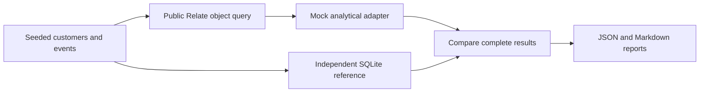

# Analytical properties performance harness

This suite prepares repeatable measurements while analytical properties are
being implemented. **It does not yet measure Relate analytical performance.** No
latency threshold is a CI gate. No specification or product API is introduced
here.

- **Scenario:** one of the three fixed requests in `scenarios.ts`.
- **Span:** a monotonic start offset and duration for one operation. Spans may
  nest or overlap; their durations must not be added or subtracted to infer CPU
  time.
- **Hybrid mock:** real public Relate object reads, with analytical computation
  replaced by precomputed JavaScript values. Source access is synthetic.
- **Reference:** independent handwritten SQL used to check results and measure a
  real SQLite query. It is not Relate-generated SQL.

## Run

```sh
pnpm bench:analytical --profile small
pnpm bench:analytical --profile full --out benchmark-results/analytical-full
```

Requires a repository-supported Node version (22.16+, 24 or 26). Uses Node's
built-in SQLite driver and no external database or credentials. The driver may
print its experimental warning. Each workload owns and closes its runtime and
in-memory database. Data generation, adoption, index creation and `ANALYZE` are
outside request timing. Large runs can take several minutes.

| Profile | Customer populations | Event volumes per population | Warmups | Measured warm repetitions |
| ------- | -------------------- | ---------------------------- | ------- | ------------------------- |
| small   | 100                  | 1,000                        | 1       | 3                         |
| full    | 100; 1,000; 10,000   | 100,000; 1,000,000           | 3       | 30                        |

The fixed seed is 42. Events have skewed customer activity, empty customers,
non-login events and timestamps outside the fixed October 2026 window. Twenty
percent of customers belong to a different portfolio and are excluded by the
real object policy. The ordinary query filter repeats that scope explicitly.
Both login count (an integer string) and latest login (nullable timestamp) use
`since <= occurredAt < until`.

| Scenario   | Object path                          | Analytical work                                                 |
| ---------- | ------------------------------------ | --------------------------------------------------------------- |
| objects    | First authorized page of 25          | None                                                            |
| enrichment | First authorized page of 25          | Count and latest login for page members                         |
| ranking    | Enumerate every authorized candidate | Count and latest login, then top 25 by count; ties by object ID |

## What is measured today

`model.ts` owns a real Relate graph, memory store and synthetic source
connector. `adapter.ts` calls the current public `Customer.query` API. Ranking
enumerates through its async iterator; it is not the eventual runtime
scope-first execution. The adapter reads the correlation key as well as name in
every scenario to keep the object baseline consistent. There is no
database-backed object-store timing.

The benchmark request shape anticipates `compute` and `orderBy`. The adapter
accepts only the three exact requests: it does not parse SQL or emulate a
general analytical engine. Analytical preparation, execution and finalization
are marked `mock`. Their timings cannot be used as estimates of the future
implementation. The source connector is also synthetic; refresh counts are
observed, but no real provider latency is measured. Policy evidence is valid for
one day, so these are fresh cached-object runs rather than a refresh-pressure
workload.

SQLite reference queries use a separate `:memory:` database containing the same
customers and events, an index on `(customer, type, at)`, and matching portfolio
scope. Every hybrid result is compared with the SQL result, including IDs,
order, counts, timestamps and nulls, outside request timing. Failures are
retained in reports and cause a nonzero command exit. The SQL oracle does not
prove Relate's future authorization or analytical implementation correct.

Each mode/scenario records its first request separately, followed by unreported
warmups and measured warm repetitions. First request is **not** cold database or
process startup: setup and earlier scenarios may already have warmed resources.
Runs are sequential with concurrency one. SQLite is synchronous and in-process;
its span includes driver work and result materialization, not network or pool
wait. Server-only execution time is unavailable, not zero. Throughput, queue
pressure, cancellation, Postgres and generated-SQL comparisons await
integration.



## Results and CI

`results.json` contains versioned workload/configuration metadata, commit and
dirty status, Node/SQLite versions, machine resources, raw samples, spans,
observed counters and summaries. `report.md` is readable alongside it. Small
samples omit p95; full runs report nearest-rank p95 after at least 20 successful
samples. Failures are counted separately. Metadata sets
`performanceComparisonEligible` to `false`; no mock/direct-SQL overhead ratio or
regression comparison is produced. Uninstrumented stages are listed explicitly
rather than filled with invented zero timings. Candidate counts mean admitted
objects, not inspected/rejected ones.

Default outputs live in ignored `benchmark-results/`. CI runs the small profile
on Node 26 and uploads its JSON and Markdown even on scenario failures. Focused
harness tests also run in the ordinary unit suite. Keep raw routine runs as CI
artifacts; only commit a curated baseline with complete environment metadata
when real measurements become comparable. Do not publish hybrid timings as
product performance results.

## Integrating the analytical implementation

1. Extend `model.ts` with the shipped dataset definitions and bindings. Keep the
   seeded workload and expected SQL results unchanged.
2. Replace `adapter.ts` with the real public `Customer.query(request)` call and
   runtime/connector instrumentation. Remove each mock label only when that
   stage is actually exercised; do not infer stage times from total duration.
3. Capture candidate scans, statement/batch counts, analytical queue and pool
   waits, dependency reads, final checks and database round trips. Add optional
   server execution diagnostics without folding profiling overhead into normal
   latency measurements.
4. Add generated-SQL replay beside the handwritten SQL reference. Preserve the
   actor's scope, null semantics, integer encoding and ordering in all three.
5. Add database-backed object storage and real analytical connectors, then
   concurrency/throughput and separately controlled cold-start runs. Store their
   deployment and database configuration in metadata.
6. Establish repeatable baselines on a consistent runner before enabling latency
   regression gates or performance comparisons. Version the workload if
   semantics change; never compare incompatible workload/environment
   configurations.

The fixed workloads provide continuity through integration. Adapter counters and
statement expectations must change to reflect actual batching rather than the
current mock's zero analytical statements.
