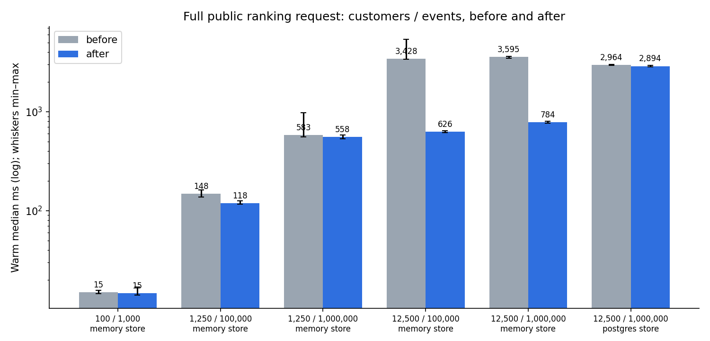
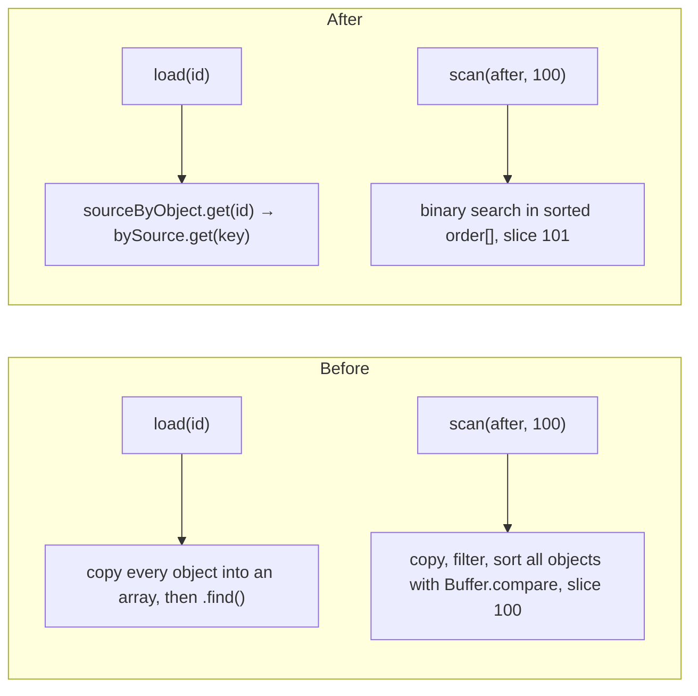

# Indexed memory-store lookups — 23 October 2026

The
[DataFusion federation spike (PR #46)](https://github.com/relatehq/relate/pull/46)
found that about 95% of a large public ranking request ran outside the query
engine, and profiled a linear object lookup in the memory store. This change
fixes that lookup and the full-population sort in every scan, then reruns the
existing analytical harness before and after on the same machine.

## Glossary

| Term            | Meaning                                                                                | Example                                                                                         |
| --------------- | -------------------------------------------------------------------------------------- | ----------------------------------------------------------------------------------------------- |
| Object store    | Where Relate retains adopted objects and their observations                            | `createMemoryStore()`, `createPostgresStore({...})`                                             |
| Population      | All adopted objects of one type from one source binding (one `StorageScope`)           | 12,500 `benchmark.customer` objects                                                             |
| Membership scan | One page of a population in ascending object-ID order                                  | `store.scan(scope, { limit: 100, after: lastId })`                                              |
| Object load     | Read one retained object by its Relate object ID                                       | `store.load(scope, objectId)`                                                                   |
| Ranking request | Public query that computes values for every authorized customer, sorts, and returns 25 | `Customer.query({ compute, orderBy: [{ field: 'loginCount', direction: 'desc' }], limit: 25 })` |
| Object-ID order | UTF-8 byte order of object IDs; PostgreSQL's `COLLATE "C"` order                       | `compareObjectIds('a', 'b') === -1`                                                             |

## Result



| Workload (memory store, PostgreSQL events)  |   Before |  After | Speedup |
| ------------------------------------------- | -------: | -----: | ------: |
| Ranking, 12,500 customers / 1M events       | 3,595 ms | 784 ms |    4.6× |
| Ranking, 12,500 customers / 100k events     | 3,428 ms | 626 ms |    5.5× |
| First page of 25, 12,500 customers          |    59 ms | 0.6 ms |     94× |
| Page with computed values, 12,500 customers |    79 ms |  12 ms |    6.3× |
| Ranking, 1,250 customers / 1M events        |   583 ms | 558 ms |   1.05× |
| Ranking, 100 customers                      |    15 ms |  15 ms |   1.02× |

- The fix removes a cost that grew with the **square** of the population: each
  load and each scan page walked every stored object. At 100 or 1,250 customers
  it barely matters; at 12,500 it dominated.
- Work is identical before and after: every ranking sample made the same 125
  membership scans, 22,525 object loads and 10,000 computed slots.
- **The PostgreSQL object store is unchanged (2,964 → 2,894 ms).** Its profile
  is now the next lead: about 1.95 s of a 2.94 s request is idle time waiting on
  22,525 sequential single-object queries.

All tables, counters and both stores' CPU profiles: [tables.md](tables.md).

## What changed



`packages/runtime/src/memory.ts` — one indexed population per scope:

```ts
// Before
const scopes = new Map<string, Map<string, StoredObject>>();
const find = (scope, objectId) =>
  [...(scopes.get(scopeKey(scope))?.values() ?? [])].find(
    (candidate) => candidate.objectId === objectId,
  );

// After
interface Population {
  readonly bySource: Map<string, StoredObject>;
  readonly sourceByObject: Map<string, string>;
  /** Object IDs in ascending storage order; identities are never removed. */
  readonly order: string[];
}
```

`accept` inserts a new identity into `order` once, at adoption. Later
observations replace the stored object but keep its ID and position.

`packages/runtime/src/storage.ts` — `compareObjectIds` keeps UTF-8 byte order
without allocating two `Buffer`s per comparison. UTF-16 code-unit order equals
UTF-8 byte order except around surrogates, so those cases still use
`Buffer.compare`. A 20,000-case property test checks equality with the old
implementation, including astral characters and lone surrogates.

The `ObservationStore` contract and its callers are unchanged.

## Profiles

One sampled warm ranking request per side, at 12,500 customers / 1M events.
Profiling adds overhead; do not compare these durations with benchmark samples.

| Self time, memory store                                                          | Before ms | After ms |
| -------------------------------------------------------------------------------- | --------: | -------: |
| `runtime/memory.js`                                                              |     1,617 |       11 |
| Node internals (before: `Buffer` allocation; after: `structuredClone`, profiler) |     1,006 |      266 |
| Unattributed builtins (array copies)                                             |       736 |        0 |
| `runtime/storage.js` (`compareObjectIds`)                                        |       207 |        0 |
| Profiled request                                                                 |     4,221 |      823 |

After the change, the largest remaining CPU frames are `structuredClone` of
loaded objects (120 ms), `readObject` (67 ms) and `canonicalJson` (48 ms). No
single frame dominates.

## How this was measured

```sh
# Each side: same harness commit, same machine, same command lines.
pnpm bench:analytical:run --profile small    --backend postgres --capture disabled --repetitions 10
pnpm bench:analytical:run --profile capacity --backend postgres --capture disabled --repetitions 10
pnpm bench:analytical:run --profile capacity --customers 12500 --events 1000000 \
  --backend postgres --store postgres --capture disabled --repetitions 5
pnpm bench:profile:run
pnpm bench:profile:run --store postgres
```

| Field        | Before                                                                        | After       |
| ------------ | ----------------------------------------------------------------------------- | ----------- |
| Harness      | `5a47519`                                                                     | `fe8e676`   |
| Runtime src  | Identical to `main` `72d2c3d`                                                 | This change |
| Working tree | `dirty: true` — uncommitted test files and this directory's `analyze.py` only | Clean       |

- Apple M2 Max, 64 GiB, macOS arm64, Node 26.9.0, PostgreSQL 18.6.
- Every Relate result is checked against the independent SQLite oracle. Zero
  failures on either side.
- One warmup, then 10 warm samples (5 for the PostgreSQL store). Medians are
  nearest-rank; ranges are min–max. Sequential, concurrency one. These are
  developer-machine observations, not capacity claims.
- Object IDs are random per run, so page scenarios may scan a different number
  of objects before finding 25 authorized customers. Full-scope ranking counters
  are identical.

Archives: `before-*.json.gz` and `after-*.json.gz` (harness results and profile
summaries) and `*.cpuprofile.gz` (open in Chrome DevTools after decompressing).
Run `uv run analyze.py` to rebuild `tables.md` and `ranking.png`.

## What this means for PR #46

The spike measured a full ranking request at about 3.6 s, with the engine taking
about 85–90 ms of it. With the memory store fixed, the same request takes 784
ms. The engine's share is now material rather than noise, so an engine
comparison would show more. The PostgreSQL object store has not improved and is
now the slowest part for persistent deployments.

## Next leads

1. **Batch object loads in the PostgreSQL store.** 22,525 sequential
   `load(scope, id)` round trips account for most of its 2.9 s. A batched read
   in the store contract (sketch below, not agreed) would turn them into a few
   queries.

   ```ts
   // Proposed shape only
   loadMany(scope: StorageScope, objectIds: readonly string[]): Promise<Map<string, StoredObject>>;
   ```

2. **Why 22,525 loads for 12,500 objects?** Candidate collection and
   revalidation each load objects. Deduplicating within one request would help
   every store.
3. **Rerun the PR #46 engine comparison** on top of this change, to see whether
   whole-scope federation now produces a visible end-to-end difference.
