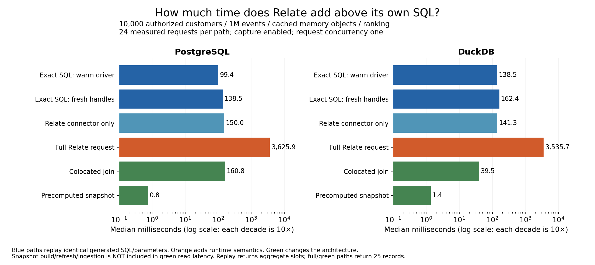
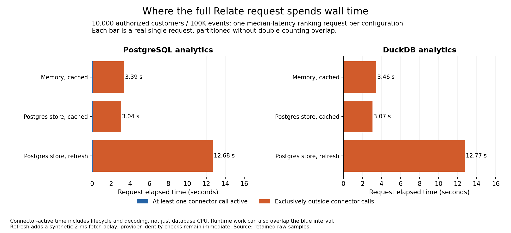
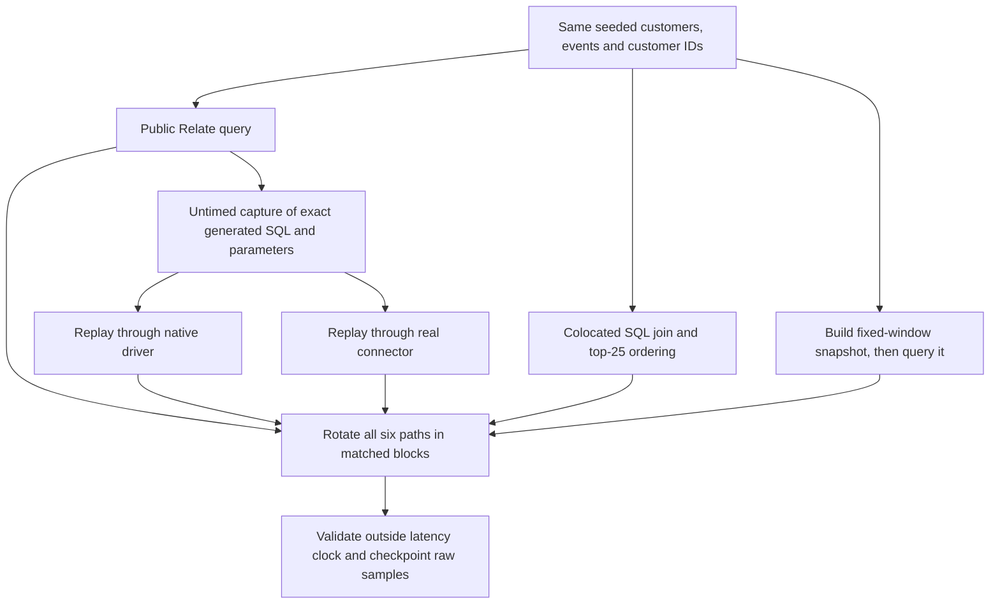
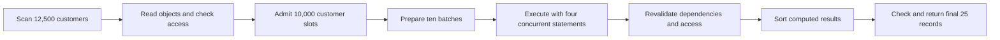

# Relate overhead and colocated-data comparison — 22 October 2026

This report replaces the earlier end-to-end latency report as the answer to
**“what overhead does Relate add?”** It compares paths within a fixed backend,
including DuckDB from PR #42. The earlier report is historical and did not
isolate overhead.

## Start here

- **Blue:** executing the exact SQL Relate generated, directly or through its
  connector.
- **Orange:** the full public Relate query, including runtime policy, evidence,
  scope and revalidation work.
- **Green:** a different architecture where data or precomputed metrics already
  live together. Faster green bars do not include ingestion/refresh work or
  equivalent Relate semantics.



## What the measurements say

- **PostgreSQL, 10,000 authorized customers / 1M events:** exact warm SQL 99.44
  ms; connector 149.99 ms; full Relate 3,625.88 ms. The median matched **total
  additional cost above exact SQL is 3,496.60 ms**; the matched runtime cost
  above connector replay is 3,456.96 ms. The colocated join is 160.76 ms; the
  precomputed read is 0.76 ms.
- **DuckDB, 10,000 authorized customers / 1M events:** exact warm SQL 138.53 ms;
  connector 141.31 ms; full Relate 3,535.71 ms. The median matched **total
  additional cost above exact SQL is 3,396.91 ms**; the matched runtime cost
  above connector replay is 3,394.35 ms. The colocated join is 39.48 ms; the
  precomputed read is 1.37 ms.

These differences include required behavior as well as implementation overhead.
They are not a claim that every extra millisecond is removable. Differences are
calculated per matched block and then summarized; they will not necessarily
equal subtraction of the displayed path medians.



The orange portion above is direct evidence of elapsed time outside connector
calls. It includes candidate/object reads, authorization, planning, host queue
work, revalidation, sorting and benchmark projection. It is not database
execution time and it is not a CPU profile. The blue portion can overlap other
runtime work. Each bar uses a single median-latency request, so its two
components add exactly to that request duration.

## What is and is not comparable

| Path                     | Inputs and output                                | Includes                                                        | Does not include                                                         |
| ------------------------ | ------------------------------------------------ | --------------------------------------------------------------- | ------------------------------------------------------------------------ |
| Exact SQL, warm driver   | Captured SQL/parameters; all aggregate slot rows | Native driver round trip and row retrieval; four warm handles   | Runtime scope, authorization, planning, evidence, revalidation           |
| Exact SQL, fresh handles | Same statements and aggregate rows               | Handle creation/closure; PostgreSQL read-only transaction setup | Runtime semantics; DuckDB subprocesses                                   |
| Connector replay         | Same opaque prepared plans; decoded slot rows    | Real connector lifecycle, execution, decoding and cleanup       | Host planning/queue, object reads, runtime policy/revalidation           |
| Full Relate              | Public query returns final 25 records            | Runtime + connector, including capture and revalidation         | Adoption/ingestion, external provider network latency                    |
| Colocated join           | Same customer IDs/data; final 25 records         | SQL portfolio predicate, aggregate and top-25 ordering          | Ingestion/sync, Relate evidence, provider revalidation, database RLS     |
| Precomputed snapshot     | Same final 25 for a fixed October window         | Indexed read of saved metrics                                   | Snapshot construction/refresh in read timing; arbitrary changing windows |

Each query uses an employee principal with portfolio north in Relate.
Alternative SQL uses an explicit north predicate. Static result equality is
verified; the alternatives are not proven equivalent under policy changes,
revoked access, source changes or failures. No database RLS or external product
is benchmarked.

## How we query and measure



The public request selects customer names and computes October login count and
latest login; ranking adds
`orderBy: [{ field: "loginCount", direction: "desc" }]`, with `limit: 25`.
Enrichment computes only for the ordinary page. Ranking computes the entire
authorized ordinary-filter scope and selects the final page afterward. See the
[actual requests](../../scenarios.ts) and
[methodology](../../overhead/README.md).

At the 12,500-customer population, 2,500 fail the portfolio policy. Ranking
executes ten batches of 1,000 authorized customer slots. Direct and connector
replay return all 10,000 aggregate rows; the public request merges, revalidates
and ranks them, returning 25. The colocated query instead joins customers and
events and pushes the final aggregate/order/limit into one statement. Exact
generated SQL, parameters and captured rows are retained inside each raw report.

The generated plans use a parameterized customer-key table, join events,
aggregate by slot and left-join results back to preserve empty customers. The
colocated query filters customers by portfolio and joins matching login events
in October before grouping and ordering. The snapshot precomputes metrics for
every customer once.

## Which runtime steps are expensive?

For ranking 10,000 authorized customers over 1M events, the median recorded
stage durations are below. These stages nest and overlap, so **do not add them
together**. The wall-time chart above is the additive view.

| Analytics backend | Candidate collection | Revalidation | Planning |
| ----------------- | -------------------: | -----------: | -------: |
| postgres          |          2,663.64 ms |    691.77 ms | 47.71 ms |
| duckdb            |          2,627.88 ms |    673.62 ms | 47.92 ms |



Candidate collection and revalidation are the clearest next profiling targets.
Their timings include object and policy work; they do not identify individual
CPU hotspots or prove checks are redundant.

## Full matrix: measured warm medians and p95

Cached memory object storage; capture enabled; 24 measured requests per path.
All numbers are milliseconds. Each cell is **median / p95**.

### Enrichment

| Backend  | Authorized customers |    Events |      Warm SQL |     Fresh SQL |     Connector |     Full Relate |     Colocated | Snapshot read |
| -------- | -------------------: | --------: | ------------: | ------------: | ------------: | --------------: | ------------: | ------------: |
| postgres |                  800 |   100,000 |   6.57 / 7.17 | 15.66 / 16.42 | 14.92 / 16.72 |   33.88 / 45.09 |   1.41 / 1.83 |   0.65 / 0.83 |
| postgres |                  800 | 1,000,000 | 15.85 / 16.51 | 27.23 / 34.77 | 27.29 / 29.71 |   52.41 / 55.58 |   7.78 / 9.23 |   0.63 / 0.89 |
| postgres |               10,000 |   100,000 |   0.80 / 0.90 |   7.16 / 7.96 |   7.24 / 7.75 |   76.88 / 79.12 |   0.68 / 0.85 |   1.88 / 2.08 |
| postgres |               10,000 | 1,000,000 |   2.18 / 3.24 | 11.38 / 15.33 | 11.27 / 14.02 | 110.54 / 118.71 |   1.60 / 2.47 |   1.93 / 2.29 |
| duckdb   |                  800 |   100,000 |   2.55 / 2.88 |   7.78 / 8.35 |   2.88 / 3.50 |   11.03 / 11.54 |   2.11 / 2.55 |   0.67 / 1.01 |
| duckdb   |                  800 | 1,000,000 |   9.29 / 9.59 | 15.42 / 16.17 |  9.82 / 10.54 |   19.61 / 20.74 |   8.92 / 9.94 |   0.71 / 1.11 |
| duckdb   |               10,000 |   100,000 |   2.88 / 3.22 |   8.42 / 8.77 |   3.24 / 3.68 |   65.36 / 66.73 |   2.82 / 3.23 |   1.29 / 1.64 |
| duckdb   |               10,000 | 1,000,000 | 14.62 / 15.08 | 21.42 / 22.12 | 14.94 / 16.40 | 106.91 / 108.93 | 14.83 / 15.97 |   1.39 / 1.67 |

### Ranking

| Backend  | Authorized customers |    Events |        Warm SQL |       Fresh SQL |       Connector |       Full Relate |       Colocated | Snapshot read |
| -------- | -------------------: | --------: | --------------: | --------------: | --------------: | ----------------: | --------------: | ------------: |
| postgres |                  800 |   100,000 |   38.62 / 44.37 |   47.19 / 53.88 |   51.02 / 54.06 |   139.75 / 167.22 |   15.53 / 17.83 |   0.53 / 0.92 |
| postgres |                  800 | 1,000,000 | 204.59 / 222.99 | 213.39 / 230.79 | 216.54 / 223.28 |   352.91 / 363.62 |   37.74 / 44.06 |   0.65 / 1.35 |
| postgres |               10,000 |   100,000 |   34.37 / 50.94 |   59.50 / 82.36 |   67.07 / 78.14 | 3385.20 / 3441.16 |   23.41 / 44.36 |   0.47 / 1.37 |
| postgres |               10,000 | 1,000,000 |  99.44 / 188.86 | 138.47 / 231.54 | 149.99 / 236.75 | 3625.88 / 3689.82 | 160.76 / 186.34 |   0.76 / 1.53 |
| duckdb   |                  800 |   100,000 |   24.55 / 26.46 |   29.87 / 31.07 |   26.54 / 27.34 |     88.63 / 97.27 |     4.00 / 4.73 |   0.78 / 1.20 |
| duckdb   |                  800 | 1,000,000 |   54.36 / 55.52 |   60.95 / 63.33 |   56.10 / 58.93 |   119.61 / 126.00 |   24.14 / 24.87 |   0.86 / 1.15 |
| duckdb   |               10,000 |   100,000 |   86.16 / 94.20 | 105.30 / 107.32 |   89.34 / 93.26 | 3460.30 / 3506.46 |    7.25 / 14.02 |   1.37 / 3.91 |
| duckdb   |               10,000 | 1,000,000 | 138.53 / 157.43 | 162.42 / 172.98 | 141.31 / 144.99 | 3535.71 / 3584.43 |   39.48 / 41.36 |   1.37 / 1.67 |

## Matched ranking overhead

Milliseconds: median of within-block differences. Negative differences are
retained. “Full − colocated” is an architecture difference, not pure framework
overhead.

| Backend  | Authorized/events | Connector − warm SQL | Connector − fresh SQL | Full − connector | Full − warm SQL | Full − colocated |
| -------- | ----------------- | -------------------: | --------------------: | ---------------: | --------------: | ---------------: |
| postgres | 800/100,000       |                11.48 |                  0.76 |            91.24 |           97.80 |           122.01 |
| postgres | 800/1,000,000     |                10.28 |                  1.29 |           137.97 |          147.24 |           311.34 |
| postgres | 10,000/100,000    |                27.40 |                  2.73 |          3315.15 |         3340.34 |          3352.01 |
| postgres | 10,000/1,000,000  |                48.16 |                 10.51 |          3456.96 |         3496.60 |          3455.53 |
| duckdb   | 800/100,000       |                 1.75 |                 -3.47 |            62.10 |           64.05 |            84.82 |
| duckdb   | 800/1,000,000     |                 1.76 |                 -4.49 |            63.75 |           65.38 |            95.67 |
| duckdb   | 10,000/100,000    |                 3.11 |                -15.63 |          3370.07 |         3375.05 |          3452.93 |
| duckdb   | 10,000/1,000,000  |                 2.87 |                -21.11 |          3394.35 |         3396.91 |          3495.60 |

## Separate object-storage and refresh costs

All rows below use 10,000 authorized customers and 100,000 events. The
persistent cached run changes object storage only. The refresh run keeps that
storage and adds forced synthetic 2 ms source fetches. Replay and colocated
alternatives do not simulate those source checks. These smaller runs report
medians only.

| Object path | Backend  | Repetitions | Exact warm SQL ms | Connector ms | Full Relate ms | Colocated ms | Outside connector ms | Source fetches |
| ----------- | -------- | ----------: | ----------------: | -----------: | -------------: | -----------: | -------------------: | -------------: |
| full        | postgres |          24 |             34.37 |        67.07 |        3385.20 |        23.41 |              3285.65 |              0 |
| full        | duckdb   |          24 |             86.16 |        89.34 |        3460.30 |         7.25 |              3347.29 |              0 |
| persistent  | postgres |          12 |             34.46 |        60.78 |        3038.11 |        21.07 |              2952.41 |              0 |
| persistent  | duckdb   |          12 |             93.16 |        94.52 |        3070.27 |         7.61 |              2956.10 |              0 |
| refresh     | postgres |           6 |             34.04 |        60.95 |       12682.78 |        22.43 |             12599.93 |          12500 |
| refresh     | duckdb   |           6 |             98.83 |        95.71 |       12765.40 |         8.06 |             12649.61 |          12500 |

## Precomputation moves work out of the read

The snapshot contains all customer metrics for a single fixed October window.
This table records one construction-and-indexing observation per configuration.
It excludes event/customer ingestion. It is not a repeated refresh-cost
benchmark.

| Backend  | Customers / events | Build + index ms | Snapshot ranking read median ms |
| -------- | ------------------ | ---------------: | ------------------------------: |
| postgres | 1,000/100,000      |            30.59 |                            0.53 |
| postgres | 1,000/1,000,000    |           173.20 |                            0.65 |
| postgres | 12,500/100,000     |            78.16 |                            0.47 |
| postgres | 12,500/1,000,000   |           252.99 |                            0.76 |
| duckdb   | 1,000/100,000      |             5.29 |                            0.78 |
| duckdb   | 1,000/1,000,000    |            29.50 |                            0.86 |
| duckdb   | 12,500/100,000     |            19.25 |                            1.37 |
| duckdb   | 12,500/1,000,000   |            56.02 |                            1.37 |

PostgreSQL uses a materialized view; DuckDB uses a snapshot table. The
fixed-window metrics are not kept fresh as data changes. Choosing this approach
requires owning ingestion, refresh cadence, invalidation and access control.
[PostgreSQL materialized-view documentation](https://www.postgresql.org/docs/current/rules-materializedviews.html).

## What to investigate next

- **Runtime scope work:** use the measured exclusive-outside-connector time to
  prioritize candidate scans, object/dependency reads and revalidation. The
  memory store filters and sorts its collection on every scan. At capacity,
  there are 125 scans, 22,525 object loads and 62,575 immediate synthetic
  identity checks. Refresh adds 12,500 fetches. These are API calls, not
  inferred network round trips.
- **Preserve semantics when optimizing:** revalidation protects against changed
  access/dependencies. This experiment does not prove any check can be removed.
  Profile/batch or cache work only under a verified evidence contract.
- **Query shape versus runtime overhead:** colocated SQL can use one
  optimizer-visible join and top-25 query. Its advantage includes a different
  plan and data arrangement; it cannot be attributed solely to framework
  overhead.
- **Lifecycle:** compare warm and fresh driver paths before attributing the
  connector gap to row decoding or JavaScript. PostgreSQL opens
  connections/transactions per statement; DuckDB reuses read-only subprocesses.
- **Deployment behavior:** request concurrency one cannot establish throughput,
  queue pressure, contention or cancellation-under-load behavior. These remain
  separate experiments.

## Alternatives and their responsibilities

A hand-built application using native drivers must still construct and authorize
the customer scope, join results across systems and decide what freshness/error
handling to implement. Replay here measures only its execution component, not
that hypothetical application end to end.

If all data is already in one database, a single SQL join is the relevant
measured alternative. PostgreSQL can also enforce row policies, but this
benchmark uses an explicit predicate and does not time RLS. RLS policy design
and bypass roles matter
([official docs](https://www.postgresql.org/docs/current/ddl-rowsecurity.html)).
PostgreSQL foreign data wrappers are another option for remote PostgreSQL data,
with pushdown where supported; they are not measured here
([official docs](https://www.postgresql.org/docs/current/postgres-fdw.html)). No
comparative claim is made against an ORM, federation product, warehouse or
external-provider workload.

## Validation, provenance and limits

Measured commit `ec058fddc8752e8cac0889c0c922cd902b7fb2a9`. All retained
performance runs started from a clean tree. Environment: Apple M2 Max, Node
26.9.0, macOS arm64. The current #38 implementation and #42 DuckDB
implementation are incorporated. Capture is enabled throughout; request
concurrency is one and per-request statement concurrency is four. No
builds/tests were launched by this work concurrently with measurements; this is
still a shared developer machine.

| Run        | Configurations | Total samples | Measured samples | Failures |
| ---------- | -------------: | ------------: | ---------------: | -------: |
| full       |              8 |          2592 |             2304 |        0 |
| persistent |              2 |           360 |              288 |        0 |
| refresh    |              2 |           216 |              144 |        0 |

All final-page outputs match independent SQLite SQL; every native replay matches
captured raw aggregate rows; every connector replay matches captured decoded
slot rows. Comparison/validation and activity draining happen after the latency
clock. First-of-scenario and warmups are retained separately. Full-profile
measured requests use two complete 12-block order cycles, balancing each mode
across positions. Persistent/refresh sample counts are smaller and do not
support p95 claims here.

`pnpm check` passed: 188 files, 2,471 tests passed and one skipped, including
new accounting and multi-batch replay tests, plus build, types, lint, boundaries
and installed-package checks. The later CLI checkpoint-preservation adjustment
was type/lint checked. The small end-to-end profile also passed on SQLite,
PostgreSQL and DuckDB with capture enabled/disabled.

Development smoke failures are retained separately: DuckDB fixture
quoting/nullability, missing backend dispatch and IPC capture of pooled workers.
They were harness integration failures, fixed before the clean performance runs.
They are not silently counted as successful performance samples.

### Reproduce

```sh
pnpm build
pnpm exec dotenvx run -f .env -- pnpm bench:analytical:run --profile small --backend all --out benchmark-results/overhead-e2e-all
pnpm exec dotenvx run -f .env -- pnpm bench:overhead:run --profile full --backend both --repetitions 24 --out benchmark-results/overhead-full
pnpm exec dotenvx run -f .env -- pnpm bench:overhead:run --profile full --backend both --customers 12500 --events 100000 --repetitions 12 --store postgres --out benchmark-results/overhead-persistent
pnpm exec dotenvx run -f .env -- pnpm bench:overhead:run --profile full --backend both --customers 12500 --events 100000 --repetitions 6 --store postgres --freshness refresh --source-delay-ms 2 --out benchmark-results/overhead-refresh
```

Regenerate both charts from the retained archives with `uv run plot.py` from
this directory.

### Raw evidence

Reports contain actual generated SQL and synthetic bound values, captured rows,
raw samples, paired differences, counters, nested stages and connector-call
intervals. Resource names are disposable benchmark-generated names; no
credentials are included. `gzip -dc full.json.gz` extracts the full report.
SHA-256 hashes below refer to decompressed bytes.

| File                                                         | SHA-256                                                            |
| ------------------------------------------------------------ | ------------------------------------------------------------------ |
| [development-failures.json.gz](development-failures.json.gz) | `cc270d5f5cf4e99247ee3a063b9f16be5e2f5059380ee03c3857961ebdaf1bed` |
| [end-to-end-small.json.gz](end-to-end-small.json.gz)         | `1061af023deaa74c5f2ca8d5e968459ade94da3412550997eefaacde5184eca4` |
| [full.json.gz](full.json.gz)                                 | `34703443197e1868272916db84483fbe879eab314eca93977b9cafcf8ea787f9` |
| [persistent.json.gz](persistent.json.gz)                     | `2fff4bd46e69fbced94ed0a260574aba13967e485cc20251f1c8c3eb586f4a74` |
| [refresh.json.gz](refresh.json.gz)                           | `b7ca584c4af4f17e2b0690af19c31cd2234c57eb0a7c6413afa75ef90e447aae` |
