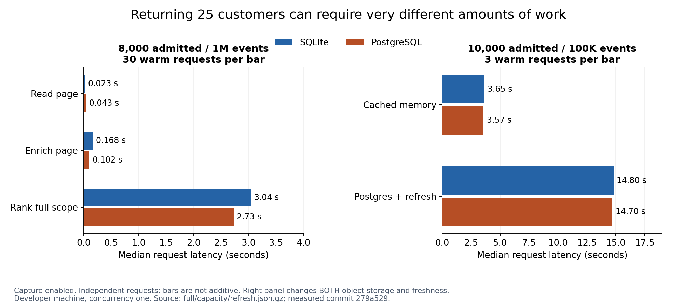
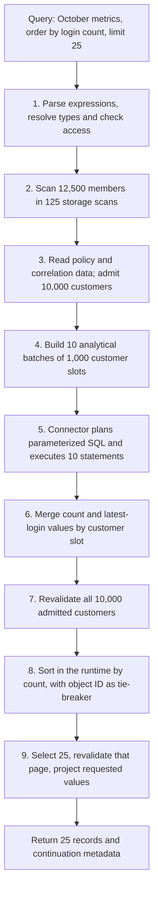
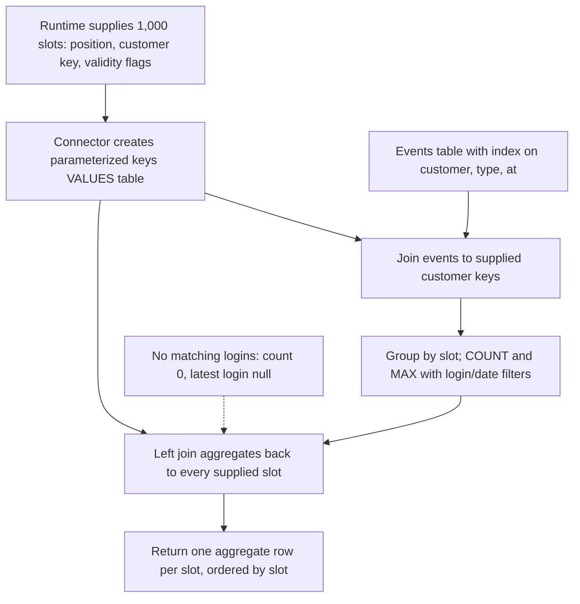
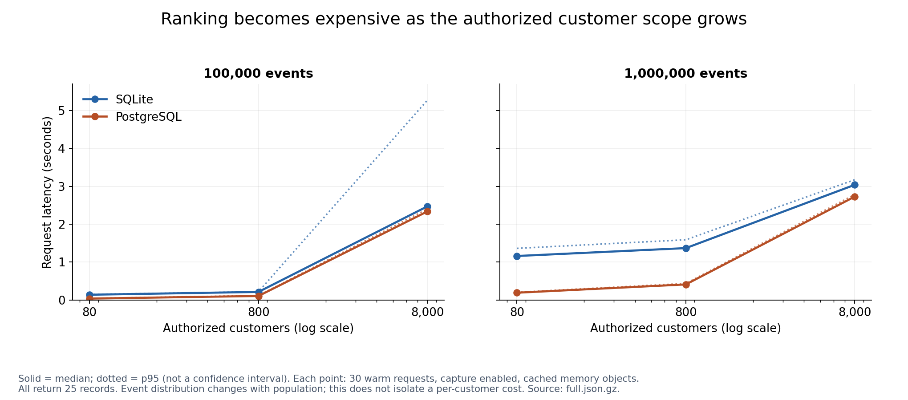
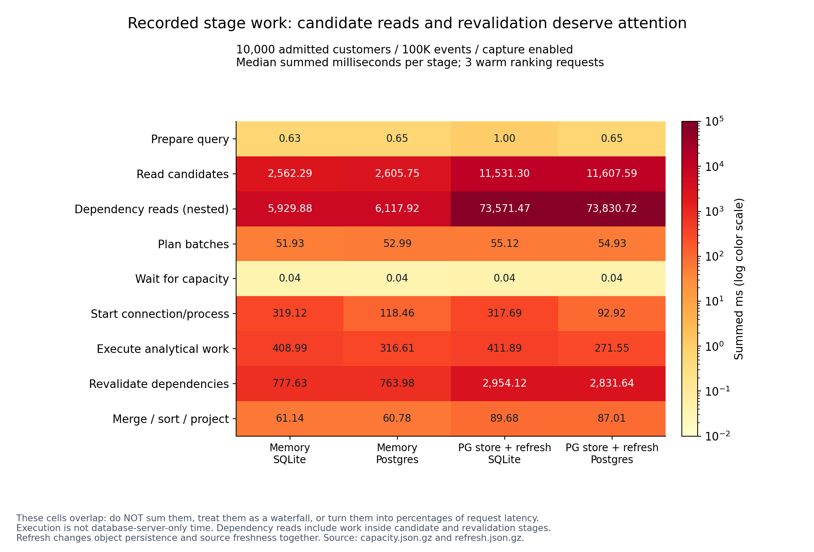

# PR #38 performance verification — 22 October 2026

The published PR is runnable as is. PR #39 introduced a mock analytical adapter;
PR #38 has already replaced it with real Node-host queries and SQLite/PostgreSQL
connectors. No runtime or harness fix was needed in this verification. This PR
retains fresh evidence rather than changing implementation.

## Findings

- All 38 configurations passed: 5,316 total samples, including 2,286 measured
  warm Relate requests. The 11 focused harness tests also passed.
- Page enrichment and full-scope ranking have very different costs. At 10,000
  customers / one million events with capture enabled, enrichment was 167.73 ms
  on SQLite and 102.40 ms on PostgreSQL; ranking was 3,039.93 ms and 2,728.72 ms
  respectively.
- PostgreSQL had a substantial advantage for the small-customer, event-heavy
  workload: at 100 customers / one million events, capture-enabled ranking
  medians were 192.17 ms versus SQLite's 1,161.07 ms. At large customer
  populations the backend gap narrowed as candidate/dependency work grew.
- Default-capacity ranking (10,000 admitted customers) completed in 3.65 s /
  3.57 s for SQLite/PostgreSQL with 100,000 events and capture enabled. With one
  million events, the corresponding medians were 4.48 s / 4.10 s. Only three
  warm repetitions support these capacity figures.
- PostgreSQL object persistence plus forced synthetic refresh raised those
  100,000-event medians to 14.80 s / 14.70 s. This changes two factors at once,
  so it does not isolate storage overhead or source delay. Every ranking
  performed 12,500 fetches plus 62,575 identity checks.
- Tail and between-configuration variability are material. SQLite's
  10,000-customer / 100,000-event capture-enabled p95 was 5.27 s against a 2.47
  s median. In the three-sample million-event capacity run, capture-disabled
  SQLite was slower (6.88 s median) than enabled (4.48 s). Ordinary-page timings
  also vary between configurations. These observations prevent a causal
  instrumentation-overhead claim.
- The next performance investigation should isolate candidate scanning and
  dependency revalidation, then add generated-SQL replay and controlled
  concurrency. This verification does not introduce those separate experiments
  or change authorization behavior.

## Reading the results

- **Objects:** read the first 25 authorized customers.
- **Enrichment:** read that page with October login count and latest-login
  timestamp.
- **Ranking:** calculate those values for every authorized customer, then return
  the top 25 by login count.
- **Admitted:** customers that pass authorization and the ordinary portfolio
  filter; 80% of the population.
- **Capture:** recording operation details and runtime stage timings.
- **Median / p95:** nearest-rank 50th / 95th percentile of measured warm
  requests. p95 is shown only for the full profile (30 repetitions).

## Visual guide: where the time goes

Read these charts as **costs observed in this workload**, not pass/fail targets:
we have not set a latency objective. All charts use capture-enabled runs from
this report's raw files. “PostgreSQL” in the legend means the analytical
backend; object storage is identified separately.

### A page of results is not always a page of work



The left panel uses 10,000 total customers, 8,000 authorized customers and one
million events. Enriching 25 customers takes about 0.10–0.17 seconds, but
finding the top 25 requires calculating and checking all 8,000 authorized
customers: about 2.73–3.04 seconds. `limit: 25` does not limit the ranking
scope.

The right panel uses 12,500 total / 10,000 authorized customers and 100,000
events. Changing both storage and freshness raises ranking to about 14.7–14.8
seconds. This is a useful expensive-path example, not an isolated measurement of
either PostgreSQL storage or the synthetic refresh delay.

### How the caller asks the question

The benchmark computes October login count and latest login, then optionally
orders by count. This is the ranking request from `scenarios.ts`, with the
adapter's explicit selected correlation key (`key`):

```ts
const parameters = {
  since: '2026-10-01T00:00:00.000Z',
  until: '2026-11-01T00:00:00.000Z',
};

await customer.query({
  select: ['name', 'key'],
  where: { portfolio: 'north' },
  compute: {
    loginCount: {
      sql: "SELECT COUNT(*) FROM self.events AS e WHERE e.eventType = 'login' AND e.occurredAt >= $since AND e.occurredAt < $until",
      parameters,
    },
    lastLogin: {
      sql: "SELECT MAX(e.occurredAt) FROM self.events AS e WHERE e.eventType = 'login' AND e.occurredAt >= $since AND e.occurredAt < $until",
      parameters,
    },
  },
  orderBy: [{ field: 'loginCount', direction: 'desc' }],
  limit: 25,
});
```

Removing `orderBy` gives the enrichment scenario. Removing both `compute` and
`orderBy` gives the ordinary-page scenario. The benchmark adapter checks and
normalizes the returned records for comparison with its independent SQL oracle.

### Steps executed for ranking

This diagram describes the successful default-capacity workload: 12,500 total
customers, 10,000 admitted, no changing dependencies. Counts are observed API
work, not inferred network round trips. **Revalidation** means checking that
access and the data used to calculate a value are still valid before exposing
it.



Enrichment instead reads an ordinary authorized page first and computes metrics
for that page. Ranking uses the full authorized ordinary-filter scope before
choosing its page. The runtime owns the final top-25 sort; the analytical
connector returns aggregates for the supplied customer slots.

### How each analytical batch queries events

A **slot** is one customer's position within a batch, carrying its correlation
key and flags indicating which calculations are valid. Both expressions share
the events association, so they can execute in the same statement for this
workload. This is the logical query shape from the connector planner, not a
captured SQL replay or an execution plan from the database:



The join and aggregate filters are generated from the parsed expressions; caller
text is not interpolated directly into this query shape. The diagrams omit
failure paths. Actual runs enforce scope, source-call and deadline budgets, and
withhold or reject values when access or dependencies become invalid.

### Where scaling becomes expensive



- **Event-heavy, small customer scope:** SQLite is materially slower for the
  million-event workload. This includes connector lifecycle and result handling;
  the chart does not isolate database-server execution.
- **Large customer scope:** both backends reach seconds of latency. With 8,000
  admitted customers the runtime performs 18,025 object loads and 50,075
  identity checks, even though analytical work is batched into eight statements.
- **Tail latency:** the dotted SQLite point at 8,000 customers / 100,000 events
  is a 5.27-second p95 against a 2.47-second median. The dotted lines are
  observed percentiles, not uncertainty bounds or predictions between tested
  populations.

### Which steps deserve investigation



This is deliberately a heatmap rather than a stacked latency chart. The runtime
sums individual stage spans, and those spans can overlap or nest. For example,
the refresh run records about **73 seconds of summed dependency-read work**
within an approximately **15-second request**. That is not 73 seconds added to
request latency; it includes overlapping read work inside other stages.

| Observed cost                                                                | What it suggests checking next                                                   | What this measurement cannot establish      |
| ---------------------------------------------------------------------------- | -------------------------------------------------------------------------------- | ------------------------------------------- |
| Candidate reads: about 2.6 s cached, 11.5–11.6 s with persistence + refresh  | Storage scans, policy/dependency reads, source refresh scheduling                | The isolated cost of storage versus refresh |
| Revalidation: about 0.76–0.78 s cached, 2.8–3.0 s with persistence + refresh | Repeated dependency reads and identity checks while preserving access guarantees | Whether any check can safely be removed     |
| Analytical execution: about 0.27–0.41 s summed at 100K events                | Generated SQL replay and database execution plans                                | A database-only overhead ratio              |
| Queue wait: about 0.04 ms summed                                             | A separate concurrent-load experiment                                            | That queues will remain cheap under load    |

At capacity, each ranking performs **125 scans → 10,000 admitted customers → 10
analytical statements → 25 returned records**. Across the request it also
performs **22,525 object loads and 62,575 identity checks**; refresh adds
**12,500 fetches**. These counters describe different operations and must not be
added as if they were a single class of database call.

Implementation references for the measured revision:

- [Benchmark requests](../../scenarios.ts) and
  [public query adapter](../../adapter.ts).
- [Scope reads, full-scope revalidation, sort and final page check](../../../../../packages/runtime/src/analytical-read.ts).
- [Typed ordering and object-ID tie-break](../../../../../packages/runtime/src/analytics/order.ts).
- [SQLite batch SQL planner](../../../../../connectors/sqlite/src/analytics/plan.ts)
  and [PostgreSQL planner](../../../../../connectors/postgres/src/plan.ts).
- [Memory-store scan](../../../../../packages/runtime/src/memory.ts), which
  filters and sorts its collection on each scan.

The three PNG figures are generated directly from the retained compressed JSON,
with no hand-entered timing values. To regenerate them without rerunning a
benchmark:

```sh
uv run tests/performance/analytical-properties/measurements/verification-2026-10-22/plot.py
```

## Provenance and reproducibility

Measured published head `279a5294ded42cffc86ef4946cd66153fa9062f0` in a new
worktree with a dedicated disposable database. The original feature worktree
contained ongoing edits and was not modified. All runs started from a clean
tree. Node 26.9.0, Apple M2 Max, arm64 macOS, 12 available CPUs and 64 GiB RAM.
This is a shared developer machine, not an exclusive benchmark host. No builds
or tests were launched by this verification concurrently with measurements. Raw
metadata records start time, versions, configuration and commit.

```sh
pnpm worktree:create test/analytical-performance-verification --base origin/feat/analytical-properties
cd ../relate-worktrees/analytical-performance-verification
pnpm exec dotenvx run -f .env -- pnpm exec vitest run --project unit tests/unit/analytical-performance.test.ts
pnpm exec dotenvx run -f .env -- pnpm bench:analytical:run --profile small --backend both --out benchmark-results/verification-small
pnpm exec dotenvx run -f .env -- pnpm bench:analytical:run --profile full --backend both --out benchmark-results/verification-full
pnpm exec dotenvx run -f .env -- pnpm bench:analytical:run --profile capacity --customers 12500 --backend both --out benchmark-results/verification-capacity
pnpm exec dotenvx run -f .env -- pnpm bench:analytical:run --profile capacity --customers 12500 --events 100000 --backend both --store postgres --freshness refresh --source-delay-ms 2 --capture enabled --out benchmark-results/verification-refresh
```

Worktree creation installs dependencies and builds. `bench:analytical:run` uses
that build; `bench:analytical` rebuilds first. The focused harness suite passed
all 11 tests. No implementation files changed, so a repository-wide test run was
not repeated.

## Coverage and correctness

| Run                             | Configurations | Total samples | Measured Relate samples | Failures |
| ------------------------------- | -------------: | ------------: | ----------------------: | -------: |
| [small](small-details.md)       |              4 |           120 |                      36 |        0 |
| [full](full-details.md)         |             24 |          4896 |                    2160 |        0 |
| [capacity](capacity-details.md) |              8 |           240 |                      72 |        0 |
| [refresh](refresh-details.md)   |              2 |            60 |                      18 |        0 |

Total samples include independent SQL reference calls, first-of-scenario calls,
warmups and measured repetitions. Every successful Relate result was compared in
full against independent handwritten SQLite SQL, including order, exact count
strings and null/timestamp values. This is not merely a successful-query check.

All 2,658 Relate samples (including first calls and warmups) were additionally
audited for returned row counts, admitted scope, statement counts, capture
behavior and ranking stages. Compressed report bytes and SHA-256 hashes match
the original outputs; local report links resolve. After the runs, the dedicated
database contained zero benchmark schemas and zero benchmark graph rows.

## Full matrix: cached memory object storage

Each cell is median / p95 milliseconds from 30 warm repetitions. Both analytical
backends use indexed events. Capture modes run sequentially, disabled before
enabled.

| Customers (admitted) |    Events | Backend  | Capture  |    Objects ms |   Enrichment ms |        Ranking ms |
| -------------------- | --------: | -------- | -------- | ------------: | --------------: | ----------------: |
| 100 (80)             |   100,000 | sqlite   | disabled |   1.08 / 1.51 |   76.61 / 79.08 |   138.25 / 141.24 |
| 100 (80)             |   100,000 | sqlite   | enabled  |   0.86 / 1.00 |   71.93 / 75.06 |   138.97 / 146.83 |
| 100 (80)             |   100,000 | postgres | disabled |   0.87 / 0.97 |   29.58 / 32.31 |     33.17 / 41.99 |
| 100 (80)             |   100,000 | postgres | enabled  |   0.96 / 1.10 |   27.58 / 30.30 |     37.73 / 41.19 |
| 100 (80)             | 1,000,000 | sqlite   | disabled |   0.84 / 0.91 | 440.51 / 456.02 | 1151.70 / 1205.02 |
| 100 (80)             | 1,000,000 | sqlite   | enabled  |   0.76 / 0.88 | 422.44 / 435.53 | 1161.07 / 1362.77 |
| 100 (80)             | 1,000,000 | postgres | disabled |   0.83 / 1.02 | 123.94 / 132.72 |   197.53 / 379.82 |
| 100 (80)             | 1,000,000 | postgres | enabled  |   1.00 / 1.11 | 120.55 / 130.20 |   192.17 / 204.25 |
| 1,000 (800)          |   100,000 | sqlite   | disabled |   5.65 / 5.86 |   57.01 / 60.24 |   212.99 / 218.95 |
| 1,000 (800)          |   100,000 | sqlite   | enabled  |   5.40 / 5.69 |   57.83 / 60.63 |   213.14 / 217.85 |
| 1,000 (800)          |   100,000 | postgres | disabled |   5.33 / 5.62 |   23.31 / 25.51 |   108.55 / 116.78 |
| 1,000 (800)          |   100,000 | postgres | enabled  |   5.48 / 5.76 |   23.89 / 25.37 |   105.84 / 117.09 |
| 1,000 (800)          | 1,000,000 | sqlite   | disabled | 10.50 / 12.03 | 183.15 / 353.03 | 1371.74 / 1426.28 |
| 1,000 (800)          | 1,000,000 | sqlite   | enabled  |   7.15 / 7.41 | 166.08 / 174.52 | 1369.31 / 1589.19 |
| 1,000 (800)          | 1,000,000 | postgres | disabled |   5.65 / 5.91 |  94.22 / 104.60 |   394.32 / 427.72 |
| 1,000 (800)          | 1,000,000 | postgres | enabled  |   5.51 / 5.67 |   96.17 / 99.09 |   410.86 / 436.20 |
| 10,000 (8,000)       |   100,000 | sqlite   | disabled | 66.19 / 67.56 | 117.92 / 121.70 | 2403.45 / 2486.33 |
| 10,000 (8,000)       |   100,000 | sqlite   | enabled  | 66.35 / 67.81 | 119.19 / 121.48 | 2470.97 / 5272.80 |
| 10,000 (8,000)       |   100,000 | postgres | disabled | 68.35 / 70.98 |  92.33 / 114.46 | 2330.71 / 2385.19 |
| 10,000 (8,000)       |   100,000 | postgres | enabled  | 66.55 / 68.40 |   92.17 / 95.79 | 2337.44 / 2401.46 |
| 10,000 (8,000)       | 1,000,000 | sqlite   | disabled | 66.34 / 70.11 | 206.89 / 221.64 | 3002.85 / 3093.90 |
| 10,000 (8,000)       | 1,000,000 | sqlite   | enabled  | 22.82 / 23.74 | 167.73 / 187.21 | 3039.93 / 3174.03 |
| 10,000 (8,000)       | 1,000,000 | postgres | disabled | 66.03 / 68.66 | 126.75 / 131.98 | 2735.88 / 2813.21 |
| 10,000 (8,000)       | 1,000,000 | postgres | enabled  | 43.41 / 44.15 | 102.40 / 105.32 | 2728.72 / 2784.65 |

## Default capacity and source refresh

Capacity admits 10,000 customers from 12,500 scanned members. These runs have
three warm repetitions, so no p95 is claimed. Refresh uses real PostgreSQL
object persistence and forces synthetic source fetches with a configured 2 ms
delay; identity checks remain immediate.

| Run      |    Events | Backend  | Capture  | Objects median ms | Enrichment median ms | Ranking median ms |
| -------- | --------: | -------- | -------- | ----------------: | -------------------: | ----------------: |
| capacity |   100,000 | sqlite   | disabled |             56.92 |               111.06 |           3613.28 |
| capacity |   100,000 | sqlite   | enabled  |             56.19 |               105.29 |           3651.66 |
| capacity |   100,000 | postgres | disabled |             56.02 |                81.76 |           3573.11 |
| capacity |   100,000 | postgres | enabled  |             57.04 |                84.84 |           3574.90 |
| capacity | 1,000,000 | sqlite   | disabled |            116.69 |               263.71 |           6876.91 |
| capacity | 1,000,000 | sqlite   | enabled  |             57.66 |               201.10 |           4482.80 |
| capacity | 1,000,000 | postgres | disabled |             59.42 |               117.54 |           4139.84 |
| capacity | 1,000,000 | postgres | enabled  |             85.05 |               152.43 |           4097.68 |
| refresh  |   100,000 | sqlite   | enabled  |             38.61 |                94.66 |          14799.94 |
| refresh  |   100,000 | postgres | enabled  |            120.78 |               193.49 |          14704.50 |

## Observed work and stage timings

The following are warm-ranking medians with capture enabled. Timings are summed
stage work in milliseconds, including nested/overlapping work; they are not
additive elapsed-time components.

| Run/backend       | Customers/events | Scans | Loads | Identity checks | Fetches | Statements | Candidate stage ms | Execution stage ms | Revalidation stage ms |
| ----------------- | ---------------- | ----: | ----: | --------------: | ------: | ---------: | -----------------: | -----------------: | --------------------: |
| full/sqlite       | 10,000/100,000   |   100 | 18025 |           50075 |       0 |          8 |            1711.63 |             349.66 |                543.36 |
| full/postgres     | 10,000/100,000   |   100 | 18025 |           50075 |       0 |          8 |            1653.70 |             255.31 |                533.28 |
| full/sqlite       | 10,000/1,000,000 |   100 | 18025 |           50075 |       0 |          8 |            1669.11 |            2746.90 |                541.22 |
| full/postgres     | 10,000/1,000,000 |   100 | 18025 |           50075 |       0 |          8 |            1652.46 |            1661.15 |                547.84 |
| capacity/sqlite   | 12,500/100,000   |   125 | 22525 |           62575 |       0 |         10 |            2562.29 |             408.99 |                777.63 |
| capacity/postgres | 12,500/100,000   |   125 | 22525 |           62575 |       0 |         10 |            2605.75 |             316.61 |                763.98 |
| capacity/sqlite   | 12,500/1,000,000 |   125 | 22525 |           62575 |       0 |         10 |            2612.34 |            3082.72 |                784.83 |
| capacity/postgres | 12,500/1,000,000 |   125 | 22525 |           62575 |       0 |         10 |            2574.76 |            1973.30 |                791.08 |
| refresh/sqlite    | 12,500/100,000   |   125 | 22525 |           62575 |   12500 |         10 |           11531.30 |             411.89 |               2954.12 |
| refresh/postgres  | 12,500/100,000   |   125 | 22525 |           62575 |   12500 |         10 |           11607.59 |             271.55 |               2831.64 |

Every ranking returns 25 records. At 8,000 admitted customers it uses eight
analytical statements; at the default 10,000-admitted capacity it uses ten.
Audited enabled samples contain one captured query operation, all nine ranking
stages and zero drops; disabled samples contain no stages or captured
operations. The retained JSON can be used to audit these invariants
independently.

The memory store filters and sorts the object collection on every scan
(`packages/runtime/src/memory.ts`, `scan`). Large-population timings therefore
include that implementation cost. Provider identity checks are synthetic and
immediate even in the refresh run. These observations suggest investigating
candidate storage scans, repeated dependency reads/identity checks and
revalidation before assuming SQL batching is the only bottleneck. Any
optimization must retain authorization and changed-dependency checks.

## Interpretation limits

Runs are sequential at concurrency one. They do not measure throughput,
concurrent queue pressure, cancellation under load or cold starts.
First-of-scenario calls share already-created resources. Setup, adoption,
indexing, cleanup, oracle comparison and activity delivery are outside request
timing. Stage durations can nest or overlap and must not be added together or
divided by latency as percentages.

The SQL reference is a correctness oracle, not an equivalent-work performance
baseline: it omits authorization, object storage, evidence and connector
lifecycle. Generated-SQL replay and server-only execution timing are still
unavailable. `performanceComparisonEligible` remains false. These results do not
establish a regression against main (which lacks the feature), production
capacity, or a causal cost of capture.

## Retained artifacts

Each compressed JSON file preserves the original full report bytes, including
raw spans, counters, stages and summaries. Inspect with `gzip -dc full.json.gz`.
The adjacent Markdown files are the harness-generated reports. SHA-256 below
hashes the decompressed JSON.

| Raw report                           | SHA-256                                                            |
| ------------------------------------ | ------------------------------------------------------------------ |
| [small.json.gz](small.json.gz)       | `5e25f35aa31d6ca4ac21ab3973b98fabdb47f6b28f16157fd4b5c8faefa2c064` |
| [full.json.gz](full.json.gz)         | `37c26810669b637a738d5a811f902ba22f77b0bac135e3f41c703ace44f4d217` |
| [capacity.json.gz](capacity.json.gz) | `47f12a18a9d36913f81343cdcdac7da1897bf1ecdf7b506ed683cc53f48baf43` |
| [refresh.json.gz](refresh.json.gz)   | `ad970e5a51ada39f26baec2336c77433c30d8ab1eafff6fc5b4687ecb0c94444` |
