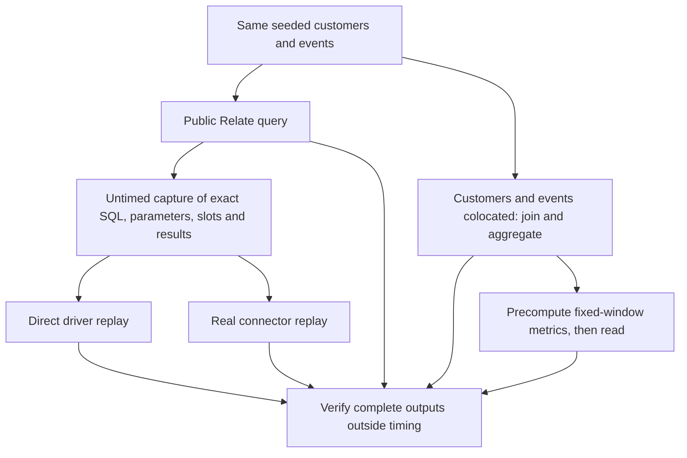

# Measuring Relate overhead

This harness asks two different questions:

1. What additional elapsed time does Relate add above executing its generated
   analytical SQL directly, on the same backend and immutable events dataset?
2. How does that compare with an application that already has customers and
   events in one database, or has precomputed the requested metrics?

It holds the backend fixed within each comparison. PostgreSQL and DuckDB are
separate experiments, not a database leaderboard. The original harness's
handwritten SQLite query remains an independent correctness oracle; its timing
is not used as an overhead baseline.

## Vocabulary and paths

A **slot** is one authorized customer's input to an analytical batch. A **plan**
is the connector's generated SQL and bound parameters for that batch. A
**block** executes each of the six paths once, in a rotating order.
**Colocated** means customers and events already exist in one queryable
database.

| Path           | Timed work                                                                                                             | Work already done or omitted                                                                                          |
| -------------- | ---------------------------------------------------------------------------------------------------------------------- | --------------------------------------------------------------------------------------------------------------------- |
| `direct-warm`  | Exact captured SQL/parameters through native driver; all slot rows returned                                            | Four open handles; scope/plan construction and authorization omitted                                                  |
| `direct-fresh` | Same statements with fresh handles; PostgreSQL also matches read-only transaction/setup/rollback                       | Scope/plan construction omitted; DuckDB opens native instances, not child processes                                   |
| `connector`    | The same opaque prepared plans through the real Relate connector, including decode and lifecycle                       | Scope/plan construction and host queue omitted; four bounded workers match statement concurrency                      |
| `relate`       | Real public query, including authorization, candidate reads, planning, connector, revalidation, sorting and projection | Adoption/startup excluded; synthetic source identity checks have no simulated latency                                 |
| `colocated`    | One handwritten join/filter/aggregate/order query producing the final 25 records                                       | Customers already copied into the database; explicit portfolio predicate, no Relate evidence or provider revalidation |
| `materialized` | Read final 25 from precomputed fixed-October metrics                                                                   | Construction/indexing measured separately; ingestion, refresh scheduling and changes omitted                          |

All paths share seeded values and the same customer IDs. Replay returns all
captured aggregate rows; the public and colocated paths return the final page.
There are no concurrent mutations. This proves static answer equality, not
identical security, freshness or failure semantics. The portfolio predicate in
the alternative SQL is **not** a benchmark of database row-level security.



## What an overhead number means

The report retains within-block differences (including negative values), not
just differences between unrelated medians:

- `connector − direct-warm`: connector/lifecycle difference above warm SQL
  execution.
- `connector − direct-fresh`: difference after adding fresh-handle lifecycle to
  the direct path.
- `relate − connector`: additional runtime work including scope construction,
  planning, authorization, object reads, revalidation and final page selection.
- `relate − direct-warm`: total additional elapsed time above warm execution of
  the exact statements. This includes necessary semantics, not just avoidable
  work.
- `relate − colocated`: **architecture gap**, not pure framework overhead. The
  colocated query has a different physical plan and different responsibilities.

These are observed matched workload differences, not causal CPU profiles. They
include scheduling, allocation, transport and timing noise. Do not add their
medians together. Runtime code may overlap connector execution.

For each actual Relate request, the harness also records connector-call
intervals. Their **union** is the wall time when at least one connector call was
in flight. `request duration − union` is elapsed time exclusively outside those
calls. This is an additive partition of that request's elapsed time, unlike the
existing nested stage sums. It does not count runtime work overlapping a
connector call and is not a CPU measurement.

## Reproduce

Use the worktree's disposable PostgreSQL database and a built checkout:

```sh
pnpm build
pnpm exec dotenvx run -f .env -- pnpm bench:overhead:run --profile small --backend both
pnpm exec dotenvx run -f .env -- pnpm bench:overhead:run --profile full --backend both --out benchmark-results/overhead-full
pnpm exec dotenvx run -f .env -- pnpm bench:overhead:run --profile full --backend both --customers 12500 --events 100000 --repetitions 5 --store postgres --freshness refresh --source-delay-ms 2 --out benchmark-results/overhead-refresh
```

- `small`: 100 customers / 1,000 events, three measured repetitions.
- `full`: 1,000 and 12,500 customers × 100,000 and 1,000,000 events, twenty
  measured repetitions. Twenty percent fail the portfolio policy.
- Each scenario/path has one first-of-scenario sample and two warmups before
  measurement. These are warmed resources, not cold-start measurements.
- `--backend postgres|duckdb|both`; `--customers`, `--events` override
  populations; `--repetitions` overrides measured repetitions. Capture is
  enabled throughout.
- Request concurrency is one. Replay and Relate statement concurrency are four.
  Each six-block cycle balances execution positions; the next cycle reverses
  order. Report the actual number of repetitions; incomplete cycles are not
  perfectly position-balanced.

Capture hooks wrap PostgreSQL driver input or DuckDB child IPC during untimed
preparation only. Every captured plan must have one SQL statement. Native SQL
results are compared with captured rows; connector rows with captured decoded
rows; final pages with independently authored SQLite SQL. Replay failures and
mismatches fail the command and remain in the incremental report.

PostgreSQL replay uses four existing connections or fresh per-statement
connections. The fresh path matches transaction and float/timeout setup; it does
not implement Relate's independent cancellation channel. DuckDB uses four native
read-only instances with one thread each, matching the connector's four
one-thread worker processes. Fresh DuckDB replay opens/closes native instances
inside the parent process, not subprocesses. DuckDB's colocated alternative uses
a copy of the immutable events file so customers can be inserted without
conflicting with connector read locks; it uses one native thread. PostgreSQL's
alternative uses the same schema/events table.

`materializeMs` includes computing and indexing the snapshot, but excludes
customer/event ingestion. PostgreSQL uses a materialized view; DuckDB uses a
snapshot table. Both represent one fixed October query. They are not maintained
as sources change. All setup and cleanup are excluded from request timings.

## Alternatives people can build today

| Approach                                         | Included here?                                         | Responsibility retained by the application                                                                                                                                      |
| ------------------------------------------------ | ------------------------------------------------------ | ------------------------------------------------------------------------------------------------------------------------------------------------------------------------------- |
| Native driver and hand-built application queries | Exact-plan replay measures the execution component     | Build and authorize scope, combine results, handle freshness and errors                                                                                                         |
| Colocate data and query it with SQL              | Yes, including the portfolio filter and final ordering | Ingestion/synchronization and application access control                                                                                                                        |
| Precompute a summary table or materialized view  | Yes, static fixed-window snapshot                      | Refresh cadence, invalidation, access control and changing query shapes                                                                                                         |
| PostgreSQL row-level security                    | Not timed                                              | Define and verify policies; table owners and bypass roles require care ([PostgreSQL docs](https://www.postgresql.org/docs/current/ddl-rowsecurity.html))                        |
| PostgreSQL foreign data wrapper                  | Not timed                                              | Remote access and consistency; applicable operations can be pushed to a remote PostgreSQL server ([PostgreSQL docs](https://www.postgresql.org/docs/current/postgres-fdw.html)) |

Materialized views persist results and are refreshed explicitly; fast reads do
not remove refresh work or staleness tradeoffs
([PostgreSQL docs](https://www.postgresql.org/docs/current/rules-materializedviews.html)).
No ORM, federation product, warehouse service or external-source network
workload is benchmarked here. Do not turn these results into comparative product
claims.

## Files

- `run.ts`: paired mode scheduling, validation, interval accounting and
  checkpoints.
- `capture.ts`: untimed SQL/IPC capture, bounded replay scheduling and interval
  union.
- `database.ts`: PostgreSQL native replay, colocated SQL and snapshot fixture.
- `../duckdb.ts`: DuckDB fixture plus native replay and colocated alternatives.
- `../../../unit/analytical-overhead.test.ts` and integration counterpart:
  accounting, capture restoration, failure drain and exact multi-batch results.
