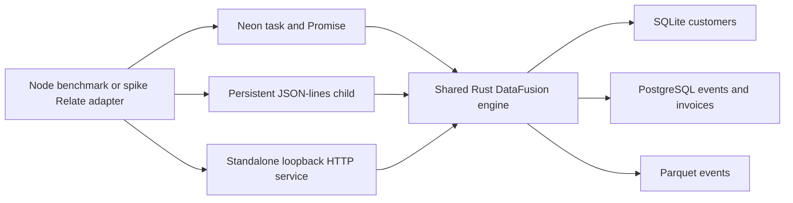
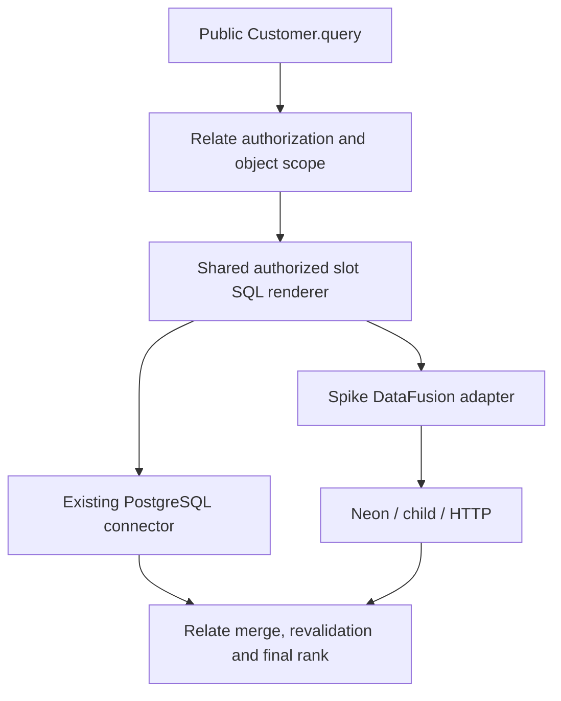
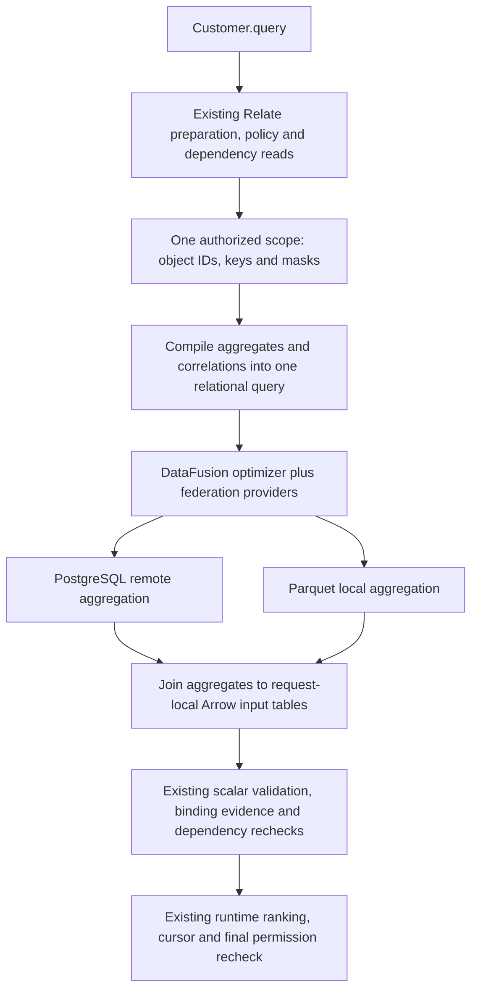

# DataFusion federation spike

Experimental implementations and repeatable measurements for joining Relate data
across databases and files. This does not enable federation in the shipped
product.

## Vocabulary

| Term           | Meaning                                                                      | Example                                                           |
| -------------- | ---------------------------------------------------------------------------- | ----------------------------------------------------------------- |
| Federation     | Execute one query across separate sources                                    | SQLite customers joined to PostgreSQL invoices and Parquet events |
| Provider       | Adapter that supplies a table to DataFusion                                  | `PostgresTableFactory.table_provider(...)`                        |
| Pushdown       | Ask a source to do work before transferring its results                      | PostgreSQL executes `GROUP BY customer`                           |
| Scan mode      | Providers can push filters/projections; DataFusion performs aggregates/joins | `query({mode: 'scan', sql})`                                      |
| Federated mode | Additional optimizer can delegate complete SQL subplans                      | `query({mode: 'federated', sql})`                                 |
| Snapshot       | Explicitly loaded Arrow tables held in engine memory                         | `query('snapshot')`, then `cached_events`                         |
| Transport      | Boundary between Node and the same Rust engine                               | Neon, JSON lines on stdin/stdout, loopback HTTP                   |
| Slot           | One authorized object's input to a Relate batch                              | Customer key plus per-calculation masks                           |

## Run

From this worktree, with Node, pnpm and Rust installed:

```sh
pnpm build
node tests/performance/federation/build.mjs
pnpm exec dotenvx run -f .env -- node --expose-gc --import tsx tests/performance/federation/test.mjs
pnpm exec dotenvx run -f .env -- node --expose-gc --import tsx --import ./tests/performance/federation/register.mjs tests/performance/federation/run.mjs --customers 100 --events 1000 --repetitions 3 --out benchmark-results/federation-small
pnpm exec dotenvx run -f .env -- node --expose-gc --import tsx --import ./tests/performance/federation/register.mjs tests/performance/federation/run.mjs --customers 1000 --events 100000 --repetitions 24 --out benchmark-results/federation-medium
pnpm exec dotenvx run -f .env -- node --expose-gc --import tsx --import ./tests/performance/federation/register.mjs tests/performance/federation/run.mjs --customers 12500 --events 1000000 --repetitions 24 --out benchmark-results/federation-large
```

Use the worktree's disposable **local** PostgreSQL database. The fixture creates
and removes only its uniquely named schema and temporary files. It does not
reset Relate storage. PostgreSQL is required; a missing backend fails the run.
Rust uses IPv4 `hostaddr` and TLS disabled for this local benchmark, avoiding a
failing provider DNS preflight on the tested host. Only localhost/127.0.0.1 and
simple database/user names are supported; URL-escaped credentials are not
tested. No remote-deployment claim is made. Lockfile pins DataFusion 54.1,
federation 0.5.5, providers 0.12 and Neon 1.1.1. DataFusion 55.2 requires a
newer Rust compiler than the installed 1.92.

`--skip-relate` and `--skip-concurrency` omit those sections explicitly. A
failed query, incorrect complete result, or setup error exits unsuccessfully.
Raw JSON checkpoints retain completed samples and failures. Generated binaries
and Cargo outputs are ignored; the lockfile is committed. This is an optional
benchmark, not part of the ordinary TypeScript installation or production
dependency graph.

## Implementations

```js
const engine = await openTransport('neon', config); // also 'child' or 'http'
const result = await engine.query({ mode: 'federated', sql });
await engine.close();
```



Neon runs Rust work off the JS thread using Neon's task/Promise API and the Node
worker pool. All engines have four Tokio workers and four DataFusion partitions.
The child handles requests serially, queuing arrivals; HTTP and Neon admit
concurrent requests. This is a deployment-policy difference measured explicitly,
not a claim that pipes inherently serialize queries. All transports return JSON,
with no compressed response, Arrow IPC transport, result cache or prepared-plan
cache. Final counts/sums are strings to avoid JS integer precision loss.

`rust/engine` owns provider registration, sessions, planning, execution, JSON
encoding and the executable. `rust/neon` only bridges the engine into Node.
`transports.mjs` owns startup, framing and process teardown. The HTTP executable
is independently launchable: send configuration as its first stdin line, pass
`--http`, and read the chosen loopback port from stdout. It intentionally binds
only loopback. Its arbitrary SQL API is for this trusted benchmark and is not a
public consumer endpoint or authorization boundary.

## Workloads and baseline

- `ranking-db`: SQLite customers plus PostgreSQL events; filter, aggregate,
  join, rank and return 25. Same seed, October window, skew, empty customers,
  and 20% excluded portfolios as the existing analytical harness.
- `ranking-file`: same answer, reading the events from Parquet instead.
- `multi`: SQLite customers, Parquet events, PostgreSQL invoices. Aggregate each
  many-side before joining, avoiding multiplied counts/sums.
- `selective`: the three-source query restricted to one customer; explicit key
  predicates in each aggregate make source selectivity available.
- `bulk`: database ranking with all authorized customer rows returned.
- `control`: one-row constant query to expose fixed planning/transport costs.

The native baseline uses persistent Node PostgreSQL and SQLite handles, DuckDB
for Parquet, and JS maps/sorting to combine source-side aggregates. Its SQLite
reads and final merge run on the Node event loop. This is a working specialized
alternative, not an ORM benchmark or automatic planner. It includes source reads
on every call. For the one-row control it returns a JS constant and therefore
measures only a JS call; do not treat it as equivalent SQL planning.

The separate public Relate comparison keeps `Customer.query()` authorization,
scoping, evidence, batching and revalidation. It compares the shipped PostgreSQL
connector to a narrow spike adapter sending generated slot SQL through each
DataFusion transport in **scan mode**. Federation 0.5.5 fails to translate the
renderer's `VALUES` input; this is retained as a limitation rather than silently
falling back. Only COUNT/MAX and the benchmark types are implemented; this is
**not a complete connector**. The adapter uses the public shared renderer and
checks resource/plan handles, slot order and safe integers. It awaits ongoing
work before honoring an abort. It does not establish production cancellation,
timestamp edge cases, or complete connector conformance.



## Measurement rules

- Fixed deterministic input, independent handwritten SQLite SQL oracle. Every
  complete output is compared after stopping the request clock, including bulk
  rows; raw samples retain a result hash. Native and DataFusion are both
  checked.
- Warm comparisons rotate path order and reverse each cycle. One
  first-of-scenario and two warmups are recorded separately. The first sample is
  **not a cold start**: schema discovery, snapshots and explain executions have
  already warmed sources.
- Public Relate paths share one adopted memory store and object IDs. Ties use
  Relate object-ID order, checked against oracle metrics sorted by those IDs.
  Whole-query SQL ties use source-key order; do not compare their hashes
  directly.
- Request timing includes Node request serialization, boundary crossing, engine
  planning, source reads, execution and result JSON decoding. Normalization,
  assertions, RSS sampling and report writes happen afterward. Setup, adoption,
  index creation and snapshot loading are separately reported.
- Rust plan/collect/encode spans are subordinate measurements. The request minus
  their sum also includes scheduling and JSON serialization; it is not pure IPC.
- 24 warm repeats permit descriptive p95 (nearest rank). Developer-machine noise
  remains. No CI timing gate or production capacity promise.
- Concurrency uses five waves of four requests per transport/mode, with raw
  latencies. It includes client validation in wave elapsed time and is a short
  burst experiment, not sustained throughput or an open-loop load test.
- RSS is an after-request observation, not peak memory. Neon RSS includes the
  Node fixture/oracle and native baseline; child RSS includes its loaded
  snapshot; HTTP RSS does not. PostgreSQL server memory and filesystem cache are
  excluded. Do not rank memory efficiency across those unequal populations.
- `maxObservedTimerLagMs` is the largest delayed 2 ms timer tick during that
  request; null means no tick was observed, not zero blocking.
- There are no concurrent source mutations, WAN delays, production data sizes,
  durable ingestion, distributed snapshots, spill tests or sustained-load tests.
  A north SQL filter is not equivalent to Relate policy/evidence semantics.

## Files

| File                          | Purpose                                                                      |
| ----------------------------- | ---------------------------------------------------------------------------- |
| `rust/engine/`                | Shared engine and process/service entry point                                |
| `rust/neon/`                  | Asynchronous Neon addon                                                      |
| `rust/Cargo.lock`             | Exact dependency resolution                                                  |
| `build.mjs`, `transports.mjs` | Optional build and Node lifecycle                                            |
| `fixture.mjs`, `queries.mjs`  | Deterministic multi-source data, independent oracle, native baseline and SQL |
| `relate-adapter.mjs`          | Experimental connector replacement within the real public query path         |
| `run.mjs`, `test.mjs`         | Checkpointed measurements and semantic/lifecycle checks                      |
| `measurements/`               | Retained reports, failures and charts                                        |

Capture the current slot-query plan separately (outside the timed matrix):

```sh
pnpm exec dotenvx run -f .env -- node --expose-gc --import tsx tests/performance/federation/diagnose.mjs
uv run tests/performance/federation/measurements/analyze.py
```

The first command captures all ten generated batches and the first batch's
physical plan; the second rebuilds the report tables and figures from the
committed archives. `diagnose.mjs` is follow-up diagnostic evidence, not another
timed path.

The [research notes](RESEARCH.md) record the Cube, DataFusion, Spice and
MetricFlow sources and proposed ownership. The measured report lives in
[`measurements/REPORT.md`](measurements/REPORT.md).

## Follow-up: one authorized calculation across sources

`scope-executor.mjs` receives the runtime's prepared calculations and all
materialized authorized candidates **before batching**. It compiles one
relational query over every required association. It does not call each database
itself: DataFusion and its federation providers choose remote execution from
that query. The original slot adapter remains in the matrix. `scope-scan`
disables the federation optimizer while retaining the same single-query shape,
isolating the placement change from removal of batching.



This is the whole **calculation scope**, not a replacement for all runtime
orchestration. Candidate authorization, ordinary field reads, revalidation,
computed filtering, final sorting and pagination still run in Relate. The engine
returns results for every authorized candidate, not just the first 25. In
particular, placing `LIMIT 25` before the runtime's revalidation would change
behavior when an object becomes inaccessible during execution.

The source subqueries aggregate independently before joining; this defines the
meaning of per-object calculations without multiplying event counts by invoice
rows. Grouping identical predicates combines COUNT/MAX. Placement into
PostgreSQL is the federation optimizer's decision. This compiler currently
accepts string correlation keys, COUNT/MAX/SUM, source-column predicates and
scalar fallbacks. It explicitly rejects per-object predicate references,
aggregate formulas and other unsupported types. It is not a general semantic
compiler.

`register.mjs` is an explicit **benchmark-only Node loading hook**. It injects
the executor at the built runtime's `computeFields` call. A request-local async
context opts into the new path; all other calls use the original function. The
hook checks its exact insertion point and the runner fails if the executor did
not run. No installed package files or public APIs change. A product integration
would replace this hook with a typed runtime-owned executor contract.

Each engine request constructs fresh catalog/Arrow tables and reuses only source
providers. Authorized keys are data, not a huge SQL `VALUES` expression.
Concurrent requests cannot overwrite each other's scope tables. PostgreSQL may
aggregate keys outside the authorized population internally; the trusted
executor joins back to the authorized scope before returning results. This is
not source-level row security or a public arbitrary-SQL endpoint.

Two end-to-end workloads use the real public consumer:

- `ranking-db`: the existing PostgreSQL event ranking, unchanged.
- `multi`: file event counts/latest-login plus paid invoice totals from
  PostgreSQL. The native baseline uses the shipped PostgreSQL connector and a
  benchmark-owned DuckDB Parquet adapter, with the same runtime batching. The
  Parquet adapter reads the actual file on each call; no materialization is
  hidden in setup. It supports the fixture's nullable string columns and does
  not prove cancellation or connector conformance.

```sh
pnpm exec dotenvx run -f .env -- node --expose-gc --import tsx --import ./tests/performance/federation/register.mjs tests/performance/federation/scope-test.mjs
```

The expanded `run.mjs` reruns all original raw SQL/transport/snapshot/burst
paths, plus ten public-runtime paths for each of the two scenarios: native,
three slot scan adapters, three scope scan adapters and three scope federation
adapters. Run small, medium and large into separate directories with the
commands above. Keep the original archives; follow-up evidence belongs under
`measurements/whole-scope/`. The full current comparison and interpretation live
in [the follow-up report](measurements/whole-scope/REPORT.md).

The scope hook is for successful benchmark executions with activity capture
disabled. It does not implement the production statement queue, diagnostic
capture, cross-source observation timestamps, or remote cancellation contract.
The source deadline covers engine execution; abort is checked after awaited
completion. These remain integration work, not optimized-away runtime
guarantees.

New files: `register.mjs` (isolated injection), `scope-executor.mjs` (authorized
scope compiler and result merge), `multi-adapter.mjs` (multi-source public model
and native file reference), `scope-test.mjs` (parity, denial, masks, isolation,
evidence and in-flight authorization change). The Rust engine adds request-local
input tables; `run.mjs` adds the full comparison. Existing implementations
remain.
