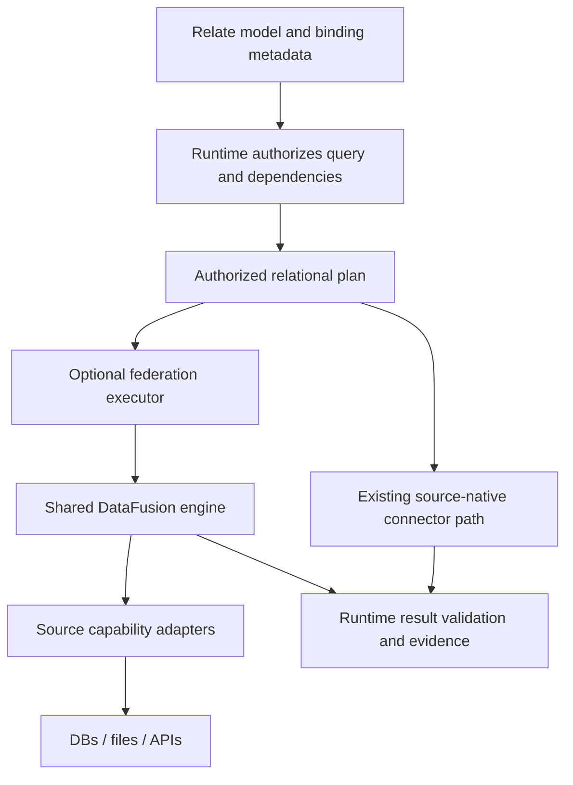

# Design evidence and options

Sources consulted on 22 October 2026. These are architecture references, not
performance comparisons against those products. Versions in the executable spike
are fixed in `rust/Cargo.lock`; current upstream documentation may describe
newer APIs. All recommendations below are proposals, not agreed Relate API
changes.

| Source                                                                                                                                                                                               | Observed design                                                                                                     | Consequence for this spike                                                                                                      |
| ---------------------------------------------------------------------------------------------------------------------------------------------------------------------------------------------------- | ------------------------------------------------------------------------------------------------------------------- | ------------------------------------------------------------------------------------------------------------------------------- |
| [Cube native manifest, immutable commit 1705458](https://github.com/cube-js/cube/blob/1705458bdb96eff331519d58bb51e8b8ab027a71/packages/cubejs-backend-native/Cargo.toml)                            | Rust native library links Cube planner/orchestrator components and Neon with async support                          | Share a Rust engine across adapters; test a real Neon addon                                                                     |
| [Cube query pushdown](https://cube.dev/blog/query-push-down-in-cubes-semantic-layer)                                                                                                                 | SQL API uses DataFusion/egg and can choose upstream SQL execution alongside local processing                        | Measure physical execution placement separately from Node/Rust transport; do not assume every query belongs in the local engine |
| [DataFusion providers](https://github.com/datafusion-contrib/datafusion-table-providers/tree/v0.12.0) and [published 0.12.0 source](https://docs.rs/crate/datafusion-table-providers/0.12.0/source/) | Source-specific providers can integrate with federation; ordinary providers push filters/projections                | Use the real SQLite/PostgreSQL providers and compare enabling the federation optimizer                                          |
| [DataFusion federation 0.5.5](https://docs.rs/crate/datafusion-federation/0.5.5/source/src/lib.rs)                                                                                                   | Registers federation optimizer and physical planner; source compute contexts distinguish where subplans can execute | Same-source joins may be delegated; cross-source joins still need data movement                                                 |
| [DataFusion custom providers](https://datafusion.apache.org/library-user-guide/custom-table-providers.html)                                                                                          | Provider describes a source; physical plan supplies streams of Arrow batches                                        | Future Relate provider should stream typed, authorized batches and expose explicit capabilities                                 |
| [Neon task/Promise API](https://docs.rs/neon/1.1.1/neon/event/struct.TaskBuilder.html)                                                                                                               | Async tasks execute on Node's worker pool and settle a Promise                                                      | No synchronous query call on the JS thread; account for worker-pool contention                                                  |
| [Spice federation and acceleration](https://spice.ai/blog/spice-sql-query-federation-acceleration)                                                                                                   | Federation and locally materialized data are distinct strategies                                                    | Measure a live source read separately from explicit snapshot load and snapshot read                                             |
| [MetricFlow](https://docs.getdbt.com/docs/build/about-metricflow)                                                                                                                                    | Semantic definitions drive SQL generation against a data platform                                                   | A semantic model need not force local execution; preserve a route to source-native plans                                        |

## Proposed ownership



The current experiment's raw SQL runner owns no Relate authorization. It accepts
trusted benchmark SQL only. A production API must receive an authorized logical
plan or equivalent opaque handle from the runtime. A plain
`WHERE portfolio = 'north'` predicate is useful for measuring static answer
equality but does not implement provider identity, binding revisions, field
access, revocation or revalidation.

The existing runtime adapter is the smaller integration: keep all runtime work
and replace only `AnalyticalConnector.plan/execute`. The federated whole-query
path is the larger proposal: expose more of the authorized operation to a
relational optimizer, including object candidate selection and top-k ordering.
The latter needs a new object/evidence contract; it cannot safely be delivered
by replacing one connector method.

```ts
// Existing shape, exercised by the spike adapter:
analytics.plan(authorizedDatasetQuery); // opaque connector-owned handle
analytics.execute(handle, { signal, timeoutMs });

// Proposed shape only; intentionally not added to exported contracts:
federation.execute(authorizedRelationalPlan, {
  signal,
  timeoutMs,
  bindings,
  evidenceRequirements,
});
```

## Integration tradeoffs to evaluate

| Option             | API / deployment                                      | Benefits                                                                            | Costs and remaining work                                                                                                                           |
| ------------------ | ----------------------------------------------------- | ----------------------------------------------------------------------------------- | -------------------------------------------------------------------------------------------------------------------------------------------------- |
| Neon               | `await addon.query(handle, json)` in the Node process | One application process; direct ownership; no pipe/socket hop                       | Native ABI/platform artifacts, Rust linking, crashes share Node fate, worker pool scheduling, explicit shutdown needed                             |
| Persistent child   | Spawn once, exchange JSON lines                       | Independent crash/kill boundary; same-host packaging; easiest lifecycle experiment  | Worker supervision, request IDs/cancellation/backpressure, pool sizing; this prototype deliberately serializes requests                            |
| Standalone service | `POST /query` to independent executable               | Independent deployment/versioning/capacity; multiple clients can share source pools | Network/auth/TLS/deploy operations; admission control and cancellation propagation; prototype measures loopback only                               |
| One-shot child     | Spawn/configure/query/exit each call                  | Simple isolation                                                                    | Startup/schema discovery on every request; estimate from separate startup plus query observations only, not benchmarked as a fourth implementation |
| Arrow IPC/Flight   | Return typed columnar batches                         | Avoid JSON conversion for large intermediate results                                | Additional client stack, stream backpressure, buffer lifetimes; not implemented or timed here                                                      |

## Production work this spike cannot settle

- **Authorized scope and evidence:** bind plans to actor, connection/resource
  and binding revision; ensure filters and join reordering cannot disclose
  forbidden rows/fields; recheck access/dependencies before publishing results.
- **Source capabilities:** prove exact filter semantics, collation, integer,
  decimal, NULL and timestamp behavior. Provider fallbacks must remain visible.
- **Consistency/freshness:** multiple databases and files do not share a
  snapshot. Track per-source read times/watermarks and define acceptable
  inconsistency.
- **Bounded execution:** memory/spill limits, output quotas, stream
  backpressure, bounded request queues, real remote query cancellation and
  connection retirement. Dropping a Rust future does not prove PostgreSQL
  stopped work.
- **Credentials and isolation:** tenant-scoped pools, secret rotation,
  authenticated service endpoint and read-only provider roles. This local
  trusted benchmark is deliberately not a deployable arbitrary-SQL service.
- **Packaging and upgrades:** native prebuilds for supported OS/architectures,
  separate Rust compatibility CI and lockfile review. A pinned addon loads on
  the tested Node 26/macOS arm64 combination only; no cross-platform result is
  claimed.
